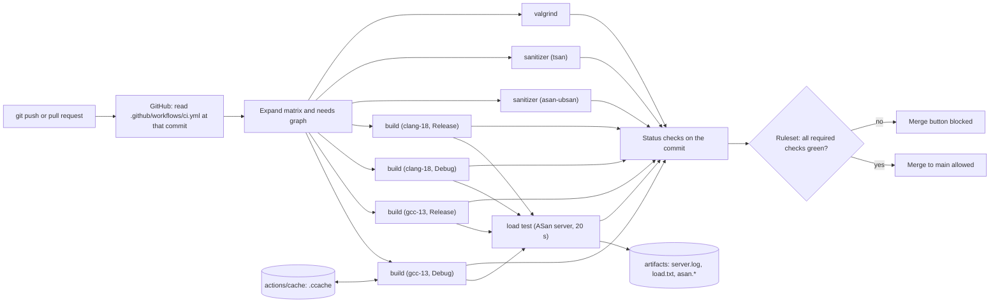

# Module 9.06: GitHub Actions

**Estimated hours:** 3

**What you will learn**

1. The anatomy of a GitHub Actions workflow: events (`on`), jobs, steps, runners, and the difference between `uses:` (run someone's action) and `run:` (run your shell command).
2. How to write the complete CI for tcpkv: a compiler-by-build-type matrix, ASan+UBSan, TSan and Valgrind jobs, ccache with `actions/cache@v4`, failure logs as artifacts, and a 20-second load test against an ASan build of the server.
3. How to make CI a gate (branch rulesets and required checks), how to debug a red job, and how to describe "GitHub Actions CI" in an interview with numbers instead of buzzwords.

**Prerequisites:** [Module 9.05: Docker internals](module-05-docker-internals.md). You also need the tcpkv CMake project from 9.01 (targets `tcpkv_server`, `load_gen`, `tcpkv_tests`), its GoogleTest suite and `ctest` from 9.02, the sanitizer flags from 9.04, `load_gen` from 5.11, and Git and GitHub from 0.07.

---

## 1. One-line intuition

GitHub Actions is a robot that, on every push, borrows a brand-new Linux machine, builds and tests your code exactly as a YAML file tells it to, and puts a green tick or a red cross next to the commit.

## 2. Real-life analogy

A loan file at a bank is never disbursed because the clerk who prepared it says "it is fine". It goes to a **checker**.

- The checker follows a **written checklist**. That is the **workflow file** (`.github/workflows/ci.yml`).
- The checker starts every file on a **clean desk** with nothing left over from yesterday. That is the **runner**: a fresh virtual machine per job, destroyed afterwards.
- Several checkers work **in parallel** on different parts of the file (KYC, income, collateral). Those are **jobs**.
- The same checklist is applied to four loan products. That is a **matrix**: one job definition, many combinations.
- The checker keeps a folder of **pre-filled standard forms** so routine pages are not rewritten each time. That is the **cache**.
- When something is wrong, the checker **attaches the evidence** to the file. Those are **artifacts** (logs uploaded from a failed job).
- The disbursement system **refuses to release money** until the checker has signed. That is a **required status check** on the `main` branch.
- The "verified" stamp on the cover of the file is the **badge** in your README.

## 3. Why it exists: the problem it solves

Without CI, "tested" means "I ran the tests on my laptop, once, probably". Three things go wrong:

1. **People forget.** A one-line change "cannot break anything", so nobody runs the sanitizer build, which takes four times longer. The race lands on `main`.
2. **Machines differ.** Your WSL has GCC 13; the reviewer's has Clang 18. Clang warns about something GCC does not, `-Werror` turns it into a build failure, and the build is broken for everyone else.
3. **Nobody can see the evidence.** Your resume says "Valgrind, ASan and TSan clean under a concurrent load generator; GitHub Actions CI". An interviewer can open `github.com/khanshaki-r/tcpkv`, click the Actions tab and check. If the last run is red, or if the workflow only runs `make`, the line is false.

CI makes the checks **automatic** (every push), **reproducible** (same clean machine each time), and **public** (anyone can read the logs). With branch protection it also makes them **mandatory**: a red check blocks the merge button.

## 4. Three layers of depth

### Layer 1 (beginner): workflows, jobs, steps

A workflow is a YAML file in `.github/workflows/` in your repository. GitHub reads every file there. The smallest useful one:

```yaml
# .github/workflows/hello.yml
name: hello
on: [push]                       # run on every push to any branch
jobs:
  say-hello:                     # job id: your choice
    runs-on: ubuntu-24.04        # which kind of machine
    steps:
      - uses: actions/checkout@v4          # an action: clone the repo
      - run: uname -a && g++ --version     # a shell command
```

Commit it, push, and open the **Actions** tab of the repository. You will see one run with one job and two steps, and the full output of each step.

| Word | Meaning | In the file |
|---|---|---|
| Workflow | One automated procedure, one YAML file | `.github/workflows/ci.yml` |
| Event | What starts it: a push, a pull request, a button press, a schedule | `on:` |
| Job | A group of steps that runs on one machine; jobs run in parallel by default | `jobs: <id>:` |
| Runner | The machine that runs a job; GitHub-hosted runners are fresh VMs | `runs-on: ubuntu-24.04` |
| Step | One command or one action inside a job, run in order | `steps:` |
| Action | A reusable, versioned step published in a repository | `uses: actions/cache@v4` |
| Run | One execution of a workflow, with a number and logs | Actions tab |
| Status check | The tick or cross a job reports on a commit or pull request | shown on the PR |

**`uses:` versus `run:`.** `run:` is your own shell command, executed by Bash on Linux runners. `uses:` runs an **action**: code someone packaged, usually JavaScript, fetched from `github.com/<owner>/<repo>` at the tag after `@`. `actions/checkout@v4` clones your repository into the runner. `actions/cache@v4` saves and restores a directory between runs. `actions/upload-artifact@v4` keeps files from a run for download. Actions take parameters under `with:`. The `@v4` is a version pin: you get bug fixes within major version 4 but no breaking changes. Newer majors may exist when you read this; any maintained major behaves the same for this workflow.

**Where it runs.** `ubuntu-24.04` is the same Ubuntu release as your WSL. The image comes with GCC, Clang, CMake and many other tools preinstalled; we still install what we need explicitly so the workflow does not break when the image changes.

### Layer 2 (working engineer): matrix, cache, artifacts, gates

**Matrix.** `strategy.matrix` turns one job definition into many. `compiler: [gcc-13, clang-18]` times `build_type: [Debug, Release]` gives four jobs. An `include:` entry whose keys match an existing combination adds extra keys to it, which is how `compiler: gcc-13` gains `cxx: g++-13`. `fail-fast: false` keeps the other three running when one fails; you want to know whether a failure is GCC-only or everywhere.

**Dependencies and conditions.** `needs: build` makes a job wait for another and skip if it failed. `if:` decides whether a step runs: `failure()` only after an earlier step failed, `always()` even after a failure or cancellation. Upload logs `if: failure()`; print cache statistics `if: always()`.

**Caching with ccache.** ccache stores compiled object files keyed by a hash of the preprocessed source and compiler flags. Its directory is saved with `actions/cache@v4`. The rules that matter:

- `key` is the exact name to **save** under. A key that already exists is never overwritten, so we include `${{ github.sha }}` to make each commit save a fresh copy.
- `restore-keys` are **prefixes** tried in order when the exact key misses. `ccache-gcc-13-Debug-` restores the most recent cache for that compiler and build type from any earlier commit.
- Caches are scoped to branches: a run can restore caches from its own branch and from the default branch, not from sibling feature branches. A repository gets about 10 GB of cache in total; entries not used for 7 days are evicted (typical limits; check the docs).

**Artifacts.** `actions/upload-artifact@v4` keeps files after the VM is destroyed, downloadable from the run page. In v4 artifacts are immutable and **names must be unique within a run**, so a matrix job must put matrix values in the name. Retention defaults to 90 days on public repositories; we set 7 for logs.

**Concurrency.** A `concurrency` group with `cancel-in-progress: true` cancels the older run when you push again to the same branch. Without it, five quick pushes queue five full runs.

**Permissions and secrets.** Each job gets an automatic `GITHUB_TOKEN`. `permissions: contents: read` restricts it to reading the code, which is all a build needs. tcpkv CI needs **no secrets**: it downloads public packages, builds public code and talks only to `127.0.0.1`. That is a feature. Workflows triggered by pull requests from forks get no secrets anyway, so a CI that needs none works for every contributor, and there is nothing to leak.

**Manual runs.** `workflow_dispatch:` under `on:` adds a **Run workflow** button in the Actions tab. Useful after you change runner settings, or to re-check `main` without a commit.

**Making CI a gate.** On GitHub go to **Settings, Rules, Rulesets, New branch ruleset**: target the default branch, enable **Require a pull request before merging** and **Require status checks to pass**, then add the checks by name. Matrix jobs report names like `build (gcc-13, Debug)` (the job's `name:` with the matrix values filled in). The check list only offers names it has seen in recent runs, so run the workflow once first. Rulesets and classic branch protection are free on public repositories; on private repositories they need a paid plan, one more reason tcpkv is public.

**The badge.** Add this line at the top of `README.md`:

```markdown
[](https://github.com/khanshaki-r/tcpkv/actions/workflows/ci.yml)
```

It shows the status of the latest run of `ci.yml` on `main` and links to the runs.

**Minutes.** Standard GitHub-hosted runners are free for public repositories. Private repositories get a monthly allowance of minutes on each plan (2,000 on the Free plan at the time of writing); Windows minutes count double and macOS minutes ten times. One tcpkv run uses roughly 8 jobs of a few minutes each, so a private repository would spend its allowance in a few dozen pushes. Public is free and is also what a recruiter can see.

**Debugging a red job.** In order of cost:

1. Read the failed step's log. With `--output-on-failure`, `ctest` prints the failing test's output right there.
2. Download the artifact (`test-logs-...` or `load-asan-logs`) for the full `LastTest.log` or ASan report.
3. **Re-run jobs** with the **Enable debug logging** box ticked. The runner then prints every expression it evaluated and every command it ran. Setting a repository variable `ACTIONS_STEP_DEBUG` to `true` does the same for all runs.
4. Reproduce locally. Run the exact commands from the log in WSL. Or use `act` (from the `nektos/act` releases page), which runs workflow jobs in Docker containers: `act -j build --matrix compiler:gcc-13 --matrix build_type:Debug -P ubuntu-24.04=catthehacker/ubuntu:act-24.04`. Its images are not identical to GitHub's, and `sysctl` is not allowed inside a container, so treat `act` as a fast first check, not the final word.

### Layer 3 (internals): what happens between `git push` and the green tick

1. **Event.** Your push reaches GitHub. GitHub records a `push` event (or `pull_request` event) and looks at every file in `.github/workflows/` **at that commit**. A workflow change takes effect in the same push that changes it.
2. **Plan.** For each workflow whose `on:` matches, GitHub creates a run, expands each matrix into concrete jobs, and works out the `needs:` graph. Jobs without dependencies are queued at once.
3. **Runner.** A GitHub-hosted runner is a fresh virtual machine created from the `ubuntu-24.04` image (typically 4 vCPUs and 16 GB of RAM for public repositories at the time of writing; check the docs). On it runs the **runner application**, an open-source .NET program that polls GitHub over outbound HTTPS for work. It receives the job, a short-lived `GITHUB_TOKEN`, and the steps.
4. **Checkout.** For a `pull_request` event, `actions/checkout@v4` checks out `refs/pull/<n>/merge`: a merge commit GitHub prepared of your branch into the base branch. CI tests the result of merging, not your branch alone. By default it fetches only that one commit (`fetch-depth: 1`).
5. **Expressions first, shell second.** Before a `run:` step executes, the runner replaces every `${{ ... }}` with its value, writes the script to a temporary file and runs it with `bash -e {0}`. If you write `shell: bash` explicitly, the command becomes `bash --noprofile --norc -eo pipefail {0}`, which also fails a pipeline whose first command fails. This order matters for security: putting `${{ github.event.pull_request.title }}` inside `run:` pastes untrusted text into your script. Pass such values through `env:` instead.
6. **Talking back.** Steps communicate with the runner through files whose paths are in environment variables: append to `$GITHUB_ENV` to set a variable for later steps, to `$GITHUB_OUTPUT` for step outputs, and to `$GITHUB_STEP_SUMMARY` for Markdown shown on the run page (the load test uses this).
7. **Teardown.** When the job ends, the cache action uploads the cache if the key was new, artifacts are uploaded, the token expires, and the VM is destroyed. Nothing survives except what you explicitly saved.

One YAML trap: `on` is a boolean `true` in YAML 1.1, the version many parsers implement. Python's PyYAML reads the workflow's top-level keys as `['name', True, 'concurrency', ...]`. GitHub's parser treats it as the key `on`, so the workflow works, but your own scripts that read workflow files must handle this.

## 5. Architecture diagram



Eight jobs per run. Seven start at once on separate VMs; the load test waits for the four plain builds.

## 6. Code

The tcpkv repository layout this workflow assumes (from 9.01 and capstone C1):

```text
tcpkv/
  CMakeLists.txt          enable_testing(); targets tcpkv_server, load_gen, tcpkv_tests
  src/  tests/  tools/load_gen.cpp
  ci/install-deps.sh      shared by GitHub Actions (this module) and Azure Pipelines (9.07)
  .github/workflows/ci.yml
```

If your targets have other names, change them in the workflow; nothing else depends on them. The server is started as `tcpkv_server 7000`; adjust if your C1 server takes its port differently.

### 6.1 `ci/install-deps.sh`

```bash
#!/usr/bin/env bash
# install-deps.sh: build and test tools for tcpkv CI on Ubuntu 24.04.
# Used by GitHub Actions and Azure Pipelines. Does nothing if all are present,
# so it is also safe on a self-hosted agent that has no sudo.
set -euo pipefail
packages=(ninja-build ccache valgrind libgtest-dev g++-13 clang-18)
if dpkg -s "${packages[@]}" >/dev/null 2>&1; then
  echo "all packages already installed"
  exit 0
fi
sudo apt-get update
sudo apt-get install -y --no-install-recommends "${packages[@]}"
```

`g++-13` and `clang-18` are usually already on the runner image; listing them costs nothing and protects you when the image changes. If 9.01 fetched GoogleTest with `FetchContent`, `libgtest-dev` is unused but harmless.

### 6.2 `.github/workflows/ci.yml`

````yaml
# .github/workflows/ci.yml -- tcpkv continuous integration.
name: CI

on:
  push:
    branches: [main]
  pull_request:
  workflow_dispatch:            # adds a "Run workflow" button in the Actions tab

# A newer push to the same branch or PR cancels the run that is still going.
concurrency:
  group: ${{ github.workflow }}-${{ github.ref }}
  cancel-in-progress: true

# Least privilege: the jobs only need to read the code.
permissions:
  contents: read

env:
  CCACHE_DIR: ${{ github.workspace }}/.ccache
  CCACHE_MAXSIZE: 300M

jobs:
  build:
    name: build (${{ matrix.compiler }}, ${{ matrix.build_type }})
    runs-on: ubuntu-24.04
    timeout-minutes: 20
    strategy:
      fail-fast: false          # let the other three finish when one fails
      matrix:
        compiler: [gcc-13, clang-18]
        build_type: [Debug, Release]
        include:                # add the real compiler names to each combination
          - compiler: gcc-13
            cc: gcc-13
            cxx: g++-13
          - compiler: clang-18
            cc: clang-18
            cxx: clang++-18
    steps:
      - uses: actions/checkout@v4

      - name: Install packages
        run: bash ci/install-deps.sh

      - name: Restore compiler cache
        uses: actions/cache@v4
        with:
          path: .ccache
          key: ccache-${{ matrix.compiler }}-${{ matrix.build_type }}-${{ github.sha }}
          restore-keys: |
            ccache-${{ matrix.compiler }}-${{ matrix.build_type }}-

      - name: Configure
        run: >
          cmake -S . -B build -G Ninja
          -DCMAKE_BUILD_TYPE=${{ matrix.build_type }}
          -DCMAKE_C_COMPILER=${{ matrix.cc }}
          -DCMAKE_CXX_COMPILER=${{ matrix.cxx }}
          -DCMAKE_C_COMPILER_LAUNCHER=ccache
          -DCMAKE_CXX_COMPILER_LAUNCHER=ccache

      - name: Build
        run: cmake --build build --parallel

      - name: Test
        run: ctest --test-dir build --output-on-failure --parallel 4

      - name: Cache statistics
        if: always()
        run: ccache --show-stats

      - name: Upload test logs
        if: failure()
        uses: actions/upload-artifact@v4
        with:
          name: test-logs-${{ matrix.compiler }}-${{ matrix.build_type }}
          path: build/Testing/Temporary/
          retention-days: 7
          if-no-files-found: ignore

  sanitizers:
    name: sanitizer (${{ matrix.name }})
    runs-on: ubuntu-24.04
    timeout-minutes: 25
    strategy:
      fail-fast: false
      matrix:
        include:
          - name: asan-ubsan
            flags: -fsanitize=address,undefined -fno-sanitize-recover=undefined
          - name: tsan
            flags: -fsanitize=thread
    env:
      ASAN_OPTIONS: detect_leaks=1:abort_on_error=1:strict_string_checks=1
      UBSAN_OPTIONS: print_stacktrace=1:halt_on_error=1
      TSAN_OPTIONS: halt_on_error=1:second_deadlock_stack=1
    steps:
      - uses: actions/checkout@v4
      - name: Install packages
        run: bash ci/install-deps.sh
      # Older sanitizer runtimes cannot map their shadow memory when the kernel
      # uses 32 bits of mmap randomness (the default on recent kernels).
      - name: Lower ASLR entropy for the sanitizer runtimes
        run: sudo sysctl -w vm.mmap_rnd_bits=28
      - uses: actions/cache@v4
        with:
          path: .ccache
          key: ccache-${{ matrix.name }}-${{ github.sha }}
          restore-keys: ccache-${{ matrix.name }}-
      - name: Configure
        run: >
          cmake -S . -B build -G Ninja
          -DCMAKE_BUILD_TYPE=RelWithDebInfo
          -DCMAKE_C_COMPILER=clang-18 -DCMAKE_CXX_COMPILER=clang++-18
          -DCMAKE_CXX_FLAGS="${{ matrix.flags }} -fno-omit-frame-pointer"
          -DCMAKE_EXE_LINKER_FLAGS="${{ matrix.flags }}"
          -DCMAKE_CXX_COMPILER_LAUNCHER=ccache
      - run: cmake --build build --parallel
      - run: ctest --test-dir build --output-on-failure
      - name: Upload test logs
        if: failure()
        uses: actions/upload-artifact@v4
        with:
          name: test-logs-${{ matrix.name }}
          path: build/Testing/Temporary/
          if-no-files-found: ignore

  valgrind:
    runs-on: ubuntu-24.04
    timeout-minutes: 30
    steps:
      - uses: actions/checkout@v4
      - name: Install packages
        run: bash ci/install-deps.sh
      - name: Configure and build (Debug, no sanitizers)
        run: |
          cmake -S . -B build -G Ninja -DCMAKE_BUILD_TYPE=Debug
          cmake --build build --parallel
      - name: Run the test binary under memcheck
        run: >
          valgrind --error-exitcode=1 --leak-check=full
          --errors-for-leak-kinds=definite,indirect --track-origins=yes
          ./build/tcpkv_tests --gtest_filter=-*DeathTest*

  load-asan:
    name: load test (ASan server, 20 s)
    needs: build                   # only worth running if the plain builds pass
    runs-on: ubuntu-24.04
    timeout-minutes: 15
    env:
      ASAN_OPTIONS: detect_leaks=1:abort_on_error=0:log_path=asan
    steps:
      - uses: actions/checkout@v4
      - name: Install packages
        run: bash ci/install-deps.sh
      - run: sudo sysctl -w vm.mmap_rnd_bits=28
      - name: Build server and load_gen with ASan
        run: |
          cmake -S . -B build -G Ninja -DCMAKE_BUILD_TYPE=RelWithDebInfo \
            -DCMAKE_CXX_COMPILER=clang++-18 \
            -DCMAKE_CXX_FLAGS="-fsanitize=address -fno-omit-frame-pointer" \
            -DCMAKE_EXE_LINKER_FLAGS="-fsanitize=address"
          cmake --build build --parallel --target tcpkv_server load_gen
      - name: Run 8 clients for 20 s against the ASan server
        shell: bash               # bash -eo pipefail, not the default bash -e
        run: |
          ./build/tcpkv_server 7000 > server.log 2>&1 &
          server_pid=$!
          for _ in $(seq 1 50); do                      # wait up to 5 s for the port
            if (exec 3<>/dev/tcp/127.0.0.1/7000) 2>/dev/null; then break; fi
            sleep 0.1
          done
          ./build/load_gen --host 127.0.0.1 --port 7000 --threads 8 \
            --duration 20 --ratio 50 --keys 1000 --warmup 1 | tee load.txt
          kill -TERM "$server_pid"                      # graceful shutdown path
          server_rc=0
          wait "$server_pid" || server_rc=$?
          echo "server exit code: $server_rc"
          {
            echo "### Load test against the ASan build"
            echo '~~~'; cat load.txt; echo '~~~'
          } >> "$GITHUB_STEP_SUMMARY"
          grep -Eq '^errors +: 0$' load.txt || { echo "load_gen saw errors"; exit 1; }
          if ls asan.* >/dev/null 2>&1; then cat asan.*; exit 1; fi
          exit "$server_rc"
      - name: Upload server and ASan logs
        if: always()
        uses: actions/upload-artifact@v4
        with:
          name: load-asan-logs
          path: |
            server.log
            load.txt
            asan.*
          if-no-files-found: ignore
````

What each non-obvious line is for:

- **Valgrind and sanitizers never share a build.** Valgrind runs an unmodified Debug binary; a sanitizer build would confuse it. `--gtest_filter=-*DeathTest*` skips death tests (9.02), which fork and crash on purpose and make Valgrind noisy.
- **`-fno-sanitize-recover=undefined`** turns UBSan reports into failures. By default UBSan prints and carries on, and the job would stay green.
- **`vm.mmap_rnd_bits=28`.** Recent kernels randomise memory mappings with 32 bits of entropy. Some sanitizer runtime versions then fail at start-up with `ThreadSanitizer: unexpected memory mapping` or a similar ASan message. Lowering it to 28 is the standard workaround on CI runners. You may need the same line in WSL (`sudo sysctl -w vm.mmap_rnd_bits=28`).
- **The load job checks three things.** `load_gen` must report `errors : 0`; ASan must write no report file (`log_path=asan` makes it write `asan.<pid>` instead of stderr); and the server must **exit 0 after SIGTERM**. I tested this step's shell logic in WSL with stub binaries: a server that handles SIGTERM gives `server exit code: 0`; one that does not is killed by the signal, `wait` returns 143 (128 + 15), and the step fails. So CI enforces the resume's "graceful shutdown on signals" every push.
- **`ls asan.*`** is the leak check: at exit, LeakSanitizer writes its report to the same `asan.<pid>` file.

**Verify before you push.** Install the linter once and run it; it checks expressions, action inputs and runs ShellCheck on every `run:` block:

```bash
python3 -m venv ~/.venvs/tools && ~/.venvs/tools/bin/pip install actionlint-py shellcheck-py
cd ~/tcpkv && PATH=~/.venvs/tools/bin:$PATH actionlint .github/workflows/ci.yml && echo clean
```

Expected output: `clean`. (This exact file passes actionlint 1.7 with ShellCheck 0.11.)

**Expected result on GitHub.** The Actions tab shows a run named after your commit message with eight jobs: `build (gcc-13, Debug)`, `build (gcc-13, Release)`, `build (clang-18, Debug)`, `build (clang-18, Release)`, `sanitizer (asan-ubsan)`, `sanitizer (tsan)`, `valgrind` and `load test (ASan server, 20 s)`. The load test's summary page shows the `load_gen` output in a box. Durations vary with runner load; on a first run without cache, expect each build job to take a few minutes; record your own numbers.

## 7. Use case: core-banking loan-origination platform

The application server and the migration engine are the kind of code where a data race or a use-after-free does not crash in testing; it corrupts one loan record in production at month end, and someone writes an RCA (module 8.09).

**Decision driven: sanitizer and load jobs run on every pull request, not nightly.** A nightly sanitizer run finds a race a day after it was merged, mixed in with twenty other commits, and someone must bisect it (module 9.10). A per-PR run names the exact change. The cost is real: more runner minutes and a PR that waits longer for its green ticks. On a self-hosted runner pool this is a capacity question; on GitHub-hosted runners for a public project it is free. Teams that cannot afford it per PR usually keep the plain build matrix per PR and move only the slowest job (Valgrind) to a schedule.

**Decision driven: no secrets in the build pipeline.** A bank's CI that builds and tests needs no database password, no signing key and no production URL. Credentials live only in the deployment pipeline, behind approvals (module 9.07). A build workflow with zero secrets cannot leak them, and it can safely run on pull requests from anyone.

Questions an interviewer may ask: "Why both Valgrind and ASan?" (they catch overlapping but different things: Valgrind needs no rebuild and sees uninitialised reads, ASan is about 2x slower instead of 20 to 50x and catches stack and global overflows Valgrind misses; module 8.05). "Why does the load test need ASan?" (a race between connection teardown and a worker shows up only under concurrency; ASan turns the resulting use-after-free into a report instead of a silent corruption).

## 8. Lab

### Part A: create the repository and the first green run (40 minutes)

1. On GitHub, create a **public** repository `khanshaki-r/tcpkv` with no README (you will push one).
2. In WSL, in your C1 project folder: `git init -b main` (if not already a repository), `git remote add origin https://github.com/khanshaki-r/tcpkv.git`.
3. Create `ci/install-deps.sh` and `.github/workflows/ci.yml` exactly as in section 6. Run actionlint as shown.
4. Commit and push: `git add -A && git commit -m "ci: add GitHub Actions workflow" && git push -u origin main`.
5. Open the Actions tab. Watch the eight jobs.

Expected: all eight green. If one is red, open it, read the failing step, fix locally, push again. The most common first failures are a target name mismatch (`tcpkv_server` versus your name), a test that writes to a fixed path, and a `-Werror` warning that only Clang reports. Record the total run time and the slowest job.

### Part B: caching (20 minutes)

1. Make a trivial change (a comment in one `.cpp` file), commit, push.
2. Open `build (gcc-13, Debug)` in both runs. Compare the **Build** step duration and the **Cache statistics** output.

Expected: the first run shows almost all cache misses; the second restores the cache from the first commit via `restore-keys` and shows mostly hits, with the Build step noticeably faster. The exact percentages and seconds are yours to record.

### Part C: make CI catch real bugs (40 minutes)

Do each on a branch, open a pull request, observe, then close the PR without merging.

1. **Data race.** In the store, remove the lock in one read path (or take a shared lock where a write happens). Push. Expected: `sanitizer (tsan)` fails with `WARNING: ThreadSanitizer: data race` and two stacks. The other jobs may stay green, which is the point of running TSan separately.
2. **Leak.** Add `new char[64];` without a matching `delete[]` inside a function the tests call. Expected: `valgrind` fails (`definitely lost: 64 bytes`) and `sanitizer (asan-ubsan)` fails with a LeakSanitizer report.
3. **Signal handling.** Comment out the SIGTERM handler installation in the server. Expected: `load test (ASan server, 20 s)` fails with `server exit code: 143`.
4. For one failure, download the artifact from the run page and find the report inside it.

### Part D: make it a gate, add the badge, run by hand (20 minutes)

1. **Settings, Rules, Rulesets, New branch ruleset**: name it `main-protection`, enforcement **Active**, target **Default branch**, tick **Require a pull request before merging** and **Require status checks to pass**, and add all eight check names. Save.
2. Push a branch with a failing test and open a PR. Expected: the merge button is disabled with "Required statuses must pass before merging".
3. Add the badge line from Layer 2 to `README.md`, merge through a PR. Expected: a green "CI passing" badge on the repository home page.
4. Actions tab, select **CI**, **Run workflow** on `main`. Expected: a run with the event `workflow_dispatch`.
5. Optional: re-run one job with **Enable debug logging** and find the `##[debug]` lines that show the expanded `cmake` command.

### Journal

Copy [journal/TEMPLATE.md](../journal/TEMPLATE.md) to `journal/YYYY-MM-DD-github-actions.md`. Record: the URL of the first all-green run; total run time and the slowest job; ccache hit statistics before and after (Part B); the exact first line of the TSan, Valgrind and ASan reports from Part C; the `server exit code` you saw with the handler removed; and the eight required check names.

## 9. Common mistakes and misconceptions

| Mistake | Why it is wrong | What it causes |
|---|---|---|
| Building with sanitizers in the same job as Valgrind | Valgrind and ASan both replace the allocator and fight | False reports or crashes at start-up |
| UBSan without `-fno-sanitize-recover` | UBSan reports and continues; exit code stays 0 | Green CI on code with undefined behaviour |
| Same artifact name in every matrix job | v4 artifacts are immutable and names are unique per run | Upload fails in three of four jobs |
| Cache key without the commit SHA | An existing key is never overwritten | Cache frozen at the first commit; hit rate decays |
| `${{ github.event.pull_request.title }}` inside `run:` | Expressions are pasted into the script before Bash runs | Script injection from a PR title |
| Assuming a skipped required job blocks merging | A job skipped by `if:` or a failed `needs:` reports as success for required checks | Merges when only the gate job was required; make the real jobs required too |
| Private repository plus required checks on the Free plan | Rulesets on private repositories need a paid plan | No gate at all |
| `wait $pid` under `bash -e` without `||` | A non-zero wait exits the step before you can record the code | Lost server exit code; confusing logs |
| Testing only your branch locally | PR runs test the merge commit with the base branch | "Works on my branch" but red on the PR |
| Adding secrets "just in case" | A build needs none; secrets widen what a malicious PR could reach | Unnecessary exposure, fork PRs fail |

## 10. Resume link

- **Claim I, tcpkv: "Valgrind, ASan and TSan clean under a concurrent load generator; GitHub Actions CI".** This module is what makes that sentence checkable. Say it with specifics: "Every push and PR runs eight jobs on `ubuntu-24.04`: GCC 13 and Clang 18 in Debug and Release with `-Werror`, an ASan+UBSan job and a TSan job running the GoogleTest suite, Valgrind memcheck on the Debug test binary, and a 20-second, 8-client `load_gen` run against an ASan build of the server that also checks the server exits 0 on SIGTERM. All eight are required checks on `main`. A full run takes [your number] minutes; ccache cut the build step from [x] to [y] seconds."
- **Claim G, "GitHub Actions".** Be ready to explain matrix `include`, cache keys versus restore keys, why there are no secrets, and how you debug a red job (logs, artifacts, debug re-run, local reproduction).

Likely follow-ups and answers:

- "What did CI actually catch?" Use Part C: "When I removed a lock on purpose, only the TSan job failed; that is why it is a separate job." If CI caught a real bug of yours during C1, tell that story instead; it is stronger.
- "Why not run everything in one job?" "Parallel jobs finish sooner, a failure names its category, and sanitizers cannot share a build with Valgrind."

## 11. Interview questions

**Q1 (easy). What is the difference between `uses:` and `run:` in a GitHub Actions step?**

<details>
<summary>Model answer</summary>

`run:` executes a shell command on the runner, with Bash on Linux by default. `uses:` runs a packaged action from a repository at a pinned version, for example `actions/checkout@v4` to clone the code or `actions/cache@v4` to restore a directory. Actions take inputs under `with:`. I use `run:` for my own build and test commands, so they are identical to what I run locally, and `uses:` for platform plumbing like checkout, cache and artifact upload.

</details>

**Q2 (easy). How does a matrix work, and what does `fail-fast: false` change?**

<details>
<summary>Model answer</summary>

The matrix is a set of variables; GitHub creates one job per combination. In tcpkv, two compilers times two build types gives four jobs, and `include` adds the real compiler executable names to the matching combinations. By default, if one matrix job fails GitHub cancels the others. With `fail-fast: false` they all finish, which tells me whether a failure is specific to Clang, to Release, or universal.

</details>

**Q3 (medium). Explain how your ccache caching works across runs, including what happens on the first run of a new branch.**

<details>
<summary>Model answer</summary>

ccache keeps compiled objects in `.ccache`, keyed by a hash of the preprocessed source and flags. `actions/cache@v4` restores that directory at the start and saves it at the end. The save key includes the commit SHA so every commit saves a new entry, because an existing key is never overwritten. On restore, the exact key misses, so it falls back to the restore-key prefix for the same compiler and build type and takes the most recent match. A new branch can restore caches created on the default branch, so its first run is already warm; it cannot see caches from sibling feature branches. Old entries are evicted after about a week unused or when the repository passes its cache size limit.

</details>

**Q4 (medium). Your CI needs no secrets. Why is that good, and how would you handle a pipeline that does need one?**

<details>
<summary>Model answer</summary>

A build and test pipeline that holds no secrets cannot leak them, even if a pull request changes the workflow or a dependency is malicious, and it runs the same for pull requests from forks, which receive no secrets anyway. I also set `permissions: contents: read` so the automatic token can only read. If a pipeline needs a secret, for example to push an image or deploy, I put it in a separate workflow that runs only on `main` or on tags, store it as an environment secret behind required reviewers, pass it to steps through `env:` rather than inline expressions, and never echo it. In a bank this split is normal: build pipelines have no credentials; deployment pipelines have approvals and audited access.

</details>

**Q5 (hard). Your TSan job fails on the GitHub runner with "unexpected memory mapping" before any test runs, but the same build passes in your WSL. Walk through how you would diagnose and fix it.**

<details>
<summary>Model answer</summary>

The failure happens before any test code, so it is the TSan runtime failing to set up, not a race. TSan reserves fixed ranges of the address space for its shadow memory and expects the program's mappings to land outside them. If the kernel randomises mmap addresses with more bits than that runtime expects, mappings can land inside the shadow range and the runtime aborts. Recent kernels default to 32 bits of mmap randomness on x86-64, which older sanitizer runtimes do not handle. I would confirm by printing `sysctl vm.mmap_rnd_bits` in the job, and compare with WSL, which may run a different kernel or setting. The fix is `sudo sysctl -w vm.mmap_rnd_bits=28` as a step before the tests, or a newer compiler whose runtime re-executes itself without ASLR when it detects the problem. I would keep the sysctl step with a comment explaining why, re-run with debug logging to confirm, and note it in the journal as an environment issue rather than a code defect.

</details>

## 12. Revision

- A workflow is YAML in `.github/workflows/`: `on` picks events, each job gets a fresh runner VM, steps either `run:` shell commands or `uses:` versioned actions.
- tcpkv CI: 2 compilers x 2 build types, ASan+UBSan, TSan, Valgrind, and a 20 s ASan load test that also checks clean SIGTERM shutdown; ccache via `actions/cache@v4` with SHA keys and prefix restore keys; logs uploaded with unique artifact names on failure.
- CI becomes a gate only with a ruleset of required checks; no secrets are needed to build and test; debug with logs, artifacts, debug re-runs and local reproduction.

---

Previous: [Module 9.05: Docker internals](module-05-docker-internals.md) | Next: [Module 9.07: Azure DevOps pipelines](module-07-azure-devops-pipelines.md)
