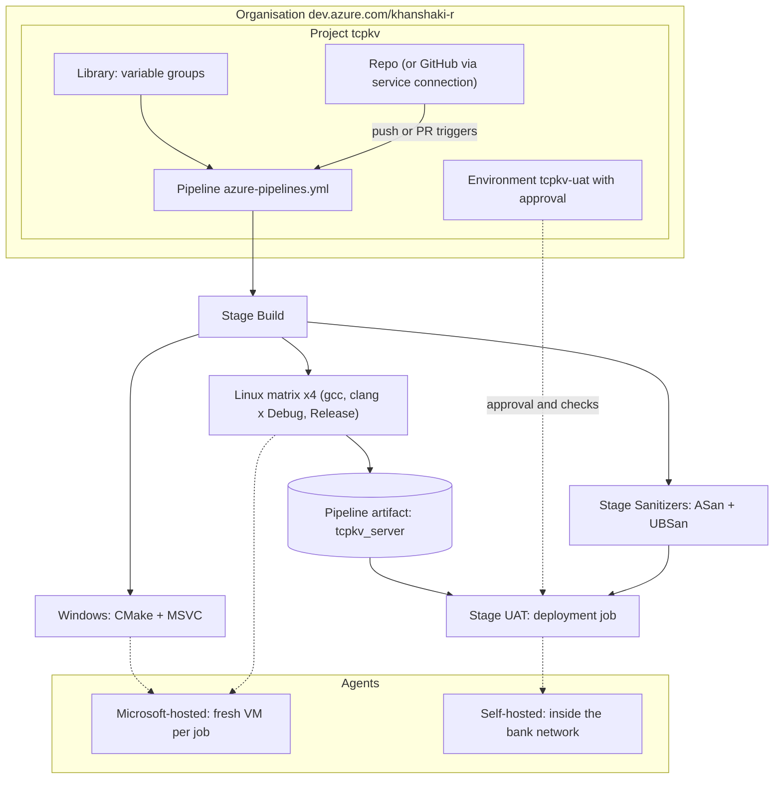

# Module 9.07: Azure DevOps pipelines

**Estimated hours:** 3

**What you will learn**

1. The Azure DevOps vocabulary (organisation, project, Repos, Pipelines, Artifacts, agents, service connections, environments) and how a YAML pipeline is built from `trigger`, `pool`, `stages`, `jobs` and `steps`.
2. How to write the tcpkv pipeline for Azure Pipelines, including a Windows job that builds with CMake and MSVC, a sanitizer stage, published test results and artifacts, and a deployment stage gated by an approval.
3. How Azure Pipelines compares with GitHub Actions line by line, how to try it on the free tier and on a self-hosted agent in your own WSL, and how to talk about Azure DevOps honestly in an interview.

**Prerequisites:** [Module 9.06: GitHub Actions](module-06-github-actions.md). The pipeline reuses `ci/install-deps.sh` and the tcpkv repository from 9.06, and the Windows side of your lab from 0.06.

---

## 1. One-line intuition

Azure DevOps is Microsoft's all-in-one engineering platform; its Pipelines part does the same job as GitHub Actions, but in banks it usually runs on build machines the bank owns, inside its own network, with approvals between every stage.

## 2. Real-life analogy

Think of how a bank group runs loan operations.

- The **organisation** is the bank group: one login, one billing account, one set of policies.
- A **project** is one line of business, say retail lending. It has its own **Repos** (the document archive), **Boards** (work tickets), **Pipelines** (the processing line) and **Artifacts** (the vault of approved, versioned outputs).
- **Agents** are the staff who process files. **Microsoft-hosted agents** are temporary staff from an agency: a fresh person every job, nothing remembered. **Self-hosted agents** are permanent staff inside the bank's building: they can reach internal systems, but they keep whatever is left on their desk unless told to clear it.
- A **service connection** is a signed letter of authority that lets the processing line talk to an outside party (GitHub, a container registry, a cloud subscription) without each clerk knowing the password.
- A **variable group** is the shared rate card every branch reads from.
- An **environment** with an **approval** is dual control: nothing moves into the UAT or production vault until a named officer signs.

## 3. Why it exists: the problem it solves

GitHub Actions answers "build and test my code on every push". A bank, or a vendor shipping software to banks, needs more around that:

1. **Code and data must stay inside the network.** Many banks forbid sending source code or test data to shared cloud machines. They run **Azure DevOps Server** on premises, or Azure DevOps Services with **self-hosted agents** inside their data centre.
2. **Every release needs an audit trail.** Regulators and internal audit ask: which work item led to which commit, which build produced which binary, who approved its deployment, and when. Azure DevOps links Boards, Repos, Pipelines and environments for exactly this.
3. **Windows is first-class.** Core-banking vendors often ship Windows services built with MSVC and MSBuild. Azure Pipelines has had Windows agents with Visual Studio preinstalled from the start.

What breaks without it: builds made on a developer's PC with an unknown compiler patch level, deployed by copying a folder over remote desktop, with no record of who approved what. When the RCA (module 8.09) asks "which binary was running?", nobody can answer.

## 4. Three layers of depth

### Layer 1 (beginner): the parts and the YAML anatomy

| Concept | What it is | Example |
|---|---|---|
| Organisation | Top-level account | `https://dev.azure.com/khanshaki-r` |
| Project | Container for repos, pipelines, boards, artifacts | `tcpkv` |
| Repos | Git hosting (Azure Repos); a pipeline can also build a GitHub repository | `tcpkv` repo or `khanshaki-r/tcpkv` on GitHub |
| Pipelines | YAML-defined build, test and deploy runs | `azure-pipelines.yml` |
| Boards | Work items (stories, bugs) that commits and PRs link to | `AB#123` in a commit message |
| Artifacts (service) | Package feeds (NuGet, npm, Maven, Python, Universal) | internal C++ packages |
| Pipeline artifacts | Files a run publishes and later stages download | `tcpkv-server-linux-gcc-13` |
| Agent and pool | A machine that runs jobs, grouped into pools | `vmImage: ubuntu-24.04`, pool `Default` |

A pipeline is a YAML file, by convention `azure-pipelines.yml` at the repository root. The smallest useful one:

```yaml
trigger:
  branches:
    include: [main]          # run on pushes to main
pool:
  vmImage: ubuntu-24.04      # a Microsoft-hosted agent
steps:
  - checkout: self
  - script: g++ --version
    displayName: Show the compiler
```

The hierarchy is **stages, jobs, steps**. A stage is a phase of the process (build, test, deploy); a job runs on one agent; steps run in order inside the job. If you have one stage, you may omit `stages:` and write `jobs:`; with one job, you may write `steps:` directly, as above.

**`script:` versus `task:`.** `script:` runs your command: Bash on Linux and macOS agents, **cmd.exe** on Windows agents. `bash:`, `pwsh:` and `powershell:` pick the shell explicitly. `task:` runs a packaged, versioned building block, like `uses:` in GitHub Actions: `PublishTestResults@2`, `PublishPipelineArtifact@1`, `Cache@2`. The `@2` is the major version. Inputs go under `inputs:`.

### Layer 2 (working engineer): agents, variables, connections, templates, environments

**Microsoft-hosted versus self-hosted agents.**

| | Microsoft-hosted | Self-hosted |
|---|---|---|
| Where | Microsoft's cloud, fresh VM per job | Your machine or VM, any network |
| Selected by | `pool: vmImage: ubuntu-24.04` or `windows-2022` | `pool: name: <PoolName>` plus optional `demands:` |
| State between runs | None | Workspace and installed tools persist |
| Reach internal systems | No (only the internet) | Yes: internal databases, licence servers, file shares |
| Toolchain | Whatever the image has this month | Exactly what you installed and validated |
| Typical user | Open source, small teams | Banks, regulated industries, large builds |

Banks usually run self-hosted agents on premises: code never leaves the network, builds can reach internal package mirrors and test databases, and the MSVC toolset version is the one the bank validated, not whatever the hosted image updated to last week. The cost is that someone must patch, clean and secure those machines. A self-hosted agent does not wipe its workspace between runs unless you ask (`workspace: clean: all` on the job), so stale build folders can make a broken change pass.

**Variables.** Define them in YAML (`variables:`), in the pipeline settings UI, or in a **variable group** under **Pipelines, Library**, shared by many pipelines and optionally backed by Azure Key Vault. Three syntaxes, evaluated at different times:

| Syntax | Evaluated | Typical use |
|---|---|---|
| `$(BUILD_TYPE)` | At run time, just before a step runs (macro) | In scripts and task inputs |
| `${{ variables.BUILD_TYPE }}` | When the YAML is compiled, before any agent starts | Template parameters, conditional insertion |
| `$[ variables.BUILD_TYPE ]` | At run time, for conditions and variables that depend on earlier jobs | `condition:`, output variables |

Non-secret variables also become environment variables for scripts, upper-cased with dots replaced by underscores (`Build.SourceVersion` becomes `BUILD_SOURCEVERSION`). **Secret variables are not**: you must map them explicitly with `env: DB_PASSWORD: $(dbPassword)` on the step, and the agent masks their values in logs.

**Service connections.** Stored, permissioned credentials for external services: GitHub, Azure Resource Manager, Docker registries, generic HTTP endpoints, SSH. A pipeline refers to one by name; an administrator must authorise each pipeline to use it, and can require approvals on the connection itself. The point is that the credential is never in the YAML and never in a developer's hands.

**Pipeline artifacts.** `PublishPipelineArtifact@1` uploads files from a job; a later job or stage downloads them with `download: current`. Build once, then promote the same files through UAT and production: the binary you tested is the binary you deploy. This is different from **Azure Artifacts**, the package-feed service.

**Templates.** Reuse YAML with parameters. A step template:

```yaml
# templates/cmake-linux.yml
parameters:
  - name: buildType
    type: string
    default: Debug
  - name: cxx
    type: string
steps:
  - script: bash ci/install-deps.sh
    displayName: Install packages
  - script: |
      set -e
      cmake -S . -B build -G Ninja -DCMAKE_BUILD_TYPE=${{ parameters.buildType }} \
        -DCMAKE_CXX_COMPILER=${{ parameters.cxx }}
      cmake --build build --parallel
      ctest --test-dir build --output-on-failure
    displayName: Build and test (${{ parameters.cxx }}, ${{ parameters.buildType }})
```

used from a pipeline as:

```yaml
steps:
  - template: templates/cmake-linux.yml
    parameters:
      buildType: Release
      cxx: clang++-18
```

Templates can be stored in a separate, locked-down repository. With `extends:` a security team forces every pipeline to wrap its jobs in an approved template (for example one that always runs a licence and secret scan). That is how a bank enforces policy across hundreds of pipelines.

**Environments, deployment jobs and approvals.** An **environment** (Pipelines, Environments) is a named target such as `tcpkv-uat`. A `deployment:` job that targets it records every deployment in the environment's history. On the environment you add **Approvals and checks**: manual approval by named users or groups, business-hours windows, required branch, required template, and others. The run pauses at that stage until the checks pass. Approvals live on the environment, not in the YAML, so a developer cannot remove them by editing the pipeline.

### Layer 3 (internals): from YAML to a running agent

1. **Compile.** When a run is triggered, the service loads the YAML at that commit, expands every `template:` with its parameters, evaluates all `${{ }}` expressions, and produces a fully expanded plan: concrete stages, jobs and steps. You can see this result: on a run, the menu offers **Download full YAML**. Errors in templates fail here, before any machine is used.
2. **Queue.** Each job goes to the queue of its pool. For a matrix, the service creates one job per matrix entry; each entry's keys become variables of that job (`CC`, `CXX`, `BUILD_TYPE`).
3. **Agent.** The agent is an open-source .NET program (`azure-pipelines-agent`; the GitHub Actions runner started as a fork of it). It holds a long-poll HTTPS connection **outbound** to the service and asks for work. It never needs an inbound port, which is why a bank can run agents behind a firewall that only allows outbound HTTPS to the Azure DevOps endpoints (or to its on-premises Azure DevOps Server).
4. **Job start.** The agent receives the job, a job-scoped access token (`System.AccessToken`), the variables and the steps. It downloads each task it needs: a task is a versioned package with a `task.json` description and a Node or PowerShell implementation, cached in the agent's folder.
5. **Steps.** Before each step, `$(...)` macros are replaced. A `script:` step is written to a temporary file and run by Bash on Linux or by `cmd.exe /D /E:ON /V:OFF /S /C` on Windows. In cmd, a failing command in the middle of a multi-line script does not stop the script; only the last command's exit code counts, which is why the Windows job below uses one command per step. Directories are fixed by variables: `$(Pipeline.Workspace)`, `$(Build.SourcesDirectory)`, `$(Build.ArtifactStagingDirectory)`, `$(Common.TestResultsDirectory)`.
6. **Reporting.** Logs stream back live. `PublishTestResults@2` parses JUnit XML and fills the **Tests** tab with pass, fail and duration per test, with history across runs. Hosted agents are then deleted; self-hosted agents keep the workspace.

## 5. Architecture diagram



## 6. Code

### 6.1 The Windows-portable CMake guard

tcpkv's server and `load_gen` use POSIX sockets, so they do not compile on Windows until you port them with module 9.10's `platform.hpp`. The protocol parser, store and thread pool are plain C++17 and must build with MSVC. Wrap the POSIX-only targets in `CMakeLists.txt`:

```cmake
if(NOT WIN32)                       # POSIX sockets: Linux only until module 9.10
  add_executable(tcpkv_server src/main.cpp)
  target_link_libraries(tcpkv_server PRIVATE tcpkv_core)
  add_executable(load_gen tools/load_gen.cpp)
endif()

if(MSVC)
  target_compile_options(tcpkv_core PRIVATE /W4 /WX /permissive-)
else()
  target_compile_options(tcpkv_core PRIVATE -Wall -Wextra -Werror)
endif()
```

`tcpkv_core` is the library target from 9.01 holding the parser, store and pool. If your test executable includes socket tests, guard those source files the same way.

### 6.2 `azure-pipelines.yml`

```yaml
# azure-pipelines.yml -- tcpkv on Azure Pipelines (the twin of ci.yml).
trigger:
  branches:
    include: [main]
pr:                               # PR builds for GitHub-hosted repos
  branches:
    include: [main]

variables:
  - name: CCACHE_DIR
    value: $(Pipeline.Workspace)/.ccache
  # - group: tcpkv-common         # a variable group from Pipelines > Library

stages:
  - stage: Build
    displayName: Build and test
    jobs:
      - job: Linux
        pool:
          vmImage: ubuntu-24.04
        strategy:
          matrix:                 # each entry becomes one job; its keys become variables
            gcc_debug:     { CC: gcc-13,   CXX: g++-13,     BUILD_TYPE: Debug }
            gcc_release:   { CC: gcc-13,   CXX: g++-13,     BUILD_TYPE: Release }
            clang_debug:   { CC: clang-18, CXX: clang++-18, BUILD_TYPE: Debug }
            clang_release: { CC: clang-18, CXX: clang++-18, BUILD_TYPE: Release }
        steps:
          - checkout: self
          - script: bash ci/install-deps.sh
            displayName: Install packages
          - task: Cache@2
            displayName: Restore compiler cache
            inputs:
              key: 'ccache | "$(Agent.OS)" | "$(CXX)" | "$(BUILD_TYPE)" | "$(Build.SourceVersion)"'
              restoreKeys: |
                ccache | "$(Agent.OS)" | "$(CXX)" | "$(BUILD_TYPE)"
              path: $(CCACHE_DIR)
          - script: |
              set -e
              cmake -S . -B build -G Ninja -DCMAKE_BUILD_TYPE=$(BUILD_TYPE) \
                -DCMAKE_C_COMPILER=$(CC) -DCMAKE_CXX_COMPILER=$(CXX) \
                -DCMAKE_CXX_COMPILER_LAUNCHER=ccache
              cmake --build build --parallel
            displayName: Configure and build
          - script: >
              ctest --test-dir build --output-on-failure
              --output-junit $(Common.TestResultsDirectory)/ctest-junit.xml
            displayName: Test
          - task: PublishTestResults@2
            displayName: Publish test results
            condition: succeededOrFailed()
            inputs:
              testResultsFormat: JUnit
              testResultsFiles: $(Common.TestResultsDirectory)/ctest-junit.xml
              testRunTitle: Linux $(CXX) $(BUILD_TYPE)
          - task: PublishPipelineArtifact@1
            displayName: Publish server binary
            condition: and(succeeded(), eq(variables['BUILD_TYPE'], 'Release'))
            inputs:
              targetPath: build/tcpkv_server
              artifact: tcpkv-server-linux-$(CC)

      - job: Windows
        pool:
          vmImage: windows-2022    # Visual Studio 2022 and CMake are preinstalled
        steps:
          - checkout: self
          # script: runs cmd.exe here, so one command per step: cmd does not
          # stop at the first failing line the way bash -e does.
          - script: cmake -S . -B build -G "Visual Studio 17 2022" -A x64
            displayName: Configure (MSVC)
          - script: cmake --build build --config Release --parallel
            displayName: Build (MSBuild under the hood)
          - script: ctest --test-dir build -C Release --output-on-failure
            displayName: Test

  - stage: Sanitizers
    dependsOn: Build
    jobs:
      - job: AsanUbsan
        pool:
          vmImage: ubuntu-24.04
        variables:
          ASAN_OPTIONS: detect_leaks=1:abort_on_error=1
          UBSAN_OPTIONS: print_stacktrace=1:halt_on_error=1
        steps:
          - script: bash ci/install-deps.sh
            displayName: Install packages
          - script: sudo sysctl -w vm.mmap_rnd_bits=28
            displayName: Lower ASLR entropy for the sanitizer runtime
          - script: |
              set -e
              cmake -S . -B build -G Ninja -DCMAKE_BUILD_TYPE=RelWithDebInfo \
                -DCMAKE_CXX_COMPILER=clang++-18 \
                -DCMAKE_CXX_FLAGS="-fsanitize=address,undefined -fno-sanitize-recover=undefined -fno-omit-frame-pointer" \
                -DCMAKE_EXE_LINKER_FLAGS="-fsanitize=address,undefined"
              cmake --build build --parallel
              ctest --test-dir build --output-on-failure
            displayName: Build and test with ASan + UBSan

  - stage: UAT
    dependsOn: Sanitizers
    condition: and(succeeded(), eq(variables['Build.SourceBranch'], 'refs/heads/main'))
    jobs:
      - deployment: StageBinary
        pool:
          vmImage: ubuntu-24.04
        environment: tcpkv-uat     # approvals and checks are configured on this environment
        strategy:
          runOnce:
            deploy:
              steps:
                - download: current
                  artifact: tcpkv-server-linux-gcc-13
                - script: sha256sum $(Pipeline.Workspace)/tcpkv-server-linux-gcc-13/tcpkv_server
                  displayName: Record the checksum of what would be deployed
```

Notes on the non-obvious lines:

- **`ctest --output-junit`** (CMake 3.21 or newer) writes JUnit XML, which `PublishTestResults@2` turns into the **Tests** tab with per-test history. GitHub Actions has no built-in equivalent.
- **The Windows job uses the Visual Studio generator.** CMake writes `tcpkv.sln` and one `.vcxproj` per target, then `cmake --build --config Release` calls MSBuild on the solution. Module 9.10 opens those files and explains them. `ctest -C Release` is required with multi-config generators, because Debug and Release live in separate folders.
- **`set -e`** at the top of multi-line Linux scripts. Azure's Bash steps do not add `-e` for you, unlike GitHub's default `bash -e`.
- **The UAT stage** runs only on `main` and only after the sanitizers pass. It downloads the exact artifact built in stage one and records its SHA-256: the evidence that the tested binary is the deployed binary.

The YAML parses cleanly (checked with PyYAML, which only checks YAML syntax). For Azure-specific validation, open the file in the pipeline editor on the website and use **Validate**, or start a run: the compile step reports errors with line numbers before any agent is used.

### 6.3 GitHub Actions and Azure Pipelines side by side

| Concern | GitHub Actions (9.06) | Azure Pipelines (this module) |
|---|---|---|
| File | `.github/workflows/*.yml`, many per repo | `azure-pipelines.yml` (any path), one pipeline per file |
| Trigger | `on: push / pull_request / workflow_dispatch / schedule` | `trigger:`, `pr:` (GitHub repos), `schedules:`; Azure Repos PR builds via branch policies |
| Structure | jobs, steps (no stages) | stages, jobs, steps |
| Machine | runner: `runs-on: ubuntu-24.04` | agent: `pool: vmImage: ubuntu-24.04` or `pool: name: MyPool` |
| Own machines | self-hosted runners | self-hosted agents and pools; Azure DevOps Server fully on premises |
| Reusable step | action: `uses: actions/cache@v4`, inputs `with:` | task: `task: Cache@2`, inputs `inputs:` |
| Shell step | `run:` (bash on Linux, pwsh on Windows) | `script:` (bash on Linux, cmd on Windows), `bash:`, `pwsh:` |
| Matrix | `strategy.matrix` with lists, cross product, `include` | `strategy.matrix` with named entries, no cross product |
| Expressions | `${{ }}` | `$( )` macro, `${{ }}` compile time, `$[ ]` run time |
| Secrets | repository and environment secrets | secret variables, variable groups, Key Vault; must map to `env:` |
| Artifacts | `actions/upload-artifact@v4` | `PublishPipelineArtifact@1`, `download:` |
| Test results UI | none built in | Tests tab from `PublishTestResults@2` |
| Approvals | environments with required reviewers | environments with approvals and checks |
| Reuse | composite actions, reusable workflows | step, job, stage templates; `extends:` for enforced policy |
| Work tracking | GitHub Issues and Projects | Azure Boards, linked to commits and runs |
| On premises | GitHub Enterprise Server | Azure DevOps Server |

## 7. Use case: core-banking loan-origination platform

A vendor builds a loan-origination application server in C and C++ for two banks. Bank A runs Azure DevOps Server inside its data centre. Bank B uses Azure DevOps Services but allows only self-hosted agents on its own network.

**Decision driven: build once, promote the same artifact.** The pipeline builds the Windows service on a self-hosted agent with the exact Visual Studio 2022 toolset version the bank validated, publishes it as a pipeline artifact with its SHA-256, and the UAT and production stages download that artifact rather than rebuilding. Rebuilding per environment would mean the binary in production was never the binary that passed UAT, and any difference in compiler patch level or a dependency would be untested.

**Decision driven: approvals on the environment, not in the YAML.** The bank's change manager is the approver on `production`. Because approvals and checks are attached to the environment, a developer who edits the YAML cannot skip them, and every deployment has a recorded approver and time. That record is what the bank's auditors and an RCA (module 8.09) ask for: "which build was deployed, and who approved it?"

**Decision driven: self-hosted agents are cleaned.** Persistent workspaces made a broken header change pass once, because an old object file was reused. The fix was `workspace: clean: all` on release jobs, accepting slower builds for correctness.

## 8. Lab

### Part A: Azure DevOps on the free tier (30 minutes)

1. Go to `https://dev.azure.com` and sign in with a Microsoft account (create one with your email if needed).
2. Create an organisation (the name must be globally unique, for example your GitHub username) and a **private** project named `tcpkv`.
3. Add `azure-pipelines.yml` from section 6.2 and the CMake guard from 6.1 to your tcpkv repository on a branch, merge to `main` through a PR (your GitHub ruleset from 9.06 still applies).
4. In Azure DevOps: **Pipelines, Create Pipeline, GitHub (YAML)**. Authorise the Azure Pipelines app for `khanshaki-r/tcpkv` only, choose the repository, choose **Existing Azure Pipelines YAML file**, branch `main`, path `/azure-pipelines.yml`, then **Run**.
5. If the run fails at once with "No hosted parallelism has been purchased or granted", your new organisation has no free hosted minutes yet. The message contains a link to the free-grant request form (`https://aka.ms/azpipelines-parallelism-request`); approval typically takes a few business days. Do Part B meanwhile: self-hosted agents need no grant.

Expected once hosted jobs run: five jobs in stage Build (four Linux, one Windows), then Sanitizers, then UAT waiting for approval (Part C). The **Tests** tab shows your GoogleTest cases by name. Free-tier limits at the time of writing: one Microsoft-hosted parallel job with 1,800 minutes a month for private projects, one self-hosted parallel job with unlimited minutes; check the pricing page.

### Part B: a self-hosted agent in your WSL (30 minutes)

1. Azure DevOps, **User settings, Personal access tokens, New Token**: name `wsl-agent`, expiry 30 days, scope **Agent Pools (Read & manage)**. Copy the token.
2. **Organization settings, Agent pools, Default, New agent, Linux, x64**. Copy the download URL shown.
3. In WSL:

```bash
mkdir -p ~/azagent && cd ~/azagent
curl -fLo agent.tar.gz "<the download URL from step 2>"
tar zxf agent.tar.gz
./config.sh          # server URL https://dev.azure.com/<your-org>, auth PAT, pool Default
./run.sh             # leave this terminal open
```

4. Make sure the tools exist locally once: `sudo apt install -y ninja-build ccache`. Then `ci/install-deps.sh` prints `all packages already installed` and needs no sudo.
5. On a branch, change the Linux job's pool to `pool: name: Default` and run the pipeline for that branch.

Expected: the `run.sh` terminal prints `Running job: Linux gcc_debug` and so on, one job at a time (one free self-hosted parallel job). Run it twice and look at `~/azagent/_work/1/s`: the checkout and build folder are still there from the previous run. That is the persistent-state property from Layer 2. Revert the pool change before merging.

### Part C: an environment with an approval (15 minutes)

1. **Pipelines, Environments**: open `tcpkv-uat` (created by the first run) or create it.
2. **Approvals and checks, Approvals**: add yourself as approver.
3. Run the pipeline on `main`. Expected: the UAT stage shows **Waiting** with a **Review** button. Approve with a comment. The deployment job runs and prints the SHA-256 of `tcpkv_server`. The environment's **Deployments** tab now lists the run, the commit and your approval.
4. Compare the hash with `sha256sum` of the artifact downloaded from the run page. They must match.

### Part D: a bug only MSVC sees (20 minutes)

1. On a branch, add to the parser or store code a function that returns `std::string::size()` as `int`:

```cpp
int key_length(const std::string& key) { return key.size(); }
```

2. Build locally with GCC: clean under `-Wall -Wextra -Werror` (GCC needs `-Wconversion` to warn about this).
3. Push and run the pipeline. Expected: only the Windows job fails, with `warning C4267: 'return': conversion from 'size_t' to 'int', possible loss of data` turned into an error by `/WX`. Fix it with `static_cast<int>(...)` after checking the range, or better, return `std::size_t`.
4. Fill in a copy of the comparison table from 6.3 with one line on what you found easier on each platform.

### Journal

Copy [journal/TEMPLATE.md](../journal/TEMPLATE.md) to `journal/YYYY-MM-DD-azure-devops.md`. Record: your organisation URL; whether you needed the parallelism grant and how long it took; the job durations of Linux versus Windows; what persisted in `_work` on the self-hosted agent; the approval record (who, when); the matching SHA-256; and the exact MSVC warning from Part D.

## 9. Common mistakes and misconceptions

| Mistake | Why it is wrong | What it causes |
|---|---|---|
| Multi-line `script:` on a Windows agent | cmd.exe does not stop at a failing line; only the last exit code counts | A failed configure followed by a "successful" step |
| Forgetting `set -e` in multi-line Bash scripts | Azure's Bash step does not add it | Errors in early lines ignored |
| Expecting secret variables in the environment | Secrets are not mapped automatically | Empty password, confusing auth failures |
| Approvals written as a YAML step | YAML can be edited by anyone with commit access | No real control; the audit finding writes itself |
| Rebuilding per environment | The tested binary is not the deployed binary | Untested differences reach production |
| Never cleaning self-hosted workspaces | Old build outputs are reused | Broken changes pass; "works on the agent" |
| Confusing pipeline artifacts with Azure Artifacts | One is run output, the other is a package feed | Looking for build outputs in the wrong place |
| `ctest` without `-C Release` on Visual Studio builds | Multi-config generators need the configuration | "No tests were found" or wrong binaries tested |
| Claiming "Azure DevOps expert" from one lab | Interviewers ask about agents, templates, approvals | Credibility lost on the first follow-up |

## 10. Resume link

The resume lists "GitHub Actions, Azure DevOps" under Platforms and Tools (claim G). The rule from the resume's own header notes applies: a skill is listed only if you can defend it.

**Say exactly what you did, in two parts.**

1. **At work.** Write down, before any interview, what you personally did in Azure DevOps at your employer. For example: raised and reviewed pull requests in Azure Repos, linked commits to work items, read failed pipeline logs to fix build breaks, triggered builds for a client release. If you did not author pipeline YAML at work, do not imply it.
2. **In this course.** "I wrote a multi-stage YAML pipeline for my tcpkv project: a four-way Linux matrix with ccache, a Windows job building with CMake and MSVC under `/W4 /WX`, an ASan+UBSan stage, JUnit results in the Tests tab, a pipeline artifact with its SHA-256, and a UAT deployment stage gated by an approval on the environment. I ran it on Microsoft-hosted agents and on a self-hosted agent I registered in WSL."

Put together: "At work I used Azure DevOps as a developer: PRs, build validation and pipeline logs. To understand the pipeline side properly I built [the above] and compared it with the GitHub Actions CI on the same repository." That answer survives every follow-up, because every claim in it is something you did.

Likely follow-ups: "Why do banks use self-hosted agents?" (network isolation, internal resources, validated toolchains; cost is maintenance and hygiene). "Where do approvals live?" (on the environment, so YAML edits cannot remove them). "How do you pass a secret to a script?" (secret variable or variable group, mapped through `env:`, masked in logs).

## 11. Interview questions

**Q1 (easy). What is the difference between a stage, a job and a step?**

<details>
<summary>Model answer</summary>

A step is one command or task. A job is a sequence of steps that runs on one agent, so steps in a job share a workspace. A stage is a group of jobs representing a phase such as build, test or deploy; stages run in order by default and can have conditions and approvals between them. In my tcpkv pipeline the Build stage has the Linux matrix and the Windows job running in parallel on different agents, the Sanitizers stage depends on Build, and the UAT stage depends on Sanitizers and waits for an approval.

</details>

**Q2 (easy). Microsoft-hosted or self-hosted agents: which would a bank choose and why?**

<details>
<summary>Model answer</summary>

Usually self-hosted, inside the bank's network. Source code and test data stay on premises, builds can reach internal package mirrors and test databases, and the toolchain is exactly the validated version. The agent only makes outbound HTTPS connections to the service, so no inbound firewall rule is needed. The costs are patching and securing the machines, capacity planning, and workspace hygiene, because self-hosted agents keep state between runs unless the job cleans it. Hosted agents are simpler and always clean, but they run in Microsoft's cloud with whatever image version is current.

</details>

**Q3 (medium). Explain `$(var)`, `${{ variables.var }}` and `$[ variables.var ]`.**

<details>
<summary>Model answer</summary>

They are evaluated at different times. `${{ }}` is a template expression, evaluated when the YAML is compiled, before any agent starts; it can change the structure of the pipeline, for example insert steps or pass template parameters. `$[ ]` is a runtime expression, evaluated when a job or condition is about to be evaluated; it is used in conditions and to read output variables from earlier jobs. `$( )` is a macro, replaced just before each step runs, and is the normal way to use a variable in a script or task input. A common bug is using `${{ }}` for a value that is only set at run time, which then expands to an empty string.

</details>

**Q4 (medium). How would you make sure a binary deployed to production is the one that passed UAT?**

<details>
<summary>Model answer</summary>

Build once in the first stage and publish it as a pipeline artifact. Later stages, including UAT and production deployment jobs, download that same artifact with `download: current` instead of rebuilding. Record its SHA-256 in the build stage and check it again in the deployment stage. Deployments target environments, so each environment's history shows which run, commit and artifact went where, and the approvals on the environment record who approved. If anything needs rebuilding, it goes through UAT again.

</details>

**Q5 (hard). A release pipeline on a self-hosted Windows agent passes, but the same commit fails on a developer's clean machine with a linker error about a missing symbol. What is your hypothesis and how do you prove and fix it?**

<details>
<summary>Model answer</summary>

The agent's persistent workspace is the first suspect: an old object file or library from a previous build is being linked, so a source file that was deleted or renamed, or a header change that should force a rebuild, is masked. Other candidates are tools or SDKs installed on the agent but not declared, or an environment variable set on the agent machine. To prove it I would look at the job log for which `.obj` and `.lib` files were linked and their timestamps, run the same pipeline with `workspace: clean: all`, and see it fail like the developer's machine. The fix is to clean the workspace for release builds, declare every tool dependency explicitly (or install it in a pipeline step), and pin the agent image or tool versions so the build is reproducible on a fresh machine. I would also add a periodic build on a Microsoft-hosted or freshly provisioned agent as a canary for hidden state.

</details>

## 12. Revision

- Azure DevOps: organisation, then project, then Repos, Boards, Pipelines and Artifacts; a YAML pipeline is stages, jobs and steps; `script:` runs your shell (cmd on Windows), `task:` runs a versioned building block.
- Banks prefer self-hosted agents (network, validated toolchains) and accept the cost of patching and cleaning them; secrets come from secret variables or variable groups mapped through `env:`; approvals live on environments.
- The tcpkv pipeline mirrors 9.06 plus a Windows CMake/MSVC job, JUnit test results, a SHA-256-recorded artifact and an approval-gated UAT stage; say exactly what you did at work and what you built here.

---

Previous: [Module 9.06: GitHub Actions](module-06-github-actions.md) | Next: [Module 9.08: Bash automation](module-08-bash-automation.md)
