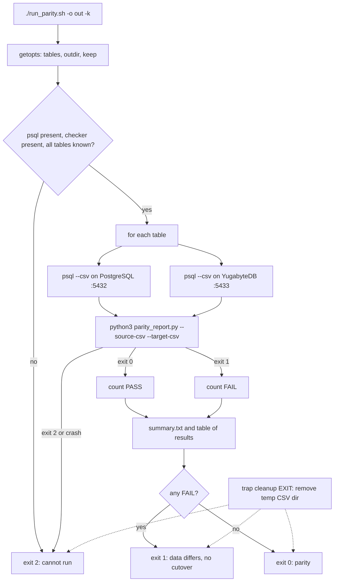

# Module 9.08: Bash automation

**Estimated hours:** 3

**What you will learn**

1. How to write Bash scripts that fail loudly instead of silently: the shebang, quoting, `[[ ]]`, arrays, functions with `local`, exit codes, `set -euo pipefail`, `trap` cleanup, here-docs and `getopts`.
2. The text-processing toolkit every engineer uses during an incident: `grep -E`, `sed -E`, `awk` (fields, sums, group-by), `sort | uniq -c`, `cut`, `tr`, `xargs -P`, `find -exec` and `jq`.
3. Three complete scripts for capstone C4: `run_parity.sh` (export every table from PostgreSQL and YugabyteDB and diff them), `cluster_up.sh`/`cluster_down.sh` (the 3-node cluster with health waits) and `latency_report.sh` (p50/p99 from a server log with awk), checked with ShellCheck.

**Prerequisites:** [Module 9.07: Azure DevOps pipelines](module-07-azure-devops-pipelines.md). Bash basics from 0.03 (pipes, redirection, variables), `psql` from Phase 6, the 3-node YugabyteDB cluster from 7.09, percentiles from 8.08, and Docker Compose from 9.05.

---

## 1. One-line intuition

A Bash script turns a page of commands you would type by hand into a procedure that runs the same way every time, stops at the first surprise, and leaves a record of what happened.

## 2. Real-life analogy

A bank's cutover weekend has a **runbook**: numbered steps, each with a check, executed at 3 a.m. by tired people.

- The **script** is the runbook written so precisely that a machine can follow it.
- **`set -euo pipefail`** is the rule "if any step shows an unexpected result, stop and escalate; never carry on hoping".
- **Functions** are sub-procedures ("export one table") that the runbook calls by name.
- The **exit code** is the sign-off box at the bottom of each step: 0 means done and correct, anything else means not.
- **`trap ... EXIT`** is "lock the vault on the way out, whatever happened": cleanup that runs even when the procedure is abandoned half way.
- **`getopts`** is the form at the top of the runbook where the operator fills in which tables and which output folder.
- **awk, sed, grep** are the clerks who read the overnight logs and produce the summary sheet.

## 3. Why it exists: the problem it solves

A parity run for capstone C4 is: export five tables from PostgreSQL, export the same five from YugabyteDB, compare each pair, collect the results, decide go or no-go. That is about twenty commands. Typed by hand:

1. **Someone skips one.** Five tables become four; the missing one is the one with the defect.
2. **Errors scroll past.** `psql` prints "connection refused" for one table, the comparison runs on an empty file, and "0 differences" looks like a pass.
3. **Nobody can repeat it exactly.** The second rehearsal uses slightly different options and the results are not comparable.

A script fixes all three, but only if it is written defensively. By default Bash **continues after errors**, treats an unset variable as an empty string, and reports a pipeline's status as that of its last command. A careless script is worse than no script, because it gives a confident green answer. Most of this module is about removing those defaults.

## 4. Three layers of depth

### Layer 1 (beginner): the parts of a script

```bash
#!/usr/bin/env bash
# greet.sh: say hello to each branch given on the command line.
set -euo pipefail

greet() {                        # a function; $1 is its first argument
  local branch="$1"              # local: visible only inside the function
  printf 'Hello, %s\n' "$branch"
}

if [[ $# -eq 0 ]]; then          # $# = number of arguments
  echo "usage: $0 BRANCH..." >&2 # >&2 sends the message to stderr
  exit 2                         # non-zero exit code = failure
fi

for b in "$@"; do                # "$@" = every argument, each kept intact
  greet "$b"
done
```

Run it with `chmod +x greet.sh && ./greet.sh MUM01 "DEL 01"`. Output: `Hello, MUM01` and `Hello, DEL 01`.

- **Shebang.** `#!/usr/bin/env bash` asks `env` to find `bash` on the `PATH`, so the script works where Bash is not at `/bin/bash`. Without a shebang, `./script` may run under `sh` (dash on Ubuntu), which lacks arrays and `[[ ]]`.
- **Quoting.** Always write `"$var"`. Unquoted, a value is split on spaces and expanded as a wildcard. With `file="loan report.csv"`, `ls -l $file` looks for two files, `loan` and `report.csv`; `ls -l "$file"` finds the one file. Single quotes (`'...'`) mean "exactly these characters, no expansion".
- **Tests.** `[[ ... ]]` is Bash's test: `[[ -f path ]]` file exists, `[[ -n "$s" ]]` non-empty, `[[ "$a" == "$b" ]]` string equal, `[[ "$s" == *.csv ]]` pattern, `(( n > 3 ))` arithmetic.
- **Exit codes.** Every command returns a number: 0 is success, 1 to 255 are failures. `$?` holds the last one. `exit N` ends the script; `return N` ends a function.
- **Arrays.** `tables=(branches loans)`, `"${tables[@]}"` expands to each element as a separate word, `${#tables[@]}` is the count. `declare -A pk=([loans]=loan_id)` is an associative array (a map).
- **Here-docs.** `cat <<EOF ... EOF` feeds the lines between as standard input; `<<'EOF'` (quoted) disables `$` expansion inside.

| Variable | Meaning |
|---|---|
| `$0` | The script's name |
| `$1`, `$2`, ... | Positional arguments |
| `$#` | Number of arguments |
| `"$@"` | All arguments, each as its own word |
| `$?` | Exit code of the last command |
| `$$` | PID of this shell |
| `$!` | PID of the last background job |
| `$SECONDS` | Seconds since the script started |

### Layer 2 (working engineer): strict mode, cleanup, options, and the text toolkit

**Strict mode, and its holes.** `set -euo pipefail` means:

- `-e`: exit when a command fails.
- `-u`: an unset variable is an error, not an empty string. This catches `rm -rf "$DIR/"` when `DIR` was never set.
- `-o pipefail`: a pipeline fails if **any** stage fails, not only the last. Without it, `pg_dump ... | gzip > dump.gz` "succeeds" when `pg_dump` cannot connect.

`-e` has holes you must know (section 8, Part A demonstrates each): it is switched off inside any command used as a condition (`if f`, `f && g`, `f || g`), including everything inside a function called that way; and `local x=$(cmd)` returns the status of `local` (0), not of `cmd`. Declare first, then assign: `local x; x=$(cmd)`. ShellCheck flags this as SC2155.

**Cleanup with `trap`.** `trap cleanup EXIT` runs `cleanup` however the script ends: normal end, `exit`, error under `-e`, or Ctrl+C. Two rules: the trap runs **after** your functions have returned, so it must only use **global** variables (a `local` is gone by then); and the cleanup function must itself succeed. `trap on_error ERR` runs on any failing command; add `set -E` so functions inherit it.

**Options with `getopts`.** `while getopts ":t:o:kh" opt` loops over short options: a letter followed by `:` takes a value (`$OPTARG`); the leading `:` lets you handle errors yourself (`:` case for a missing value, `?` case for an unknown option). After the loop, `shift $((OPTIND - 1))` leaves the remaining positional arguments.

**Logging and exit-code conventions.** Messages for humans go to stderr (`>&2`) so stdout stays clean for data. Use distinct codes: 0 success, 1 "the check ran and found a problem", 2 "the check could not run" (bad usage, no connection). A caller, such as CI or another script, can then tell "data differs" from "tool broken".

**The text toolkit.** All examples run on the sample log made by `make_sample_log.sh` in section 6.3, whose request lines look like `2026-10-19T10:00:00.001Z INFO req conn=1 op=GET key=k1 status=OK latency_us=77`.

| Task | Command | Result on the sample log |
|---|---|---|
| Count error requests | `grep -c 'status=ERR' server.log` | `20` |
| Extended regex, only the match | `grep -oE 'op=[A-Z]+' server.log \| sort \| uniq -c \| sort -rn` | `6000 op=GET`, `3000 op=SET`, `1000 op=DEL` |
| Lines by level | `cut -d' ' -f2 server.log \| sort \| uniq -c` | `10002 INFO`, `4 WARN` |
| Select by field | `awk '$2 == "WARN"' server.log` | the four queue-depth warnings |
| Rewrite with capture groups | `sed -E -n 's/.*op=([A-Z]+).*latency_us=([0-9]+)$/\1 \2/p' server.log` | `GET 77`, `GET 54`, ... |
| Group-by mean | `grep ' req ' server.log \| awk '{split($NF,a,"="); s[$5]+=a[2]; c[$5]++} END {for (k in s) printf "%s mean=%.1f\n", k, s[k]/c[k]}' \| sort` | `op=DEL mean=81.0`, `op=GET mean=89.1`, `op=SET mean=104.3` |
| Translate characters | `echo "GET,SET" \| tr ',' '\n'` | two lines |
| Parallel work | `find parity-* -name '*.csv' -print0 \| xargs -0 -P 4 -n 1 gzip` | compresses CSVs four at a time |
| Act on found files | `find reports -name '*.md' -mtime +30 -exec rm -- {} +` | deletes reports older than 30 days |
| Read JSON | `docker inspect yb3-yb-n1-1 \| jq -r '.[0].State.Health.Status'` | `healthy` |

`awk` deserves a sentence of its own: it reads input line by line, splits each line into fields `$1`, `$2`, ..., `$NF` (the last), runs your `pattern { action }` rules, and at `END` prints totals. Associative arrays (`s[$5] += ...`) make group-by a one-liner. `-print0` with `xargs -0` keeps file names with spaces intact. Install the two missing tools once: `sudo apt install -y jq shellcheck`.

**ShellCheck and `bash -x`.** `shellcheck script.sh` is a static analyser that knows every quoting and `-e` trap in this module; treat its warnings like compiler warnings under `-Werror`. `bash -x script.sh` prints each command after expansion before running it; set `PS4='+ ${BASH_SOURCE##*/}:${LINENO}: '` to prefix each traced line with file and line number.

**When to use PowerShell instead.** On Windows machines and Windows build agents, use PowerShell. Its pipeline passes objects, not text, so you filter on properties instead of parsing columns, and it reaches Windows things Bash cannot: services, the event log, the registry, IIS, certificates. The p99 per operation from the sample log, in PowerShell 5.1:

```powershell
Select-String -Path .\server.log -Pattern ' req .*op=(\w+) .*latency_us=(\d+)$' |
  ForEach-Object { [pscustomobject]@{ Op = $_.Matches[0].Groups[1].Value; Us = [int]$_.Matches[0].Groups[2].Value } } |
  Group-Object Op |
  ForEach-Object {
    $s = @($_.Group.Us | Sort-Object)
    [pscustomobject]@{ Op = $_.Name; Count = $s.Count
                       P50 = $s[[math]::Ceiling(0.50 * $s.Count) - 1]
                       P99 = $s[[math]::Ceiling(0.99 * $s.Count) - 1]
                       Max = $s[-1] }
  } | Format-Table -AutoSize
```

It prints the same numbers as the awk version (GET: count 6000, p50 70, p99 1180, max 1580). Rule of thumb: Bash for Linux servers, containers and CI on Linux; PowerShell for Windows hosts and Windows agents; Python (module 9.09) once the logic needs data structures, tests or more than a page.

### Layer 3 (internals): what Bash does with one line

1. **Parse.** Bash reads a line, splits it into words and operators (`|`, `&&`, `>`, `;`), and recognises keywords such as `if`, `for` and `[[`.
2. **Expand, in a fixed order:** brace expansion (`{a,b}`), tilde (`~`), then parameter (`$x`), command substitution (`$(...)`) and arithmetic (`$((...))`), then **word splitting** of unquoted results on `$IFS` (space, tab, newline), then **pathname expansion** (globbing `*.csv`), then quote removal. Quoting stops the last three steps from touching your value; that is the whole reason for `"$var"`.
3. **Execute.** A builtin (`cd`, `echo`, `local`) runs inside the shell. An external command (`psql`, `awk`) means `fork()` a child process, set up redirections in the child, then `execve()` the program (module 3.01). The parent waits and stores the exit status in `$?`.
4. **Pipelines are concurrent.** `a | b | c` starts three processes at once, connected by kernel pipes (module 3.10). Each runs until its input ends. The pipeline's status is `c`'s, unless `pipefail` is set, in which case it is the last non-zero status. In Bash every stage of a pipeline runs in a subshell by default, so `cat f | while read x; do n=$((n+1)); done` leaves `n` unchanged in the parent. Use `while read ...; done < f` instead.
5. **`[[` versus `[`.** `[` is an ordinary command (also `/usr/bin/[`), so its arguments go through word splitting and globbing: `[ $x == y ]` breaks when `x` is empty or contains spaces. `[[` is shell syntax, parsed before expansion, so it does not split and supports `&&`, `||`, patterns and `=~` regular expressions.
6. **Traps.** On exit, the shell runs the EXIT trap string as code at that moment, in the global scope. That is why a trap that mentions a function's `local` variable sees nothing.
7. **`awk` and `sort` are programs, not Bash.** awk compiles your script to an internal form and runs it once per line in a single process, so `awk` over a million lines is far faster than a Bash `while read` loop that forks a command per line. `sort` handles files bigger than RAM with an external merge sort in temporary files; `LC_ALL=C sort` compares bytes and is much faster than locale-aware sorting.

## 5. Architecture diagram



## 6. Code

Put everything for C4 in `capstones/data-parity-cutover/scripts/`. All scripts below pass ShellCheck 0.11 with no warnings and were run in WSL (Bash 5.2).

### 6.1 `run_parity.sh` and the checker it calls

The script exports every table from both databases with `psql --csv`, calls the Python checker on each pair, and prints a summary. Two details prevent false results:

- `-P 'null=\N'`: by default `psql --csv` prints SQL NULL and the empty string identically (as nothing). With this option NULL becomes `\N`, so the two are different.
- `PGTZ=UTC`: `timestamptz` values are printed in the session time zone. Two servers with different `TimeZone` settings print the same instant differently, which looks like a mismatch on every row.

```bash
#!/usr/bin/env bash
# run_parity.sh: export every table from the source (PostgreSQL) and the
# target (YugabyteDB) with psql --csv, run the parity checker on each pair,
# and print one summary. Exit 0 = all tables match, 1 = differences, 2 = error.
set -euo pipefail

SCRIPT_DIR="$(cd "$(dirname "${BASH_SOURCE[0]}")" && pwd)"
readonly SCRIPT_DIR
readonly CHECKER="${CHECKER:-$SCRIPT_DIR/parity_report.py}"
readonly PYTHON="${PYTHON:-python3}"

# Connection settings. Override any of them from the environment.
SRC_HOST="${SRC_HOST:-localhost}"  SRC_PORT="${SRC_PORT:-5432}"
SRC_USER="${SRC_USER:-postgres}"   SRC_DB="${SRC_DB:-parity_lab}"
SRC_PASSWORD="${SRC_PASSWORD:-postgres}"
DST_HOST="${DST_HOST:-localhost}"  DST_PORT="${DST_PORT:-5433}"
DST_USER="${DST_USER:-yugabyte}"   DST_DB="${DST_DB:-parity_lab}"
DST_PASSWORD="${DST_PASSWORD:-yugabyte}"
export PGTZ=UTC                    # both servers print timestamps in UTC

# Table name -> its primary key, used for ORDER BY. Parents before children.
declare -A ORDER_BY=(
  [branches]="branch_code"
  [products]="product_code"
  [customers]="customer_id"
  [loan_applications]="application_id"
  [loans]="loan_id"
)
DEFAULT_TABLES=(branches products customers loan_applications loans)

TMP_DIR=""                         # global, so the EXIT trap can still see it
cleanup() { if [[ -n "$TMP_DIR" ]]; then rm -rf "$TMP_DIR"; fi; }
trap cleanup EXIT

usage() {
  cat <<EOF
usage: $(basename "$0") [-t "table1 table2"] [-o outdir] [-k] [-h]
  -t  tables to compare (default: ${DEFAULT_TABLES[*]})
  -o  output directory for reports (default: parity-<UTC timestamp>)
  -k  keep the exported CSV files in <outdir>/csv
  -h  show this help
EOF
}

log() { printf '%s %s\n' "$(date -u +%H:%M:%S)" "$*" >&2; }
die() { log "ERROR: $*"; exit 2; }

# export_table <src|dst> <table> <output.csv>
export_table() {
  local side="$1" table="$2" out="$3"
  local host port user db password
  if [[ "$side" == src ]]; then
    host=$SRC_HOST port=$SRC_PORT user=$SRC_USER db=$SRC_DB password=$SRC_PASSWORD
  else
    host=$DST_HOST port=$DST_PORT user=$DST_USER db=$DST_DB password=$DST_PASSWORD
  fi
  PGPASSWORD="$password" psql -X -q -v ON_ERROR_STOP=1 --csv -P 'null=\N' \
    -h "$host" -p "$port" -U "$user" -d "$db" \
    -c "SELECT * FROM ${table} ORDER BY ${ORDER_BY[$table]}" > "$out"
}

main() {
  local tables=("${DEFAULT_TABLES[@]}")
  local out_dir keep=false opt
  out_dir="parity-$(date -u +%Y%m%dT%H%M%SZ)"
  while getopts ":t:o:kh" opt; do
    case "$opt" in
      t) read -r -a tables <<< "$OPTARG" ;;
      o) out_dir="$OPTARG" ;;
      k) keep=true ;;
      h) usage; exit 0 ;;
      :) usage >&2; die "option -$OPTARG needs a value" ;;
      *) usage >&2; die "unknown option -$OPTARG" ;;
    esac
  done
  shift $((OPTIND - 1))

  # Validate everything before touching any database.
  command -v psql >/dev/null || die "psql not found (sudo apt install postgresql-client)"
  [[ -f "$CHECKER" ]] || die "checker not found: $CHECKER"
  local table
  for table in "${tables[@]}"; do
    [[ -n "${ORDER_BY[$table]:-}" ]] || die "unknown table: $table"
  done

  mkdir -p "$out_dir"
  local csv_dir
  if $keep; then
    csv_dir="$out_dir/csv"
    mkdir -p "$csv_dir"
  else
    TMP_DIR="$(mktemp -d)"
    csv_dir="$TMP_DIR"
  fi

  local line rc pass=0 fail=0
  local summary="$out_dir/summary.txt"
  : > "$summary"
  for table in "${tables[@]}"; do
    log "exporting $table"
    export_table src "$table" "$csv_dir/src_$table.csv"
    export_table dst "$table" "$csv_dir/dst_$table.csv"
    if line=$("$PYTHON" "$CHECKER" --table "$table" \
                --source-csv "$csv_dir/src_$table.csv" \
                --target-csv "$csv_dir/dst_$table.csv" \
                --report "$out_dir/$table.md"); then
      pass=$((pass + 1))
    else
      rc=$?
      (( rc == 1 )) || die "checker failed on $table (exit $rc)"
      fail=$((fail + 1))
    fi
    printf '%s\n' "$line" >> "$summary"
  done

  printf '\n%-18s %-6s %s\n' TABLE RESULT DETAIL
  awk '{ t = $1; r = $2; $1 = ""; $2 = ""; sub(/^ +/, "");
         printf "%-18s %-6s %s\n", t, r, $0 }' "$summary"
  printf '\n%d table(s) passed, %d failed. Reports in %s/\n' "$pass" "$fail" "$out_dir"
  (( fail == 0 ))
}

main "$@"
```

The checker is written properly in module 9.09. Until then use this stand-in with the **same command line and exit codes**, so `run_parity.sh` will not change when you swap it:

```python
#!/usr/bin/env python3
"""Stand-in parity checker for module 9.08. Module 9.09 replaces this file
with the full tool; the command line and exit codes stay the same."""
import argparse
import csv
import sys

p = argparse.ArgumentParser()
p.add_argument("--table", required=True)
p.add_argument("--source-csv", required=True)
p.add_argument("--target-csv", required=True)
p.add_argument("--report", required=True)
a = p.parse_args()

def load(path):
    with open(path, newline="", encoding="utf-8") as f:
        rows = list(csv.reader(f))
    return {r[0]: r for r in rows[1:]}          # key = first column

src, dst = load(a.source_csv), load(a.target_csv)
missing = [k for k in src if k not in dst]
extra = [k for k in dst if k not in src]
changed = [k for k in src if k in dst and src[k] != dst[k]]
ok = not (missing or extra or changed)
with open(a.report, "w", encoding="utf-8") as f:
    f.write(f"# {a.table}\n\nmissing: {missing}\nextra: {extra}\nchanged: {changed}\n")
print(f"{a.table} {'PASS' if ok else 'FAIL'} source={len(src)} target={len(dst)} "
      f"missing={len(missing)} extra={len(extra)} mismatched={len(changed)}")
sys.exit(0 if ok else 1)
```

Save it as `parity_report.py` next to the script. The lab (Part B) loads both databases from `seed_parity_lab.sql`, which is printed in module 9.09 section 6.1; create the file now from there. Expected output after a clean seed (the time stamps on the left are yours):

```text
06:12:01 exporting branches
06:12:02 exporting products
06:12:02 exporting customers
06:12:03 exporting loan_applications
06:12:04 exporting loans

TABLE              RESULT DETAIL
branches           PASS   source=3 target=3 missing=0 extra=0 mismatched=0
products           PASS   source=5 target=5 missing=0 extra=0 mismatched=0
customers          PASS   source=300 target=300 missing=0 extra=0 mismatched=0
loan_applications  PASS   source=1000 target=1000 missing=0 extra=0 mismatched=0
loans              PASS   source=1000 target=1000 missing=0 extra=0 mismatched=0

5 table(s) passed, 0 failed. Reports in parity-20261019T061201Z/
```

### 6.2 `cluster_up.sh`, `cluster_down.sh` and the compose file

If you kept the compose file from 7.09, point `COMPOSE_FILE` at it and set `YSQL_PORT` to the host port where its first node publishes YSQL; the scripts assume nothing else. Otherwise use this one. It publishes node 1 on 5434, 7001 and 15434 so it can coexist with the single-node `yb` container (5433, 7000, 15433) from 0.05.

```yaml
# yb-3node.yml: three YugabyteDB nodes on one Docker network.
name: yb3

x-node: &node
  image: ${YB_IMAGE:-yugabytedb/yugabyte:latest}
  restart: unless-stopped

services:
  yb-n1:
    <<: *node
    hostname: yb-n1
    command: ["bin/yugabyted", "start", "--base_dir=/home/yugabyte/yb_data",
              "--background=false"]
    ports: ["5434:5433", "7001:7000", "15434:15433"]
    volumes: ["yb-n1:/home/yugabyte/yb_data"]
    healthcheck:
      test: ["CMD", "/home/yugabyte/bin/ysqlsh", "-h", "yb-n1", "-c", "SELECT 1"]
      interval: 5s
      timeout: 5s
      retries: 30
      start_period: 20s

  yb-n2:
    <<: *node
    hostname: yb-n2
    command: ["bin/yugabyted", "start", "--join=yb-n1",
              "--base_dir=/home/yugabyte/yb_data", "--background=false"]
    volumes: ["yb-n2:/home/yugabyte/yb_data"]
    depends_on:
      yb-n1: { condition: service_healthy }

  yb-n3:
    <<: *node
    hostname: yb-n3
    command: ["bin/yugabyted", "start", "--join=yb-n1",
              "--base_dir=/home/yugabyte/yb_data", "--background=false"]
    volumes: ["yb-n3:/home/yugabyte/yb_data"]
    depends_on:
      yb-n1: { condition: service_healthy }

volumes:
  yb-n1:
  yb-n2:
  yb-n3:
```

Set `export YB_IMAGE=yugabytedb/yugabyte:<the exact tag you pinned in 7.09>` so all three nodes run the same build.

```bash
#!/usr/bin/env bash
# cluster_up.sh: start the 3-node YugabyteDB cluster and block until it can
# serve SQL with all three tablet servers registered.
# Exit 0 = ready, 1 = failed or timed out (node logs are printed).
set -Eeuo pipefail                 # -E: functions inherit the ERR trap

SCRIPT_DIR="$(cd "$(dirname "${BASH_SOURCE[0]}")" && pwd)"
readonly SCRIPT_DIR
COMPOSE_FILE="${COMPOSE_FILE:-$SCRIPT_DIR/yb-3node.yml}"
YSQL_PORT="${YSQL_PORT:-5434}"     # host port that node 1's YSQL is published on
EXPECTED_NODES="${EXPECTED_NODES:-3}"
TIMEOUT_S="${TIMEOUT_S:-180}"

compose() { docker compose -f "$COMPOSE_FILE" "$@"; }

on_error() {
  local rc=$?
  echo "cluster_up: failed (exit $rc). Last 20 log lines per node:" >&2
  compose logs --tail 20 >&2 || true
  exit 1
}
trap on_error ERR

# wait_until <description> <command...>: retry every 2 s until success or timeout.
wait_until() {
  local what="$1"; shift
  local start=$SECONDS
  until "$@" >/dev/null 2>&1; do
    if (( SECONDS - start >= TIMEOUT_S )); then
      echo "timed out after ${TIMEOUT_S}s waiting for: $what" >&2
      return 1
    fi
    sleep 2
  done
  echo "ready after $(( SECONDS - start ))s: $what"
}

ysql() {
  psql -X -qtA -h localhost -p "$YSQL_PORT" -U yugabyte -d yugabyte -c "$1"
}
all_nodes_registered() {
  [[ "$(ysql 'SELECT count(*) FROM yb_servers()')" == "$EXPECTED_NODES" ]]
}

[[ -f "$COMPOSE_FILE" ]] || { echo "compose file not found: $COMPOSE_FILE" >&2; exit 1; }
command -v psql >/dev/null || { echo "psql not found" >&2; exit 1; }

if [[ "${YB_IMAGE:-}" != *:* || "${YB_IMAGE:-}" == *:latest ]]; then
  echo "warning: YB_IMAGE is not pinned; pin a version so all nodes match (module 0.05)" >&2
fi

compose up -d
wait_until "YSQL answering on localhost:$YSQL_PORT" ysql 'SELECT 1'
wait_until "$EXPECTED_NODES tablet servers in yb_servers()" all_nodes_registered
ysql "SELECT host, port, node_type FROM yb_servers() ORDER BY host"
echo "cluster is up: psql -h localhost -p $YSQL_PORT -U yugabyte"
```

Why two waits: YSQL on node 1 can answer before nodes 2 and 3 have joined. `yb_servers()` is a YSQL function listing the tablet servers the cluster knows, so the second wait proves the cluster has three nodes, not just that one port is open.

```bash
#!/usr/bin/env bash
# cluster_down.sh: stop the 3-node cluster. Data volumes are kept unless -v.
set -euo pipefail

SCRIPT_DIR="$(cd "$(dirname "${BASH_SOURCE[0]}")" && pwd)"
readonly SCRIPT_DIR
COMPOSE_FILE="${COMPOSE_FILE:-$SCRIPT_DIR/yb-3node.yml}"

usage() { echo "usage: $(basename "$0") [-v] [-h]   (-v also deletes the data volumes)"; }

wipe=false
while getopts ":vh" opt; do
  case "$opt" in
    v) wipe=true ;;
    h) usage; exit 0 ;;
    *) usage >&2; exit 2 ;;
  esac
done

args=(down --remove-orphans --timeout 30)
if $wipe; then
  read -r -p "Delete all cluster data volumes? Type yes: " answer
  [[ "$answer" == yes ]] || { echo "aborted"; exit 1; }
  args+=(--volumes)
fi

docker compose -f "$COMPOSE_FILE" "${args[@]}"

# Prove it: no container of this compose project may still be running.
left="$(docker compose -f "$COMPOSE_FILE" ps -q | wc -l)"
if (( left > 0 )); then
  echo "still running: $left container(s)" >&2
  exit 1
fi
if $wipe; then echo "cluster is down and its volumes are deleted"; else echo "cluster is down (volumes kept)"; fi
```

Expected output of `./cluster_up.sh` (the seconds vary; on one laptop the first start, which pulls nothing but initialises three nodes, takes about a minute):

```text
[+] Running 4/4 ... (docker compose progress lines)
ready after 24s: YSQL answering on localhost:5434
ready after 36s: 3 tablet servers in yb_servers()
yb-n1|5433|primary
yb-n2|5433|primary
yb-n3|5433|primary
cluster is up: psql -h localhost -p 5434 -U yugabyte
```

The control flow (both waits, the timeout path that prints node logs and exits 1, and the `-v` confirmation) was tested with stub `docker` and `psql` commands; the timings and the compose progress lines above are illustrative, so record your own. Depending on how yugabyted advertises itself, `host` may show container IP addresses instead of names.

### 6.3 `latency_report.sh`: p50 and p99 per operation with awk

```bash
#!/usr/bin/env bash
# latency_report.sh: per-operation count, errors, p50, p99 and max from a
# tcpkv server log. Reads files named on the command line, or stdin.
# Expected line shape (other lines are ignored):
#   2026-10-19T10:00:00.001Z INFO req conn=3 op=GET key=k1 status=OK latency_us=77
set -euo pipefail

# Step 1: pull "op latency status" out of every request line.
# Step 2: sort by op, then latency numerically, so each op is a sorted run.
# Step 3: walk each run and pick nearest-rank percentiles.
awk '
  $3 == "req" {
    op = ""; lat = ""; st = ""
    for (i = 4; i <= NF; i++) {
      split($i, kv, "=")
      if (kv[1] == "op")         op  = kv[2]
      else if (kv[1] == "latency_us") lat = kv[2]
      else if (kv[1] == "status")     st  = kv[2]
    }
    if (op != "" && lat ~ /^[0-9]+$/) {
      print op, lat, st
      print "ALL", lat, st          # a second copy feeds the overall row
    }
  }
' "$@" |
sort -k1,1 -k2,2n |
awk '
  function rank(p, n) { return int((p * n + 99) / 100) }   # ceil(p*n/100)
  function flush() {
    if (n == 0) return
    printf "%-4s %8d %6d %8d %8d %8d\n", cur, n, err, v[rank(50, n)], v[rank(99, n)], v[n]
  }
  BEGIN { printf "%-4s %8s %6s %8s %8s %8s\n", "op", "count", "errors", "p50_us", "p99_us", "max_us" }
  $1 != cur { flush(); cur = $1; n = 0; err = 0 }
  { v[++n] = $2; if ($3 != "OK") err++ }
  END { flush() }
'
```

A deterministic sample log, so everyone gets the same numbers (no randomness; 1 request in 100 is slow, 1 in 500 is an error):

```bash
#!/usr/bin/env bash
# make_sample_log.sh: write a deterministic fake tcpkv server log.
set -euo pipefail
n="${1:-10000}"
awk -v n="$n" 'BEGIN {
  print "2026-10-19T10:00:00.000Z INFO server listening port=7000 workers=8"
  for (i = 1; i <= n; i++) {
    r = i % 10
    if (r < 6)      { op = "GET"; lat = 40 + (i * 37) % 60 }
    else if (r < 9) { op = "SET"; lat = 60 + (i * 53) % 90 }
    else            { op = "DEL"; lat = 50 + (i * 29) % 70 }
    if (i % 100 == 0) lat += 900 + (i % 700)        # a slow tail: 1 in 100
    st = (i % 500 == 0) ? "ERR" : "OK"
    ts = sprintf("2026-10-19T10:%02d:%02d.%03dZ", int(i / 60000) % 60, int(i / 1000) % 60, i % 1000)
    printf "%s INFO req conn=%d op=%s key=k%d status=%s latency_us=%d\n", ts, i % 8, op, i % 1000, st, lat
    if (i % 2500 == 0) printf "%s WARN queue depth=%d\n", ts, 100 + i % 37
  }
  print "2026-10-19T10:00:10.001Z INFO shutdown signal=SIGTERM drained=8"
}'
```

```bash
chmod +x make_sample_log.sh latency_report.sh
./make_sample_log.sh > server.log
./latency_report.sh server.log
```

Expected output (identical with GNU awk and mawk, Ubuntu's two awks; runs in well under a second):

```text
op      count errors   p50_us   p99_us   max_us
ALL     10000     20       78      148     1580
DEL      1000      0       81      111      111
GET      6000     20       70     1180     1580
SET      3000      0      104      148      148
```

Read it the way you would in an incident. The overall p99 is 148 µs, which looks healthy, yet GET's p99 is 1180 µs. Exactly 1% of all requests are slow, and every one of them is a GET, so nearest rank for the overall p99 lands on the last fast value. The overall percentile hid the problem; the per-operation breakdown found it. Always group by operation (and by branch, module 5.11) before you trust a percentile.

## 7. Use case: core-banking loan-origination platform

During the Berkeley DB to YugabyteDB migration (claims H1 and H3), the cutover runbook had a step: "run the parity suite; proceed only if it passes". The suite was a script exactly like `run_parity.sh`.

**Decision driven: the exit code is the gate.** The runbook did not say "check the parity output looks fine". It said "proceed only if `run_parity.sh` exits 0". An exit code is unambiguous at 3 a.m.; a screen of output is not. That decision forced the script to have three distinct codes, so "the database was unreachable" (2) could never be mistaken for "all tables match" (0) or reported as "data differs" (1).

**Decision driven: canonical exports before comparison.** The first rehearsal reported every `customers` row as mismatched. Nothing was wrong with the data: the two servers had different `TimeZone` settings and printed `created_at` differently. The fix was `PGTZ=UTC` for every export and an explicit NULL marker. The lesson the team wrote down: a parity tool must compare canonical forms, or it will either cry wolf (and be ignored) or, worse, be "fixed" by loosening the comparison until it hides real defects.

**Decision driven: health waits instead of sleeps.** An early rehearsal script started the cluster and then `sleep 60`. On a slow day the third node joined after 70 seconds and the first parity export ran against a cluster still rebalancing tablets. Waiting on `yb_servers()` replaced a guess with a condition.

## 8. Lab

Work in `capstones/data-parity-cutover/scripts/`. Install the tools once: `sudo apt install -y jq shellcheck`.

### Part A: the holes in strict mode (20 minutes)

1. Save this as `trap_bug.sh`, run it, and print `$?`:

```bash
#!/usr/bin/env bash
# trap_bug.sh: a cleanup trap that refers to a local variable.
set -euo pipefail
main() {
  local tmp
  tmp="$(mktemp -d)"
  trap 'rm -rf "$tmp"' EXIT
  echo "working in $tmp"
}
main
echo "all work finished"
```

Expected (verified in WSL; your temp name differs):

```text
working in /tmp/tmp.8L8VO6fWhs
all work finished
./trap_bug.sh: line 1: tmp: unbound variable
```

and `$?` is `1`. The script finished its work, then the EXIT trap ran in global scope where `tmp` does not exist, `-u` killed it, the exit code became 1, and the temp folder was never deleted: check with `ls -d /tmp/tmp.*`. ShellCheck does **not** catch this one. I hit exactly this bug while writing `run_parity.sh`; the fix is the global `TMP_DIR` and the `cleanup` function in section 6.1.

2. Run the same script with tracing: `PS4='+ ${BASH_SOURCE##*/}:${LINENO}: ' bash -x ./trap_bug.sh`. Find the line that sets `tmp` and the last traced line before the error.
3. Write `pitfalls.sh` with the three holes from Layer 2: `false | true` without `pipefail`; a function containing `false; echo still running` called as `if check; then`; and `local out=$(false)`. Expected: all three keep running. Run `shellcheck pitfalls.sh` and note which one it flags (SC2155 for the `local`).

### Part B: run the parity suite (40 minutes)

1. Create the database in both servers and load identical data:

```bash
PGPASSWORD=postgres psql -h localhost -U postgres -c "CREATE DATABASE parity_lab"
PGPASSWORD=yugabyte psql -h localhost -p 5433 -U yugabyte -c "CREATE DATABASE parity_lab"
PGPASSWORD=postgres psql -h localhost -U postgres -d parity_lab -f seed_parity_lab.sql
PGPASSWORD=yugabyte psql -h localhost -p 5433 -U yugabyte -d parity_lab -f seed_parity_lab.sql
```

Expected from each seed: the final query prints 3 branches, 5 products, 300 customers, 1000 loan applications and 1000 loans.

2. `chmod +x run_parity.sh parity_report.py && ./run_parity.sh -o run1`. Expected: five PASS lines and `5 table(s) passed, 0 failed`, exit code 0.
3. Break the target on purpose:

```bash
PGPASSWORD=yugabyte psql -h localhost -p 5433 -U yugabyte -d parity_lab \
  -c "DELETE FROM loans WHERE loan_id = 1007" \
  -c "UPDATE loans SET principal_paise = principal_paise + 100 WHERE loan_id = 1500" \
  -c "UPDATE customers SET kyc_status = 'PENDING' WHERE customer_id = 100042"
./run_parity.sh -o run2 -k; echo "exit=$?"
```

Expected (verified against two PostgreSQL databases standing in for the pair):

```text
customers          FAIL   source=300 target=300 missing=0 extra=0 mismatched=1
loans              FAIL   source=1000 target=999 missing=1 extra=0 mismatched=1
3 table(s) passed, 2 failed. Reports in run2/
exit=1
```

and `run2/loans.md` lists `missing: ['1007']` and `changed: ['1500']`. Because of `-k`, the CSV files are in `run2/csv/`.

4. Error paths: `./run_parity.sh -t "loans nosuch"` must exit 2 with `ERROR: unknown table: nosuch` before exporting anything; `DST_PORT=5999 ./run_parity.sh` must exit 2 with a `psql` connection error. Then re-run the seed on YugabyteDB to restore it.
5. Run `shellcheck run_parity.sh`. Expected: no output.

### Part C: the 3-node cluster with health waits (30 minutes)

1. `export YB_IMAGE=yugabytedb/yugabyte:<your pinned tag>`, then `./cluster_up.sh`. Record both "ready after" times.
2. `docker inspect yb3-yb-n1-1 | jq -r '.[0].State.Health.Status'`. Expected: `healthy`.
3. Point the parity suite at the cluster: `DST_PORT=5434 ./run_parity.sh -t loans` after seeding `parity_lab` on port 5434.
4. Time-out path: `docker compose -f yb-3node.yml stop yb-n3`, then `EXPECTED_NODES=3 TIMEOUT_S=20 ./cluster_up.sh`. Note whether `yb_servers()` still lists the stopped node (the master keeps a stopped tablet server in its list until it is declared dead, so this may still pass; write down what you observe and why).
5. `./cluster_down.sh` (volumes kept), then `./cluster_up.sh` again and compare the start time with step 1. Finally `./cluster_down.sh -v`, answer `yes`.

### Part D: log analysis (20 minutes)

1. Build `server.log` with `make_sample_log.sh` and run `latency_report.sh`. Compare with the expected table.
2. Run every row of the toolkit table in Layer 2 and check each result.
3. Filter before analysing: `grep ' op=GET ' server.log | ./latency_report.sh`. Expected: the `ALL` row equals the `GET` row.
4. If your C1 server logs request latencies, run the report on a real log captured during a `load_gen` run. If it does not, add one log line per request in the format above (module 8.10 covers structured logging) and do it.

### Journal

Copy [journal/TEMPLATE.md](../journal/TEMPLATE.md) to `journal/YYYY-MM-DD-bash-automation.md`. Record: the trap bug's exit code and the leftover temp folder; which pitfall ShellCheck caught and which it did not; the parity results before and after breaking the target, with exit codes; both cluster "ready after" times for a cold and a warm start; what happened in the time-out experiment; and the per-operation p99 table with one sentence on why the overall p99 hid the GET tail.

## 9. Common mistakes and misconceptions

| Mistake | Why it is wrong | What it causes |
|---|---|---|
| Unquoted `$var` | Word splitting and globbing run on the value | Breaks on spaces; `rm $dir/*` with empty `dir` deletes from `/` |
| No `set -o pipefail` | A pipeline's status is its last command's | `pg_dump` fails, `gzip` succeeds, empty backup "succeeds" |
| Trusting `set -e` inside functions called by `if` | `-e` is disabled in conditional contexts | Errors silently ignored in "checked" functions |
| `local x=$(cmd)` | Returns the status of `local`, always 0 | Failed command goes unnoticed (SC2155) |
| EXIT trap that uses a `local` variable | The trap runs after the function returned | Cleanup skipped, exit code changed to 1 |
| `sleep 60` instead of a health wait | Start-up time varies | Flaky runs on slow days, wasted time on fast days |
| `cat f \| while read ...` to set counters | The loop runs in a subshell | Counters are 0 after the loop |
| `[ $x == y ]` | `[` is a command; empty `x` becomes a syntax error | "unary operator expected" in production only |
| Parsing CSV with `cut -d,` | Quoted fields may contain commas | Wrong columns, silent mismatches; use a CSV parser (Python) |
| `psql --csv` without a NULL marker | NULL and empty string print the same | NULL-versus-empty defects invisible to parity |
| Bash for complex logic | No data structures beyond arrays, no tests | 400-line scripts nobody can change; move to Python (9.09) |

## 10. Resume link

- **Claim A, "Bash".** Say what your scripts do and how they fail safely: "My parity runner exports every table from PostgreSQL and YugabyteDB with `psql --csv` using a NULL marker and UTC time zone, runs the checker per table and exits 0, 1 or 2, so the cutover runbook can gate on the exit code. It uses strict mode, a global EXIT trap for cleanup and `getopts`, and passes ShellCheck."
- **Claim H3, data-parity regression suite.** The orchestration layer of the suite is this script; the comparison is module 9.09. When asked "how did you know the comparison itself was right?", give the time zone story: every row mismatched until both exports used UTC, which taught you to canonicalise before comparing.
- **Claim F and the incident side.** `latency_report.sh` is how you answer "the p99 went up, where?" in five minutes from a log, and the GET-only tail hidden by the overall p99 is a concrete example of why you group before you trust a percentile.

Likely follow-ups: "What does `set -euo pipefail` not protect you from?" (conditional contexts, `local` with substitution, subshell variables). "How do you stop a script hanging forever on a dead database?" (`wait_until` with a timeout, `connect_timeout` in libpq, `timeout 30 cmd`).

## 11. Interview questions

**Q1 (easy). What does `set -euo pipefail` do, piece by piece?**

<details>
<summary>Model answer</summary>

`-e` exits the script when a command fails. `-u` makes using an unset variable an error instead of silently expanding to an empty string. `-o pipefail` makes a pipeline fail if any command in it fails, instead of reporting only the last command's status. Together they turn Bash's "carry on regardless" defaults into "stop at the first surprise". They are not complete: `-e` is suspended inside conditions such as `if f` or `f || g`, including inside functions called that way, and `local x=$(cmd)` hides `cmd`'s failure.

</details>

**Q2 (easy). Why must you write `"$var"` with quotes?**

<details>
<summary>Model answer</summary>

After expanding an unquoted variable, Bash splits the result into words on spaces, tabs and newlines and then expands wildcards in each word. A file name with a space becomes two arguments, and a value containing `*` becomes a list of files. Quoted, the value is passed as exactly one argument. The classic disaster is `rm -rf $dir/*` when `dir` is empty, which becomes `rm -rf /*`; with quotes and `set -u` it fails safely instead.

</details>

**Q3 (medium). How does your `cluster_up.sh` decide the cluster is ready, and why not just sleep?**

<details>
<summary>Model answer</summary>

It polls two conditions every two seconds with a timeout. First, YSQL on node 1 answers `SELECT 1`. Second, `SELECT count(*) FROM yb_servers()` returns 3, meaning all three tablet servers have registered. Node 1 can accept SQL before nodes 2 and 3 have joined, so the first check alone is not enough. A fixed sleep is wrong in both directions: too short on a slow day, so the next step runs against a half-formed cluster, and wasted time on a fast day. On timeout the ERR trap prints the last log lines from every node and exits 1, so the operator sees why it failed.

</details>

**Q4 (medium). Compute p99 latency per operation from a 2 GB log file with standard tools. What are the pitfalls?**

<details>
<summary>Model answer</summary>

Extract `op` and latency with one awk pass, sort by operation and then numerically by latency, and walk each operation's sorted run picking the value at rank `ceil(0.99 * n)`. That is my `latency_report.sh`. `sort` handles input larger than RAM with an external merge sort; `LC_ALL=C` makes it faster. Pitfalls: averaging percentiles across files or hosts is wrong, you must merge raw values or histograms; an overall p99 can hide one operation's tail, as in my sample log where the overall p99 was 148 µs but GET's was 1180 µs; nearest rank versus interpolation gives slightly different answers, so state which; and a log that only records completed requests misses timeouts, which are the worst latencies of all.

</details>

**Q5 (hard). Your parity script reported "5 tables passed" during a rehearsal, but a defect was found afterwards in `loans`. List the ways a Bash orchestration script can produce a false pass, and how `run_parity.sh` guards against each.**

<details>
<summary>Model answer</summary>

First, an export fails but the script continues: guarded by `set -e`, `ON_ERROR_STOP=1` on `psql`, and `pipefail`. Second, an export succeeds but is empty or partial, for example because the wrong database name silently connected to an empty one: the checker prints source and target counts, and the summary shows them, so 0 versus 1000 is visible; in a real cutover I would also compare against an expected row count. Third, the checker crashes and its non-zero exit is treated as "differences" or ignored: the script distinguishes exit 1 from anything else and dies with exit 2 on a crash. Fourth, canonicalisation hides a real difference, for example trimming spaces or ignoring NULL versus empty: the export uses an explicit NULL marker and UTC, and the checker does not trim text. Fifth, the table list is incomplete: the default list is in one place and an unknown table name fails validation before any export. Sixth, comparing the wrong pair, such as source against source because of an environment variable typo: the report records both connection descriptions so the evidence shows what was compared. Finally, the defect may be in a column the export did not include or in data written after the export; parity is a snapshot, which is why the cutover runbook freezes writes or uses a dual-write window before the final run.

</details>

## 12. Revision

- Start every script with `#!/usr/bin/env bash` and `set -euo pipefail`, quote every expansion, keep variables in functions `local`, and know the holes: conditions, `local x=$(...)`, subshell loops, and EXIT traps that read locals.
- Exit codes are an interface: 0 pass, 1 found a problem, 2 could not run; traps clean up, `getopts` parses options, ShellCheck and `bash -x` find the rest.
- grep, sed, awk, sort, uniq, cut, tr, xargs, find and jq answer most log questions in one line; group by operation before you trust a percentile; move to Python when the logic needs data structures and tests.

---

Previous: [Module 9.07: Azure DevOps pipelines](module-07-azure-devops-pipelines.md) | Next: [Module 9.09: Python scripting](module-09-python-scripting.md)
