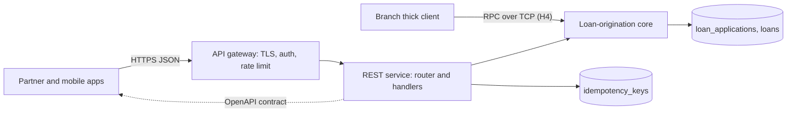
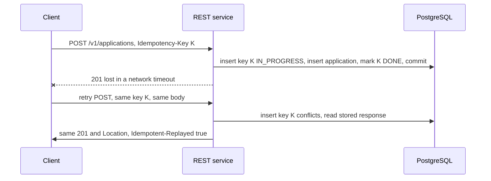

# Module 10.01: HTTP/REST API design

**Estimated hours:** 3

**What you will learn**

1. How to shape an API around resources and a few verbs, pick status codes that clients and tools can act on, and return every error in one standard shape (problem+json).
2. The design decisions interviewers probe: pagination (offset vs keyset, with the SQL and the query plans), filtering, versioning, idempotency keys for POSTs that create or move money, ETags and conditional requests, rate-limit headers, and OpenAPI as the contract.
3. How to add a small router to the HTTP server from module 5.08, serve the loan-origination endpoints from an in-memory map, test them with `curl`, and explain when REST would have replaced the RPC-over-TCP design of claim H4.

**Prerequisites:** [Module 9.10: Cross-platform builds and Git workflows](../phase-09-build-test-delivery/module-10-cross-platform-builds-and-git-workflows.md). You also need the HTTP server from [module 5.08](../phase-05-networking-and-servers/module-08-http.md), the RPC retry discussion from [module 5.07](../phase-05-networking-and-servers/module-07-rpc-and-serialization.md), transactions from module 6.04 and composite indexes from module 6.09.

---

## 1. One-line intuition

A REST API is a set of nouns with addresses (resources at URLs) and a handful of verbs (GET, POST, PUT, PATCH, DELETE) whose meaning every client, proxy, cache and load balancer already knows.

## 2. Real-life analogy

Think of the record room behind a bank branch.

- Every file has a fixed **address**: "branch MUM001, applications shelf, file 1001". That address is the **URL** (`/v1/branches/MUM001/applications`, `/v1/applications/1001`).
- You do not invent your own way of asking. The counter has a few **standard request slips**: "show me", "file this new one", "replace this", "amend this", "remove this". Those are the **HTTP verbs**. Because the slips are standard, any clerk (any server instance) can serve you.
- The clerk stamps every slip with a **standard reply**: "done, filed as 1001" (`201 Created` plus the address), "no such file" (`404`), "your form is filled in wrongly" (`422`), "counter is overloaded, come back in 30 seconds" (`429` with `Retry-After`).
- For deposits you get a **token number** before you hand over cash. If the clerk's receipt is lost and you come back with the same token, the clerk looks it up and hands you the same receipt instead of crediting the money twice. That is an **idempotency key**.
- Each file carries a **version stamp**. An officer may write a decision only "if the file is still version 3". If someone changed it meanwhile, the clerk refuses (`412 Precondition Failed`). That is an **ETag** with `If-Match`.

## 3. Why it exists: the problem it solves

Before REST, every service invented its own verbs, error formats and transport: SOAP envelopes, CORBA, custom binary RPC like the one you built in 5.07. Each needed a bespoke client library. Proxies and load balancers could not tell a read from a write, so they could not cache, retry or route intelligently. A timeout on "create loan" left the caller guessing.

REST (Roy Fielding's 2000 dissertation) describes constraints that the web already followed: client-server, **stateless** requests, cacheable responses, a **uniform interface** (resources plus standard methods), and layered systems (gateways and proxies in between). HTTP's semantics, now written down in RFC 9110, give every method and status code a shared meaning.

What breaks when an API ignores that design:

- `200 OK` with `{"error": "..."}` in the body: load balancers, monitoring and retry logic see success. Failures become invisible.
- A client retries `POST /applications` after a timeout and the customer gets two loan applications, or worse, two disbursements.
- A branch worklist uses `OFFSET 19000` and the last pages take seconds while the first takes milliseconds.
- A field is renamed and every deployed branch client breaks on the same morning.

## 4. Three layers of depth

### Layer 1 (beginner): resources, verbs and status codes

**Words first.**

| Term | Meaning | Example |
|---|---|---|
| Resource | A thing the API exposes, named by a URL | one loan application |
| Collection | A resource that contains others | all applications of branch MUM001 |
| Representation | The bytes that describe the resource right now | a JSON object |
| Endpoint | One method on one URL pattern | `GET /v1/applications/{id}` |
| Path parameter | A variable segment of the path | `{id}` = `1001` |
| Query parameter | Options after `?` | `?limit=20&after=1002` |
| Status code | Three-digit result class | `201`, `404`, `422` |

**The loan-origination API.** Four endpoints cover the core flow:

| Method and path | Meaning | Success | Typical errors |
|---|---|---|---|
| `GET /v1/branches/{code}/applications` | the branch's worklist, paginated | `200` | `400` bad filter, `401`, `403` another branch |
| `POST /v1/applications` | create an application | `201` + `Location` | `400` malformed, `415`, `422` invalid |
| `GET /v1/applications/{id}` | read one application | `200`, or `304` if unchanged | `404` |
| `POST /v1/applications/{id}/decisions` | record approve or reject | `201` | `403`, `409` wrong state, `412` stale version |

Two design choices are worth saying out loud. URLs are **nouns**, never verbs: there is no `/approveApplication`. And a decision is its own **sub-resource**, not a `PATCH` of a status field, because a decision has its own data (who decided, when, the reason, the sanctioned amount) and must be kept forever for audit. The application's status changes as a consequence of creating a decision.

**Verb semantics.** Two properties matter. A method is **safe** if it does not change server state. A method is **idempotent** if sending it twice has the same effect on the server as sending it once.

| Method | Safe | Idempotent | Typical use |
|---|---|---|---|
| `GET`, `HEAD` | yes | yes | read; may be cached and retried freely |
| `PUT` | no | yes | replace the whole resource at a known URL |
| `DELETE` | no | yes | remove; deleting twice leaves it deleted |
| `PATCH` | no | not guaranteed | change some fields ("add 1 to attempts" is not idempotent) |
| `POST` | no | no | create, or trigger a process; idempotent only with an idempotency key |

Idempotent means "same effect", not "same response": a second `DELETE` may return `404`, and that is fine.

**Status codes that matter.**

| Code | When to use it in this API |
|---|---|
| `200 OK` | a read succeeded |
| `201 Created` | a POST created something; add `Location: /v1/applications/1001` |
| `202 Accepted` | work was queued, not done (generate the sanction letter PDF); return a URL to poll |
| `204 No Content` | success with nothing to say (logout) |
| `304 Not Modified` | conditional GET: the client's copy is current |
| `400 Bad Request` | cannot parse: broken JSON, missing required header |
| `401 Unauthorized` | not authenticated: no or bad credentials (module 10.02) |
| `403 Forbidden` | authenticated but not allowed: a clerk deciding, an officer of another branch |
| `404 Not Found` | no such resource (also used to hide resources the caller may not know exist) |
| `405 Method Not Allowed` | path exists, verb does not; must send an `Allow` header |
| `409 Conflict` | the request conflicts with current state: deciding an application already decided |
| `412 Precondition Failed` | `If-Match` did not match: someone changed it first |
| `415 Unsupported Media Type` | body is not `application/json` |
| `422 Unprocessable Content` | well-formed but invalid: negative amount, tenure above the product maximum |
| `428 Precondition Required` | the server insists on `If-Match` for this write |
| `429 Too Many Requests` | rate limited; add `Retry-After` (module 10.05) |
| `500`, `502`, `503`, `504` | server bug; bad upstream; overloaded or draining; upstream timeout |

The rule: **4xx means the client must change something; 5xx means the server failed and a retry may work.** Retry logic, alerting and SLOs (module 8.10) are built on that split.

**Statelessness.** Each request carries everything the server needs: credentials, ids, the version it expects. The server keeps no conversation in its memory between requests. That is what lets a load balancer send request 1 to instance A and request 2 to instance B (module 10.05). State that must survive lives in the database or a shared session store (module 10.02).

### Layer 2 (working engineer): the decisions that make or break an API

**Errors as problem+json.** RFC 9457 defines one error shape with media type `application/problem+json`. Every error from every endpoint looks the same, so a client writes one error handler.

```json
{
  "type": "/problems/validation-error",
  "title": "Unprocessable Content",
  "status": 422,
  "detail": "tenure_months 400 exceeds the product maximum of 360",
  "instance": "/v1/applications",
  "errors": [ { "field": "tenure_months", "reason": "max 360 for HL01" } ]
}
```

`type` is a stable identifier clients can switch on; `title` is a human summary; `detail` is specific to this occurrence; extra members such as `errors` are allowed. Never put stack traces, SQL text or another customer's data in `detail`.

**Pagination: offset versus keyset.** A branch worklist can hold tens of thousands of applications. Two ways to page through it:

```sql
-- Offset: "skip N rows, give me 20". Simple, supports "jump to page 951".
SELECT application_id, amount_paise, status
FROM loan_applications
WHERE branch_code = 'MUM001'
ORDER BY application_id
LIMIT 20 OFFSET 19000;

-- Keyset (seek): "give me 20 after the last one I saw". The client sends
-- the last application_id of the previous page as the cursor.
SELECT application_id, amount_paise, status
FROM loan_applications
WHERE branch_code = 'MUM001' AND application_id > 1900000
ORDER BY application_id
LIMIT 20;
```

Both want the composite index `(branch_code, application_id)` from module 6.09. With it, the keyset query descends the B-tree straight to `('MUM001', 1900000)` and reads 20 entries. The offset query cannot jump: the database must produce and throw away the first 19,000 rows of the branch every time. Measured on one WSL2 laptop with 2,000,000 applications spread across 100 branches (20,000 per branch), `EXPLAIN (ANALYZE, BUFFERS)` showed:

| Query | Plan | Buffers touched | Time on that laptop |
|---|---|---|---|
| `OFFSET 0` | Index Scan on the composite index | 23 | about 2 ms |
| `OFFSET 19000` | Bitmap Heap Scan of all 20,000 branch rows, then Sort | 20,079 | 2.5 s (data not cached) |
| keyset `> 1900000` | Index Scan, `Index Cond` on both columns | 26 | about 6 ms |

The times depend on your disk and cache; the buffer counts are the stable part, and they differ by a factor of about 800. Offset also has a correctness problem: if a new application arrives while a clerk is on page 3, every row shifts by one and page 4 repeats a row. Keyset pages are stable.

Keyset rules: the sort must end in a **unique** column (add `application_id` as a tie-breaker when sorting by `created_at`); multi-column cursors compare as a row, `WHERE (created_at, application_id) < ($1, $2) ORDER BY created_at DESC, application_id DESC`, with a matching index; and the cursor should be **opaque** to clients (for example base64 of the last key) so you can change it later. Keyset cannot "jump to page 951"; worklists rarely need that, and search screens can use filters instead. Return the next cursor in the body and in a `Link: <...>; rel="next"` header.

**Filtering and sorting.** `GET /v1/branches/MUM001/applications?status=SUBMITTED&product_code=HL01&sort=-created_at`. Whitelist the fields that may be filtered and sorted, because each one needs an index and each one is an input that must never be concatenated into SQL (module 11.03: parameterise). Reject unknown parameters with `400` rather than silently ignoring them, so a typo like `?stauts=` is caught.

**Versioning.** Some change will eventually break clients. The options:

| Where the version lives | Example | Trade-off |
|---|---|---|
| URL path | `/v1/applications` | visible in logs and easy to route at the gateway; the most common choice |
| Header or media type | `Accept: application/vnd.bank.loan.v2+json` | cleaner URLs; harder to test with a browser or `curl` |
| Query parameter | `?version=2` | easy, but caches and logs treat it as just another parameter |

What counts as **breaking**: removing or renaming a field, changing a type (`amount` from rupees to paise), adding a new required input, changing the meaning of a status. **Non-breaking**: adding an optional input or a new response field, provided clients ignore fields they do not know (the "tolerant reader" rule, the same rule as schema evolution in 5.07). When `/v1` must retire, announce it with the `Sunset` header (RFC 8594) and the `Deprecation` header (RFC 9745), give partners a date, and watch the access logs until traffic reaches zero.

**Idempotency keys for POSTs that create things or move money.** The client generates a random key (a UUID) once per logical operation and sends it on every retry as `Idempotency-Key: 6f1d2c3a-...`. The server remembers the key, a hash of the request, and the response it gave. This is the same idea as option 2 in 5.07, now in HTTP. The IETF draft for this header suggests `400` when a required key is missing, `422` when a key is reused with a different body, and `409` when the first request with that key is still in progress.

```sql
CREATE TABLE idempotency_keys (
  client_id      text        NOT NULL,          -- who sent it: user or API key
  idem_key       text        NOT NULL,          -- the client's UUID
  request_hash   bytea       NOT NULL,          -- sha256 of method + path + body
  status         text        NOT NULL,          -- IN_PROGRESS, DONE
  response_code  int,
  response_body  jsonb,
  created_at     timestamptz NOT NULL DEFAULT now(),
  PRIMARY KEY (client_id, idem_key)            -- scoped per client
);
```

The logic, when the business write is in the same database:

1. `BEGIN`.
2. `INSERT INTO idempotency_keys (...) VALUES (..., 'IN_PROGRESS') ON CONFLICT DO NOTHING RETURNING idem_key`.
3. If one row came back, this request owns the key: insert the application, then `UPDATE idempotency_keys SET status = 'DONE', response_code = 201, response_body = ...`, then `COMMIT`. The key and the business row commit together or not at all.
4. If zero rows came back, the key exists: `SELECT request_hash, status, response_code, response_body`. A different hash means `422`. `DONE` means return the stored response unchanged.

When the work calls an outside system (the payment switch for a disbursement), it cannot sit inside one database transaction. Then commit the `IN_PROGRESS` row first, call the switch passing the same key, and record `DONE` afterwards; a concurrent retry that finds `IN_PROGRESS` gets `409` and tries again later. Keep keys for a fixed retention period (24 hours is a common choice) and delete older ones in a nightly job.

**ETags and conditional requests.** An **ETag** is a response header naming the version of a representation, for example `ETag: "v3"`.

- Reads: the client sends `If-None-Match: "v3"`. If nothing changed, the server answers `304 Not Modified` with no body. The branch client saves bandwidth on slow links.
- Writes: the client sends `If-Match: "v3"` on `POST /v1/applications/1001/decisions`. If another officer decided first, the version is now `"v4"` and the server answers `412`. This is **optimistic concurrency control** and it prevents the lost-update problem from 6.04 across HTTP. If the client omitted `If-Match` and the server requires it, answer `428`.

**Rate-limit headers.** When a client exceeds its budget the answer is `429 Too Many Requests` with `Retry-After: <seconds>` (standard, RFC 9110). Many APIs also send `X-RateLimit-Limit` and `X-RateLimit-Remaining` so well-behaved clients slow down before they hit the wall. An IETF draft standardises `RateLimit` and `RateLimit-Policy` fields, but its syntax has changed between drafts, so check the current version before you rely on it. The algorithms are module 10.05.

**OpenAPI as the contract.** An OpenAPI document (YAML or JSON) describes every path, parameter, body schema and response. Write it first, review it like code, and generate documentation, client SDKs, request validation and mock servers from it. In CI, lint it and diff it against the last released version to catch breaking changes before a partner does. A fragment:

```yaml
openapi: 3.1.0
info: { title: Loan Origination API, version: 1.0.0 }
paths:
  /v1/applications:
    post:
      operationId: createApplication
      parameters:
        - { name: Idempotency-Key, in: header, required: true, schema: { type: string, format: uuid } }
      requestBody:
        required: true
        content:
          application/json:
            schema:
              type: object
              required: [branch_code, customer_id, product_code, amount_paise, tenure_months]
              properties:
                branch_code:   { type: string, maxLength: 6 }
                customer_id:   { type: integer, format: int64 }
                product_code:  { type: string, maxLength: 8 }
                amount_paise:  { type: integer, format: int64, minimum: 1 }
                tenure_months: { type: integer, minimum: 1, maximum: 360 }
      responses:
        "201": { description: Created, headers: { Location: { schema: { type: string } } } }
        "422": { description: Validation failed, content: { application/problem+json: {} } }
```

### Layer 3 (internals): what the server, the database and the proxies actually do

**One request, end to end.** The kernel delivers bytes on a TCP connection (5.02). The server reads until `\r\n\r\n`, splits the request line into method, target and version, lower-cases header names (HTTP header names are case-insensitive), and reads exactly `Content-Length` body bytes so the next request on the keep-alive connection starts at the right byte (5.08). The **router** splits the path into segments and compares them with each registered pattern; a `{name}` segment matches anything and captures it. If the path matched some route but not the method, the answer is `405` with `Allow`, not `404`. Our router is a linear scan, fine for ten routes. Production routers compile routes into a prefix tree (a radix tree) so matching costs time proportional to the path length, not to the number of routes.

**Why keyset is logarithmic and offset is linear.** A B-tree (6.09) can find the first entry `>= ('MUM001', 1900000)` in a few page reads: one per tree level. After that, `LIMIT 20` reads 20 neighbouring leaf entries and their heap rows. With `OFFSET 19000` there is no "position 19000" stored anywhere; positions depend on the filter. The executor must generate rows in order and discard them one by one. In the measured plan PostgreSQL chose a Bitmap Heap Scan: it collected all 20,000 matching row addresses from the index, visited 20,000 heap pages (`Heap Blocks: exact=20000`, because each branch's rows are spread across the table), sorted them, then skipped 19,000. Cost grows with the page number; at page 1,000 it reads every row the branch has ever had.

**How the database arbitrates idempotency keys.** Two retries of the same request can arrive at two app instances at the same moment. Both run the `INSERT ... ON CONFLICT DO NOTHING`. The primary key's unique index is the referee: the second insert finds an index entry written by a transaction that has not committed yet, and **waits** for that transaction to finish (PostgreSQL's "speculative insertion"). If the first commits, the second does nothing and returns zero rows; if the first rolls back, the second inserts and proceeds. Lab Part D shows the second session blocking for exactly as long as the first holds its transaction open. No application lock, no race.

**What proxies and caches do with your semantics.** A shared cache or CDN may store a `GET` response and serve it to others unless told otherwise. Customer data must carry `Cache-Control: no-store` (or at least `private`). Reverse proxies retry idempotent requests on another backend after a connection failure, but by default nginx does not resend a `POST` once it has been sent upstream, precisely because `POST` is not idempotent (module 10.05). The verb you choose changes what the infrastructure is allowed to do for you.

## 5. Architecture diagram





The first diagram is the shape of the platform: the existing branch client keeps its RPC channel, while new channels arrive over HTTPS through a gateway. The second is why the idempotency key exists: the client cannot tell "lost before" from "lost after", so the server makes the retry safe.

## 6. Code

Two files. `mini_http.hpp` grows the `http_health_server` from 5.08 into a reusable header: a `Request` with a header map and query parsing, a `Response` with headers, a `Router` with `{param}` segments and `404` versus `405`, and problem+json errors. `rest_server.cpp` serves three endpoints from an in-memory `std::map`. Modules 10.02 and 10.05 reuse the header.

```bash
mkdir -p ~/course/rest && cd ~/course/rest
```

**`mini_http.hpp`**

```cpp
// mini_http.hpp -- a tiny HTTP/1.1 server with a router.
// Grown from 5.08's http_health_server: same header parsing and keep-alive
// loop, plus Request/Response types, a route table with {param} segments,
// 404 vs 405, and RFC 9457 problem+json errors.
// Teaching code: one thread per connection, no TLS, no chunked request bodies.
#pragma once
#include <arpa/inet.h>
#include <netinet/in.h>
#include <sys/socket.h>
#include <unistd.h>

#include <cctype>
#include <cerrno>
#include <cstdint>
#include <cstdio>
#include <cstdlib>
#include <functional>
#include <map>
#include <string>
#include <thread>
#include <utility>
#include <vector>

namespace mini {

struct Request {
    std::string method, path, query, version, body;
    std::map<std::string, std::string> headers;   // names lower-cased
    std::map<std::string, std::string> params;    // filled from {name} route segments

    std::string header(const std::string& lower_name) const {
        auto it = headers.find(lower_name);
        return it == headers.end() ? "" : it->second;
    }
    // "?limit=2&after=1001" -> query_param("limit") == "2". No %-decoding (toy).
    std::string query_param(const std::string& name) const {
        size_t pos = 0;
        while (pos < query.size()) {
            size_t amp = query.find('&', pos);
            if (amp == std::string::npos) amp = query.size();
            std::string kv = query.substr(pos, amp - pos);
            size_t eq = kv.find('=');
            if (kv.substr(0, eq) == name) return eq == std::string::npos ? "" : kv.substr(eq + 1);
            pos = amp + 1;
        }
        return "";
    }
};

struct Response {
    int status = 200;
    std::vector<std::pair<std::string, std::string>> headers;
    std::string body;
    Response& set(const std::string& k, const std::string& v) { headers.emplace_back(k, v); return *this; }
};

inline Response json(int status, std::string body) {
    Response r;
    r.status = status;
    r.body = std::move(body);
    r.set("Content-Type", "application/json");
    return r;
}

// RFC 9457 "problem details": one error shape every client can parse.
inline Response problem(int status, const std::string& type, const std::string& title,
                        const std::string& detail) {
    Response r;
    r.status = status;
    r.body = "{\"type\":\"/problems/" + type + "\",\"title\":\"" + title + "\",\"status\":" +
             std::to_string(status) + ",\"detail\":\"" + detail + "\"}";
    r.set("Content-Type", "application/problem+json");
    return r;
}

using Handler = std::function<Response(const Request&)>;

class Router {
public:
    void add(const std::string& method, const std::string& pattern, Handler h) {
        routes_.push_back({method, split(pattern), std::move(h)});
    }
    Response dispatch(Request& req) const {
        std::vector<std::string> segs = split(req.path);
        std::string allow;                              // methods that exist for this path
        for (const Route& r : routes_) {
            std::map<std::string, std::string> params;
            if (!match(r.parts, segs, params)) continue;
            if (r.method == req.method) {
                req.params = std::move(params);
                return r.handler(req);
            }
            allow += (allow.empty() ? "" : ", ") + r.method;
        }
        if (!allow.empty())                             // path exists, verb does not
            return problem(405, "method-not-allowed", "Method Not Allowed", req.method + " is not supported here")
                .set("Allow", allow);
        return problem(404, "not-found", "Not Found", "no route for " + req.path);
    }

private:
    struct Route { std::string method; std::vector<std::string> parts; Handler handler; };

    static std::vector<std::string> split(const std::string& path) {
        std::vector<std::string> out;
        size_t i = 0;
        while (i < path.size()) {
            if (path[i] == '/') { ++i; continue; }
            size_t j = path.find('/', i);
            if (j == std::string::npos) j = path.size();
            out.push_back(path.substr(i, j - i));
            i = j;
        }
        return out;
    }
    static bool match(const std::vector<std::string>& pat, const std::vector<std::string>& segs,
                      std::map<std::string, std::string>& params) {
        if (pat.size() != segs.size()) return false;
        for (size_t i = 0; i < pat.size(); ++i) {
            const std::string& p = pat[i];
            if (p.size() > 2 && p.front() == '{' && p.back() == '}') params[p.substr(1, p.size() - 2)] = segs[i];
            else if (p != segs[i]) return false;
        }
        return true;
    }
    std::vector<Route> routes_;
};

inline const char* reason(int s) {
    switch (s) {
        case 200: return "OK";                    case 201: return "Created";
        case 204: return "No Content";            case 304: return "Not Modified";
        case 400: return "Bad Request";           case 401: return "Unauthorized";
        case 403: return "Forbidden";             case 404: return "Not Found";
        case 405: return "Method Not Allowed";    case 409: return "Conflict";
        case 412: return "Precondition Failed";   case 415: return "Unsupported Media Type";
        case 422: return "Unprocessable Content"; case 428: return "Precondition Required";
        case 429: return "Too Many Requests";     case 500: return "Internal Server Error";
        case 503: return "Service Unavailable";   default:  return "Unknown";
    }
}

inline bool send_all(int fd, const std::string& s) {
    size_t done = 0;
    while (done < s.size()) {
        ssize_t n = ::send(fd, s.data() + done, s.size() - done, MSG_NOSIGNAL);
        if (n < 0) { if (errno == EINTR) continue; return false; }
        done += static_cast<size_t>(n);
    }
    return true;
}

inline std::string serialize(const Response& r, bool close) {
    std::string out = "HTTP/1.1 " + std::to_string(r.status) + " " + reason(r.status) + "\r\n";
    for (const auto& h : r.headers) out += h.first + ": " + h.second + "\r\n";
    bool no_body = r.status == 204 || r.status == 304;          // these never carry a body
    if (!no_body) out += "Content-Length: " + std::to_string(r.body.size()) + "\r\n";
    out += close ? "Connection: close\r\n" : "Connection: keep-alive\r\n";
    out += "\r\n";
    if (!no_body) out += r.body;
    return out;
}

inline void serve_connection(int fd, const Router& router) {
    std::string buf;
    char tmp[4096];
    for (;;) {
        size_t hdr_end;
        while ((hdr_end = buf.find("\r\n\r\n")) == std::string::npos) {
            if (buf.size() > 16384) { ::close(fd); return; }
            ssize_t n = ::recv(fd, tmp, sizeof tmp, 0);
            if (n <= 0) { ::close(fd); return; }
            buf.append(tmp, static_cast<size_t>(n));
        }
        std::string head = buf.substr(0, hdr_end + 2);           // keep the last CRLF
        buf.erase(0, hdr_end + 4);

        Request req;
        size_t eol = head.find("\r\n");
        std::string line = head.substr(0, eol);
        size_t sp1 = line.find(' '), sp2 = line.rfind(' ');
        if (sp1 == std::string::npos || sp2 == sp1) { ::close(fd); return; }
        req.method = line.substr(0, sp1);
        std::string target = line.substr(sp1 + 1, sp2 - sp1 - 1);
        req.version = line.substr(sp2 + 1);
        size_t qm = target.find('?');
        req.path = target.substr(0, qm);
        if (qm != std::string::npos) req.query = target.substr(qm + 1);

        for (size_t pos = eol + 2; pos < head.size();) {         // "Name: value\r\n" lines
            size_t e = head.find("\r\n", pos);
            std::string h = head.substr(pos, e - pos);
            pos = e + 2;
            size_t colon = h.find(':');
            if (colon == std::string::npos) continue;
            std::string name = h.substr(0, colon), value = h.substr(colon + 1);
            for (char& c : name) c = static_cast<char>(std::tolower(static_cast<unsigned char>(c)));
            size_t b = value.find_first_not_of(" \t"), z = value.find_last_not_of(" \t");
            req.headers[name] = b == std::string::npos ? "" : value.substr(b, z - b + 1);
        }

        size_t body_len = std::strtoul(req.header("content-length").c_str(), nullptr, 10);
        if (body_len > 1 << 20) { ::close(fd); return; }         // 1 MB cap
        while (buf.size() < body_len) {
            ssize_t n = ::recv(fd, tmp, sizeof tmp, 0);
            if (n <= 0) { ::close(fd); return; }
            buf.append(tmp, static_cast<size_t>(n));
        }
        req.body = buf.substr(0, body_len);
        buf.erase(0, body_len);

        bool close = req.version == "HTTP/1.0" || req.header("connection") == "close";
        Response resp = router.dispatch(req);
        std::printf("%s %s%s%s -> %d\n", req.method.c_str(), req.path.c_str(),
                    req.query.empty() ? "" : "?", req.query.c_str(), resp.status);
        std::fflush(stdout);
        if (!send_all(fd, serialize(resp, close)) || close) { ::close(fd); return; }
    }
}

inline int run(uint16_t port, const Router& router) {
    int lfd = ::socket(AF_INET, SOCK_STREAM, 0);
    int yes = 1;
    ::setsockopt(lfd, SOL_SOCKET, SO_REUSEADDR, &yes, sizeof yes);
    sockaddr_in a{};
    a.sin_family = AF_INET;
    a.sin_addr.s_addr = htonl(INADDR_ANY);
    a.sin_port = htons(port);
    if (::bind(lfd, reinterpret_cast<sockaddr*>(&a), sizeof a) < 0 || ::listen(lfd, 128) < 0) {
        std::perror("bind/listen");
        return 1;
    }
    std::printf("listening on http://127.0.0.1:%u\n", static_cast<unsigned>(port));
    std::fflush(stdout);
    for (;;) {
        int c = ::accept(lfd, nullptr, nullptr);
        if (c < 0) { if (errno == EINTR) continue; std::perror("accept"); return 1; }
        std::thread(serve_connection, c, std::cref(router)).detach();   // thread per connection (5.05)
    }
}

}  // namespace mini
```

**`rest_server.cpp`**

```cpp
// rest_server.cpp -- the loan-origination REST API over an in-memory map.
//   POST /v1/applications                  create; Idempotency-Key required
//   GET  /v1/applications/{id}              read one; ETag + If-None-Match -> 304
//   GET  /v1/branches/{code}/applications   list; keyset pagination ?limit=&after=
// Build: g++ -std=c++17 -O2 -Wall -Wextra -Werror -g -pthread -o rest_server rest_server.cpp
#include "mini_http.hpp"

#include <functional>
#include <map>
#include <mutex>
#include <optional>
#include <string>

struct Application {
    long long id = 0;
    std::string branch_code;
    long long customer_id = 0;
    std::string product_code;
    long long amount_paise = 0;
    int tenure_months = 0;
    std::string status = "SUBMITTED";
    int version = 1;                       // bumps on every change; drives the ETag
};

static std::string to_json(const Application& a) {
    return "{\"application_id\":" + std::to_string(a.id) + ",\"branch_code\":\"" + a.branch_code +
           "\",\"customer_id\":" + std::to_string(a.customer_id) + ",\"product_code\":\"" + a.product_code +
           "\",\"amount_paise\":" + std::to_string(a.amount_paise) + ",\"tenure_months\":" +
           std::to_string(a.tenure_months) + ",\"status\":\"" + a.status + "\"}";
}
static std::string etag(const Application& a) { return "\"v" + std::to_string(a.version) + "\""; }

// Toy JSON readers for flat objects: find "name": then a string or an integer.
// A real server uses a JSON library (nlohmann/json, simdjson, RapidJSON).
static std::optional<std::string> json_str(const std::string& b, const std::string& name) {
    size_t k = b.find("\"" + name + "\"");
    if (k == std::string::npos) return std::nullopt;
    size_t q1 = b.find('"', b.find(':', k) + 1), q2 = b.find('"', q1 + 1);
    if (q1 == std::string::npos || q2 == std::string::npos) return std::nullopt;
    return b.substr(q1 + 1, q2 - q1 - 1);
}
static std::optional<long long> json_int(const std::string& b, const std::string& name) {
    size_t k = b.find("\"" + name + "\"");
    if (k == std::string::npos) return std::nullopt;
    const char* p = b.c_str() + b.find(':', k) + 1;
    char* end = nullptr;
    long long v = std::strtoll(p, &end, 10);
    if (end == p) return std::nullopt;
    return v;
}

struct Idem { size_t fingerprint; mini::Response response; };

class Store {
public:
    std::mutex mu;
    std::map<long long, Application> apps;     // ordered by id: keyset paging is a range scan
    std::map<std::string, Idem> idem;          // Idempotency-Key -> stored first response
    long long next_id = 1001;
};

int main(int argc, char** argv) {
    uint16_t port = argc > 1 ? static_cast<uint16_t>(std::atoi(argv[1])) : 8080;
    Store store;
    mini::Router router;

    router.add("POST", "/v1/applications", [&store](const mini::Request& rq) {
        if (rq.header("content-type").rfind("application/json", 0) != 0)
            return mini::problem(415, "unsupported-media-type", "Unsupported Media Type", "send application/json");
        std::string key = rq.header("idempotency-key");
        if (key.empty())
            return mini::problem(400, "idempotency-key-missing", "Bad Request", "Idempotency-Key header is required");
        size_t fp = std::hash<std::string>{}(rq.body);       // production: SHA-256 of the canonical body

        std::lock_guard<std::mutex> lk(store.mu);             // one lock: check, create, remember
        if (auto it = store.idem.find(key); it != store.idem.end()) {
            if (it->second.fingerprint != fp)
                return mini::problem(422, "idempotency-key-reused", "Unprocessable Content",
                                     "this key was used with a different body");
            mini::Response replay = it->second.response;      // same answer as the first time
            return replay.set("Idempotent-Replayed", "true");
        }
        Application a;
        auto br = json_str(rq.body, "branch_code"), pr = json_str(rq.body, "product_code");
        auto cu = json_int(rq.body, "customer_id"), am = json_int(rq.body, "amount_paise");
        auto te = json_int(rq.body, "tenure_months");
        if (!br || !pr || !cu || !am || !te)
            return mini::problem(400, "malformed-body", "Bad Request", "missing or malformed field");
        if (*am <= 0 || *te < 1 || *te > 360 || br->empty() || br->size() > 6)
            return mini::problem(422, "validation-error", "Unprocessable Content",
                                 "amount_paise must be > 0 and tenure_months 1..360");
        a.id = store.next_id++;
        a.branch_code = *br; a.product_code = *pr; a.customer_id = *cu;
        a.amount_paise = *am; a.tenure_months = static_cast<int>(*te);
        store.apps[a.id] = a;

        mini::Response r = mini::json(201, to_json(a));
        r.set("Location", "/v1/applications/" + std::to_string(a.id)).set("ETag", etag(a));
        store.idem[key] = Idem{fp, r};
        return r;
    });

    router.add("GET", "/v1/applications/{id}", [&store](const mini::Request& rq) {
        long long id = std::atoll(rq.params.at("id").c_str());
        std::lock_guard<std::mutex> lk(store.mu);
        auto it = store.apps.find(id);
        if (it == store.apps.end())
            return mini::problem(404, "not-found", "Not Found", "no application " + rq.params.at("id"));
        std::string tag = etag(it->second);
        if (rq.header("if-none-match") == tag) {               // client copy is current
            mini::Response nm; nm.status = 304; nm.set("ETag", tag);
            return nm;
        }
        return mini::json(200, to_json(it->second)).set("ETag", tag);
    });

    router.add("GET", "/v1/branches/{code}/applications", [&store](const mini::Request& rq) {
        long long limit = rq.query_param("limit").empty() ? 20 : std::atoll(rq.query_param("limit").c_str());
        if (limit < 1 || limit > 100)
            return mini::problem(400, "bad-limit", "Bad Request", "limit must be 1..100");
        long long after = std::atoll(rq.query_param("after").c_str());   // 0 when absent
        const std::string& code = rq.params.at("code");

        std::lock_guard<std::mutex> lk(store.mu);
        std::string items;
        long long last = 0, n = 0;
        bool more = false;
        // Keyset: "WHERE branch_code = $1 AND application_id > $after ORDER BY application_id LIMIT $n"
        for (auto it = store.apps.upper_bound(after); it != store.apps.end(); ++it) {
            if (it->second.branch_code != code) continue;
            if (n == limit) { more = true; break; }
            items += (n ? "," : "") + to_json(it->second);
            last = it->first;
            ++n;
        }
        std::string next = more ? std::to_string(last) : "null";
        mini::Response r = mini::json(200, "{\"items\":[" + items + "],\"next_after\":" + next + "}");
        if (more)
            r.set("Link", "</v1/branches/" + code + "/applications?limit=" + std::to_string(limit) +
                              "&after=" + next + ">; rel=\"next\"");
        return r;
    });

    return mini::run(port, router);
}
```

**Build and run** (terminal 1):

```bash
g++ -std=c++17 -O2 -Wall -Wextra -Werror -g -pthread -o rest_server rest_server.cpp
./rest_server 8080
```

**Talk to it** (terminal 2). Create an application, then retry the identical request with the same key:

```bash
B=http://127.0.0.1:8080
BODY='{"branch_code":"MUM001","customer_id":501,"product_code":"HL01","amount_paise":250000000,"tenure_months":240}'
curl -s -i -X POST $B/v1/applications -H 'Content-Type: application/json' -H 'Idempotency-Key: 6f1d2c3a-0001' -d "$BODY"; echo
curl -s -i -X POST $B/v1/applications -H 'Content-Type: application/json' -H 'Idempotency-Key: 6f1d2c3a-0001' -d "$BODY"; echo
```

Expected output (exact; nothing here depends on the machine):

```text
HTTP/1.1 201 Created
Content-Type: application/json
Location: /v1/applications/1001
ETag: "v1"
Content-Length: 152
Connection: keep-alive

{"application_id":1001,"branch_code":"MUM001","customer_id":501,"product_code":"HL01","amount_paise":250000000,"tenure_months":240,"status":"SUBMITTED"}
HTTP/1.1 201 Created
Content-Type: application/json
Location: /v1/applications/1001
ETag: "v1"
Idempotent-Replayed: true
Content-Length: 152
Connection: keep-alive

{"application_id":1001,"branch_code":"MUM001","customer_id":501,"product_code":"HL01","amount_paise":250000000,"tenure_months":240,"status":"SUBMITTED"}
```

The retry got the same `201`, the same id and one extra header; no second application exists. Now the error paths and conditional reads:

```bash
curl -s -i -X POST $B/v1/applications -H 'Content-Type: application/json' -H 'Idempotency-Key: 6f1d2c3a-0001' \
     -d '{"branch_code":"MUM001","customer_id":501,"product_code":"HL01","amount_paise":990000000,"tenure_months":240}'; echo
curl -s -i $B/v1/applications/1001 -H 'If-None-Match: "v1"'
curl -s -i -X DELETE $B/v1/applications/1001; echo
curl -s $B/v1/applications/9999; echo
```

Expected (headers trimmed to the interesting ones):

```text
HTTP/1.1 422 Unprocessable Content
Content-Type: application/problem+json
...
{"type":"/problems/idempotency-key-reused","title":"Unprocessable Content","status":422,"detail":"this key was used with a different body"}
HTTP/1.1 304 Not Modified
ETag: "v1"
Connection: keep-alive

HTTP/1.1 405 Method Not Allowed
Content-Type: application/problem+json
Allow: GET
...
{"type":"/problems/method-not-allowed","title":"Method Not Allowed","status":405,"detail":"DELETE is not supported here"}
{"type":"/problems/not-found","title":"Not Found","status":404,"detail":"no application 9999"}
```

Pagination: add three more MUM001 applications and one for PUN002, then page with `limit=2`:

```bash
for i in 2 3 4; do
  curl -s -o /dev/null -X POST $B/v1/applications -H 'Content-Type: application/json' -H "Idempotency-Key: k-$i" \
       -d "{\"branch_code\":\"MUM001\",\"customer_id\":50$i,\"product_code\":\"PL01\",\"amount_paise\":${i}0000000,\"tenure_months\":36}"
done
curl -s -o /dev/null -X POST $B/v1/applications -H 'Content-Type: application/json' -H 'Idempotency-Key: k-5' \
     -d '{"branch_code":"PUN002","customer_id":777,"product_code":"PL01","amount_paise":1000000,"tenure_months":12}'
curl -s -D - "$B/v1/branches/MUM001/applications?limit=2" | grep -E '^Link|next_after' | cut -c1-90
curl -s "$B/v1/branches/MUM001/applications?limit=2&after=1002" | grep -o '"application_id":[0-9]*\|"next_after":[a-z0-9]*'
```

Expected:

```text
Link: </v1/branches/MUM001/applications?limit=2&after=1002>; rel="next"
{"items":[{"application_id":1001,"branch_code":"MUM001","customer_id":501,"product_code":
"application_id":1003
"application_id":1004
"next_after":null
```

Page 1 returned 1001 and 1002 and a `next` link; page 2 returned 1003 and 1004 and `null`, because 1005 belongs to PUN002. The server log in terminal 1 shows one line per request, for example `POST /v1/applications -> 201`, `GET /v1/applications/1001 -> 304`, `DELETE /v1/applications/1001 -> 405`.

## 7. Use case: core-banking loan-origination platform

The application server of claim H4 speaks RPC over TCP to the bank's own branch client. Module 5.08 explained why that was reasonable when it was designed: one client type, both ends owned by the same team, compact frames, pipelining by request id. The question an interviewer asks next is "when would you have used REST instead?"

| Concern | RPC over TCP (H4) | REST over HTTPS |
|---|---|---|
| Who calls it | one client the team controls | partners, mobile apps, other teams, auditors' tools |
| Contract | header file and opcode table shared by both sides | OpenAPI document; any language generates a client |
| Errors | custom status byte | standard status codes and problem+json; gateways and monitors understand them |
| Retries | the client must know which opcodes are safe | the method says it (`GET`, `PUT`, `DELETE` safe to retry; `POST` with a key) |
| Caching and proxies | none | ETags, `304`, gateways, rate limiters, WAFs work out of the box |
| Tooling | hex decoder, custom load generator | `curl`, browsers, every proxy log, every load tester |
| Cost per call | smallest frames, no text parsing | JSON parsing and larger headers; HTTP/2 removes most of the connection cost |

**The decision it drove:** when the bank opened loan origination to new channels (a direct-selling-agent portal and a mobile app), the team exposed a **versioned REST API (`/v1`) behind an API gateway**, with three non-negotiable rules: **every `POST` that creates an application or moves money requires an `Idempotency-Key`**; **every list endpoint uses keyset pagination on an indexed key**; **every write that changes an application requires `If-Match`**. The branch thick client stayed on RPC, because rewriting a working, latency-sensitive internal channel bought nothing. Both front doors call the same core and the same PL/pgSQL validation layer (claim H6), so the business rules exist once.

The cost, written down: two protocols to operate, and an idempotency table that grows by one row per create and must be purged on a schedule.

## 8. Lab

### Part A: the curl session (20 minutes)

1. Build and run `rest_server` as in section 6. Run every `curl` command and compare with the expected output.
2. Send `curl -s -o /dev/null -w '%{http_code}\n' -X POST $B/v1/applications -H 'Content-Type: application/json' -d '{}'`. Expected: `400` (no key). Add a key and send `-d 'x'` with `Content-Type: text/plain`. Expected: `415`.
3. Send a valid body with `"amount_paise":-5`. Expected: `422` with `"type":"/problems/validation-error"`. In your journal write one line per code (`400`, `415`, `422`) explaining why it is that code and not another.

### Part B: decisions with optimistic concurrency (45 minutes)

Add `POST /v1/applications/{id}/decisions` with body `{"decision":"APPROVED"}` or `{"decision":"REJECTED"}`. Rules:

- No `If-Match` header: `428`.
- `If-Match` different from the current ETag: `412`.
- Application not in `SUBMITTED`: `409`.
- Otherwise set `status`, bump `version`, answer `201` with the new `ETag`.

Expected session:

```text
POST .../1001/decisions  (no If-Match)          -> 428
POST .../1001/decisions  If-Match: "v1"  APPROVED -> 201, ETag: "v2"
POST .../1001/decisions  If-Match: "v1"  REJECTED -> 412   (someone decided first)
POST .../1001/decisions  If-Match: "v2"  REJECTED -> 409   (already APPROVED)
GET  .../1001  If-None-Match: "v1"                -> 200 with "status":"APPROVED"
```

<details>
<summary>Hint</summary>

Register the route with `router.add("POST", "/v1/applications/{id}/decisions", ...)`. Inside, lock `store.mu`, find the application, compare `rq.header("if-match")` with `etag(app)`, then check `app.status`. The order of the checks matters: `404`, then `428`, then `412`, then `409`. Why is `412` checked before `409`? Because a stale client must re-read before anything else it believes is meaningful.

</details>

### Part C: offset versus keyset in PostgreSQL (40 minutes)

1. Create a scratch database and load the canonical schema from module 6.03 (the `CREATE TABLE` block, saved as `schema.sql`):

```bash
export PGHOST=localhost PGUSER=postgres PGPASSWORD=postgres
psql -c "CREATE DATABASE lab10"
psql -d lab10 -f schema.sql
```

2. Seed 100 branches, two products, 9,999 customers and 2,000,000 applications. Foreign-key checks are switched off for the bulk load only (`session_replication_role = replica`, superuser only); expect a few minutes.

```sql
INSERT INTO branches VALUES ('MUM001','Mumbai Fort','Mumbai','WEST','2001-04-01');
INSERT INTO branches SELECT 'BR' || lpad(g::text, 4, '0'), 'Branch ' || g, 'City', 'WEST', '2010-01-01'
FROM generate_series(1, 99) g;
INSERT INTO products VALUES ('HL01','Home loan',50000000,1000000000,360,850,true),
                            ('PL01','Personal loan',5000000,250000000,60,1350,true);
INSERT INTO customers SELECT g, 'MUM001', 'Customer ' || g, 'ABCDE' || lpad(g::text, 4, '0') || 'F',
       date '1980-01-01' + g, 'VERIFIED' FROM generate_series(1, 9999) g;
SET session_replication_role = replica;
INSERT INTO loan_applications (application_id, branch_code, customer_id, product_code,
                               amount_paise, tenure_months, status, created_by)
SELECT g, CASE WHEN g % 100 = 0 THEN 'MUM001' ELSE 'BR' || lpad((g % 100)::text, 4, '0') END,
       1 + g % 9999, 'PL01', 1000000 + g, 36, 'SUBMITTED', 'U001'
FROM generate_series(1, 2000000) g;
RESET session_replication_role;
CREATE INDEX la_branch_id ON loan_applications (branch_code, application_id);
VACUUM ANALYZE loan_applications;
```

3. Run the two queries from Layer 2 under `EXPLAIN (ANALYZE, BUFFERS, COSTS OFF)`, each twice. Expected: `OFFSET 19000` shows a Bitmap Heap Scan with `Heap Blocks: exact=20000` and a Sort over about 19,020 rows, roughly 20,000 buffers; keyset shows an Index Scan on `la_branch_id` with `Index Cond` on both columns and a few dozen buffers. Your times will differ from the table in Layer 2; record the buffer counts and both times.
4. Try `OFFSET 100` and `OFFSET 10000`. Expected: buffers and time grow with the offset; keyset stays flat wherever the cursor is.

### Part D: two retries racing one idempotency key (20 minutes)

1. In `lab10`, create the `idempotency_keys` table from Layer 2.
2. Terminal 1: `BEGIN;` then the `INSERT ... ON CONFLICT DO NOTHING RETURNING idem_key` with key `'6f1d2c3a-0001'` and `sha256(convert_to('POST /v1/applications {...}', 'UTF8'))` as the hash. Do not commit yet. Expected: one row returned.
3. Terminal 2 (with `\timing on`): run the same insert. Expected: it **hangs**.
4. Terminal 1: `UPDATE idempotency_keys SET status = 'DONE', response_code = 201, response_body = '{"application_id":1001}' WHERE idem_key = '6f1d2c3a-0001'; COMMIT;`. Expected: terminal 2 returns immediately with `(0 rows)` and `INSERT 0 0`; its `Time:` equals how long you waited. A `SELECT` in terminal 2 now shows `DONE`, `201` and the stored body. In a scripted run where session 1 held its transaction for 3 seconds and session 2 started 1 second after it, session 2 reported `Time: 2000.113 ms`.
5. Repeat, but `ROLLBACK` in terminal 1. Expected: terminal 2 returns `1 row`: it now owns the key.

### Journal

Copy [journal/TEMPLATE.md](../journal/TEMPLATE.md) to `journal/YYYY-MM-DD-rest-api-design.md`. Record: the status code for each request in Parts A and B and one line of reasoning per code; the buffers and times for `OFFSET 0`, `100`, `10000`, `19000` and keyset from Part C; the wait time and the `RETURNING` result in both runs of Part D; and three sentences on when you would expose REST and when you would keep RPC, in your own words.

## 9. Common mistakes and misconceptions

| Mistake | Why it is wrong | Bug it causes |
|---|---|---|
| `200 OK` with an error in the body | status class drives retries, alerts and SLOs | failures invisible to monitoring; no retries where they would help |
| Verbs in URLs (`/approveLoan`) | the method already says what happens; resources become RPC with extra steps | no caching or retry semantics; endpoints multiply |
| Retrying `POST` without an idempotency key | "timed out" does not mean "did not happen" | duplicate applications or a double disbursement |
| Using the RPC request id as the idempotency key | request ids are per attempt and per connection | a retry on a new connection is not recognised |
| Offset pagination on large lists | the database reads and discards every skipped row | last pages time out; rows repeat or vanish as data changes |
| Keyset on a non-unique sort column | ties break the cursor | rows silently skipped between pages |
| Renaming a field "because it is clearer" | clients are not deployed when you are | a branch outage at 10 a.m. on release day |
| `401` versus `403` mixed up | `401` means "who are you", `403` means "I know, and no" | clients re-prompt for passwords when they lack a role |
| No `If-Match` on decisions | two officers overwrite each other | lost update: a rejection silently replaced by an approval |
| Caching customer data without `Cache-Control: no-store` | shared caches may store it | one customer's data served to another |

## 10. Resume link

- **Claim H4, "multithreaded application server ... over RPC-over-TCP".** The REST comparison is the follow-up you must own. Say: "Our branch client used a custom RPC because we controlled both ends and needed pipelining on one connection. For partner channels we would choose REST over HTTPS with OpenAPI, because gateways, rate limiters and monitoring understand HTTP semantics. In my lab I built a router on my own HTTP server with idempotency keys, ETags and keyset pagination, and tested every status path with curl."
- **Claim E, "HTTP, client-server architecture".** Status code classes, safe and idempotent methods, `304` and `412`.
- **Claim H7, "composite and covering indexes".** Keyset pagination is an index design decision: `(branch_code, application_id)` turned page 951 from a scan of every branch row into a 26-buffer index range read. Quote your Part C buffer counts.
- **Claim H6, "stored-procedure layer centralising validation".** One validation layer serves both front doors, so REST and RPC cannot drift apart.

Likely follow-ups: "How do you stop a double disbursement when the client retries?" (idempotency key, unique constraint as referee, stored response, `IN_PROGRESS` and `409` for external calls). "Why is your page 1,000 slow?" (offset; show the plan; switch to keyset).

## 11. Interview questions

**Q1 (easy). Which HTTP methods are idempotent, and what does idempotent mean?**

<details>
<summary>Model answer</summary>

Idempotent means that sending the same request several times has the same effect on the server as sending it once. `GET`, `HEAD`, `PUT`, `DELETE` and `OPTIONS` are idempotent by definition; `GET` and `HEAD` are also safe, meaning they change nothing. `POST` is neither, and `PATCH` is not guaranteed to be idempotent. The response may differ: a second `DELETE` can return `404` while the effect, "resource absent", is the same. This matters because clients, proxies and load balancers may retry idempotent requests automatically after a timeout, but must not blindly retry a `POST`.

</details>

**Q2 (easy). When do you return 400, 401, 403, 404, 409 and 422?**

<details>
<summary>Model answer</summary>

`400` when the request cannot be understood: malformed JSON or a missing required header. `401` when the caller is not authenticated. `403` when the caller is authenticated but not allowed, for example a clerk trying to approve or an officer acting on another branch's application. `404` when the resource does not exist, sometimes also to avoid revealing that it exists. `409` when the request conflicts with the resource's current state, such as deciding an application that is already approved. `422` when the request is well-formed but semantically invalid, such as a negative amount or a tenure above the product limit. All 4xx tell the client to change something; 5xx say the server failed.

</details>

**Q3 (medium). Why does offset pagination get slower on later pages, and how does keyset fix it?**

<details>
<summary>Model answer</summary>

With `LIMIT 20 OFFSET 19000` the database has no stored notion of "row 19,000 of this filter"; it must generate the first 19,020 matching rows in order and discard 19,000. Cost grows linearly with the offset. In my lab the plan was a Bitmap Heap Scan visiting all 20,000 heap pages of the branch plus a sort, about 20,000 buffers. Keyset pagination remembers the last key of the previous page and asks for `WHERE branch_code = $1 AND application_id > $2 ORDER BY application_id LIMIT 20`. With a composite index on `(branch_code, application_id)` that is a B-tree descent plus 20 leaf entries, 26 buffers in my run, regardless of depth. Keyset also gives stable pages when rows are inserted concurrently. The costs are no random page jumps and the need for a unique tie-breaker in the sort.

</details>

**Q4 (medium). Design idempotency for `POST /v1/disbursements`.**

<details>
<summary>Model answer</summary>

The client generates a UUID per logical disbursement and sends it as `Idempotency-Key` on every attempt. The server has a table keyed by `(client_id, idem_key)` holding a hash of the request, a status, and the stored response. On arrival it inserts the key as `IN_PROGRESS` with `ON CONFLICT DO NOTHING`. If it wins, it performs the work and records `DONE` with the response. If the key exists: different hash returns `422`; `DONE` returns the stored response; `IN_PROGRESS` returns `409` so the client retries later. Because a disbursement calls the payment switch, the `IN_PROGRESS` row is committed before the external call, the same key is passed to the switch so it can deduplicate too, and the outcome is recorded after. The unique index is the referee under concurrency: a second inserter waits for the first transaction and then sees the conflict. Keys are retained for a fixed window, then purged. The loan row and the outbox event for the SMS are in the same transaction as the `DONE` update (module 10.04).

</details>

**Q5 (hard). You must expose the loan-origination core, today reachable only by your RPC server, to a partner portal. Walk through the API design and the risks.**

<details>
<summary>Model answer</summary>

Contract first: an OpenAPI 3.1 document for `/v1` with resources for applications, decisions as a sub-resource, and branch worklists; reviewed with the partner and linted in CI with a breaking-change diff. Transport: HTTPS through an API gateway that terminates TLS, authenticates the partner (OAuth client credentials or mTLS, module 10.02), applies per-partner rate limits with `429` and `Retry-After`, and logs every call. Semantics: `POST` creates require `Idempotency-Key`; writes on an application require `If-Match` and return `412` on a stale version; lists use keyset cursors with a server-enforced maximum `limit`; all errors are problem+json with stable `type` values; customer data responses carry `Cache-Control: no-store`. Versioning in the path; additive changes only within `v1`; `Sunset` and `Deprecation` headers when `v2` arrives. Implementation: the REST handlers call the same PL/pgSQL validation and authorisation procedures as the RPC path so rules cannot diverge, and side effects such as SMS go through the outbox. Risks: duplicated business logic if anyone bypasses the shared layer; the idempotency table's growth and purge; partner clients that ignore `Retry-After`; latency added by the gateway hop, which I would measure with the load generator from 5.11 before committing to an SLO. The branch client stays on RPC, since it works and its pipelining matters on branch links.

</details>

## 12. Revision

- Resources are nouns at URLs; methods carry meaning (`GET` safe, `PUT` and `DELETE` idempotent, `POST` neither unless keyed); 4xx means the client must change something, 5xx means the server failed; errors are problem+json.
- Keyset pagination plus a composite index reads a page in a few buffers at any depth; offset reads and discards every skipped row; idempotency keys plus a unique constraint make `POST` retries safe; ETags give `304` for reads and `412` for stale writes.
- Version in the path, change additively, contract in OpenAPI; keep RPC where one owned client needs it and expose REST where many clients and standard infrastructure must understand the API.

---

Previous: [Module 9.10: Cross-platform builds and Git workflows](../phase-09-build-test-delivery/module-10-cross-platform-builds-and-git-workflows.md) | Next: [Module 10.02: Authentication and sessions](module-02-authentication-and-sessions.md)
