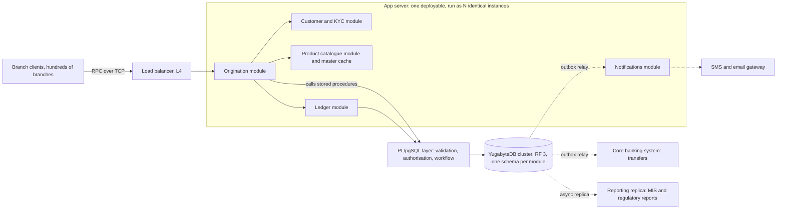
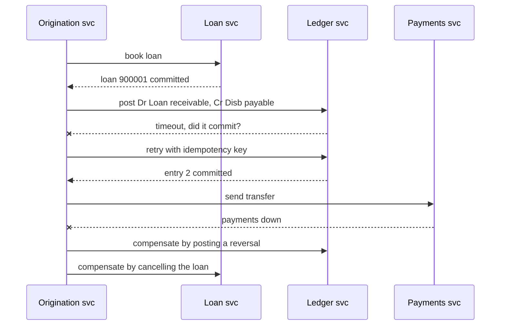

# Module 10.06: Monolith vs microservices

**Estimated hours:** 2

**What you will learn**

1. What a monolith and a microservice really are: a deployment unit plus a rule about who owns which data, not a coding style or a fashion.
2. The real, countable costs of splitting a system (network hops, lost transactions, observability, versioning, team size), and the signals that say "split" or "do not split".
3. How a lending platform divides into bounded contexts, why the platform behind claim H is one multithreaded app server, one stored-procedure layer and one distributed SQL database, and how to answer "would you have used microservices?" in an interview.

**Prerequisites:** [Module 10.05: Rate limiting and load balancing](module-05-rate-limiting-and-load-balancing.md). You also need RPC failure modes from module 5.07, transactions from module 6.04, PL/pgSQL from module 6.11, distributed transactions in YugabyteDB from module 7.08, and the outbox pattern from module 10.04.

---

## 1. One-line intuition

A monolith is one program you ship as one piece; microservices are many small programs that each own their own data and talk over the network; the right split follows the business and the teams, and every line you draw between two pieces of code turns a function call into a network call that can fail.

## 2. Real-life analogy

Think of a bank branch.

- **The monolith** is one branch building. The cashier, the loans desk, the KYC (know your customer) desk and the manager sit in one hall. When a loan is disbursed, the loans officer walks ten steps to the manager, gets a signature, and the cashier writes the debit and the credit in **one ledger book** in one sitting. Either both lines are in the book or neither is.
- **Microservices** are the same desks moved into separate buildings on different streets, each with its own book. They talk by courier. Each office can repaint its walls (deploy) without closing the others, and the busy cashier's office can hire more staff (scale) without hiring more KYC clerks. But now a disbursement needs three couriers. If one courier is lost, the loans office has written "loan given" in its book and the cash office has not. Somebody must notice and fix it. That somebody is called **reconciliation**, and in software it is code you have to write.
- **A modular monolith** is one building with **walls and counters** inside it. Each department owns its own cabinet. Other departments may not open that cabinet; they must ask at the counter. You still walk ten steps, you still have one ledger book, but nobody rummages in another team's drawers.

Most good systems start as the third picture. Some later grow into the second, one department at a time, for a reason they can name.

## 3. Why it exists: the problem it solves

Software teams grow. When 5 engineers become 100, one deployable program causes real pain:

1. **Every change ships everything.** A one-line fix to the SMS template waits for the whole release train, and a bad change in reporting can crash loan origination, because it is the same process.
2. **You scale everything to scale one thing.** If PDF generation needs 10 times more CPU at month end, you run 10 copies of the whole server.
3. **Teams collide.** Fifty people editing one code base and one schema step on each other: merge conflicts, long builds, one shared test suite that nobody fully understands.

Companies like Amazon and Netflix moved to many small services in the 2000s so that hundreds of teams could each deploy on their own schedule. That is the problem microservices solve: **organisational scale**, independent deployment, independent scaling, fault isolation.

What breaks if you split without that problem: you pay all the costs (section 4) and get none of the benefits. The classic failure is the **distributed monolith**: services that must be deployed together, share one database, and call each other synchronously ten times per request. It has the coupling of a monolith and the failure modes of a distributed system. Two public examples worth reading: Segment's 2018 post "Goodbye Microservices" (they merged more than a hundred small services back into one) and the Amazon Prime Video team's 2023 post describing how they moved one monitoring service from many distributed components into a single process and cut its infrastructure cost by about 90%.

What breaks without any boundaries at all: the **big ball of mud**. Every module reads every table, nobody can change a column safely, and the code base cannot be split later even when there is a good reason. The modular monolith exists to avoid both failures.

## 4. Three layers of depth

### Layer 1 (beginner): the words

| Term | Plain meaning |
|---|---|
| **Deployment unit** | The thing you build, ship, start and stop as one piece: one executable, one container image. |
| **Monolith** | All features in one deployment unit, usually with one database. "Monolith" says nothing about code quality; it can be beautifully organised. |
| **Microservice** | A small deployment unit that owns one business capability **and its data**. Other services may reach that data only through its API (RPC or HTTP) or its published events. |
| **Data ownership** | The rule that exactly one module or service writes a given table. If two services write the same table, they are not really separate. |
| **Bounded context** | A term from Eric Evans's book *Domain-Driven Design* (2003): a part of the business inside which every word has one meaning. "Customer" in KYC means a person with documents; "customer" in collections means a borrower with overdue EMIs. Each context gets its own model. |
| **Modular monolith** | One deployment unit with enforced internal boundaries: separate schemas or packages per module, calls only through module interfaces, no reaching into another module's tables. |
| **Saga** | A long business process split into local transactions, each with a **compensating action** that undoes it if a later step fails (Garcia-Molina and Salem, 1987). |
| **Strangler fig** | Martin Fowler's name (2004) for replacing an old system slice by slice: put a router in front, send one feature at a time to the new code, until the old code has nothing left to do. |

The three shapes side by side:

| | Monolith (unstructured) | Modular monolith | Microservices |
|---|---|---|---|
| Deployables | 1 | 1 | Many (one per service) |
| Databases | 1 | 1, one schema per module | One per service (the rule) |
| Call between features | Function call, about 5 ns | Function call through an interface | Network call, tens of µs to ms |
| Transaction across features | `BEGIN ... COMMIT` | `BEGIN ... COMMIT` | Saga, 2PC, or "eventually" |
| One bug crashes | Everything | Everything | That service (if callers handle it) |
| Scale one feature alone | No | No | Yes |
| Fits | A small team, early product | Most teams up to a few dozen engineers | Many teams, clearly separate domains |

### Layer 2 (working engineer): what splitting really costs, and when it pays

Every arrow you draw between two services has a price. Here is the bill, with numbers.

**1. Latency.** An in-process call is a `call` instruction: about 5 ns (you will measure it in section 6). The same call over TCP on the **same machine** measured about 27 µs at the median on one WSL2 laptop, roughly 4,000 to 5,000 times slower, and its p99 was about 10 times its median. Between two hosts in one data centre, add the network: a few hundred microseconds is typical. A request that crosses 10 service boundaries spends milliseconds just travelling.

**2. Availability multiplies.** If a request needs 5 services synchronously and each is up 99.9% of the time, the chain is up 0.999^5 = 99.5% of the time. That is roughly 216 minutes of failure per 30 days instead of 43. You fix it with timeouts, retries, circuit breakers and fallbacks (module 10.09), and each of those is code you write and test.

**3. You lose the transaction.** Inside one database, `BEGIN; book loan; post ledger entry; COMMIT;` is atomic. Across two services with two databases there is no shared `COMMIT`. Your choices are:

- **Two-phase commit (2PC)**: a coordinator asks every participant to prepare, then to commit. PostgreSQL supports it (`PREPARE TRANSACTION`), but it is off by default (`max_prepared_transactions = 0`), locks are held across the network round trips, and a dead coordinator leaves prepared transactions holding locks until someone resolves them by hand.
- **Saga**: each step commits locally; on failure you run compensations. Between steps the world is **inconsistent and visible**: a loan exists with no ledger entry for a few milliseconds, or for hours if a consumer is down.
- **Outbox plus at-least-once events** (module 10.04): commit the state change and the message in one local transaction; a relay publishes it; consumers must be idempotent.

**4. Observability.** In a monolith one stack trace or one core dump shows the whole failing request. Across services you need a **correlation id** on every log line, distributed tracing (OpenTelemetry is the common standard), and central logging (module 8.10). An incident that took one GDB session now takes a trace query and three teams.

**5. Versioning.** A function signature change in a monolith is caught by the compiler. A message format change between services must stay backward compatible, because you cannot deploy both sides at the same instant (module 5.07's schema-evolution rules). Every API becomes a contract.

**6. Database connections.** Each service instance keeps its own connection pool (module 6.12). 12 services × 4 instances × 20 connections = 960 connections, against PostgreSQL's default `max_connections` of 100. You end up adding a pooler such as pgbouncer just to survive your own architecture.

**7. Team size.** **Conway's law** (Melvin Conway, 1968): a system's structure copies the communication structure of the organisation that builds it. Services work best as **one service per team**, not one per developer. A team of six owning twelve services spends its time on pipelines, not features.

**Signals that a split will pay:**

- A part needs to **scale very differently** (a document-OCR worker at month end; a public rate-quote endpoint hit by internet traffic).
- A part needs **different release cadence or isolation for compliance**. Card data is the textbook case: isolating it in its own small service shrinks the PCI-DSS audit scope (module 11.05).
- A part needs a **different technology** (a Python credit-scoring model).
- A part **crashes or leaks** and you want it out of the process that holds the money logic (a third-party PDF library).
- **Several teams** are blocked on each other in one code base.

**Signals that it will not:**

- The team is small (under about 10 to 15 engineers).
- The parts share **transactional data**. A ledger is the strongest example: money must move atomically.
- The boundaries are unclear. You will draw them wrong; moving a boundary inside one process is a refactor, moving it between services is a migration.
- The calls are latency-critical chains.

**Sync RPC or async events?** Use a synchronous call when the caller **cannot continue without the answer** ("is this customer's KYC verified?"). Use an asynchronous event when the caller only needs to know **it will happen** ("send the disbursement SMS", "update the reporting copy"). Sync couples the two services in time: if KYC is down, origination is down. Async removes that coupling but adds delay and duplicates, so consumers must be idempotent (module 10.04).

**Saga versus one transaction, for a disbursement.** As microservices:

1. Loan service books the loan. Compensation: cancel the loan.
2. Ledger service posts Dr Loan receivable / Cr Disbursement payable. Compensation: post a reversal.
3. Payments service sends the transfer to the core banking system. Compensation: none possible once the money has left; you can only request a return.
4. Notification service sends an SMS. Compensation: none; send a correction.

Each arrow can fail after the step committed. You need a saga orchestrator with its own state table, retries, idempotent steps and a reconciliation job. In a modular monolith over one database, steps 1 and 2, plus the outbox row for step 3, are **one transaction** (module 10.10 builds exactly this); only the external transfer and the SMS are asynchronous, because they leave your system anyway.

### Layer 3 (internals): what really changes in the machine and the database

**An in-process call.** Arguments go in registers, the CPU executes `call`, the callee runs on the same thread with the same stack, and returns. Exceptions propagate. The database transaction, held in the connection the thread is using, simply continues. Cost: a few nanoseconds.

**A cross-service call.** The caller serialises the request (module 5.07), makes a `send` system call, the kernel copies bytes into the socket buffer and runs the TCP stack, the packet crosses the loopback device or the network card, the receiver's kernel wakes a thread in another process (a scheduler decision: microseconds, sometimes much more), that thread deserialises, does the work, and the whole path runs again in reverse. Each step is small; together they are tens of microseconds on one machine. The tail is worse than the median because the scheduler, page faults, and the other process's own queues add random delay. That is why the p99 in section 6 is about 10 times the p50.

**One database, many modules.** All modules write through one write-ahead log (module 6.06). One `COMMIT` writes one commit record; every table touched by the transaction becomes visible together. That atomicity is free.

**Database per service.** Each service's commit is local to its own WAL. Nothing in either database knows the other exists. Cross-service consistency is now an application protocol: 2PC (`PREPARE TRANSACTION` persists the prepared state so it survives a crash, then `COMMIT PREPARED`), or a saga's state machine.

**One distributed SQL database.** YugabyteDB spreads tables over tablets on several nodes and replicates each tablet with Raft (modules 7.05 and 7.07). A transaction that touches a loan row on node 1 and a ledger row on node 3 is already a distributed transaction, but **the database runs the protocol for you**: provisional records, a transaction status tablet, a single commit point (module 7.08). You get horizontal scale and fault tolerance **and** multi-table ACID transactions, without writing a saga. This is the architectural reason the lending platform in claim H could stay one logical database while running on a multi-node cluster.

## 5. Architecture diagram

The lending platform as a modular monolith. Solid arrows are synchronous calls inside one transaction; dotted arrows are asynchronous.



Read it as: one deployable (scaled out as identical copies behind the load balancer), internal modules with walls, one transactional database, and only the things that leave the bank's core (transfers, messages, reports) are asynchronous.

The same disbursement as a microservices saga, for contrast. Every dashed return is a place where the books can disagree:



## 6. Code

Two experiments: the cost of one service boundary, and boundaries enforced inside one database.

### `hop_cost.cpp`: one function call versus one loopback RPC

```cpp
// hop_cost.cpp -- what one service boundary costs: the same eligibility check
// called in-process versus over a loopback TCP connection (the cheapest
// possible "microservice": same machine, no TLS, no JSON, no load balancer).
#include <arpa/inet.h>
#include <netinet/in.h>
#include <netinet/tcp.h>
#include <sys/socket.h>
#include <unistd.h>
#include <algorithm>
#include <chrono>
#include <cmath>
#include <cstdint>
#include <cstdio>
#include <cstring>
#include <stdexcept>
#include <thread>
#include <vector>

using Clock = std::chrono::steady_clock;

// The "business rule": amount between 50,000 and 50,00,000 rupees, tenure 12-360 months.
static bool eligible(std::int64_t amount_paise, std::int32_t tenure_months) {
    return amount_paise >= 5'000'000 && amount_paise <= 500'000'000 &&
           tenure_months >= 12 && tenure_months <= 360;
}

static void read_all(int fd, void* buf, std::size_t n) {
    auto* p = static_cast<char*>(buf);
    while (n > 0) {
        ssize_t r = ::read(fd, p, n);
        if (r <= 0) throw std::runtime_error("read failed or peer closed");
        p += r; n -= static_cast<std::size_t>(r);
    }
}
static void write_all(int fd, const void* buf, std::size_t n) {
    auto* p = static_cast<const char*>(buf);
    while (n > 0) {
        ssize_t w = ::write(fd, p, n);
        if (w <= 0) throw std::runtime_error("write failed");
        p += w; n -= static_cast<std::size_t>(w);
    }
}

// Server: 12-byte request (int64 amount, int32 tenure), 1-byte reply.
static void serve(int listen_fd) {
    int c = ::accept(listen_fd, nullptr, nullptr);
    int one = 1;
    ::setsockopt(c, IPPROTO_TCP, TCP_NODELAY, &one, sizeof one);
    unsigned char req[12];
    try {
        for (;;) {
            read_all(c, req, sizeof req);
            std::int64_t amount; std::int32_t tenure;
            std::memcpy(&amount, req, 8); std::memcpy(&tenure, req + 8, 4);
            unsigned char ok = eligible(amount, tenure) ? 1 : 0;
            write_all(c, &ok, 1);
        }
    } catch (const std::exception&) { /* client closed: done */ }
    ::close(c);
}

static double pct(std::vector<double> v, double p) {
    std::sort(v.begin(), v.end());
    return v[static_cast<std::size_t>(p * (v.size() - 1))];
}

int main() {
    // 1. In-process: a function call.
    const int kLocal = 10'000'000;
    volatile std::int64_t sink = 0;
    auto t0 = Clock::now();
    for (int i = 0; i < kLocal; ++i) sink = sink + eligible(5'000'000 + i, 12 + (i % 300));
    double local_ns = std::chrono::duration<double, std::nano>(Clock::now() - t0).count() / kLocal;

    // 2. Over TCP on 127.0.0.1: a round trip per call.
    int lfd = ::socket(AF_INET, SOCK_STREAM, 0);
    sockaddr_in addr{};
    addr.sin_family = AF_INET;
    addr.sin_addr.s_addr = htonl(INADDR_LOOPBACK);
    addr.sin_port = 0;                                   // let the kernel pick a port
    if (::bind(lfd, reinterpret_cast<sockaddr*>(&addr), sizeof addr) != 0 || ::listen(lfd, 1) != 0)
        return 1;
    socklen_t len = sizeof addr;
    ::getsockname(lfd, reinterpret_cast<sockaddr*>(&addr), &len);
    std::thread server(serve, lfd);

    int cfd = ::socket(AF_INET, SOCK_STREAM, 0);
    if (::connect(cfd, reinterpret_cast<sockaddr*>(&addr), sizeof addr) != 0) return 1;
    int one = 1;
    ::setsockopt(cfd, IPPROTO_TCP, TCP_NODELAY, &one, sizeof one);

    const int kRemote = 20'000;
    std::vector<double> us;
    us.reserve(kRemote);
    for (int i = 0; i < kRemote; ++i) {
        unsigned char req[12];
        std::int64_t amount = 5'000'000 + i; std::int32_t tenure = 12 + (i % 300);
        std::memcpy(req, &amount, 8); std::memcpy(req + 8, &tenure, 4);
        auto s = Clock::now();
        write_all(cfd, req, sizeof req);
        unsigned char ok;
        read_all(cfd, &ok, 1);
        us.push_back(std::chrono::duration<double, std::micro>(Clock::now() - s).count());
    }
    ::close(cfd);
    server.join();
    ::close(lfd);

    double p50 = pct(us, 0.50), p99 = pct(us, 0.99);
    std::printf("in-process call      : %8.1f ns per call\n", local_ns);
    std::printf("loopback TCP call    : p50 %6.1f us   p99 %6.1f us\n", p50, p99);
    std::printf("ratio (p50 / local)  : about %.0fx\n", p50 * 1000.0 / local_ns);

    // 3. Availability multiplies along a synchronous call chain.
    std::printf("\nservices in chain, each 99.9%% available -> chain availability\n");
    for (int n : {1, 3, 5, 10}) {
        double a = std::pow(0.999, n);
        std::printf("  %2d -> %.4f%%  (about %.0f minutes down per 30 days)\n",
                    n, a * 100.0, (1.0 - a) * 30 * 24 * 60);
    }
    return 0;
}
```

Compile and run in WSL:

```bash
g++ -std=c++17 -O2 -Wall -Wextra -Werror -g -pthread hop_cost.cpp -o hop_cost
./hop_cost
```

Output on one WSL2 laptop (the first three lines vary by machine and by run; the availability table is pure arithmetic and must match exactly):

```text
in-process call      :      5.3 ns per call
loopback TCP call    : p50   27.6 us   p99  281.1 us
ratio (p50 / local)  : about 5185x

services in chain, each 99.9% available -> chain availability
   1 -> 99.9000%  (about 43 minutes down per 30 days)
   3 -> 99.7003%  (about 129 minutes down per 30 days)
   5 -> 99.5010%  (about 216 minutes down per 30 days)
  10 -> 99.0045%  (about 430 minutes down per 30 days)
```

This is the **best case** for a microservice: no TLS, no JSON, no service mesh, no second host. Real cross-host calls are slower still.

### `modules.sql`: walls inside one database

A modular monolith enforces boundaries with the tools the database already has: one schema per module, one role per module, and `SECURITY DEFINER` functions as the module's public door.

```sql
-- modules.sql -- one database, one schema per module, enforced boundaries.
DROP SCHEMA IF EXISTS origination CASCADE;
DROP SCHEMA IF EXISTS ledger CASCADE;
DROP ROLE IF EXISTS origination_app;
DROP ROLE IF EXISTS ledger_owner;

CREATE ROLE ledger_owner NOLOGIN;             -- owns the ledger's tables
CREATE ROLE origination_app NOLOGIN;          -- what the origination module runs as

CREATE SCHEMA origination;
CREATE SCHEMA ledger AUTHORIZATION ledger_owner;

CREATE TABLE origination.applications (
  application_id bigint PRIMARY KEY,
  amount_paise   bigint NOT NULL,
  status         text   NOT NULL
);
GRANT USAGE ON SCHEMA origination TO origination_app;
GRANT SELECT, INSERT, UPDATE ON origination.applications TO origination_app;

CREATE TABLE ledger.entries (
  entry_id     bigserial PRIMARY KEY,
  amount_paise bigint NOT NULL,
  memo         text   NOT NULL
);
ALTER TABLE ledger.entries OWNER TO ledger_owner;

-- The ledger module's public interface: one function. SECURITY DEFINER means it
-- runs with the owner's rights, so callers need EXECUTE, not table access.
CREATE FUNCTION ledger.post(p_amount bigint, p_memo text) RETURNS bigint
LANGUAGE sql SECURITY DEFINER SET search_path = ledger, pg_temp AS $$
  INSERT INTO ledger.entries (amount_paise, memo) VALUES (p_amount, p_memo) RETURNING entry_id;
$$;
ALTER FUNCTION ledger.post(bigint, text) OWNER TO ledger_owner;
REVOKE ALL ON FUNCTION ledger.post(bigint, text) FROM PUBLIC;
GRANT USAGE ON SCHEMA ledger TO origination_app;
GRANT EXECUTE ON FUNCTION ledger.post(bigint, text) TO origination_app;
```

```sql
-- boundary_demo.sql -- act as the origination module and test the walls.
SET ROLE origination_app;

-- 1. Reaching into another module's table: refused.
INSERT INTO ledger.entries (amount_paise, memo) VALUES (100, 'sneaky');

-- 2. Going through the module's interface: allowed.
INSERT INTO origination.applications VALUES (5001, 50000000, 'APPROVED');
SELECT ledger.post(50000000, 'disburse application 5001') AS entry_id;

-- 3. One transaction across both modules: all or nothing.
BEGIN;
UPDATE origination.applications SET status = 'DISBURSED' WHERE application_id = 5001;
SELECT ledger.post(50000000, 'second try') AS entry_id;
ROLLBACK;

RESET ROLE;
SELECT a.status, (SELECT count(*) FROM ledger.entries) AS ledger_rows
  FROM origination.applications a;
```

Run against the `pg16` container in a scratch database (roles are cluster-wide, so use a lab cluster, not a shared one):

```bash
psql -h localhost -U postgres -c "CREATE DATABASE modlab"
psql -h localhost -U postgres -d modlab -f modules.sql
psql -h localhost -U postgres -d modlab -f boundary_demo.sql
```

Expected output of the demo (verified on PostgreSQL 16; the `NOTICE` lines from the first run's `DROP ... IF EXISTS` are harmless):

```text
SET
psql:boundary_demo.sql:5: ERROR:  permission denied for table entries
INSERT 0 1
 entry_id
----------
        1
(1 row)

BEGIN
UPDATE 1
 entry_id
----------
        2
(1 row)

ROLLBACK
RESET
  status  | ledger_rows
----------+-------------
 APPROVED |           1
(1 row)
```

Three facts, proven: a module cannot touch another module's table; it can go through the module's function; and a change spanning two modules rolled back as one unit (status is still `APPROVED`, entry 2 vanished). Microservices cannot give you the third line.

## 7. Use case: core-banking loan-origination platform

The platform behind claim H is shaped like the first diagram in section 5:

- **One multithreaded application server** (claim H4), a single deployable written in C, run as several identical instances. Branch clients reach it over RPC-over-TCP. Inside it: request handling, the synchronisation layer, the pooled request model and the in-memory master-table cache.
- **One stored-procedure layer** (claim H6) in PL/pgSQL that centralises validation, authorisation and workflow rules, so each request is one or two round trips instead of many.
- **One distributed SQL database**: YugabyteDB on a multi-node cluster, after the migration from Berkeley DB (claims H1 to H3).

The bounded contexts exist, but as **modules**, not services:

| Context | Owns (tables) | Talks to others by |
|---|---|---|
| Origination | `loan_applications`, workflow state | Calls catalogue and KYC in-process; calls ledger procedures in the same transaction |
| Customer and KYC | `customers`, documents | In-process calls; KYC bureau calls are async |
| Product catalogue (master data) | `products`, `branches`, `roles`, `users` | Read through the master-table cache |
| Ledger | `ledger_accounts`, `journal_entries`, `journal_lines` | Only through `post_journal_entry` (module 10.10) |
| Notifications | outbox consumer | Async events only |
| Reporting | read replica | Async replication; never writes |

**The decision it drove: keep one deployable and one transactional database; split out only what leaves the bank's core (transfers, SMS, reports) through the outbox and a replica.**

Why that shape fits a bank's branch network:

1. **Load is bounded and known.** Users are bank staff logged in at branches, not anonymous internet traffic. Capacity grows with branch count, which changes slowly and on a plan. Horizontal copies of one server behind a load balancer cover it; no feature needs to scale alone.
2. **The data is transactional end to end.** Application, loan, ledger and audit row must change together. One distributed SQL transaction does this; a saga would add intermediate states that auditors would ask about.
3. **Releases are gated anyway.** Banks release through UAT (user acceptance testing) and change windows. Independent deployment, the main benefit of microservices, buys little when every release needs the bank's sign-off.
4. **The team is small.** A handful of engineers cannot run a dozen pipelines, on-call rotations and versioned APIs, and still debug production crashes under SLA (claim H5). One process means one core dump shows the whole story.
5. **Scale comes from the database tier.** YugabyteDB scales and survives node loss underneath (module 7.09), so the application tier can stay simple.

What would justify a split later: a public, internet-facing quote API (different scale and security profile); a card-data component (PCI scope); a Python scoring model. Each would be carved out with the strangler-fig approach: route that one call to the new service, keep the rest.

## 8. Lab

Work in `~/course/monolith-lab`.

### Part A: measure one boundary (20 minutes)

1. Build and run `hop_cost` from section 6 three times. Record the in-process ns, the p50 and the p99 for each run.
2. A loan-origination request in the app server touches about 20 internal functions across modules. Compute what that request would spend **only on transport** if each of those were a loopback RPC at your p50, and at your p99.
3. Pin both ends to one core and run again: `taskset -c 0 ./hop_cost`. Expected: the in-process number barely changes; the loopback median moves a little (on one laptop it went from about 27 to about 25 µs, because no cross-core wakeup is needed) and the p99 stays noisy. Write one sentence on why: the cost is in the kernel and the scheduler, not in your code.

Expected: on a laptop, 20 hops at about 25 to 30 µs is about half a millisecond at the median and several milliseconds at p99. Across real hosts it would be many milliseconds.

### Part B: walls inside one database (25 minutes)

1. Create `modlab`, run `modules.sql` and `boundary_demo.sql` as in section 6, and check your output against the expected text.
2. Add a third schema `reporting` with a role `reporting_app` that may only `SELECT` from `ledger.entries`. Prove that `reporting_app` can read and cannot insert.
3. Try to break the wall: as `origination_app`, run `SELECT * FROM ledger.entries;`. Expected: `permission denied for table entries`. Now explain in your notes why `GRANT USAGE ON SCHEMA ledger` was needed for the function call but did not open the table.

### Part C: draw the bounded contexts (30 minutes)

1. Take the canonical schema from module 6.03. For each table, write which context owns it (use the table in section 7). Any table that two contexts want to **write** is a design smell: write down which one you would make the owner and what the other gets instead (a function, an event, or a read-only view).
2. Mark every arrow between contexts as **sync** (needs the answer now) or **async** (needs it to happen eventually).
3. Pick the one context you would extract first if the bank asked for microservices. Expected answer for most designs: notifications (already async, no shared transaction, easy to make idempotent). Write why the ledger would be the **last**.

### Part D: write the saga on paper (25 minutes)

1. Write the disbursement as a four-step saga (Layer 2): step, local transaction, compensation, and what a user sees if the process stops after that step.
2. Count the intermediate states a reconciliation job must detect. Expected: at least three (loan without entry; entry without transfer; transfer without SMS), each needing a query and a runbook.
3. Write the same flow for the modular monolith: which steps share one `COMMIT`? Expected: book loan, post entry and write the outbox row are one transaction; only the transfer and SMS are async. Module 10.10 implements this.

### Journal

Copy [journal/TEMPLATE.md](../journal/TEMPLATE.md) to `journal/YYYY-MM-DD-monolith-vs-microservices.md`. Record: your three `hop_cost` runs and the 20-hop arithmetic; the reporting role you added and its proof; your context map with owners; the saga's intermediate states; and a five-sentence answer to "would you have used microservices for the loan platform?". That answer is an interview story.

## 9. Common mistakes and misconceptions

| Mistake | Why it is wrong | Bug or cost it causes |
|---|---|---|
| "Monolith" means "badly written" | It describes deployment, not quality | Rewrites justified by a word instead of a measured problem |
| Splitting services but sharing one database | Data ownership is the real boundary; shared tables mean shared coupling | Schema change in one service breaks another at runtime: a distributed monolith |
| One service per developer or per table | Services should follow teams and business capabilities | Dozens of pipelines, chatty calls, nobody owns the whole flow |
| Treating a remote call like a local call | It can time out, run twice, or half-succeed (module 5.07) | Duplicate disbursements after a blind retry |
| Using a saga for money that could share one transaction | Compensations are visible, can fail, and need reconciliation | Books out of balance for minutes or hours; audit findings |
| Sync calls everywhere "for simplicity" | Availability multiplies down the chain | 99.9% services giving a 99.5% product |
| No correlation id in logs | You cannot follow one request across processes | Incidents take hours; RCA without evidence |
| Modules that read each other's tables "just this once" | The wall stops existing the first time | You can never extract the module later |
| Microservices to "make it scale" when the database is the bottleneck | More app instances add database connections, not capacity | `too many clients already` errors at peak |

## 10. Resume link

This module does not add a resume line; it lets you **defend the architecture** behind claims H4 and H6 and the distributed SQL part of claim E.

- **Claim H4, "multithreaded application server ... RPC-over-TCP ... against a distributed SQL backend".** Say: "It was a modular monolith: one multithreaded server, run as identical instances behind a load balancer, with modules for origination, KYC, catalogue and ledger. Scale and failover came from the YugabyteDB cluster underneath, so a disbursement could book the loan, post the ledger entry and queue the transfer in one distributed transaction."
- **Claim H6, "stored-procedure layer centralising validation, authorisation and workflow".** The procedures were the module interfaces inside the database: callers went through functions, not tables, the same idea as `ledger.post` in section 6.
- **Claim E, "client-server architecture, distributed SQL".** Explain the trade: microservices push consistency into application code; distributed SQL keeps it in the database while still scaling out.

The question you will get: **"Would you have used microservices?"** A strong answer has four parts:

1. "Not for the core. The team was small, the users were bank staff with bounded load, releases were gated by the bank's UAT anyway, and the core data (application, loan, ledger, audit) had to change atomically."
2. "We got the benefits that mattered without the split: horizontal app instances, a distributed database that survives node loss, and module boundaries enforced in code and in database permissions."
3. "I would extract things that leave the core or have a different profile: notifications, a public quote API, document processing, anything holding card data for PCI scope. Via the outbox, one at a time, strangler-fig style."
4. Give a number: "A loopback RPC measured about 27 µs at p50 against about 5 ns for a function call on my machine. Twenty internal hops per request would have been pure overhead."

## 11. Interview questions

**Q1 (easy). What is the difference between a monolith and microservices?**

<details>
<summary>Model answer</summary>

A monolith is one deployment unit: all features are built, shipped and started together, usually over one database. Microservices are several independently deployable programs, each owning one business capability and its own data, which others reach only through its API or its events. The defining difference is not code size but deployment independence and data ownership. A monolith can be well structured internally (a modular monolith); a set of services that share a database and must be deployed together is a distributed monolith and gets the worst of both.

</details>

**Q2 (easy). Name four concrete costs of splitting one service into two.**

<details>
<summary>Model answer</summary>

Latency: a function call of nanoseconds becomes a network call of tens of microseconds on one host and hundreds across hosts, with a long tail. Availability: dependent services multiply, so five 99.9% services in a chain give about 99.5%. Transactions: there is no shared `COMMIT`, so you need 2PC, a saga with compensations, or an outbox with idempotent consumers. Operations: separate pipelines, versioned APIs that must stay backward compatible, distributed tracing and correlation ids to debug one request, and more database connections because every instance has its own pool.

</details>

**Q3 (medium). What is a bounded context, and how would you cut a loan-origination system into them?**

<details>
<summary>Model answer</summary>

A bounded context is a part of the business with its own consistent model and vocabulary; the same word can mean different things in different contexts. For lending I would use origination (applications and workflow), customer and KYC, product catalogue and master data, ledger, notifications and reporting. Each owns its tables; the ledger is reachable only through a posting function; notifications and reporting are fed asynchronously by the outbox and a replica. I would implement these as modules in one deployable over one database first, because origination and ledger must commit together; the boundaries let me extract notifications or reporting later without touching the money path.

</details>

**Q4 (medium). Compare a saga with a single database transaction for a loan disbursement.**

<details>
<summary>Model answer</summary>

In one transaction, booking the loan, posting the double-entry and writing the outbox row for the transfer commit atomically: either all are visible or none. A saga splits these into local transactions in separate services with compensations: cancel the loan, post a reversal. Between steps the system is inconsistent and that state is visible to readers; a compensation can itself fail and must be retried; every step must be idempotent because messages can be redelivered; and you need a reconciliation job to find stuck sagas. Some steps cannot be compensated at all, such as money already sent to another bank. So I use a single transaction for everything inside the bank's own database and reserve asynchronous, saga-like handling for the external transfer and notifications, where there is no choice.

</details>

**Q5 (hard). Your manager wants to split the loan platform into microservices "to scale". What do you ask, and what do you propose?**

<details>
<summary>Model answer</summary>

First, what is not scaling, measured: CPU on the app servers, database latency, lock contention, or team throughput. If it is the database, more services make it worse, because each adds connections and cross-service calls; the fix is query and index work, caching master data, or adding database nodes. If it is app CPU, more identical instances behind the load balancer solve it without a split. If it is one feature with a different profile, such as document OCR at month end or a public quote API, extract that one component behind the strangler-fig router, feed it through the outbox, and give it its own SLO. If it is team contention, enforce module boundaries first (schemas, roles, interfaces) and split only along team lines. I would keep the ledger and the origination workflow together on one transactional database until there is a measured reason not to, and I would write the decision down with the numbers: per-hop latency, chain availability, connection counts, and the reconciliation work a saga would add.

</details>

## 12. Revision

- A monolith is one deployment unit; a microservice is a deployment unit that exclusively owns its data; the boundary that matters is data ownership, and a modular monolith enforces it with schemas, roles and interfaces inside one process and one database.
- Splitting costs latency (about 5 ns versus tens of µs per hop measured here), multiplied availability (0.999^5 = 99.5%), the loss of the shared `COMMIT` (2PC, sagas, outbox), tracing, versioning and connections; it pays for independent scaling, compliance isolation, different technology, or many teams.
- The lending platform is one multithreaded app server, one PL/pgSQL layer and one distributed SQL database, because its load is bounded, its money data must commit atomically, its releases are gated and its team is small; only transfers, messages and reports are asynchronous.

---

Previous: [Module 10.05: Rate limiting and load balancing](module-05-rate-limiting-and-load-balancing.md) | Next: [Module 10.07: Design: KV store and log-structured storage engine](module-07-design-kv-store-and-log-structured-engine.md)
