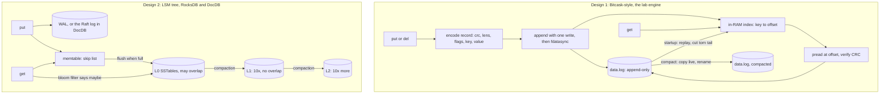

# Module 10.07: Design: KV store and log-structured storage engine

**Estimated hours:** 5

**What you will learn**

1. How to design a persistent key-value store the way an interviewer expects: requirements and numbers, API, data layout on disk, write path, read path, crash recovery, compaction, failure handling, scaling.
2. The three engine families and their trade-offs: an append-only log with a hash index (Bitcask), the LSM tree (RocksDB, YugabyteDB's DocDB), and the B+tree with a write-ahead log (PostgreSQL, Berkeley DB), measured in read, write and space amplification.
3. How to build and test a ~200-line C++17 log-structured engine with a CRC on every record, recovery by replay, compaction, and a `kill -9` crash test, plus the roadmap for the optional "minidb" B+tree project on the resume.

**Prerequisites:** [Module 10.06: Monolith vs microservices](module-06-monolith-vs-microservices.md). You also need file I/O and `fsync` from modules 1.09 and 3.08, the tcpkv store from Phase 5, PostgreSQL pages and WAL from modules 6.05 and 6.06, B-trees from module 6.09, Berkeley DB from module 6.13, and YugabyteDB's architecture from module 7.07.

---

## 1. One-line intuition

A durable key-value store is a file you only ever append to, plus an index that tells you where the newest copy of each key lives; everything else (compaction, levels, bloom filters, B+trees) is a way to keep that file small, that index cheap, and reads fast.

## 2. Real-life analogy

A bank's old **cash book**.

- The clerk never erases. Every transaction is written on the next empty line, in ink. That is an **append-only log**. Writing is fast because the clerk never searches for a place to write.
- To find a customer's latest balance quickly, the clerk keeps an **index card box**: one card per customer saying "latest entry on page 412, line 7". That is the **in-memory hash index**. If the box is lost in a fire, the clerk can rebuild it by reading the whole book from page 1: **recovery by replay**.
- If the power fails while the clerk is writing a line, the last line is half written. Next morning the clerk sees a smudged, incomplete line at the end and **crosses it out**: the customer was never told "done" for that one. That is discarding a **torn tail** using a **checksum**.
- Once a year the book is too thick. The clerk copies only the latest line for each customer into a new, thin book and archives the old one: **compaction**.
- A different bank keeps **one ledger card per customer in alphabetical drawers** and corrects the balance on the card in place, after first noting the change in a day journal. That is a **B+tree with a write-ahead log**: slower to write (find the card, rewrite it), faster to read in order.

## 3. Why it exists: the problem it solves

tcpkv (claim I) keeps its data in a `std::unordered_map` guarded by a `shared_mutex`. Kill the process and every key is gone. A real store must survive three things:

1. **Process crash** (`kill -9`, a segfault, an OOM kill): anything only in the process's memory is lost; anything handed to the kernel with `write()` is in the page cache and survives.
2. **Power loss or kernel crash**: anything not yet forced to the device with `fsync`/`fdatasync` may be lost, and a write in flight may be **torn** (partly on disk).
3. **Silent corruption**: a flipped bit, a bad sector, a bug.

What breaks without a designed engine: either you lose acknowledged writes (a loan application the branch was told was saved disappears), or you rewrite whole files on every change and the store is unusably slow. Every database you will meet (PostgreSQL, Berkeley DB, RocksDB under YugabyteDB, Redis's AOF) is an answer to this problem, and they differ only in **how** they trade write speed, read speed and disk space.

## 4. Three layers of depth

### Layer 1 (beginner): requirements, API and the simplest durable design

**Requirements first.** In an interview, never draw boxes before you have numbers. A reasonable set:

| Requirement | Value |
|---|---|
| Keys, values | Keys up to 64 B (typically 20 B), values up to 64 KB (typically 100 B) |
| Data size | 100 million keys |
| Load | 10,000 writes/s, 50,000 point reads/s, no range scans (for now) |
| Durability | An acknowledged write survives process crash and power loss |
| Latency | p99 read under 1 ms on one node |
| Consistency | Single node, read-your-writes |

**Back of the envelope.** On disk: 100 M × (13 B header + 20 B key + 100 B value) ≈ 13 GB per copy of each key. Write bandwidth: 10,000 × 133 B ≈ 1.3 MB/s, tiny for any SSD. The hard part is not bandwidth, it is **`fsync` latency**: one flush to a consumer SSD is typically 0.1 to a few ms (you will measure about 2.5 to 4 ms per synced put in WSL2 in the lab), so "flush every write, one at a time" caps you at a few hundred writes per second. 10,000 writes/s needs **group commit**: many writers share one flush.

**API.**

```cpp
void put(const std::string& key, const std::string& value);   // durable when it returns
std::optional<std::string> get(const std::string& key) const;
bool del(const std::string& key);                             // durable when it returns
void compact();                                               // reclaim space from old versions
```

**Design 1: append-only log plus in-memory hash index.** This is **Bitcask**, the engine Basho built for the Riak database (Sheehy and Smith, 2010). It is the simplest design that is fully durable and fast.

- **Data file**: a sequence of records. Each record is `crc32 | key_len | val_len | flags | key | value`. A delete is a record with the **tombstone** flag set and an empty value.
- **Index** (Bitcask calls it the *keydir*): a hash map in RAM, `key -> (offset, key_len, val_len)` of the **newest** record for that key.
- **Write path**: encode the record into one buffer, `write()` it at the end of the file, `fdatasync()`, then update the index. One sequential write per put.
- **Read path**: look up the index, one `pread()` at the offset, verify the CRC, return the value. At most one disk read per get, often zero (page cache).
- **Recovery**: read the file from offset 0, rebuilding the index; stop at the first record that is short or fails its CRC, and cut the file there.
- **Compaction (Bitcask calls it *merge*)**: old versions and tombstones waste space. Copy only the live records to a new file, `fsync` it, atomically `rename()` it over the old one, `fsync` the directory.
- **Hint files**: replaying 13 GB at startup takes minutes. When Bitcask merges files, it also writes a small **hint file** per data file: just `key, offset, sizes` for each live record. Startup reads the hints instead of the data, which is far smaller.

The limit, and every interviewer finds it: **all keys must fit in RAM**. With `std::unordered_map<std::string, Loc>` in libstdc++, a short key costs very roughly 80 to 100 bytes of RAM (node, string, location, bucket, allocator overhead), so 100 M keys need about 8 to 10 GB. Section 10 covers what to do when they do not fit.

### Layer 2 (working engineer): LSM trees, B+trees, and how to choose

**The LSM tree** (log-structured merge tree; O'Neil and others, 1996; made famous by Google's Bigtable and LevelDB, and by RocksDB, which Facebook forked from LevelDB) removes "all keys in RAM" by keeping data **sorted** on disk.

- **WAL**: every write is first appended to a write-ahead log and flushed (or group-committed). Only for crash recovery.
- **Memtable**: an in-memory sorted structure (RocksDB's default is a skip list) holding recent writes. Reads check it first.
- **Flush**: when the memtable reaches a size (RocksDB's `write_buffer_size` defaults to 64 MB), it is frozen and written out as an immutable, sorted file: an **SSTable** (sorted string table). The WAL up to that point can then be deleted.
- **SSTable layout**: sorted data blocks (RocksDB's default block size is 4 KB, often compressed), an **index block** with the first key of each data block, a **bloom filter**, and a footer. Finding a key means one index lookup (usually cached) and one data-block read.
- **Levels and compaction**: new SSTables land in **L0**, where files may overlap. Compaction merges them into **L1**, **L2**, ..., each level about 10 times larger than the one above. In **leveled** compaction (RocksDB's default) each level from L1 down has non-overlapping files, so a point read checks at most one file per level. In **size-tiered** compaction (Cassandra's original default; RocksDB calls its variant *universal*) files of similar size are merged together, which rewrites data fewer times but leaves more overlapping files.
- **Deletes** are tombstones; they disappear only when compaction carries them to the bottom level.
- **Bloom filter**: a bit array per SSTable that answers "definitely not here" or "maybe here". With 10 bits per key the false-positive rate is about 1%, so a read for a missing key usually touches no data block at all.

**The B+tree engine** (PostgreSQL's indexes, Berkeley DB's B-tree access method, InnoDB, SQLite, LMDB) keeps data in fixed-size **pages** (8 KB in PostgreSQL) organised as a balanced tree, and **updates pages in place**.

- To write: find the leaf page (a few page reads, internal pages usually cached), modify it **in the buffer pool**, append a **WAL record** describing the change, flush the WAL at commit. The dirty page is written back later, at a checkpoint or by the background writer (module 6.06).
- The WAL rule: a page may not be written to disk until the WAL records describing its changes are on disk.
- Torn pages: a crash in the middle of an 8 KB page write leaves half old, half new. PostgreSQL defends with `full_page_writes` (the first change to a page after each checkpoint logs the whole page image to WAL); InnoDB uses a doublewrite buffer.

**Amplification**, the three numbers that decide everything:

- **Write amplification**: bytes written to disk ÷ bytes the user wrote.
- **Read amplification**: disk reads per user read.
- **Space amplification**: bytes on disk ÷ bytes of live data.

| Property (typical) | Bitcask | LSM, leveled | LSM, size-tiered | B+tree + WAL |
|---|---|---|---|---|
| Write amplification | about 1 plus compaction copies | high: roughly the level fan-out per level, often 10 to 30 | lower than leveled | high for small updates: a 100 B change dirties an 8 KB page, plus WAL, plus full-page images |
| Write pattern | sequential | sequential | sequential | random page writes |
| Point read | 1 read, index in RAM | about 1 read with bloom filters and cached index | several files may need checking | about 1 read; internal pages cached |
| Range scan | not supported (hash) | good (merge iterator over levels) | fair | excellent (leaf pages are in order) |
| Space amplification | grows with garbage until merge | about 1.1 | up to about 2 during big merges | page fill factor and bloat, often 1.3 to 1.5 |
| RAM need | every key | block cache, bloom filters, index blocks | same | buffer pool |
| Where you meet it | Riak; your lab engine | RocksDB, YugabyteDB DocDB, Cassandra (leveled option) | Cassandra, ScyllaDB, RocksDB universal | PostgreSQL, Berkeley DB, InnoDB, SQLite |

**When to pick which.**

- **B+tree** when reads and range scans dominate, updates are in place, and you want predictable read latency: an OLTP schema like the canonical lending schema, master tables, Berkeley DB's role in the original platform.
- **LSM** when writes dominate, data is larger than RAM, you want compression and sequential I/O on SSDs, and you can live with background compaction: time-series, event logs, and distributed SQL storage layers.
- **Bitcask** when the key set fits in RAM, values are small to medium, you need very fast writes and simple recovery, and you never scan ranges.

**Failure handling for the design.**

| Failure | What the engine does |
|---|---|
| Process crash mid-stream | Records written with `write()` survive in the page cache; recovery replays them. Acknowledged = flushed, so nothing acknowledged is lost. |
| Power loss mid-write | The last record may be torn; its CRC fails; recovery truncates the file there. That write was never acknowledged. |
| Corrupt record in the middle | Replay stops there. Everything after it is lost from this copy. Production engines make this a policy: RocksDB's WAL recovery modes range from "tolerate a corrupted tail" to "absolute consistency" (refuse to open). The real fix is a replica. |
| Disk full | `write()` fails; cut off the partial record, return an error; reads keep working. |
| Crash during compaction | Compaction writes a temporary file and `rename()`s it only when complete and flushed; a leftover temp file is deleted at startup. |
| `fsync` fails | Do not retry and carry on: after a failed `fsync`, Linux may have dropped the dirty pages and cleared the error. PostgreSQL learned this in 2018 ("fsyncgate") and now panics and recovers from WAL instead. |

**Scaling.** One node holds what one disk and one RAM can. Beyond that: **replicate** the log to followers (ship WAL records; module 7.04), **shard** keys by hash across nodes (module 7.06), and run **Raft per shard** so each shard has a leader and survives a node loss. That last sentence is a description of YugabyteDB: tablets, each a Raft group, each stored in DocDB.

### Layer 3 (internals): the bytes, the syscalls, and the real engines

**What "durable" means at the syscall level.**

- `write()` copies your bytes into the kernel's **page cache** and returns. The data survives your process dying, not the machine dying.
- `fdatasync(fd)` blocks until the file's data, and the metadata needed to read it back (such as the new file size), are on the device. `fsync(fd)` also flushes other metadata (timestamps). An append-only log needs `fdatasync` after each group of records.
- Creating or renaming a file changes the **directory**. To make the new name durable you must `fsync` the directory itself. Forget this and a compaction that "finished" can be gone after a power cut.
- `rename(tmp, final)` on the same filesystem is atomic: after a crash you see either the old file or the new one, never a mix.

**Why a CRC per record.** A disk promises atomic writes only per sector (512 B or 4 KB) at best, and a power cut can leave a multi-sector write half done. Our record is checksummed over everything after the CRC field, so a torn or bit-flipped record is detected, not believed. CRC-32 (the same polynomial as zip and Ethernet) catches all burst errors up to 32 bits and is cheap; its standard check value, CRC-32 of the ASCII string `123456789`, is `0xCBF43926`, which the first test asserts.

**Why write each record with one `write()` call.** If the header and the value went out in two calls, a `kill -9` between them would leave a header with no body in the page cache. One buffer, one call: a process kill cannot tear it (on a local filesystem the kernel copies the whole small write or none of it); only a power cut can, and the CRC catches that.

**Group commit.** The engine in section 6 holds its mutex across `fdatasync`, so writers queue and each pays a full flush. A production engine lets writers append their records, then one thread flushes for all of them and wakes them together. PostgreSQL's WAL writer, RocksDB's write groups and the `commit_delay` setting are all group commit.

**Bloom filter maths.** With `m` bits, `n` keys and `k` hash functions, the false-positive rate is about `(1 - e^(-kn/m))^k`, minimised at `k = (m/n) ln 2`. With 10 bits per key, `k = 7` and the rate is about 0.8%.

**RocksDB inside YugabyteDB.** YugabyteDB's storage layer, **DocDB**, is built on a modified RocksDB, one instance set per tablet. Two details matter in interviews: the tablet's **Raft log is the write-ahead log** (RocksDB's own WAL is turned off, because the Raft log already makes writes durable and replicated), and each tablet has a **regular** RocksDB for committed data and an **intents** RocksDB for provisional records of in-flight distributed transactions (module 7.08). Keys are encoded as the document key plus column id plus a **hybrid timestamp**, which is how MVCC works on an LSM: old versions are just older keys, cleaned up by compaction after the history retention window.

**PostgreSQL and Berkeley DB are the other family.** PostgreSQL's heap and B-tree pages are updated in place in `shared_buffers`, protected by WAL with full-page images; Berkeley DB's transactional B-tree uses the same write-ahead-logging idea with its own log files and checkpoints (module 6.13). The migration engine of claim H1 read from one family and wrote into the other.

## 5. Architecture diagram



## 6. Code

`logstore.hpp` is a complete Bitcask-style engine for Linux: one data file, CRC per record, tombstones, recovery by replay with torn-tail truncation, compaction with atomic rename, and a durability switch.

```cpp
// logstore.hpp -- a Bitcask-style durable key-value store: one append-only
// data file plus an in-memory hash index. Linux/POSIX, C++17, header-only.
//
// Record layout on disk (all integers little-endian):
//   crc32 u32 | key_len u32 | val_len u32 | flags u8 | key bytes | value bytes
// The CRC covers every byte after the CRC field. flags bit 0 = tombstone.
#pragma once
#include <fcntl.h>
#include <sys/stat.h>
#include <unistd.h>
#include <array>
#include <cerrno>
#include <cstdint>
#include <cstring>
#include <mutex>
#include <optional>
#include <stdexcept>
#include <string>
#include <unordered_map>
#include <vector>

namespace minikv {

inline std::uint32_t crc32(const unsigned char* p, std::size_t n) {
    static const auto table = [] {
        std::array<std::uint32_t, 256> t{};
        for (std::uint32_t i = 0; i < 256; ++i) {
            std::uint32_t c = i;
            for (int k = 0; k < 8; ++k) c = (c & 1u) ? 0xEDB88320u ^ (c >> 1) : c >> 1;
            t[i] = c;
        }
        return t;
    }();
    std::uint32_t crc = 0xFFFFFFFFu;
    for (std::size_t i = 0; i < n; ++i) crc = table[(crc ^ p[i]) & 0xFFu] ^ (crc >> 8);
    return crc ^ 0xFFFFFFFFu;
}

inline void put_u32(unsigned char* p, std::uint32_t v) {
    for (int i = 0; i < 4; ++i) p[i] = static_cast<unsigned char>(v >> (8 * i));
}
inline std::uint32_t get_u32(const unsigned char* p) {
    std::uint32_t v = 0;
    for (int i = 0; i < 4; ++i) v |= static_cast<std::uint32_t>(p[i]) << (8 * i);
    return v;
}

[[noreturn]] inline void sys_fail(const std::string& what) {
    throw std::runtime_error(what + ": " + std::strerror(errno));
}

enum class Sync { EveryWrite, None };  // EveryWrite: fdatasync before put() returns

class LogStore {
public:
    static constexpr std::size_t kHeader = 13;
    static constexpr std::uint32_t kMaxLen = 64u << 20;  // 64 MB sanity limit

    explicit LogStore(std::string path, Sync sync = Sync::EveryWrite)
        : path_(std::move(path)), sync_(sync) { open_and_recover(); }
    ~LogStore() { if (fd_ >= 0) ::close(fd_); }
    LogStore(const LogStore&) = delete;
    LogStore& operator=(const LogStore&) = delete;

    void put(const std::string& key, const std::string& value) {
        std::lock_guard<std::mutex> lk(mu_);
        std::uint64_t at = append(fd_, end_, key, value, false);
        index_[key] = Loc{at, static_cast<std::uint32_t>(key.size()),
                          static_cast<std::uint32_t>(value.size())};
    }

    bool del(const std::string& key) {
        std::lock_guard<std::mutex> lk(mu_);
        if (index_.find(key) == index_.end()) return false;
        append(fd_, end_, key, "", true);  // the tombstone makes the delete survive restart
        index_.erase(key);
        return true;
    }

    std::optional<std::string> get(const std::string& key) const {
        std::lock_guard<std::mutex> lk(mu_);
        auto it = index_.find(key);
        if (it == index_.end()) return std::nullopt;
        const Loc& l = it->second;
        std::vector<unsigned char> rec(kHeader + l.key_len + l.val_len);
        if (::pread(fd_, rec.data(), rec.size(), static_cast<off_t>(l.offset)) !=
            static_cast<ssize_t>(rec.size()))
            sys_fail("pread");
        if (get_u32(rec.data()) != crc32(rec.data() + 4, rec.size() - 4))
            throw std::runtime_error("checksum mismatch reading key " + key);
        return std::string(reinterpret_cast<char*>(rec.data()) + kHeader + l.key_len, l.val_len);
    }

    // Copy only the live records into a new file, then atomically swap it in.
    void compact() {
        std::lock_guard<std::mutex> lk(mu_);
        const std::string tmp = path_ + ".compact";
        int nfd = ::open(tmp.c_str(), O_CREAT | O_TRUNC | O_WRONLY | O_CLOEXEC, 0644);
        if (nfd < 0) sys_fail("open " + tmp);
        std::unordered_map<std::string, Loc> nindex;
        std::uint64_t nend = 0;
        for (const auto& [key, loc] : index_) {
            std::string value(loc.val_len, '\0');
            if (::pread(fd_, value.data(), loc.val_len,
                        static_cast<off_t>(loc.offset + kHeader + loc.key_len)) !=
                static_cast<ssize_t>(loc.val_len))
                sys_fail("pread");
            std::uint64_t at = append(nfd, nend, key, value, false);
            nindex[key] = Loc{at, loc.key_len, loc.val_len};
        }
        if (::fsync(nfd) != 0) sys_fail("fsync compact file");
        ::close(nfd);
        if (::rename(tmp.c_str(), path_.c_str()) != 0) sys_fail("rename");
        fsync_dir();  // make the rename itself durable
        ::close(fd_);
        fd_ = ::open(path_.c_str(), O_RDWR | O_APPEND | O_CLOEXEC);
        if (fd_ < 0) sys_fail("reopen " + path_);
        index_.swap(nindex);
        end_ = nend;
    }

    std::size_t size() const { std::lock_guard<std::mutex> lk(mu_); return index_.size(); }
    std::uint64_t file_bytes() const { std::lock_guard<std::mutex> lk(mu_); return end_; }
    std::uint64_t discarded_tail_bytes() const { return discarded_; }

private:
    struct Loc { std::uint64_t offset; std::uint32_t key_len; std::uint32_t val_len; };

    // Encode one record into one buffer and write it; returns the record's offset.
    std::uint64_t append(int fd, std::uint64_t& end, const std::string& key,
                         const std::string& value, bool tombstone) {
        if (key.empty() || key.size() > kMaxLen || value.size() > kMaxLen)
            throw std::invalid_argument("bad key or value size");
        std::vector<unsigned char> rec(kHeader + key.size() + value.size());
        put_u32(rec.data() + 4, static_cast<std::uint32_t>(key.size()));
        put_u32(rec.data() + 8, static_cast<std::uint32_t>(value.size()));
        rec[12] = tombstone ? 1 : 0;
        std::memcpy(rec.data() + kHeader, key.data(), key.size());
        if (!value.empty()) std::memcpy(rec.data() + kHeader + key.size(), value.data(), value.size());
        put_u32(rec.data(), crc32(rec.data() + 4, rec.size() - 4));
        std::size_t done = 0;
        while (done < rec.size()) {
            ssize_t n = ::write(fd, rec.data() + done, rec.size() - done);
            if (n < 0 && errno == EINTR) continue;
            if (n <= 0) {  // disk full or I/O error: cut the half-written record off
                int saved = errno;
                if (::ftruncate(fd, static_cast<off_t>(end)) != 0) { /* recovery will cut it */ }
                errno = saved;
                sys_fail("write");
            }
            done += static_cast<std::size_t>(n);
        }
        if (fd == fd_ && sync_ == Sync::EveryWrite && ::fdatasync(fd) != 0) sys_fail("fdatasync");
        std::uint64_t at = end;
        end += rec.size();
        return at;
    }

    // Replay the log from offset 0. Stop at the first short or corrupt record and
    // cut the file there: that tail was never acknowledged as committed.
    void open_and_recover() {
        fd_ = ::open(path_.c_str(), O_CREAT | O_RDWR | O_APPEND | O_CLOEXEC, 0644);
        if (fd_ < 0) sys_fail("open " + path_);
        struct stat st {};
        if (::fstat(fd_, &st) != 0) sys_fail("fstat");
        const std::uint64_t file_size = static_cast<std::uint64_t>(st.st_size);
        std::uint64_t off = 0;
        std::vector<unsigned char> rec;
        while (off + kHeader <= file_size) {
            unsigned char h[kHeader];
            if (::pread(fd_, h, kHeader, static_cast<off_t>(off)) != static_cast<ssize_t>(kHeader)) break;
            std::uint32_t klen = get_u32(h + 4), vlen = get_u32(h + 8);
            if (klen == 0 || klen > kMaxLen || vlen > kMaxLen) break;           // garbage header
            std::uint64_t total = kHeader + std::uint64_t{klen} + vlen;
            if (off + total > file_size) break;                                  // torn write
            rec.resize(total);
            if (::pread(fd_, rec.data(), total, static_cast<off_t>(off)) != static_cast<ssize_t>(total)) break;
            if (get_u32(rec.data()) != crc32(rec.data() + 4, total - 4)) break;  // corrupt
            std::string key(reinterpret_cast<char*>(rec.data()) + kHeader, klen);
            if (rec[12] & 1u) index_.erase(key);
            else index_[key] = Loc{off, klen, vlen};
            off += total;
        }
        end_ = off;
        discarded_ = file_size - off;
        if (discarded_ > 0) {
            if (::ftruncate(fd_, static_cast<off_t>(end_)) != 0) sys_fail("ftruncate");
            if (::fsync(fd_) != 0) sys_fail("fsync");
        }
    }

    void fsync_dir() {
        auto slash = path_.find_last_of('/');
        std::string dir = slash == std::string::npos ? "." : path_.substr(0, slash);
        int dfd = ::open(dir.c_str(), O_RDONLY | O_DIRECTORY | O_CLOEXEC);
        if (dfd < 0) sys_fail("open dir");
        ::fsync(dfd);
        ::close(dfd);
    }

    std::string path_;
    Sync sync_;
    int fd_ = -1;
    std::uint64_t end_ = 0;        // offset where the next record goes
    std::uint64_t discarded_ = 0;  // bytes cut off the tail by recovery
    std::unordered_map<std::string, Loc> index_;
    mutable std::mutex mu_;
};

}  // namespace minikv
```

`logstore_test.cpp` proves the properties, including the crash test: a child process writes and acknowledges each put through a pipe, the parent `kill -9`s it mid-stream, appends a torn half-record as a power cut would, reopens the store and checks that **every acknowledged record survived** and the torn tail was cut off.

```cpp
// logstore_test.cpp -- GoogleTest suite for minikv::LogStore, including a
// kill -9 crash test and a torn-tail test.
#include "logstore.hpp"
#include <gtest/gtest.h>
#include <signal.h>
#include <sys/wait.h>
#include <cstdio>
#include <fstream>
#include <string>

using minikv::LogStore;
using minikv::Sync;

namespace {
std::string fresh(const std::string& name) {      // a new, empty data file per test
    std::string path = "./" + name + ".log";
    std::remove(path.c_str());
    return path;
}
std::string value_for(int i) { return "loan-" + std::to_string(i) + std::string(100, 'x'); }
long file_size(const std::string& p) {
    std::ifstream f(p, std::ios::binary | std::ios::ate);
    return static_cast<long>(f.tellg());
}
}  // namespace

TEST(LogStore, Crc32MatchesTheStandardCheckValue) {
    const char* s = "123456789";
    EXPECT_EQ(minikv::crc32(reinterpret_cast<const unsigned char*>(s), 9), 0xCBF43926u);
}

TEST(LogStore, PutGetDelete) {
    LogStore db(fresh("basic"));
    db.put("HL01:1001", "5000000");
    db.put("HL01:1001", "4900000");              // overwrite: newest record wins
    EXPECT_EQ(db.get("HL01:1001").value(), "4900000");
    EXPECT_TRUE(db.del("HL01:1001"));
    EXPECT_FALSE(db.get("HL01:1001").has_value());
    EXPECT_FALSE(db.del("HL01:1001"));
}

TEST(LogStore, ReopenReplaysPutsAndTombstones) {
    const auto path = fresh("reopen");
    {
        LogStore db(path);
        for (int i = 0; i < 100; ++i) db.put("k" + std::to_string(i), value_for(i));
        for (int i = 0; i < 100; i += 2) db.del("k" + std::to_string(i));
    }
    LogStore db(path);                            // recovery by replay
    EXPECT_EQ(db.size(), 50u);
    EXPECT_FALSE(db.get("k10").has_value());
    EXPECT_EQ(db.get("k11").value(), value_for(11));
    EXPECT_EQ(db.discarded_tail_bytes(), 0u);
}

TEST(LogStore, CompactionKeepsLiveDataAndShrinksFile) {
    const auto path = fresh("compact");
    {
        LogStore db(path, Sync::None);
        for (int round = 0; round < 20; ++round)
            for (int i = 0; i < 50; ++i) db.put("k" + std::to_string(i), value_for(round * 100 + i));
        db.del("k0");
        const auto before = db.file_bytes();
        db.compact();
        EXPECT_LT(db.file_bytes() * 10, before);  // 20 versions per key became 1
        db.put("new", "after-compaction");
    }
    LogStore db(path);                            // the compacted file replays cleanly
    EXPECT_EQ(db.size(), 50u);                    // 49 old keys + "new"
    EXPECT_FALSE(db.get("k0").has_value());
    EXPECT_EQ(db.get("k7").value(), value_for(19 * 100 + 7));
    EXPECT_EQ(db.get("new").value(), "after-compaction");
}

TEST(LogStore, TornTailIsDiscardedOnRecovery) {
    const auto path = fresh("torn");
    {
        LogStore db(path);
        for (int i = 0; i < 3; ++i) db.put("k" + std::to_string(i), value_for(i));
    }
    const long good = file_size(path);
    {   // simulate a power cut halfway through a 4th record: header + a few key bytes
        std::ofstream f(path, std::ios::binary | std::ios::app);
        const unsigned char partial[] = {0xDE, 0xAD, 0xBE, 0xEF, 2, 0, 0, 0, 100, 0, 0, 0, 0, 'k'};
        f.write(reinterpret_cast<const char*>(partial), sizeof partial);
    }
    LogStore db(path);
    EXPECT_EQ(db.size(), 3u);
    EXPECT_EQ(db.discarded_tail_bytes(), 14u);
    EXPECT_EQ(file_size(path), good);             // file cut back to the last good record
    db.put("k3", value_for(3));                   // appends go after the good data
    LogStore db2(path);
    EXPECT_EQ(db2.get("k3").value(), value_for(3));
}

TEST(LogStore, FlippedByteStopsReplayAtThatRecord) {
    const auto path = fresh("flip");
    {
        LogStore db(path);
        for (int i = 0; i < 3; ++i) db.put("k" + std::to_string(i), value_for(i));
    }
    {   // corrupt one value byte inside record 1 (records are 13 + 2 + 106 bytes)
        std::fstream f(path, std::ios::binary | std::ios::in | std::ios::out);
        f.seekp(121 + 13 + 2 + 5);
        f.put('?');
    }
    LogStore db(path);
    EXPECT_EQ(db.size(), 1u);                     // k0 only: replay stops at bad k1
    EXPECT_TRUE(db.get("k0").has_value());
    EXPECT_FALSE(db.get("k2").has_value());       // lost with everything after k1
}

TEST(LogStore, KillNineMidStreamKeepsEveryAcknowledgedWrite) {
    const auto path = fresh("crash");
    int fds[2];
    ASSERT_EQ(pipe(fds), 0);
    pid_t child = fork();
    ASSERT_GE(child, 0);
    if (child == 0) {                             // writer process
        close(fds[0]);
        LogStore db(path, Sync::EveryWrite);
        for (int i = 0;; ++i) {
            db.put("loan:" + std::to_string(i), value_for(i));
            if (write(fds[1], &i, sizeof i) != sizeof i) _exit(2);  // ack AFTER put returned
        }
    }
    close(fds[1]);
    int acked = -1, i = 0;
    while (acked < 300 && read(fds[0], &i, sizeof i) == sizeof i) acked = i;
    kill(child, SIGKILL);                         // no destructor, no flush, no goodbye
    int status = 0;
    waitpid(child, &status, 0);
    while (read(fds[0], &i, sizeof i) == sizeof i) acked = i;  // acks already in the pipe
    close(fds[0]);
    ASSERT_TRUE(WIFSIGNALED(status));
    {   // and add a torn half-record, as a power cut during the next write would
        std::ofstream f(path, std::ios::binary | std::ios::app);
        f.write("\x01\x02\x03\x04\x09\x00\x00", 7);
    }
    LogStore db(path);
    for (int k = 0; k <= acked; ++k)
        ASSERT_EQ(db.get("loan:" + std::to_string(k)).value(), value_for(k)) << "lost " << k;
    EXPECT_GE(db.size(), static_cast<std::size_t>(acked + 1));
    EXPECT_LE(db.size(), static_cast<std::size_t>(acked + 2));  // at most one un-acked put
    EXPECT_GE(db.discarded_tail_bytes(), 7u);     // our 7 bytes (plus any torn record)
    std::printf("acked=%d recovered=%zu\n", acked, db.size());
}
```

Build and run in WSL from a folder on the Linux filesystem (for example `~/course/minikv`, not `/mnt/c`, which is slow and has different `fsync` behaviour):

```bash
g++ -std=c++17 -O2 -Wall -Wextra -Werror -g -pthread logstore_test.cpp -lgtest_main -lgtest -o logstore_test
./logstore_test
```

Expected output (verified on Ubuntu 24.04 in WSL2; set-up and blank lines trimmed; timings vary by machine; `recovered` may be `acked + 1` or `acked + 2`):

```text
[==========] Running 7 tests from 1 test suite.
[----------] 7 tests from LogStore
[ RUN      ] LogStore.Crc32MatchesTheStandardCheckValue
[       OK ] LogStore.Crc32MatchesTheStandardCheckValue (0 ms)
[ RUN      ] LogStore.PutGetDelete
[       OK ] LogStore.PutGetDelete (66 ms)
[ RUN      ] LogStore.ReopenReplaysPutsAndTombstones
[       OK ] LogStore.ReopenReplaysPutsAndTombstones (1063 ms)
[ RUN      ] LogStore.CompactionKeepsLiveDataAndShrinksFile
[       OK ] LogStore.CompactionKeepsLiveDataAndShrinksFile (24 ms)
[ RUN      ] LogStore.TornTailIsDiscardedOnRecovery
[       OK ] LogStore.TornTailIsDiscardedOnRecovery (105 ms)
[ RUN      ] LogStore.FlippedByteStopsReplayAtThatRecord
[       OK ] LogStore.FlippedByteStopsReplayAtThatRecord (61 ms)
[ RUN      ] LogStore.KillNineMidStreamKeepsEveryAcknowledgedWrite
acked=300 recovered=302
[       OK ] LogStore.KillNineMidStreamKeepsEveryAcknowledgedWrite (1624 ms)
[----------] 7 tests from LogStore (2955 ms total)
[  PASSED  ] 7 tests.
```

Why `recovered=302` when `acked=300`: keys 0 to 300 are 301 acknowledged keys; key 301's `put` had returned but the child died before writing its acknowledgement. A durable write that the client never heard about is allowed (the client will retry, which is why module 10.10 needs idempotency keys); a lost acknowledged write is not.

## 7. Use case: core-banking loan-origination platform

The original lending platform stored its records in **Berkeley DB**: a B-tree key-value store with packed records and composite keys (claims H1 and H2). The migration moved them into **YugabyteDB**, whose storage layer is an **LSM tree** (DocDB on RocksDB) under a PostgreSQL-compatible SQL layer.

**The decision it drove: the migration engine was written to suit the target's storage engine, not the source's.**

- **Batched, mostly key-ordered writes.** An LSM absorbs writes into the memtable and flushes sequentially, so bulk loading is cheap per row, but each statement is a Raft round trip. The engine streamed the source with a B-tree cursor (already in key order) and wrote multi-row batches, so one Raft round trip carried hundreds of rows.
- **Restartable batches keyed by the last committed key.** Because the source is a sorted B-tree, "the last key written" is a complete checkpoint: on restart, position the cursor just after it. That is the same idea as replaying a log from an offset.
- **No per-row update-in-place after load.** Rewriting rows on an LSM creates new versions that compaction must clean up, so the engine wrote each target row once, and the parity suite (claim H3) read it back once.
- **Space and compaction are planned for.** After a bulk load, the cluster spends time compacting, and reads are slower until it settles; the cutover rehearsal in capstone C4 (module 7.10) therefore waits for compaction to finish before running the performance checks that gate go-live.

The second decision, for the app server: **the idempotency and session state that must survive restarts lives in the database, not in a home-made file engine.** Writing your own durable store is exactly this module's lab; running one in production means owning its recovery, compaction, backups and replication. A bank buys that from the database.

## 8. Lab

Work in `~/course/minikv` with `logstore.hpp` and `logstore_test.cpp`.

### Part A: build, pass, and break it (40 minutes)

1. Build and run the tests as in section 6. All 7 must pass.
2. Break the write path on purpose: in `append`, split the single `write` into two calls, first the 13-byte header, then the rest. The tests still pass (a `kill -9` between the calls is rare). Now explain in your notes what a crash between the two calls leaves on disk and why recovery still copes (the length check sees a short record). Revert.
3. Break recovery: change `break;` after the CRC check to `continue;` with `off += total`. Run `FlippedByteStopsReplayAtThatRecord`. Expected: it fails, because the corrupt record is skipped and `k2` comes back. Write down whether "skip" or "stop" is right for a bank, and why it is a policy decision. Revert.

### Part B: measure what durability costs (30 minutes)

Write `kv_bench.cpp`:

```cpp
// kv_bench.cpp -- puts/sec with and without fdatasync, and replay time.
#include "logstore.hpp"
#include <chrono>
#include <cstdio>
#include <string>
using Clock = std::chrono::steady_clock;
static double secs(Clock::time_point t0) { return std::chrono::duration<double>(Clock::now() - t0).count(); }

int main() {
    const std::string value(100, 'v');
    std::remove("bench_sync.log");
    { minikv::LogStore db("bench_sync.log", minikv::Sync::EveryWrite);
      auto t0 = Clock::now();
      for (int i = 0; i < 500; ++i) db.put("loan:" + std::to_string(i), value);
      std::printf("Sync::EveryWrite : %8.0f puts/s\n", 500 / secs(t0)); }
    std::remove("bench_fast.log");
    { minikv::LogStore db("bench_fast.log", minikv::Sync::None);
      auto t0 = Clock::now();
      for (int i = 0; i < 200000; ++i) db.put("loan:" + std::to_string(i), value);
      std::printf("Sync::None       : %8.0f puts/s\n", 200000 / secs(t0)); }
    auto t0 = Clock::now();
    minikv::LogStore db("bench_fast.log");
    std::printf("replay %zu keys in %.3f s\n", db.size(), secs(t0));
}
```

Build with the same flags (`g++ -std=c++17 -O2 -Wall -Wextra -Werror -g -pthread kv_bench.cpp -o kv_bench`) and run it three times.

Expected shape: on one WSL2 laptop, four runs gave `EveryWrite` about 250 to 400 puts/s and `None` about 200,000 to 450,000 puts/s, roughly a thousand times faster; replaying 200,000 keys (about 25 MB) took 0.4 to 1.0 s. Your numbers will differ; the ratio is the lesson. Then answer: how many puts/s would the requirement table in section 4 need, and which technique closes the gap? (Group commit.)

### Part C: add hint files (60 minutes)

1. After `compact()` writes the new data file, also write `path + ".hint"`: for each live key, `key_len u32 | val_len u32 | offset u64 | key`, then a CRC-32 of the whole hint file at the end. Write it to a temp name, `fsync`, `rename`, `fsync` the directory.
2. In `open_and_recover()`, if a hint file exists and its CRC is valid, build the index from it, then replay only the data file **after** the last offset the hint file covers (writes made after the compaction).
3. Add a test: put 50,000 keys, compact, put 10 more, reopen; all 50,010 keys must be readable. Time recovery with and without the hint file using `kv_bench`'s replay timer.

Expected: with hints, startup reads about 30 bytes per key instead of about 130; replay time drops roughly in proportion.

### Part D: plug it into tcpkv and outline minidb (45 minutes)

1. In your tcpkv server, replace the in-memory map behind `SET`, `GET` and `DEL` with a `LogStore`. Reply `OK` to `SET` only after `put()` returns. Restart the server and show a key survives. Note your tcpkv throughput before and after with `load_gen` (module 5.11) and explain the drop.
2. Write `minidb/DESIGN.md` from the roadmap in the box below, with your own estimate of hours per milestone.

**The minidb roadmap** (the optional second resume project: "single-file storage engine with 4 KB pages, a page cache, a B+tree index and a write-ahead log with checkpoints; crash-recovery test kills the process mid-write and verifies every committed record survives"):

| Milestone | What you build | Done when | Honest estimate |
|---|---|---|---|
| M1 Pager | One file as an array of 4 KB pages; page 0 is a header (magic, version, root page id, free-list head, last checkpoint LSN) | Allocate, read, write and free pages; header survives reopen | 4 to 6 h |
| M2 Page cache | Fixed number of frames, page table `page_id -> frame`, pin counts, dirty bits, clock or LRU eviction (module 10.08) that never evicts a pinned page | A test touching 10 times more pages than frames passes | 4 to 6 h |
| M3 B+tree | Slotted leaf pages, internal pages with separator keys, search, insert with split, a cursor for range scans over linked leaves | 1 M random inserts, then an ordered scan returns sorted keys | 10 to 14 h |
| M4 WAL | Log records `LSN, page id, redo bytes`; each page stores its `pageLSN`; the WAL rule (flush log up to `pageLSN` before writing a page); commit = WAL `fdatasync` | Committed inserts survive `kill -9` | 6 to 8 h |
| M5 Recovery and checkpoints | Replay WAL from the last checkpoint, applying a record only if `pageLSN < recordLSN` (redo is idempotent); checkpoints flush dirty pages and let old WAL be recycled; torn pages handled by a full page image in the first WAL record after each checkpoint | The crash test from this module, ported to minidb, passes 100 runs in a loop | 6 to 8 h |
| M6 Hardening | Page checksums, fuzzed page decoder (module 9.03), ASan and TSan runs, CI | Green CI; numbers in the README | 4 h |

Total: roughly 35 to 45 hours. Do not put minidb on the resume until M5 passes.

### Journal

Copy [journal/TEMPLATE.md](../journal/TEMPLATE.md) to `journal/YYYY-MM-DD-kv-store-design.md`. Record: the passing test output with your `acked` and `recovered` numbers; the two deliberate breaks and what they taught; your three `kv_bench` runs (sync and no-sync puts/s, replay time); recovery time with and without hint files; tcpkv throughput before and after durability; and your minidb milestone estimates.

## 9. Common mistakes and misconceptions

| Mistake | Why it is wrong | Bug it causes |
|---|---|---|
| "`write()` returned, so it is on disk" | It is in the page cache; power loss can drop it | Acknowledged writes vanish after a power cut |
| Acknowledging before `fdatasync` | The client is told "saved" for data that may be lost | Lost loan applications that the branch saw confirmed |
| No checksum per record | A torn or flipped record is read back as valid | Garbage values returned, or a crash during recovery |
| Writing header and body in separate calls | A crash between them leaves a header with no body | Recovery must handle it; a naive parser reads past the end |
| `rename()` without `fsync` of the directory | The rename may not be durable | After a power cut the old file is back, or no file at all |
| Deleting by removing the key from the index only | Replay brings the key back | "Deleted" data reappears after a restart |
| Retrying `fsync` after it failed | Linux may have dropped the dirty pages and cleared the error | Silent data loss (PostgreSQL's 2018 fsyncgate) |
| "LSM is always faster" | Faster writes, but compaction costs CPU and I/O, and reads may check several files | Latency spikes during compaction; disappointed read benchmarks |
| Ignoring write amplification on SSDs | Every rewrite costs device endurance and bandwidth | Disks wear out early; compaction falls behind writes |
| Keeping every key in RAM without a budget | Bitcask's index grows with the key count | OOM kill on the night the key count doubles |

## 10. Resume link

- **Claim D, "storage engines, B-tree indexing, WAL".** Say: "I built a log-structured engine: append-only file, CRC-32 per record, in-memory hash index, recovery by replay that truncates a torn tail, compaction with atomic rename and directory fsync. A crash test forks a writer, `kill -9`s it mid-stream and verifies every acknowledged record survives. I measured about 300 synced puts per second versus about 300,000 unsynced on my laptop, which is why real engines use group commit."
- **Claims H1 and H2.** Contrast the two families you moved data between: Berkeley DB's B-tree with in-place pages, and YugabyteDB's LSM (DocDB on RocksDB) where the Raft log is the WAL. Explain why the migration wrote ordered batches and checkpointed by the last committed key.
- **Claim I, tcpkv.** If you did Part D, tcpkv now has a durable backend, and you can explain exactly what `OK` means after a `SET`.
- **minidb** (optional). Only once M5 passes: "4 KB pages, page cache with pin counts, B+tree with splits and range cursors, WAL with pageLSN-based idempotent redo and checkpoints, and the same kill-9 crash test."

**How an interviewer will push**, and what to say:

- **"The index does not fit in memory."** Options in order: shard keys across nodes; shrink each entry (store an 8-byte hash of the key plus an 8-byte offset, about 16 B per key, and confirm the key when you read the record; 100 M keys then need about 1.6 GB); keep data sorted so the index can be **sparse** (one entry per 4 KB block), which is exactly an SSTable, so you have reinvented the LSM; or use an on-disk B+tree.
- **"What about torn writes?"** A CRC per record detects them; recovery truncates at the first bad record at the tail; a bad record in the middle is corruption, not a crash, and you stop, alert and rebuild from a replica. Page-based engines need more: full-page images in the WAL (PostgreSQL) or a doublewrite buffer (InnoDB), plus page checksums.
- **"How is this different from tcpkv?"** tcpkv is an in-memory map: fast, volatile, no recovery. This engine changes what `OK` means: durable before reply. It adds the costs: `fsync` latency, recovery time proportional to the log, compaction, and disk space for garbage.
- **"How do you get 10,000 durable writes per second?"** Group commit: writers append under the lock, one thread `fdatasync`s for the batch and wakes them all; with a 2 ms flush that is 500 flushes per second carrying 20 or more writes each.
- **"Range queries?"** Not with a hash index. Keep data sorted (LSM or B+tree).
- **"Replication?"** Ship the log: followers apply the same records in the same order; with Raft, a write is acknowledged once a majority has it in its log.

## 11. Interview questions

**Q1 (easy). What happens on the write path and the read path of a Bitcask-style store?**

<details>
<summary>Model answer</summary>

Write: encode a record with a CRC, key and value lengths, a tombstone flag, the key and the value; append it to the end of the active data file with one `write()`; `fdatasync` (or group commit) so it is durable; then point the in-memory hash index at the record's offset. Read: look up the key in the index, do one positioned read at that offset, verify the CRC, return the value. Writes are sequential and reads are at most one disk access, at the cost of keeping every key in RAM and running compaction to reclaim space from old versions.

</details>

**Q2 (easy). How does the store recover after a crash, and why is a CRC needed?**

<details>
<summary>Model answer</summary>

On startup it reads the data file from the beginning and rebuilds the index: each valid record sets or, for a tombstone, removes its key. It stops at the first record that is incomplete or whose CRC does not match, and truncates the file there. The CRC is what distinguishes a complete record from a torn or corrupted one: after a power cut the last write may be partly on disk, and without a checksum recovery would believe garbage lengths or values. Hint files make recovery faster by storing only keys and offsets for compacted data.

</details>

**Q3 (medium). Explain the LSM tree and its read, write and space amplification compared with a B+tree.**

<details>
<summary>Model answer</summary>

Writes go to a WAL and an in-memory sorted memtable; full memtables are flushed as immutable sorted SSTables; background compaction merges SSTables into levels that grow by about 10 times each. Writes are sequential and cheap at first, but each byte is rewritten as it moves down the levels, so leveled compaction has write amplification often in the 10 to 30 range; size-tiered compaction lowers that at the cost of more overlapping files, higher read amplification and up to about twice the space during merges. Reads check the memtable and then at most one file per level, made cheap by cached index blocks and bloom filters. A B+tree updates fixed pages in place: point reads are about one I/O, range scans are excellent, but a small update dirties a whole page and needs a WAL record, and writes are random. LSM suits write-heavy and larger-than-RAM data; B+tree suits read-heavy OLTP with range scans.

</details>

**Q4 (medium). Why does a compaction need `fsync` on the new file, an atomic rename and an `fsync` on the directory?**

<details>
<summary>Model answer</summary>

The new file must be fully on disk before it replaces the old one, otherwise a crash after the rename could leave a name pointing at a partly written file and the old data already gone. `rename()` within one filesystem is atomic, so after a crash you see either the complete old file or the complete new file. But the rename is a change to the directory, and the directory's own data must be flushed to make the new name durable; without the directory `fsync`, a power cut can roll back to the old name, or with some filesystems lose both. The temporary file left by a crash before the rename is simply deleted at startup.

</details>

**Q5 (hard). Design a durable KV store for 100 million keys and 10,000 writes per second on one node, then tell me how it changes when keys no longer fit in RAM and when you need high availability.**

<details>
<summary>Model answer</summary>

Start with requirements: 20-byte keys, 100-byte values, about 13 GB of data, durability on acknowledgement, p99 reads under 1 ms. A Bitcask design works if the index fits: roughly 8 to 10 GB with a standard hash map, or about 1.6 GB storing an 8-byte key hash and an 8-byte offset and verifying the key on read. Durability at 10,000 writes per second needs group commit, because one `fdatasync` costs around a millisecond on typical SSDs; batching 20 writes per flush at 500 flushes per second does it. Records carry CRCs; recovery replays from hint files plus the tail of the active file; compaction merges immutable files in the background and swaps them in with fsync, rename and a directory fsync. When keys exceed RAM, keep data sorted so the index can be sparse: that is an LSM tree with SSTables, a block cache and bloom filters, which is what RocksDB gives you; alternatively a B+tree if range scans and read latency dominate. For availability, replicate the log with Raft: a write is acknowledged once a majority has it durably, a follower takes over when the leader fails, and shard by key hash when one node's disk or CPU is not enough. That is the shape of YugabyteDB: hash-sharded tablets, each a Raft group, each stored in RocksDB with the Raft log as its WAL.

</details>

## 12. Revision

- Durable KV = append-only log of CRC-checked records plus an index to the newest copy of each key; acknowledge only after `fdatasync`; recover by replay and truncate the torn tail; compact by copying live records, `fsync`, atomic `rename`, `fsync` the directory.
- Bitcask keeps every key in RAM and does one read per get; LSM (memtable, WAL, SSTables, leveled or size-tiered compaction, bloom filters) keeps data sorted on disk and trades write amplification for space and read efficiency; B+tree with WAL updates pages in place and is best for reads and ranges.
- YugabyteDB's DocDB is RocksDB per tablet with the Raft log as WAL and a separate intents store; PostgreSQL and Berkeley DB are B-tree-plus-WAL engines; minidb is a 35 to 45 hour roadmap of pager, page cache, B+tree, WAL and checkpoints.

---

Previous: [Module 10.06: Monolith vs microservices](module-06-monolith-vs-microservices.md) | Next: [Module 10.08: Design: thread pool, LRU cache, connection pool](module-08-design-thread-pool-lru-cache-connection-pool.md)
