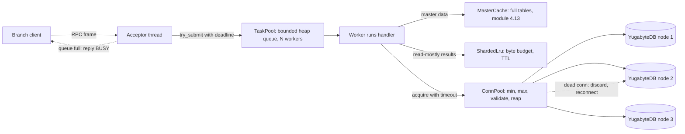

# Module 10.08: Design: thread pool, LRU cache, connection pool

**Estimated hours:** 4

**What you will learn**

1. How to answer three classic "design a component" questions the way a senior engineer does: requirements, interface, concurrency model, sizing, failure handling, then code.
2. The design choices inside each one: queue bounds and rejection, priorities and deadlines for a thread pool; O(1) eviction, byte budgets, sharding, TTL and scan resistance for an LRU cache; acquire timeouts, validation, reaping and leak detection for a connection pool.
3. How the three fit together in the capstone C2 application server, including what happens to pooled connections when a YugabyteDB node dies.

**Prerequisites:** [Module 10.07: Design: KV store and log-structured storage engine](module-07-design-kv-store-and-log-structured-engine.md). You built the pieces this module redesigns: `BoundedQueue` (4.04), `ThreadPool` (4.10), the pooled request model and `MasterCache` (4.13), backpressure (5.10), and the libpq `ConnectionPool` (6.12). Cache policies come from module 10.03.

---

## 1. One-line intuition

All three are managers of a scarce resource (threads, memory, database connections): they hand it out under a lock, say "no" quickly when it runs out, take it back when the user is done, and clean up when it breaks.

## 2. Real-life analogy

A busy bank branch.

- **Thread pool**: four tellers and a token machine. The machine prints at most 30 tokens; when the hall is full it shows "please come back later" (a **bounded queue** with **rejection**). Senior citizens get priority tokens (**priorities**). A customer who has waited 40 minutes for a 10-minute errand has usually left; when the teller finally calls the number, she just marks it "gone" (**deadline**). At closing time the guard either lets everyone inside finish (**drain**) or sends the queue home (**stop now**).
- **LRU cache**: the clerk's desk drawer fits 20 files. Every time a file is used it goes to the front. When a 21st file arrives, the file at the back, the one untouched longest, goes back to the record room (**least recently used eviction**). A file older than a day must be re-fetched because it may be out of date (**TTL**). If an auditor asks to see 500 files once each, a naive clerk empties the drawer of everything useful (**scan pollution**).
- **Connection pool**: the branch has 8 phone lines to head office. Staff wait up to 30 seconds for a free line (**acquire timeout**), check for a dial tone before talking (**validation**), hang up lines nobody has used for an hour (**idle reaping**), and the manager notices a line that has been off the hook for two hours (**leak detection**). If head office's exchange restarts, every line goes dead at once; the first person to pick up each one hears silence and must redial (**discard and reconnect**).

## 3. Why it exists: the problem it solves

Without these three, a server creates resources on demand: a thread per request, a cache that grows forever, a connection per query. Each works in a demo and fails under load:

- **Threads**: creation costs tens of microseconds and each thread reserves stack (8 MB virtual by default on Linux). Ten thousand concurrent requests mean ten thousand threads, constant context switching, and an OOM kill.
- **Memory**: an unbounded cache is a memory leak with a hit rate. It grows until the process is killed, usually on the busiest day.
- **Connections**: a PostgreSQL connection is a whole backend process; opening one costs a TCP handshake, authentication and process start, typically a few milliseconds. PostgreSQL's default `max_connections` is 100. Opening one per query is slow; opening one per request at peak is an outage.

They are also the three most common "design a component" interview questions for C++ backend roles, because each tests concurrency, resource ownership and failure handling in under 200 lines.

## 4. Three layers of depth

### Layer 1 (beginner): requirements and interfaces

Always start a component design with a requirements table and the interface. Here are the three, sized for the C2 app server (a few hundred branch users, each request doing one to three database calls of 1 to 5 ms).

| | Thread pool `TaskPool` | LRU cache `LruCache<K,V>` | Connection pool `ConnPool<Conn>` |
|---|---|---|---|
| Hands out | A worker thread's time | Memory for recently used values | An open database connection |
| Bound | N workers, queue of Q tasks | A byte budget | `max_size` connections |
| When exhausted | `try_submit` returns false: reply "busy" | Evict the least recently used entry | Wait up to a timeout, then throw `PoolTimeout` |
| Key operations | `try_submit(task, priority, max_queue_wait)`, `shutdown(Drain or Now)`, `stats()` | `get(key)`, `put(key, value)`, `erase(key)`, `stats()` | `acquire()` returns a move-only `Lease`; `reap_idle()`, `suspected_leaks()`, `stats()` |
| Failure it must survive | A task that throws or runs late | Stale data | Dead connections after a database failover |
| Counters exposed | accepted, rejected, completed, failed, expired, dropped, queue high-water | hits, misses, evictions, expirations, bytes | total, idle, in use, created, discarded, timeouts |

**Counters are part of the interface.** A pool without metrics cannot be tuned and cannot be debugged at 2 a.m. Every design answer should say what it exports.

### Layer 2 (working engineer): the design decisions

#### Thread pool

- **Bounded queue and a rejection policy.** An unbounded queue turns overload into unbounded latency and memory. With a bound you must choose what happens when it is full. Java's `ThreadPoolExecutor` names the classic four: **abort** (reject with an error; ours returns `false`), **caller runs** (the submitting thread runs the task itself, which naturally slows the producer), **discard**, and **discard oldest**. For a request server, reject fast and let the client back off (module 5.10).
- **Priorities.** A heap ordered by (priority, sequence number) gives "high first, FIFO within a priority". Danger: **starvation**, where low-priority work never runs under steady high-priority load. Fixes: aging (raise priority with waiting time) or a separate small pool for the low class.
- **Per-task timeouts.** You cannot safely kill a C++ thread in the middle of a task. What you can do: give each task a **queue deadline** and, if it is dequeued after the deadline, tell it so it can send a cheap "timeout" reply instead of doing work nobody is waiting for. Inside a long task, use a cooperative cancellation flag the task checks between steps, and pass the deadline down to the database call (a statement timeout).
- **Graceful versus immediate shutdown.** Drain: stop accepting, finish everything queued, join. Now: stop accepting, drop the queue (count what was dropped), let running tasks finish, join. Neither interrupts a running task.
- **Work stealing.** One shared queue means one lock every worker contends on. Work-stealing pools give each worker its own deque: the owner pushes and pops at one end, idle workers steal from the other end. Intel TBB, Java's `ForkJoinPool`, the Go scheduler and Rust's Tokio all do this. It wins for many tiny tasks that spawn more tasks; for request handling, where each task takes milliseconds of database wait, one queue is not the bottleneck.
- **Sizing.** CPU-bound work: about one worker per core; more only adds context switches. Waiting-bound work: Brian Goetz's rule from *Java Concurrency in Practice*, `N = cores × (1 + wait time / compute time)`. Check with **Little's law**, `L = λ × W`: to sustain λ = 2,000 requests/s at W = 5 ms each, about 10 requests are in flight on average, so 10 to 20 workers suffice. And never more workers that use the database than you have database connections; the extra ones just wait for a connection.

#### LRU cache

- **O(1) everything.** A hash map from key to a node, and a doubly linked list of nodes in recency order. `get`: find in the map, move the node to the front (relink two pointers; `std::list::splice` does it without copying). `put`: insert at the front; while over budget, remove from the back and erase from the map.
- **Capacity in bytes, not entries.** Values vary in size (a product row of 100 bytes, a rendered sanction letter of 200 KB). An entry count gives no memory bound. Pass a **charge** function that returns an entry's cost in bytes; reject entries larger than the whole cache.
- **One mutex or sharded.** A `get` **writes** (it moves the node), so a `shared_mutex` does not help: every operation needs exclusive access. One mutex is correct and fine at moderate load. Under many cores it becomes the hot spot; **sharding** splits the cache into N independent LRUs by key hash, each with its own lock. The cost: eviction is only approximately LRU across the whole cache, and a skewed key distribution can overfill one shard.
- **TTL.** Store an expiry time per entry; on `get`, an expired entry is a miss and is removed (lazy expiry). Add a periodic sweep only if expired entries holding memory is a problem.
- **Scan resistance.** A one-off scan of many keys pushes every hot key out of a plain LRU. Better policies: **2Q** (Johnson and Shasha, 1994: new keys enter a probation queue and are promoted only on a second access), **ARC** (adapts between recency and frequency; used by ZFS), **LFU** variants such as **W-TinyLFU** (Java's Caffeine library). Real systems you know: PostgreSQL's buffer pool uses a **clock sweep** with a usage count capped at 5, and big sequential scans use a small ring of buffers so they cannot flush `shared_buffers`; Redis approximates LRU by sampling a few keys (`maxmemory-samples`, default 5) and has offered LFU policies since 4.0.

#### Connection pool

- **Acquire with a timeout.** Waiting forever hides an outage: requests pile up behind an empty pool. A timeout (hundreds of milliseconds for an interactive server) turns it into a fast, visible error.
- **Validation on checkout.** An idle connection can be dead: the database restarted, a node failed, a firewall dropped an idle TCP flow. libpq's `PQstatus()` only reports what libpq last saw; it does **not** notice a dead socket until you do I/O. A real check is a round trip (`SELECT 1`), which costs a millisecond, so validate only connections that have been **idle longer than a threshold**, and always discard a connection after an error on it.
- **Min and max.** `min_size` keeps warm connections for the first requests after a quiet period; `max_size` protects the database. Size `max` from the database side: total connections from all app instances must stay below `max_connections`.
- **Idle reaping and max lifetime.** Close connections idle longer than a limit, down to `min_size`. Many pools also retire connections after a maximum lifetime so that, after a database node is added, new connections spread onto it.
- **Leak detection.** Record when each lease was taken. A lease held longer than a threshold (tens of seconds for a request server) is almost certainly a code path that forgot to return it. RAII leases make leaks rare in C++; long-running work holding a lease still shows up here.
- **For comparison**, the popular Java pool HikariCP defaults to 10 connections, a 30 s acquire timeout, a 10 minute idle timeout and a 30 minute maximum lifetime, with leak detection off.

**What happens when a YugabyteDB node fails.** Every pooled connection to that node's YSQL process dies at once. In-flight queries on it fail with a connection error, and their transactions are rolled back. Idle connections look healthy until used. Tablet leaders on the failed node move to the surviving nodes, typically within a few seconds (module 7.09), and connections to surviving nodes see a short pause on the affected tablets. The pool's job: discard each dead connection the first time it is touched (validation or error), open replacements on a live node, and keep the acquire timeout short so callers fail fast during the gap. Spreading connections over nodes is the client's job: list all nodes in the libpq connection string (`host=n1,n2,n3`), and from libpq 16 add `load_balance_hosts=random`; or put a load balancer in front; YugabyteDB also ships "smart" drivers for several languages that are cluster-aware.

### Layer 3 (internals): what the machine is doing

- **Waiting with a deadline.** `condition_variable::wait_until(lock, deadline)` unlocks the mutex, sleeps on a futex (module 4.03) and re-locks on wake. It can wake spuriously or after a `notify` that another thread already consumed, so the acquire loop re-checks its condition every time it wakes and only throws when the deadline has passed **and** there is still nothing to take.
- **Never do I/O under the pool lock.** Connecting, validating and closing a connection take milliseconds. `ConnPool` reserves a slot (`++total_`) under the lock, then connects **unlocked**, and closes dead connections unlocked. Holding the lock across a `SELECT 1` would serialise every acquire behind one network round trip.
- **The heap.** `TaskPool` keeps tasks in a `std::vector` managed with `std::push_heap` and `std::pop_heap`: O(log n) per operation, contiguous memory, and `pop_heap` moves the top to the back so it can be moved out cleanly (moving out of `priority_queue::top()` would need a `const_cast`).
- **`std::list::splice`.** Moving a node to the front of the recency list rewires four pointers; no allocation, no copy, iterators stay valid. That is why the map can store list iterators safely.
- **Lock contention.** One mutex shared by all cores puts its cache line in constant motion between cores (module 4.08). Sharding by key hash spreads that traffic over N lines. A multiplicative hash (the 64-bit golden-ratio constant) mixes keys before picking a shard, because libstdc++'s `std::hash<int>` is the identity and patterned keys would land on a few shards.
- **Dead TCP peers.** If a database host loses power, no FIN or RST ever arrives. The client's socket looks open until it sends and the retransmissions time out (many seconds to minutes), or until TCP keepalive fires (Linux default: first probe after 7,200 s idle). Set `keepalives_idle`, `keepalives_interval` and `keepalives_count` (and `tcp_user_timeout`) in the libpq connection string so dead connections are detected in seconds, not hours.

## 5. Architecture diagram

How the three sit on the request path of the C2 app server.



## 6. Code

Three headers and one test file. Compile everything with the course flags.

### `task_pool.hpp`

```cpp
// task_pool.hpp -- the 4.10 thread pool redesigned for a server: bounded
// priority queue, reject-when-full, queue-wait deadlines, two stop modes, counters.
#pragma once
#include <algorithm>
#include <chrono>
#include <condition_variable>
#include <cstdint>
#include <functional>
#include <mutex>
#include <stdexcept>
#include <thread>
#include <vector>

namespace design {

enum class Priority : int { High = 0, Normal = 1, Low = 2 };
enum class Stop { Drain, Now };

struct PoolStats {
    std::uint64_t accepted = 0, rejected = 0, completed = 0, failed = 0, expired = 0, dropped = 0;
    std::size_t queue_high_water = 0;
};

class TaskPool {
public:
    using Clock = std::chrono::steady_clock;
    // A task is told whether it waited too long, so it can send a cheap "timeout" reply.
    using Task = std::function<void(bool expired)>;

    TaskPool(std::size_t workers, std::size_t queue_capacity) : cap_(queue_capacity) {
        if (workers == 0 || queue_capacity == 0) throw std::invalid_argument("zero size");
        for (std::size_t i = 0; i < workers; ++i) threads_.emplace_back([this] { run(); });
    }
    ~TaskPool() { shutdown(Stop::Drain); }
    TaskPool(const TaskPool&) = delete;
    TaskPool& operator=(const TaskPool&) = delete;

    // Never blocks. Returns false when the queue is full or the pool is stopping:
    // the caller turns that into a "server busy" reply (rejection policy = Reject).
    bool try_submit(Task t, Priority p = Priority::Normal,
                    std::chrono::milliseconds max_queue_wait = std::chrono::milliseconds::zero()) {
        {
            std::lock_guard<std::mutex> lk(mu_);
            if (stop_ || q_.size() >= cap_) { ++stats_.rejected; return false; }
            auto deadline = max_queue_wait.count() > 0 ? Clock::now() + max_queue_wait
                                                       : Clock::time_point::max();
            q_.push_back(Item{static_cast<int>(p), seq_++, deadline, std::move(t)});
            std::push_heap(q_.begin(), q_.end(), Later{});
            ++stats_.accepted;
            stats_.queue_high_water = std::max(stats_.queue_high_water, q_.size());
        }
        cv_.notify_one();
        return true;
    }

    // Drain: run everything already queued, then stop. Now: drop the queue, finish
    // only the tasks already running. Neither can interrupt a running task.
    void shutdown(Stop how) {
        {
            std::lock_guard<std::mutex> lk(mu_);
            stop_ = true;
            if (how == Stop::Now) { stats_.dropped += q_.size(); q_.clear(); }
        }
        cv_.notify_all();
        for (auto& t : threads_) if (t.joinable()) t.join();
    }

    PoolStats stats() const { std::lock_guard<std::mutex> lk(mu_); return stats_; }

private:
    struct Item { int prio; std::uint64_t seq; Clock::time_point deadline; Task fn; };
    struct Later {  // heap order: lower prio number first, then FIFO by sequence
        bool operator()(const Item& a, const Item& b) const {
            return a.prio != b.prio ? a.prio > b.prio : a.seq > b.seq;
        }
    };

    void run() {
        for (;;) {
            Item it;
            {
                std::unique_lock<std::mutex> lk(mu_);
                cv_.wait(lk, [this] { return stop_ || !q_.empty(); });
                if (q_.empty()) return;                 // stopping and nothing left
                std::pop_heap(q_.begin(), q_.end(), Later{});
                it = std::move(q_.back());
                q_.pop_back();
            }
            const bool expired = Clock::now() > it.deadline;
            bool ok = true;
            try { it.fn(expired); } catch (...) { ok = false; }   // a task must not kill a worker
            std::lock_guard<std::mutex> lk(mu_);
            if (expired) ++stats_.expired;
            else if (ok) ++stats_.completed;
            else ++stats_.failed;
        }
    }

    const std::size_t cap_;
    std::vector<Item> q_;            // a binary heap managed with push_heap/pop_heap
    std::uint64_t seq_ = 0;
    bool stop_ = false;
    PoolStats stats_;
    mutable std::mutex mu_;
    std::condition_variable cv_;
    std::vector<std::thread> threads_;
};

}  // namespace design
```

### `lru_cache.hpp`

```cpp
// lru_cache.hpp -- O(1) LRU cache with a byte budget and TTL, plus a sharded
// wrapper. unordered_map gives O(1) find; a doubly linked list gives O(1)
// "move to front" and "remove the oldest".
#pragma once
#include <chrono>
#include <cstdint>
#include <functional>
#include <list>
#include <memory>
#include <mutex>
#include <optional>
#include <stdexcept>
#include <unordered_map>
#include <vector>

namespace design {

struct CacheStats {
    std::uint64_t hits = 0, misses = 0, evictions = 0, expirations = 0;
    std::size_t bytes = 0, entries = 0;
};

template <class K, class V>
class LruCache {
public:
    using Clock = std::chrono::steady_clock;
    using Charge = std::function<std::size_t(const K&, const V&)>;  // bytes one entry costs
    using Now = std::function<Clock::time_point()>;                 // injectable for tests

    LruCache(std::size_t capacity_bytes, std::chrono::milliseconds ttl, Charge charge,
             Now now = [] { return Clock::now(); })
        : cap_(capacity_bytes), ttl_(ttl), charge_(std::move(charge)), now_(std::move(now)) {
        if (cap_ == 0) throw std::invalid_argument("capacity 0");
    }

    std::optional<V> get(const K& key) {
        std::lock_guard<std::mutex> lk(mu_);
        auto it = map_.find(key);
        if (it == map_.end()) { ++st_.misses; return std::nullopt; }
        if (now_() >= it->second->expires) {          // stale: treat as a miss
            ++st_.expirations; ++st_.misses;
            remove(it->second);
            return std::nullopt;
        }
        lru_.splice(lru_.begin(), lru_, it->second);  // O(1) move to front, no copy
        ++st_.hits;
        return it->second->value;
    }

    // Returns false if the single entry is bigger than the whole cache.
    bool put(const K& key, V value) {
        const std::size_t c = charge_(key, value);
        if (c > cap_) return false;
        std::lock_guard<std::mutex> lk(mu_);
        auto it = map_.find(key);
        if (it != map_.end()) remove(it->second);
        lru_.push_front(Node{key, std::move(value), c, now_() + ttl_});
        map_[key] = lru_.begin();
        st_.bytes += c;
        while (st_.bytes > cap_) {                    // evict from the cold end
            remove(std::prev(lru_.end()));
            ++st_.evictions;
        }
        return true;
    }

    bool erase(const K& key) {
        std::lock_guard<std::mutex> lk(mu_);
        auto it = map_.find(key);
        if (it == map_.end()) return false;
        remove(it->second);
        return true;
    }

    CacheStats stats() const {
        std::lock_guard<std::mutex> lk(mu_);
        CacheStats s = st_;
        s.entries = map_.size();
        return s;
    }

private:
    struct Node { K key; V value; std::size_t charge; Clock::time_point expires; };
    using Iter = typename std::list<Node>::iterator;

    void remove(Iter n) {                             // caller holds mu_
        st_.bytes -= n->charge;
        map_.erase(n->key);
        lru_.erase(n);
    }

    const std::size_t cap_;
    const std::chrono::milliseconds ttl_;
    Charge charge_;
    Now now_;
    std::list<Node> lru_;                             // front = most recently used
    std::unordered_map<K, Iter> map_;
    CacheStats st_;
    mutable std::mutex mu_;                           // get() writes (splice), so no shared_mutex
};

// N independent LRUs; a key always maps to the same shard. Less lock contention,
// but eviction is only "approximately LRU" across the whole cache.
template <class K, class V>
class ShardedLru {
public:
    ShardedLru(std::size_t shards, std::size_t capacity_bytes, std::chrono::milliseconds ttl,
               typename LruCache<K, V>::Charge charge) {
        for (std::size_t i = 0; i < shards; ++i)
            shards_.push_back(std::make_unique<LruCache<K, V>>(capacity_bytes / shards, ttl, charge));
    }
    std::optional<V> get(const K& k) { return shard(k).get(k); }
    bool put(const K& k, V v) { return shard(k).put(k, std::move(v)); }
    bool erase(const K& k) { return shard(k).erase(k); }

private:
    LruCache<K, V>& shard(const K& k) {
        std::uint64_t h = std::hash<K>{}(k) * 0x9E3779B97F4A7C15ull;  // mix weak hashes
        return *shards_[(h >> 32) % shards_.size()];
    }
    std::vector<std::unique_ptr<LruCache<K, V>>> shards_;
};

}  // namespace design
```

### `conn_pool.hpp`

```cpp
// conn_pool.hpp -- a generic connection pool as a design: acquire with timeout,
// validate on checkout, min/max size, idle reaping, leak detection, and
// discarding broken connections. Conn can be a libpq wrapper or a fake.
#pragma once
#include <chrono>
#include <condition_variable>
#include <cstdint>
#include <deque>
#include <functional>
#include <memory>
#include <mutex>
#include <stdexcept>
#include <unordered_map>

namespace design {

struct PoolTimeout : std::runtime_error {
    PoolTimeout() : std::runtime_error("connection pool: acquire timed out") {}
};

template <class Conn>
class ConnPool {
public:
    using Clock = std::chrono::steady_clock;
    struct Config {
        std::size_t min_size = 2, max_size = 8;
        std::chrono::milliseconds acquire_timeout{500};
        std::chrono::milliseconds validate_if_idle_for{1000};  // 0 = check on every checkout
        std::chrono::milliseconds max_idle{60000};
        std::chrono::milliseconds leak_after{30000};
    };
    struct Hooks {
        std::function<std::unique_ptr<Conn>()> connect;  // may throw
        std::function<bool(Conn&)> is_alive;             // e.g. PQstatus + "SELECT 1"
    };
    struct Stats { std::size_t total = 0, idle = 0, in_use = 0;
                   std::uint64_t created = 0, discarded = 0, timeouts = 0; };

    class Lease {                                   // move-only; returns the connection
    public:
        Lease(ConnPool* p, std::uint64_t id, std::unique_ptr<Conn> c)
            : pool_(p), id_(id), c_(std::move(c)) {}
        Lease(Lease&& o) noexcept : pool_(o.pool_), id_(o.id_), c_(std::move(o.c_)), broken_(o.broken_) {
            o.pool_ = nullptr;
        }
        Lease(const Lease&) = delete;
        Lease& operator=(const Lease&) = delete;
        Lease& operator=(Lease&&) = delete;
        ~Lease() { if (pool_) pool_->give_back(id_, std::move(c_), broken_); }
        Conn* operator->() { return c_.get(); }
        Conn& operator*() { return *c_; }
        void mark_broken() { broken_ = true; }     // after a network or protocol error
    private:
        ConnPool* pool_;
        std::uint64_t id_;
        std::unique_ptr<Conn> c_;
        bool broken_ = false;
    };

    ConnPool(Config cfg, Hooks hooks) : cfg_(cfg), hooks_(std::move(hooks)) {
        for (std::size_t i = 0; i < cfg_.min_size; ++i) {  // warm up; a down DB is not fatal here
            try { idle_.push_back(Idle{hooks_.connect(), Clock::now()}); ++total_; ++created_; }
            catch (...) { break; }
        }
    }

    Lease acquire() {
        const auto deadline = Clock::now() + cfg_.acquire_timeout;
        std::unique_lock<std::mutex> lk(mu_);
        for (;;) {
            if (!idle_.empty()) {                    // LIFO: the warmest connection
                Idle it = std::move(idle_.back());
                idle_.pop_back();
                const bool check = Clock::now() - it.since >= cfg_.validate_if_idle_for;
                lk.unlock();                         // never do I/O under the pool lock
                const bool alive = !check || hooks_.is_alive(*it.conn);
                if (!alive) it.conn.reset();         // close the dead socket, still unlocked
                lk.lock();
                if (alive) return checkout(std::move(it.conn));
                --total_; ++discarded_;              // dead (e.g. its DB node failed)
                cv_.notify_one();                    // a slot opened up for a waiter
                continue;                            // try the next idle one, or open new
            }
            if (total_ < cfg_.max_size) {
                ++total_;                            // reserve the slot, then connect unlocked
                lk.unlock();
                std::unique_ptr<Conn> c;
                try { c = hooks_.connect(); }
                catch (...) { lk.lock(); --total_; cv_.notify_one(); throw; }
                lk.lock();
                ++created_;
                return checkout(std::move(c));
            }
            if (cv_.wait_until(lk, deadline) == std::cv_status::timeout &&
                idle_.empty() && total_ >= cfg_.max_size) {
                ++timeouts_;
                throw PoolTimeout();
            }
        }
    }

    // Close connections idle longer than max_idle, but keep min_size. Call periodically.
    std::size_t reap_idle() {
        std::deque<Idle> doomed;
        {
            std::lock_guard<std::mutex> lk(mu_);
            const auto now = Clock::now();
            while (!idle_.empty() && total_ > cfg_.min_size &&
                   now - idle_.front().since > cfg_.max_idle) {   // front = coldest
                doomed.push_back(std::move(idle_.front()));
                idle_.pop_front();
                --total_; ++discarded_;
            }
        }
        return doomed.size();                        // closed here, outside the lock
    }

    // Leases held longer than leak_after: someone forgot to return a connection.
    std::size_t suspected_leaks() const {
        std::lock_guard<std::mutex> lk(mu_);
        std::size_t n = 0;
        for (const auto& kv : out_) if (Clock::now() - kv.second > cfg_.leak_after) ++n;
        return n;
    }

    Stats stats() const {
        std::lock_guard<std::mutex> lk(mu_);
        return Stats{total_, idle_.size(), out_.size(), created_, discarded_, timeouts_};
    }

private:
    struct Idle { std::unique_ptr<Conn> conn; Clock::time_point since; };

    Lease checkout(std::unique_ptr<Conn> c) {        // caller holds mu_
        const std::uint64_t id = next_id_++;
        out_[id] = Clock::now();
        return Lease(this, id, std::move(c));
    }

    void give_back(std::uint64_t id, std::unique_ptr<Conn> c, bool broken) {
        {
            std::lock_guard<std::mutex> lk(mu_);
            out_.erase(id);
            if (broken) { --total_; ++discarded_; }
            else idle_.push_back(Idle{std::move(c), Clock::now()});
        }
        cv_.notify_one();
        // a broken c is destroyed here, after the lock is released
    }

    const Config cfg_;
    Hooks hooks_;
    std::deque<Idle> idle_;
    std::size_t total_ = 0;                          // idle + in use + being opened
    std::unordered_map<std::uint64_t, Clock::time_point> out_;
    std::uint64_t next_id_ = 1, created_ = 0, discarded_ = 0, timeouts_ = 0;
    mutable std::mutex mu_;
    std::condition_variable cv_;
};

}  // namespace design
```

A `Lease` must not outlive its pool; in the app server the pool is created before the worker threads and destroyed after they are joined.

### `design_test.cpp`

```cpp
// design_test.cpp -- GoogleTest suite for TaskPool, LruCache and ConnPool.
#include "conn_pool.hpp"
#include "lru_cache.hpp"
#include "task_pool.hpp"
#include <gtest/gtest.h>
#include <atomic>
#include <string>
#include <thread>
#include <vector>

using namespace design;
using namespace std::chrono_literals;

// A task that blocks the single worker until we let it go.
struct Gate { std::atomic<bool> open{false};
              void wait() const { while (!open) std::this_thread::sleep_for(1ms); } };

TEST(TaskPool, RejectsWhenTheQueueIsFull) {
    TaskPool pool(1, 2);
    Gate g;
    ASSERT_TRUE(pool.try_submit([&](bool) { g.wait(); }));
    std::this_thread::sleep_for(20ms);                  // the worker is now busy
    EXPECT_TRUE(pool.try_submit([](bool) {}));
    EXPECT_TRUE(pool.try_submit([](bool) {}));
    EXPECT_FALSE(pool.try_submit([](bool) {}));         // queue holds 2: third is rejected
    g.open = true;
    pool.shutdown(Stop::Drain);
    auto s = pool.stats();
    EXPECT_EQ(s.accepted, 3u);
    EXPECT_EQ(s.rejected, 1u);
    EXPECT_EQ(s.completed, 3u);
}

TEST(TaskPool, HighPriorityFirstAndFifoWithinAPriority) {
    TaskPool pool(1, 16);
    std::vector<std::string> order;                     // only the single worker writes it
    Gate g;
    pool.try_submit([&](bool) { g.wait(); });
    std::this_thread::sleep_for(20ms);
    pool.try_submit([&](bool) { order.push_back("low"); }, Priority::Low);
    pool.try_submit([&](bool) { order.push_back("n1"); });
    pool.try_submit([&](bool) { order.push_back("high"); }, Priority::High);
    pool.try_submit([&](bool) { order.push_back("n2"); });
    g.open = true;
    pool.shutdown(Stop::Drain);
    EXPECT_EQ(order, (std::vector<std::string>{"high", "n1", "n2", "low"}));
}

TEST(TaskPool, TaskThatWaitedPastItsDeadlineIsToldSo) {
    TaskPool pool(1, 4);
    std::atomic<bool> saw_expired{false};
    pool.try_submit([](bool) { std::this_thread::sleep_for(60ms); });
    pool.try_submit([&](bool expired) { saw_expired = expired; }, Priority::Normal, 10ms);
    pool.shutdown(Stop::Drain);
    EXPECT_TRUE(saw_expired);
    EXPECT_EQ(pool.stats().expired, 1u);
}

static std::size_t charge(const std::string& k, const std::string& v) { return k.size() + v.size(); }

TEST(LruCache, EvictsTheLeastRecentlyUsedByBytes) {
    LruCache<std::string, std::string> c(30, 1h, charge);   // 30-byte budget
    c.put("HL01", "home loan  ");                            // 4 + 11 = 15 bytes
    c.put("PL01", "personal   ");                            // 15 bytes: cache full
    ASSERT_TRUE(c.get("HL01"));                              // HL01 is now most recent
    c.put("GL01", "gold loan  ");                            // evicts PL01, the coldest
    EXPECT_FALSE(c.get("PL01"));
    EXPECT_TRUE(c.get("HL01"));
    EXPECT_EQ(c.stats().evictions, 1u);
    EXPECT_EQ(c.stats().bytes, 30u);
    EXPECT_FALSE(c.put("BIG", std::string(100, 'x')));       // larger than the whole cache
}

TEST(LruCache, ExpiredEntryIsAMiss) {
    auto t = LruCache<int, int>::Clock::now();
    LruCache<int, int> c(100, 5s, [](const int&, const int&) { return 8; }, [&t] { return t; });
    c.put(1, 850);
    EXPECT_EQ(c.get(1).value(), 850);
    t += 6s;                                                 // move the fake clock
    EXPECT_FALSE(c.get(1));
    EXPECT_EQ(c.stats().expirations, 1u);
}

TEST(LruCache, ShardedIsSafeUnderConcurrentUse) {
    ShardedLru<int, int> c(8, 8 * 1024, 1h, [](const int&, const int&) { return 16; });
    std::vector<std::thread> ts;
    for (int t = 0; t < 4; ++t)
        ts.emplace_back([&c, t] {
            for (int i = 0; i < 20000; ++i) {
                int k = (i * 7 + t) % 1000;
                if (auto v = c.get(k)) { EXPECT_EQ(*v, k * 2); } else { c.put(k, k * 2); }
            }
        });
    for (auto& th : ts) th.join();
}

// A fake database node; a connection is "alive" while its node is up.
struct FakeNode { std::atomic<bool> up{true}; std::atomic<int> opened{0}; };
struct FakeConn { FakeNode* node; };

struct PoolTest : ::testing::Test {
    FakeNode a, b;
    std::atomic<FakeNode*> target{&a};                // where connect() goes, like a DNS name
    ConnPool<FakeConn>::Hooks hooks() {
        return {[this] {
                    FakeNode* n = target.load();
                    if (!n->up) throw std::runtime_error("connection refused");
                    ++n->opened;
                    return std::make_unique<FakeConn>(FakeConn{n});
                },
                [](FakeConn& c) { return c.node->up.load(); }};
    }
    using Cfg = ConnPool<FakeConn>::Config;           // {min, max, acquire timeout,
};                                                     //  validate if idle for, max idle, leak after}

TEST_F(PoolTest, AcquireTimesOutWhenExhausted) {
    ConnPool<FakeConn> pool(Cfg{1, 2, 100ms, 1000ms, 60s, 30s}, hooks());
    auto l1 = pool.acquire();
    auto l2 = pool.acquire();
    auto t0 = std::chrono::steady_clock::now();
    EXPECT_THROW(pool.acquire(), PoolTimeout);
    EXPECT_GE(std::chrono::steady_clock::now() - t0, 100ms);
    EXPECT_EQ(a.opened.load(), 2);                    // reused, never more than max
}

TEST_F(PoolTest, NodeFailureDiscardsDeadConnectionsAndReconnects) {
    ConnPool<FakeConn> pool(Cfg{4, 8, 200ms, 0ms, 60s, 30s}, hooks());  // validate every checkout
    ASSERT_EQ(pool.stats().idle, 4u);
    a.up = false;                                     // node A dies; its sockets are dead
    target = &b;                                      // the cluster endpoint now reaches B
    auto l = pool.acquire();
    EXPECT_EQ(l->node, &b);
    EXPECT_EQ(pool.stats().discarded, 4u);            // all four dead ones thrown away
    { auto l2 = pool.acquire(); l2.mark_broken(); }   // a query failed mid-stream
    EXPECT_EQ(pool.stats().total, 1u);                // the broken one was not returned
}

TEST_F(PoolTest, ReaperKeepsMinAndLeakDetectorFindsForgottenLeases) {
    ConnPool<FakeConn> pool(Cfg{2, 8, 200ms, 1000ms, 50ms, 50ms}, hooks());
    {
        std::vector<ConnPool<FakeConn>::Lease> ls;
        for (int i = 0; i < 6; ++i) ls.push_back(pool.acquire());
    }                                                 // all six back in the pool
    std::this_thread::sleep_for(80ms);
    EXPECT_EQ(pool.reap_idle(), 4u);                  // 6 idle, keep min 2
    auto forgotten = pool.acquire();
    std::this_thread::sleep_for(80ms);
    EXPECT_EQ(pool.suspected_leaks(), 1u);
}
```

Build and run in WSL:

```bash
g++ -std=c++17 -O2 -Wall -Wextra -Werror -g -pthread design_test.cpp -lgtest_main -lgtest -o design_test
./design_test
```

Expected (verified on Ubuntu 24.04 in WSL2): nine `[       OK ]` lines, then `[==========] 9 tests from 3 test suites ran. (434 ms total)` (the time varies) and `[  PASSED  ] 9 tests.`

## 7. Use case: core-banking loan-origination platform

The C2 app server (claim H4) uses all three, and each one carries a decision you should be able to defend.

**Thread pool. Decision: reject at the queue, never block the acceptor, and give every task the client's own deadline.** The branch client's RPC timeout was a few seconds. A request that waited in the queue longer than that would be answered after the client had already given up and retried, doubling the load exactly when the server was slowest. So the acceptor submits with `max_queue_wait` equal to the client timeout minus a margin; expired tasks reply "timeout" without touching the database; a full queue replies "busy" in microseconds. The worker count matched the connection pool size (module 4.10), because every worker's request needs a connection.

**LRU cache. Decision: full-table caching for master data, a bounded LRU only for read-mostly derived results, and never for balances.** Master tables are small and fully loaded (module 4.13). An LRU with a byte budget and a short TTL is the right tool for larger read-mostly items, such as computed eligibility rule sets per product and branch, or rendered document templates, where the key space is too big to load fully. Anything a transaction writes (application status, loan balance) is read from the database every time.

**Connection pool. Decision: validate connections idle longer than a few seconds, discard on any error, list every YugabyteDB node in the connection string, and keep the acquire timeout short.** During a node failure the pool's idle connections to that node are all dead; validation on checkout finds them one by one and the replacements land on live nodes. Short acquire timeouts mean requests fail fast with a retryable error during the few seconds of leader movement, instead of every worker hanging on a dead socket.

## 8. Lab

Work in `~/course/design-lab` with the four files from section 6.

### Part A: tests and ThreadSanitizer (30 minutes)

1. Build and run `design_test` as in section 6. All 9 must pass. Then add a tenth test of your own, `StopNowDropsQueuedWork`: one slow task running, five queued, `shutdown(Stop::Now)`; assert one task ran, `stats().dropped == 5`, and `try_submit` now returns `false`.
2. Build with TSan: `g++ -std=c++17 -O1 -g -fsanitize=thread -pthread design_test.cpp -lgtest_main -lgtest -o design_test_tsan`, then run `setarch $(uname -m) -R ./design_test_tsan` (the `setarch -R` turns off address randomisation, which newer WSL2 kernels need for TSan; module 4.13). Expected: no `WARNING: ThreadSanitizer` lines. Run it three times.
3. Break it: in `LruCache::get`, replace `std::lock_guard<std::mutex>` with nothing (no lock). Rebuild the TSan binary and run `--gtest_filter=LruCache.Sharded*`. Expected: TSan reports races on the list and map. Revert.

### Part B: size a pool by measurement (30 minutes)

Write `pool_sizing.cpp`. For each worker count in 1, 2, 4, 8, 16, 32, 64: create a `TaskPool(workers, 10000)`, submit 2,000 tasks, `shutdown(Stop::Drain)`, and print tasks per second. Do it twice: once with a CPU-bound task (a loop of 400,000 additions into a `volatile double`, about 1 ms) and once with an I/O-bound task (`sleep_for(1ms)`, standing in for a database call). Print `std::thread::hardware_concurrency()` first. Build with the course flags and run it. On one 4-core WSL2 laptop the CPU-bound line peaked at 4 workers (about 1,900 tasks/s) and fell to about 600 at 64; the I/O-bound line kept climbing to about 35,000 tasks/s at 64 workers, because sleeping threads cost almost nothing. Record your curves and write the sizing rule in your own words, then add the constraint the benchmark cannot show: real I/O-bound tasks need a database connection each.

### Part C: watch scan pollution, then fix it (45 minutes)

1. Write a test: an `LruCache<int,int>` of 200 entries (charge 1 each). Access a hot set of keys 0 to 99 ten times each (hit rate near 100% after warm-up). Then access keys 1000 to 1999 once each (a "report scan"). Then access the hot set once more and record the hit rate. Expected: 0% for that pass, because the scan evicted every hot key.
2. Implement a 2Q-lite: a probation `LruCache` of 25% of the budget for first-time keys and a protected `LruCache` of 75%; a hit in probation promotes the key to protected. Repeat the experiment. Expected: the hot set survives the scan and its hit rate stays near 100%.

### Part D: a real pool against a real database restart (30 minutes)

Write `pg_pool_demo.cpp`, a `ConnPool<PgConn>` over real libpq connections:

- `struct PgConn`: the constructor calls `PQconnectdb(dsn)` and throws `std::runtime_error(PQerrorMessage(c))` (after `PQfinish`) if `PQstatus` is not `CONNECTION_OK`; the destructor calls `PQfinish`; a method `bool query_ok(const char* sql)` runs `PQexec` and returns whether the status is `PGRES_TUPLES_OK`.
- Config `{4, 8, 3000ms, 500ms, 60s, 30s}` (validate connections idle 0.5 s or more); hooks: connect makes a `PgConn` from `"host=localhost port=5432 user=postgres password=postgres connect_timeout=2"`, `is_alive` is `query_ok("SELECT 1")`.
- Loop 20 times, once per second: acquire, run `SELECT now()`, `mark_broken()` the lease if it fails, catch exceptions from `acquire`, and print `tick N: outcome total= idle= created= discarded=` from `stats()`.

Build: `g++ -std=c++17 -O2 -Wall -Wextra -Werror -g -pthread -I/usr/include/postgresql pg_pool_demo.cpp -lpq -o pg_pool_demo`. Run it, and after about 5 ticks run `docker restart pg16` in a second terminal.

Expected shape (verified against a local PostgreSQL 16 restarted with a fast shutdown, which is what `docker restart` does to the official image):

```text
tick  5: ok             total=4 idle=4 created=4 discarded=0
tick  6: acquire failed total=0 idle=0 created=4 discarded=4
tick  7: acquire failed total=0 idle=0 created=4 discarded=4
tick  8: ok             total=1 idle=1 created=5 discarded=4
```

Read it: all four idle connections failed validation and were discarded in one acquire; while the server was down, `connect` failed fast; once it was back, one fresh connection was opened. Notice the pool did not grow back to `min_size`: add a `maintain()` method that tops the pool up to `min_size`, call it from a background thread every second, and rerun. If you have the 3-node YugabyteDB cluster from module 7.09, repeat with `host=<node1>,<node2>,<node3> port=5433 load_balance_hosts=random` and stop one node instead.

### Journal

Copy [journal/TEMPLATE.md](../journal/TEMPLATE.md) to `journal/YYYY-MM-DD-component-designs.md`. Record: the test and TSan results and the race you introduced; your two sizing curves with the core count; the hit rates before and after the scan for plain LRU and 2Q-lite; the `pg_pool_demo` output around the restart, before and after `maintain()`. Copy the three headers into `capstones/rpc-app-server/src/`.

## 9. Common mistakes and misconceptions

| Mistake | Why it is wrong | Bug it causes |
|---|---|---|
| Unbounded task queue | Overload becomes unbounded latency and memory | Every request times out; then the OOM killer |
| Blocking the acceptor when the queue is full | New connections stall; clients retry | A retry storm that makes overload worse |
| Workers > database connections | Extra workers just wait for a connection | More threads, no more throughput, longer queues |
| `shared_mutex` for an LRU | `get` moves the node, so it writes | Data race on the list, or no gain at all |
| Capacity in entries for variable-size values | No real memory bound | One big value type blows the memory budget |
| Caching transactional data | Stale reads change business outcomes | Disbursement approved on an old status |
| Doing connect or validation under the pool lock | Every acquire waits behind one network call | Pool throughput collapses during a database hiccup |
| Trusting `PQstatus()` to detect a dead server | It reports libpq's last known state | First query after a failover fails; or hangs without keepalives |
| Returning a connection after an error | It may be mid-transaction or dead | The next request inherits an aborted transaction |
| No acquire timeout | Requests queue forever behind an empty pool | A database blip becomes a full outage |
| No counters | You cannot see rejections, timeouts or leaks | Tuning by guesswork; RCA without evidence |

## 10. Resume link

- **Claim C, "thread pools"; claim I, tcpkv's "fixed thread pool".** Say: "The pool has a bounded heap-ordered queue, rejects when full so the caller replies busy, supports priorities with FIFO inside a priority, gives every task a queue deadline so stale requests get a cheap timeout reply, has drain and stop-now shutdown, and exports accepted, rejected, expired and queue high-water counters. I sized it by measurement: CPU-bound work peaked at the core count, I/O-bound work scaled with threads, and the real limit was the connection pool."
- **Claim H4, "pooled request model ... in-memory master-table cache".** Master data is a full-table cache; an LRU with a byte budget and TTL is for read-mostly derived data; transactional rows are never cached.
- **Claims D and E, PostgreSQL and YugabyteDB, high availability.** Explain validation on checkout, discard on error, multi-host connection strings, keepalives, and what you saw in `pg_pool_demo` when the server restarted.

**How an interviewer will chain the questions**, and short answers:

1. "Design a thread pool." Interface, bounded queue, condition variable, shutdown.
2. "The queue is full. What now?" Reject (busy), block, caller-runs, drop oldest; for a server, reject fast with backoff on the client.
3. "One task takes 30 seconds. What happens?" It occupies a worker; you cannot kill it; deadlines plus statement timeouts plus a separate pool for slow work.
4. "How many threads?" Cores for CPU-bound; `cores × (1 + wait/compute)` and Little's law for waiting work; capped by connections.
5. "Now add a cache in front of the database." LRU with map plus list, byte budget, TTL, what not to cache.
6. "It is slow on 32 cores." One mutex is the hot spot; shard it; accept approximate LRU.
7. "A nightly report evicts everything." Scan resistance: 2Q, ARC, TinyLFU, or bypass the cache for scans.
8. "The database fails over. What does your pool do?" Validation on checkout, discard on error, short acquire timeout, keepalives, multi-host connection string, maintain `min_size` in the background.

## 11. Interview questions

**Q1 (easy). How do you get O(1) `get` and `put` in an LRU cache?**

<details>
<summary>Model answer</summary>

Combine a hash map with a doubly linked list. The list holds the entries in recency order, most recent at the front; the map goes from key to the list node. `get` finds the node through the map and moves it to the front by relinking pointers (`std::list::splice`), which is O(1) and does not invalidate iterators. `put` inserts at the front and records the iterator in the map; while the cache is over its budget, it removes the node at the back and erases its key from the map. Both operations are constant time on average.

</details>

**Q2 (easy). Why must a connection pool have an acquire timeout and validation?**

<details>
<summary>Model answer</summary>

Without a timeout, when every connection is in use or the database is slow, callers wait forever, so a database blip becomes every request hanging and threads piling up. A timeout turns it into a fast, retryable error. Without validation, the pool hands out connections that died while idle, after a database restart, a node failover or a firewall dropping idle flows; the first query fails. Validation, cheaply done only for connections idle longer than a threshold, plus discarding any connection that saw an error, keeps dead connections out of the request path.

</details>

**Q3 (medium). How do you size a thread pool for a server whose requests mostly wait on the database?**

<details>
<summary>Model answer</summary>

Start from the work's shape. If each request computes for 0.5 ms and waits 4.5 ms on the database, `N = cores × (1 + 4.5/0.5) = cores × 10`. Cross-check with Little's law: at 2,000 requests per second and 5 ms each, about 10 are in flight on average, so peaks need more. Then apply the hard limit: a worker that needs a database connection cannot do anything without one, so workers beyond the connection pool size add only context switches. In the app server the two pools were the same size, and that size came from raising both until the database's own latency started to rise. Then measure: throughput and p99 at several sizes, as in the lab.

</details>

**Q4 (medium). Why is one mutex a problem for a cache on many cores, and what are the trade-offs of sharding?**

<details>
<summary>Model answer</summary>

Every `get` on an LRU writes, because it moves the entry to the front, so all operations take the mutex exclusively and every core contends on one lock and one cache line. Throughput stops rising with cores. Sharding splits the cache into N independent LRUs chosen by a mixed hash of the key, so different keys mostly take different locks. The costs: eviction is LRU only within a shard, so a globally hot key can be evicted from a busy shard while a cold one survives elsewhere; the byte budget is split, so a skewed key distribution can overfill one shard; and whole-cache operations (stats, clear) must visit every shard. With 8 to 32 shards these costs are usually small compared with the contention removed.

</details>

**Q5 (hard). A YugabyteDB node dies at peak. Walk through what happens to your connection pool and request path, and how you designed for it.**

<details>
<summary>Model answer</summary>

Connections to that node die at once. Queries in flight on them fail with a connection error and their transactions roll back; the handler marks those leases broken so the pool discards them, and replies with a retryable error carrying the request's idempotency key, so a retry cannot double-apply. Idle connections to the dead node are still in the pool looking healthy; each is validated on checkout because it has been idle past the threshold, fails `SELECT 1` and is discarded, and the pool opens a replacement through a multi-host connection string, so it lands on a live node. TCP keepalives and `tcp_user_timeout` bound how long a silent dead peer can hang a socket. Meanwhile tablet leaders move to surviving nodes, typically within a few seconds; queries touching those tablets pause or get retryable errors during the move. The thread pool's queue deadlines stop stale requests from being processed after clients gave up, and a short acquire timeout makes workers fail fast instead of waiting. Afterwards a background task tops the pool back up to its minimum, and the counters (discarded, timeouts, rejected) show the event in the dashboards and the RCA.

</details>

## 12. Revision

- Thread pool: bounded heap queue with reject-when-full, priorities with FIFO inside, queue deadlines that tell late tasks they are late, drain or stop-now shutdown, counters; size CPU work to cores and waiting work by `cores × (1 + wait/compute)`, capped by database connections.
- LRU: hash map plus doubly linked list for O(1), capacity in bytes, one mutex because `get` writes, sharding for many cores, lazy TTL, and 2Q, ARC or TinyLFU when scans would pollute it; never cache transactional rows.
- Connection pool: acquire with timeout, validate idle connections, discard on error, min and max, idle reaping and leak detection, connect outside the lock; on a node failure, dead connections are discarded on first touch and replaced on live nodes.

---

Previous: [Module 10.07: Design: KV store and log-structured storage engine](module-07-design-kv-store-and-log-structured-engine.md) | Next: [Module 10.09: Design: rate limiter, distributed lock, RPC framework](module-09-design-rate-limiter-distributed-lock-rpc.md)
