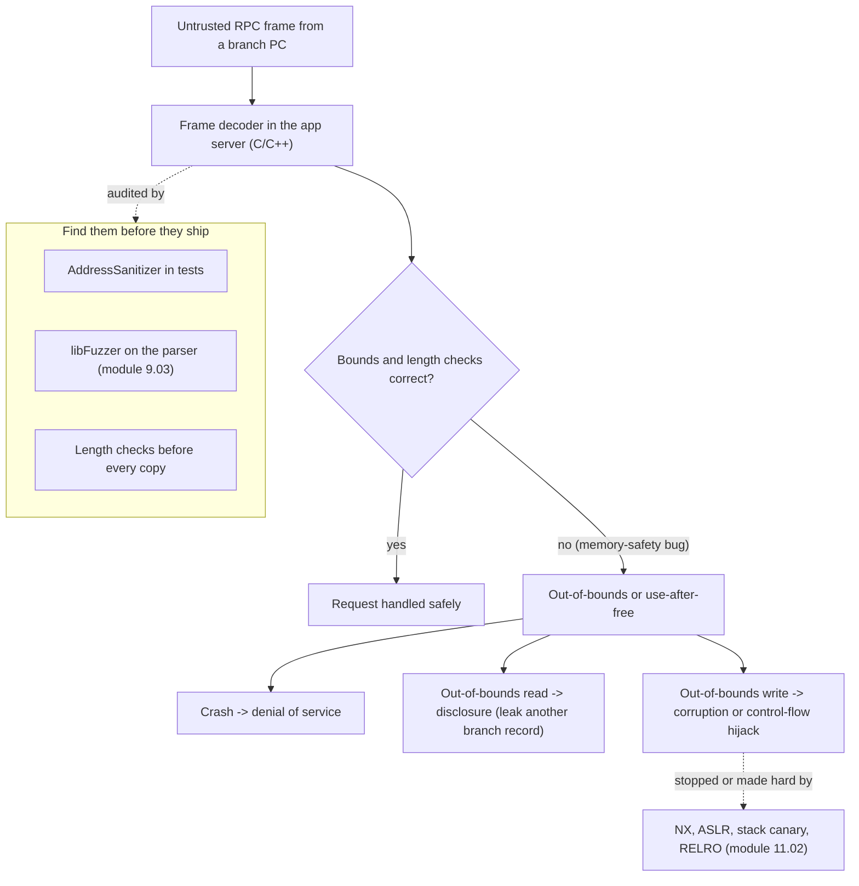

# Module 11.01: Memory-safety bugs

**Estimated hours:** 3

**What you will learn**

1. What a memory-safety bug is, the six main classes of them, and why they are the single largest source of serious security vulnerabilities.
2. What an attacker can do with each class **in principle** (crash, disclose, corrupt or redirect) so you understand the risk, without writing a single exploit.
3. How to find and fix memory-safety bugs in your own C and C++ with AddressSanitizer and a fuzzer, using a loan-origination RPC decoder as the worked example.

**Prerequisites:** [Module 10.10: Design: banking transaction system](../phase-10-backend-fundamentals-and-system-design/module-10-design-banking-transaction-system.md). You also lean on module 1.05 (pointers), 1.10 (process memory layout), 1.11 (undefined behaviour), 3.05 (malloc internals), 8.05 (how ASan works), 8.06 (memory corruption patterns) and 9.03 (fuzzing).

---

## 1. One-line intuition

A memory-safety bug is a program touching memory it was never given: past the end of a buffer, after it was freed, or before it was set; an attacker who controls the input that triggers it can often turn that mistake into a crash, a data leak, or control of the program.

## 2. Real-life analogy

Think back to the warehouse clerk from module 0.01, working the rows of numbered pigeonholes.

- You hand the clerk a form that says "copy these 40 letters into pigeonholes 100 to 115". There are only 16 holes there (100 to 115). The clerk, who never counts, keeps going into holes 116, 117, 118. That is a **buffer overflow**: you wrote past the end, into pigeonholes that belonged to something else, maybe the note that tells the clerk which desk to return to next.
- You tell the clerk "the file in hole 200 is finished, it can be reused", then a moment later "read me the file in hole 200". Someone else's new file may already be there. That is **use-after-free**: reading or writing through a pointer to memory that was handed back.
- You say "return hole 200" twice. The filing system's bookkeeping gets confused about what is free. That is a **double free**.
- You ask the clerk to read hole 300, which you never filled in. The clerk reads whatever the last tenant left there and reports it as your data. That is an **uninitialised read**, and if the clerk reads it out to a stranger, it is a **disclosure**.

The clerk is the CPU. It does exactly what the form says and never checks whether the holes belong to you. In C and C++ **you** are the one who has to count. Every one of these bugs is a counting or bookkeeping mistake, and every one can become a security hole when the "form" comes from an attacker over the network.

## 3. Why it exists: the problem it solves

C and C++ give you raw access to memory with no automatic checks. That is the point: it is why they are fast and why operating systems, databases and trading systems are written in them. A `memcpy` is a handful of instructions with no bounds check, so it runs at memory speed. The cost is that **nothing** stops you writing past the end of an array or reading freed memory. The language calls these situations **undefined behaviour** (module 1.11): the standard places no requirement on what happens, so the compiler assumes they never happen and the CPU simply does the mechanical thing.

Why does this matter for security and not just correctness? Because the bytes an attacker sends you often end up in your buffers. If you mis-count by one byte while copying an attacker-controlled branch code into a fixed array on the stack, you have not just a bug but a bug an attacker can **steer**. The difference between a reliability bug and a security bug is often only "can an outsider trigger it on demand?".

The scale is not a matter of opinion. Microsoft reported that around 70% of the security vulnerabilities it assigns a CVE to each year are memory-safety issues. The Chrome security team at Google reported the same figure, around 70%, for serious security bugs in Chromium. Two of the largest C and C++ codebases in the world, measured independently, land on the same number. That is why this module exists, why module 11.02 is about the mitigations, and why memory-safe languages (Rust, Go) are now used for new network-facing code.

What breaks without the discipline in this module: a parser that reads loan requests from branch machines becomes the way an attacker gets into the bank's network. The famous examples, Morris worm (1988, stack overflow in `fingerd`), Code Red (2001, overflow in IIS), Heartbleed (2014, an over-read in OpenSSL that leaked server memory including private keys), were all memory-safety bugs in C.

## 4. Three layers of depth

### Layer 1 (beginner): the six classes, in plain terms

Every memory-safety bug is one of these. You met the mechanics in modules 1.06, 1.08, 1.11 and 8.06; here they are named as security bug classes.

| Class | What happens | Smallest example |
|---|---|---|
| **Stack buffer overflow** | Write past the end of a local array; the bytes after it on the stack (including the saved return address) get overwritten | `char b[16]; strcpy(b, attacker_string);` |
| **Heap buffer overflow** | Write past the end of a `malloc`ed block; the next chunk's header or data gets overwritten | `char *b = malloc(16); memcpy(b, src, 40);` |
| **Use-after-free (UAF)** | Read or write through a pointer after `free`; the memory may hold a different object now | `free(p); use(p);` |
| **Double free** | Free the same block twice; the allocator's free-list bookkeeping is corrupted | `free(p); free(p);` |
| **Uninitialised read** | Read a variable or buffer before writing it; you get stale bytes from whoever used that memory last | `int n; send(fd, &n, sizeof n);` |
| **Integer overflow into a small allocation** | An arithmetic wrap makes a size look small, you allocate too little, then write the real (large) amount | `malloc(count * size)` where `count*size` wraps |

A seventh, the **format-string bug**, is a cousin: passing attacker text as the format argument of `printf` (`printf(user)` instead of `printf("%s", user)`) lets the input's `%` directives read the stack, and `%n` even write to memory. It is a memory-safety bug reached through a formatting function, and the fix is trivial (`-Wformat=2`, never pass user data as a format).

"Safe" does not mean "no crash". Many of these first show up as a crash (good: the OS stopped the program). The danger is the ones that do **not** crash: a read that quietly returns the wrong record, or a write that corrupts a neighbouring object the program keeps using.

### Layer 2 (working engineer): what an attacker can do, in principle

Keep this at the level of "what is the risk", not "how do I build a weapon". For a loan server the three outcomes map onto the classic security triad.

**1. Crash = denial of service (availability).** The simplest outcome. A one-packet input that reliably crashes the app server means an attacker can keep the lending platform down: every branch retries, the process restarts, the next packet kills it again. No data is stolen, but the bank cannot originate loans. An over-read or a null-deref that just faults is "only" a DoS, and for a bank that is still a serious incident.

**2. Read out of bounds = information disclosure (confidentiality).** If the code reads more bytes than it should, or reads a buffer that still holds an earlier request, it can hand the attacker data that was never meant for them. Heartbleed is the textbook case: a length field was trusted without checking it against the actual buffer size, so the server replied with up to 64 KB of whatever happened to be next in memory, which included other users' data and the server's private key. In a lending context the equivalent is a reused request buffer leaking **another branch's customer record**, because the new, shorter request did not overwrite all of the previous, longer one, and the code sent back the whole buffer.

**3. Write out of bounds = corruption or control-flow hijack (integrity).** A write past a buffer overwrites whatever sits after it. Two sub-cases:
   - **Data corruption.** The neighbouring bytes are another variable, a length, a flag, an array of pointers. Overwriting them changes the program's decisions: a status flag flips, a loan amount changes, an access check that read "role = CLERK" now reads something else.
   - **Control-flow hijack.** The bytes after a stack buffer include the **saved return address**, the address the CPU jumps to when the function returns (you saw it in module 1.04). The bytes after a heap object may include a **function pointer** or a C++ object's **vtable pointer**. If an attacker can overwrite one of those with an address of their choosing, then when the function returns or the pointer is called, the CPU jumps where the attacker said. That is the essence of "arbitrary code execution": the input chose where the program goes next.

That last paragraph is the entire conceptual basis of exploitation, and it is as far as this course goes. We will **not** build a working exploit. What you need for your job is the mental model: *an out-of-bounds write near a return address or a function pointer can, in principle, redirect control flow; that is why overwriting a few bytes you did not mean to is not a cosmetic bug.* Module 11.02 then shows the three mitigations (NX, ASLR, stack canaries) that make this far harder, and why "far harder" is not "impossible".

**Why it is usually harder than it sounds.** On a modern Linux or Windows system the attacker faces: a non-executable stack and heap (NX, so they cannot just place code in their input and jump to it), randomised addresses (ASLR, so they do not know where anything is), and a stack canary (a secret value between the buffer and the return address that the function checks on exit). Each of these turns "overwrite the return address and win" into a research project. They are mitigations, not cures; the real fix is to not have the bug. That is the thread running through both modules.

### Layer 3 (internals): the heap-metadata angle, and the CVE lifecycle

**Heap metadata (link to module 3.05).** You learned that glibc's `malloc` stores a small **header** immediately before each block you get, holding the chunk's size and some flags, and that freed small chunks are linked into per-thread **tcache** lists and per-arena bins using pointers stored *inside the freed chunk*. Two consequences for security:

- A **heap buffer overflow** writes past your block into the **next chunk's header**. Corrupt the size field and the next `malloc`/`free` does arithmetic on a bogus size. Historically attackers used this to make the allocator return a pointer into memory they chose. glibc now sanity-checks sizes and aborts with messages like `malloc(): corrupted top size` (you saw these in module 3.05), which is the allocator catching the corruption it was handed.
- A **double free** or **use-after-free** corrupts the free-list pointers. Classic attacks made `malloc` return an already-in-use address. glibc's modern defences (tcache key checks, and **safe-linking**, which XORs free-list pointers with a per-run secret) exist specifically to make these harder. Again: mitigations layered on top, because the bugs keep happening.

The takeaway is not the attack mechanics; it is *why* a one-byte overflow is dangerous even when it does not touch a return address: it can corrupt the allocator's own bookkeeping, and the crash then happens later, far from the real bug. That "detected here, caused earlier" gap is exactly why you reach for AddressSanitizer, which reports the write at the instruction that did it, not at the later abort.

**The CVE lifecycle.** When a memory-safety bug turns out to be a security vulnerability, it moves through a standard process you should be able to describe:

1. **Discovery.** A researcher, an internal fuzzing run, or an incident finds it.
2. **Private report.** It goes to the vendor through responsible/coordinated disclosure, often with an embargo (typically up to 90 days, the Google Project Zero convention).
3. **CVE assignment.** A **CVE** (Common Vulnerabilities and Exposures) identifier like `CVE-2014-0160` (Heartbleed) is assigned by a CVE Numbering Authority. It gets a **CVSS** score (0.0 to 10.0) describing severity.
4. **Fix and advisory.** The vendor ships a patch and publishes an advisory. Downstream distributions (Ubuntu, Red Hat) rebuild and push updates.
5. **Public disclosure.** Details become public, often with a proof-of-concept. The clock for defenders is now running against attackers writing exploits.
6. **Patch rollout.** Operators patch. The gap between disclosure and patching is when systems are most exposed.

For a bank, steps 4 to 6 are an operational drill: a security advisory for OpenSSL or glibc triggers an emergency change. Your job as a C++ engineer sits at step 1, keeping your own code out of this pipeline, and at step 6, knowing which of your binaries link the affected library.

**Memory-safe languages, and why C++ stays.** Rust and Go enforce memory safety at compile time or with cheap runtime checks, so whole classes above simply cannot happen in safe code. New network-facing components across the industry are increasingly written in them for this reason. C++ does not go away: there are tens of millions of lines of it in databases, kernels and the bank's own platform, it interoperates with everything, and rewrites are risky. The professional answer is **hardened C++**: the mitigations in 11.02, the safe APIs below, sanitizers and fuzzing in CI (module 9.03, 9.04), and modern types (`std::string`, `std::span`, `std::vector::at`) that carry their size with them so the counting is done for you.

## 5. Architecture diagram



The one idea: the decoder is the attack surface, the bug classes are the ways it fails, the mitigations make the worst case hard, and the defence box is what keeps bugs out in the first place.

## 6. Code

We will not write an exploit. We will do what the job actually is: take a small decoder with real bugs in it and let **AddressSanitizer** (ASan, module 8.05) point at each one. ASan instruments every memory access and aborts at the exact instruction that goes out of bounds or touches freed memory, printing both the faulting access and the allocation.

Two tiny C programs, each with one deliberate bug, built with `-fsanitize=address`.

```c
/* uaf.c - a use-after-free. ASan finds it in milliseconds. */
#include <stdlib.h>
#include <string.h>
#include <stdio.h>

int main(void) {
    char *rec = malloc(32);
    strcpy(rec, "loan HYD001");
    free(rec);                 /* record returned to the allocator */
    printf("%s\n", rec);       /* BUG: read through a dangling pointer */
    return 0;
}
```

```c
/* heap_of.c - a one-byte heap overflow (off-by-one on the NUL terminator). */
#include <stdlib.h>
#include <string.h>

int main(void) {
    char *branch = malloc(6);          /* "HYD001" is 6 chars + 1 for the NUL */
    memcpy(branch, "HYD001", 6);
    branch[6] = '\0';                  /* BUG: index 6 is one past a 6-byte block */
    free(branch);
    return 0;
}
```

Compile and run on Linux (in WSL):

```bash
gcc -std=gnu17 -g -fsanitize=address -o uaf uaf.c
./uaf
gcc -std=gnu17 -g -fsanitize=address -o heap_of heap_of.c
./heap_of
```

Expected output (addresses and PIDs vary; this is a real run, trimmed):

```text
==6109==ERROR: AddressSanitizer: heap-use-after-free on address 0x503000000040 ...
READ of size 2 at 0x503000000040 thread T0
    #1 0x... in main uaf.c:9
freed by thread T0 here:
    #1 0x... in main uaf.c:8
previously allocated by thread T0 here:
    #1 0x... in main uaf.c:6
```

```text
==6122==ERROR: AddressSanitizer: heap-buffer-overflow on address 0x502000000016 ...
WRITE of size 1 at 0x502000000016 thread T0
    #0 0x... in main heap_of.c:7
allocated by thread T0 here:
    #0 0x... in malloc
SUMMARY: AddressSanitizer: heap-buffer-overflow heap_of.c:7 in main
```

Read the report like an engineer, not a victim:

- The first line names the **class** (`heap-use-after-free`, `heap-buffer-overflow`) and whether it was a **READ** or a **WRITE**. Read-vs-write tells you disclosure-risk vs corruption-risk.
- The stack under the error is **where it happened** (`uaf.c:9`, `heap_of.c:7`). For the UAF, ASan also prints **where it was freed** and **where it was allocated**, the three facts you need to fix it.
- The fix for `uaf.c` is to not use `rec` after `free` (and set `rec = NULL` after freeing so a later use faults immediately). The fix for `heap_of.c` is `malloc(7)`, or better, stop hand-counting and use `strlen(src) + 1`, or a `std::string`.

This is the entire loop of defensive memory-safety work: build with ASan, run your tests and your fuzzer, read the report, fix the counting. You are not studying how to break programs; you are studying how to make the program tell on itself before an attacker does.

## 7. Use case: core-banking loan-origination platform

The app server from resume claim H4 accepts RPC-over-TCP frames from branch PCs (the wire format from module 5.07: a 4-byte length, a 2-byte opcode, a 4-byte request id, then a payload). **Those frames are untrusted input.** A branch PC can be compromised, a laptop on the branch LAN can speak the protocol, and a malicious or buggy client can send any bytes at all. The decoder that turns those bytes into a `LoanRequest` is the platform's primary memory-safety attack surface, exactly the box in the diagram.

**The decision it drove: a parser-hardening checklist, enforced in code review and CI.** On this platform the rule was that any function reading from the wire had to satisfy, and show in review, this list:

1. **Length check before every copy.** Never `memcpy`/`strcpy` into a fixed buffer without first checking the source length against the destination size. The decoder in module 5.07 does this: its `Reader::need(k)` throws if fewer than `k` bytes remain, so a truncated or lying length can never make it read past the buffer.
2. **Bounded reads only.** The length field in the header is checked against `MAX_FRAME_LEN` (1 MiB) *before* it is trusted, so a 4-byte `0xFFFFFFFF` cannot make the server try to assemble a 4 GB frame.
3. **Reject, then log, safely.** On a bad field, reject the request and log it, but log only a bounded, sanitised copy (printable characters, capped length), never the raw attacker bytes straight into a format string or a fixed buffer.
4. **Fuzz the parser (module 9.03).** The decoder has a libFuzzer harness in CI so that millions of malformed frames are thrown at it under ASan on every change.

The decision this list drove was concrete: the team moved the decoder behind the `Reader`/`FrameDecoder` types from 5.07 (bounds-checked by construction) and deleted every hand-written `while (*p) *q++ = *p++;` copy loop, because those loops are exactly the ones a fuzzer finds and a reviewer cannot eyeball. The interview-ready sentence is: *"Our RPC decoder parses untrusted frames, so we treated it as the attack surface: length checks before copies, a size cap before any allocation, bounded sanitised logging on reject, and a libFuzzer target under ASan in CI."*

## 8. Lab

You will find and fix memory-safety bugs in a frame decoder using ASan and libFuzzer. **No exploit writing.** The whole lab is detection and repair. Work in `~/labs/11.01` inside WSL.

### Part A: see each class crash under ASan (25 minutes)

1. Type the two programs from section 6 (`uaf.c`, `heap_of.c`). Build each with `gcc -std=gnu17 -g -fsanitize=address` and run it.
2. Confirm you can read, in each report: the bug class, READ vs WRITE, the source line, and (for the UAF) the free site and allocation site.
3. Write a third tiny program `stack_of.c` with `char code[6]; strcpy(code, "HYD001-ANDHERI");` in a function, build it with `-fsanitize=address -g`, run it. ASan reports a `stack-buffer-overflow`. Note that this one writes toward the saved return address; this is the control-flow-hijack class, and ASan caught it as a write.

Expected: three reports, three classes (`heap-use-after-free`, `heap-buffer-overflow`, `stack-buffer-overflow`), each naming the exact line.

### Part B: fix them and prove the fix (15 minutes)

1. Fix `uaf.c` (do not use after free; set the pointer to `NULL` after `free`). Fix `heap_of.c` (`malloc(7)` or `strlen+1`). Fix `stack_of.c` (a 32-byte buffer, or `snprintf`, or a `std::string`).
2. Rebuild each with ASan and run. Expect **no** ASan output and a clean exit. "Silent" is success.

Expected: all three run cleanly under ASan.

### Part C: the three planted bugs in the RPC decoder (45 minutes)

A starter decoder for the module 5.07 frame format is provided below as `decode.c`. It compiles and works on well-formed frames, but it has **three** memory-safety bugs typical of hand-written parsers. Your job is to find them with tools, not by eye, and fix them. (If module 9.03 has shipped its `rpc` fuzz target, use that instead; the shape is identical.)

```c
/* decode.c - decode a module-5.07 frame. Has three memory-safety bugs to find.
 * Frame: [len u32 BE][op u16 BE][req_id u32 BE][payload].
 * CREATE_LOAN payload (little-endian): customer_id u64 | amount i64 |
 *   tenure u16 | product (u16 len + bytes) | branch (u16 len + bytes). */
#include <stdint.h>
#include <stdio.h>
#include <stdlib.h>
#include <string.h>

struct loan { uint64_t customer_id; int64_t amount; uint16_t tenure;
              char product[9]; char branch[7]; };

static uint16_t be16(const uint8_t *p) { return (uint16_t)((p[0] << 8) | p[1]); }
static uint32_t be32(const uint8_t *p) {
    return ((uint32_t)p[0]<<24)|((uint32_t)p[1]<<16)|((uint32_t)p[2]<<8)|p[3];
}

/* Copy a u16-length-prefixed string at *pp into dst (cap bytes incl NUL). */
static int take_str(const uint8_t **pp, const uint8_t *end, char *dst, size_t cap) {
    const uint8_t *p = *pp;
    uint16_t n = be16(p); p += 2;            /* BUG 1: reads 2 bytes without checking end */
    memcpy(dst, p, n);                        /* BUG 2: no check n < cap, and none vs end */
    dst[n] = '\0';
    *pp = p + n;
    return 0;
}

int decode(const uint8_t *buf, size_t len, struct loan *out) {
    if (len < 4) return -1;
    uint32_t flen = be32(buf);
    const uint8_t *p = buf + 4;
    const uint8_t *end = buf + 4 + flen;      /* BUG 3: end can point past buf+len */
    out->customer_id = 0; memcpy(&out->customer_id, p + 6, 8); p += 14;
    memcpy(&out->amount, p, 8); p += 8;
    out->tenure = (uint16_t)(p[0] | (p[1] << 8)); p += 2;
    take_str(&p, end, out->product, sizeof out->product);
    take_str(&p, end, out->branch, sizeof out->branch);
    return 0;
}

int LLVMFuzzerTestOneInput(const uint8_t *data, size_t size) {
    struct loan out; decode(data, size, &out); return 0;
}

#ifndef FUZZING
int main(void) {
    uint8_t frame[] = {0,0,0,27, 0,2, 0,0,0,1,   /* len=27, op=2, req_id=1 */
        1,0,0,0,0,0,0,0,  0,0x40,0x7a,0x10,0,0,0,0,  12,0, /* cust, amount, tenure */
        4,0,'H','L','0','1',  6,0,'H','Y','D','0','0','1'};
    struct loan out; decode(frame, sizeof frame, &out);
    printf("product=%s branch=%s tenure=%u\n", out.product, out.branch, out.tenure);
    return 0;
}
#endif
```

1. Build and run the happy path: `gcc -std=gnu17 -g -fsanitize=address decode.c -o decode && ./decode`. It should print the loan. The bugs do not fire on well-formed input; that is why they survive to production.
2. Now fuzz it. Build the fuzzer and run it for a few hundred thousand iterations:
   ```bash
   clang -g -O1 -DFUZZING -fsanitize=address,fuzzer decode.c -o decode_fuzz
   ./decode_fuzz -max_len=64 -runs=1000000
   ```
   Within seconds libFuzzer finds an input that makes ASan abort, saves it as a `crash-...` file, and prints the report. Read the class and line.
3. Replay the crash under the non-fuzz build to study it: `./decode_fuzz crash-<hash>`. Fix the first bug it found. The three fixes are: in `take_str`, check `end - p >= 2` before `be16`, then check `n <= end - p` and `n < cap` before `memcpy`; and in `decode`, reject when `flen > len - 4` (and when `len < 4 + 14 + 10`). Re-fuzz after each fix.
4. When all three are fixed, run the fuzzer again for `-runs=2000000`. It should finish with `Done ... runs` and no crash.

Expected: the fuzzer finds a crashing input in under a second initially; after the three fixes it runs millions of inputs cleanly. You have reproduced, in miniature, the "fuzz the parser under ASan" rule from section 7.

### Part D: the disclosure case without an exploit (20 minutes)

1. Write `reuse.c`: a function with a `static char buf[64]` that it fills from a request and then "sends" (prints) the first `reported_len` bytes, where `reported_len` comes from the request, not from how much was actually written. Call it twice: first with a long request ("full customer record"), then with a short one but a `reported_len` of 64.
2. Observe that the second call prints bytes left over from the first request: a miniature of the Heartbleed/"leak another branch's record" disclosure. No attacker code ran; a trusted length was wrong.
3. Fix it: send only `min(actually_written, sizeof buf)` bytes, and clear the buffer between uses. Rerun and confirm the leak is gone.

Expected: before the fix, the short request leaks tail bytes of the long one; after, it does not. Write down, in one sentence, why "trust the length field" is the root cause of both this and Heartbleed.

### Journal

Copy [journal/TEMPLATE.md](../journal/TEMPLATE.md) to `journal/YYYY-MM-DD-memory-safety-bugs.md`. Record: the three ASan report classes from Part A, how long the fuzzer took to find the first crash in Part C and the three fixes you made, and your one-sentence root cause from Part D. Note any bug you found that you would **not** have spotted by reading the code.

## 9. Common mistakes and misconceptions

| Mistake | Why it is wrong | Bug it causes |
|---|---|---|
| "It compiled with no warnings, so the memory use is fine" | Compilers cannot see most out-of-bounds accesses; only tools that check at runtime can | Shipping a parser with a latent overflow a fuzzer would have found |
| "A memory bug just crashes, worst case a restart" | Reads can disclose data; writes can corrupt or redirect control flow without any crash | Treating a security vulnerability as a mere reliability bug |
| "We validate on the client, so the server input is trusted" | Anyone can speak the protocol; the client is not a trust boundary | The server decoder is left unhardened |
| "ASan is a production feature we can leave on" | ASan roughly doubles memory and adds overhead; it is a test/CI tool, not a prod mitigation | Confusing finding bugs (ASan) with surviving them (NX/ASLR/canary) |
| "Checking the length *after* the copy is enough" | The out-of-bounds write already happened; the check runs too late | Classic off-by-one and overflow |
| "`strncpy` is the safe `strcpy`" | `strncpy` does not always NUL-terminate and pads with zeros; it has its own foot-guns | Non-terminated strings, later over-reads |
| "Integer overflow is just a wrong number" | A wrapped `count*size` makes a too-small allocation that the next write overflows | Heap overflow reached through arithmetic |

## 10. Resume link

This module supports several lines, spoken through the lab you just did:

- **Claim B, "undefined-behaviour-aware coding".** Say: *"Out-of-bounds access and use-after-free are undefined behaviour, which is why they are also security bugs. I harden parsers with length checks before copies and a size cap before allocation, and I gate them with a libFuzzer target under AddressSanitizer in CI."* You have the fuzzer-found-it-in-a-second story from Part C.
- **Claim F, "memory corruption investigation, ASan/TSan".** Say: *"I read an ASan report top-down: class, read or write, the faulting line, and for a UAF the free site and allocation site. The abort location is where it was detected; with heap corruption the cause is often earlier, so I reproduce under ASan which reports the write itself."*
- **Claim H4 / H5, the app server and incidents.** The parser-hardening checklist from section 7 is a concrete, defensible engineering decision an interviewer can probe.

Likely follow-up: *"What fraction of serious security bugs are memory-safety issues, and why?"* Answer: *"Around 70%, reported independently by both Microsoft and Google's Chrome team. Because C and C++ do no automatic bounds or lifetime checks, so any counting or ownership mistake on attacker-controlled input is a candidate."*

## 11. Interview questions

**Q1 (easy). Name three classes of memory-safety bug and say, for each, whether it is primarily a read problem or a write problem.**

<details>
<summary>Model answer</summary>

Buffer overflow is a write problem (writing past the end of a buffer). Use-after-free can be either (reading or writing freed memory). Uninitialised read is a read problem (reading memory before it was set). Others: double free (corrupts allocator bookkeeping), integer overflow leading to a too-small allocation (sets up a later write overflow), and format-string bugs (`%n` can write). The read-vs-write distinction maps to disclosure risk versus corruption risk.

</details>

**Q2 (easy). Roughly what proportion of serious security vulnerabilities in large C/C++ codebases are memory-safety bugs, and who reported it?**

<details>
<summary>Model answer</summary>

Around 70%. Microsoft reported that about 70% of the CVEs it assigns are memory-safety issues, and Google's Chrome security team reported the same figure, about 70%, for serious security bugs in Chromium. Two very large, independently measured codebases arriving at the same number is why the industry treats this as the dominant class and why memory-safe languages are being adopted for new network-facing code.

</details>

**Q3 (medium). In principle, how can an out-of-bounds write lead to an attacker controlling what the program does next? Keep it conceptual.**

<details>
<summary>Model answer</summary>

A write past a stack buffer can overwrite the function's saved return address; when the function returns, the CPU jumps to whatever address is now stored there. A write past a heap object can overwrite a function pointer or a C++ vtable pointer that is later called. If the attacker controls the bytes written, they can in principle set that address to code of their choosing, which is arbitrary code execution. In practice NX, ASLR and stack canaries make this very hard, which is module 11.02. The real fix is bounds-checking so the write never happens. I would not go further than this conceptually; building an exploit is not something I do or need to.

</details>

**Q4 (medium). You get `malloc(): corrupted top size` and an abort in production. What does it tell you and how do you find the real bug?**

<details>
<summary>Model answer</summary>

glibc keeps each heap chunk's size in a header just before the user data and sanity-checks it during `malloc`/`free`. That message means the size field of the top chunk was overwritten, almost always by a write past the end of the block allocated just before it. Crucially, the abort is where the corruption was *detected*, not *caused*; the bad write could be anywhere earlier. To find it I reproduce under AddressSanitizer, which instruments every heap access and reports the out-of-bounds write at the exact line, with both the write and the allocation stacks. If it only reproduces in production, I analyse the core dump in GDB, inspect the heap around the top chunk, and find which object's allocation sits just below the corrupted header. The fix is almost always a bounds error in a copy or loop.

</details>

**Q5 (hard). Your server reuses a per-request buffer. A customer reports seeing fragments of another branch's data in a response. No crash, no attacker code. What happened and how do you prevent the whole class?**

<details>
<summary>Model answer</summary>

This is an information-disclosure bug from trusting a length. The buffer is reused between requests; a long request fills it, a later short request only partly overwrites it, and the code sends back a number of bytes based on a reported/expected length rather than on how much was actually written this time, so the tail still holds the previous request's bytes. It is the same root cause as Heartbleed: a length field trusted without checking it against what was really produced. Prevention for the class: never send or process more bytes than were actually written this request; track an explicit `written` count and send `min(written, capacity)`; clear sensitive buffers between uses (and for secrets, right after use); prefer length-carrying types (`std::string`, `std::span`) over a raw buffer plus a separate length; and add a test that fills the buffer, then issues a short request, and asserts no stale bytes leak. I would also classify the leaked data: if it is customer PII, this is a reportable incident, not just a bug fix.

</details>

## 12. Revision

- Memory-safety bugs are a program touching memory it was not given: stack/heap overflow, use-after-free, double free, uninitialised read, integer-overflow-to-small-allocation, and the format-string cousin; around 70% of serious C/C++ security bugs (Microsoft and Google) are of this kind.
- An attacker who controls the triggering input can, in principle, crash (DoS), read out of bounds (disclosure, as in Heartbleed), or write out of bounds (corruption, or control-flow hijack via a return address or function pointer); mitigations in 11.02 make the worst case hard but the cure is not having the bug.
- Find them before they ship: length checks before every copy, a size cap before any allocation, bounded sanitised logging on reject, and a libFuzzer target under AddressSanitizer in CI; read an ASan report as class, read/write, line, and (for UAF) free and allocation sites.

---

Previous: [Module 10.10: Design: banking transaction system](../phase-10-backend-fundamentals-and-system-design/module-10-design-banking-transaction-system.md) | Next: [Module 11.02: ASLR, canaries, NX and secure C/C++ coding](module-02-aslr-canaries-nx-secure-coding.md)
