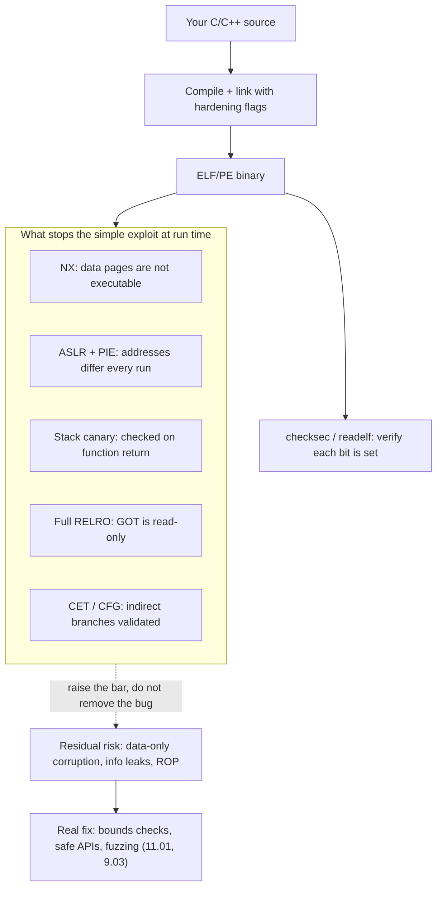

# Module 11.02: ASLR, canaries, NX and secure C/C++ coding

**Estimated hours:** 3

**What you will learn**

1. The four load-bearing exploit mitigations (NX, ASLR, stack canaries, RELRO) plus `_FORTIFY_SOURCE` and control-flow protection: what each one stops, what it does **not** stop, and the exact command to see whether a binary has it.
2. The GCC/Clang flags and the Windows equivalents that turn each mitigation on, and what Ubuntu 24.04 enables by default.
3. Secure C/C++ coding rules you can apply today: safe APIs, validation at trust boundaries, banned functions, static analysis with `clang-tidy` and `cppcheck`, and the CERT/MISRA standards.

**Prerequisites:** [Module 11.01: Memory-safety bugs](module-01-memory-safety-bugs.md). Also uses module 1.04 (the call stack and return address), 1.10 (process memory layout), 3.04 (virtual memory), 3.05 (the heap) and 8.06 (corruption patterns).

---

## 1. One-line intuition

Mitigations do not fix the bug; they make the common ways to exploit it fail fast: the stack cannot run code (NX), nobody knows where anything is (ASLR), a secret guard value catches an overwritten return address (canary), and the things worth corrupting are made read-only (RELRO).

## 2. Real-life analogy

Back to the bank branch. You cannot make every clerk perfect, so you add layered controls that assume a mistake will happen:

- **NX (no-execute):** the strongroom can hold cash, but you physically cannot *operate the branch* from inside it. Even if a robber hides instructions among the banknotes, no one can execute them there. Data pages hold data; they are not allowed to be code.
- **ASLR (address randomisation):** every morning the bank reshuffles which room holds the vault, the keys and the manager's office, and does not publish the map. A robber with a plan that says "go to room 12" is lost, because room 12 is somewhere different today.
- **Stack canary:** a tamper-evident seal placed just inside the door of each office. Before anyone leaves (a function returns), they check the seal. If it is broken, they raise the alarm and evacuate instead of walking out through a door a robber has moved.
- **RELRO:** the directory of "who to call for each service" is written in wet ink in the morning, then laminated. Once laminated (`relro,now`), a robber cannot quietly change an entry to redirect a call to themselves.

None of these makes the clerk count correctly. They make a single mistake far less likely to end in a robbery. That is the whole philosophy of exploit mitigation: defence in depth around bugs you have not found yet.

## 3. Why it exists: the problem it solves

Module 11.01 ended on the conceptual attack: overwrite a return address or a function pointer and the CPU jumps where the attacker said. In the 1990s that was often enough. You put your own machine code (**shellcode**) into the same buffer you overflowed, overwrote the return address with the buffer's address, and on return the CPU ran your code. It worked because the stack was executable, addresses were predictable, and nothing checked the return address.

Each mitigation kills one assumption of that recipe:

- Shellcode on the stack? **NX** makes the stack non-executable; the CPU faults the instant it tries to run data.
- Know the buffer's address? **ASLR** randomises it every run.
- Overwrite the return address undetected? The **stack canary** sits between the buffer and the return address and is checked on exit.
- Redirect a library call instead? **RELRO** makes the relocation tables read-only after startup.

Attackers adapted (return-oriented programming reuses existing executable code to sidestep NX; info-leaks defeat ASLR), so defenders added more (`_FORTIFY_SOURCE`, control-flow integrity, shadow stacks). This is an arms race, and you are not here to win it. You are here to (a) make sure your binaries ship with every mitigation on, because the cost is near zero and it raises the bar enormously, and (b) know what each one does **not** cover, so you never mistake "mitigations on" for "memory-safe". What breaks without them: a single overflow in 1999-era code was a straight path to code execution; the mitigations are why the same class of bug today is usually "just" a crash.

## 4. Three layers of depth

### Layer 1 (beginner): the four mitigations and how to see them

The one tool to learn first is **`checksec`**, which reads an ELF binary and prints which mitigations are compiled in. Install it: `sudo apt install checksec` (it is also bundled with pwntools). Then:

```bash
checksec --file=./myprogram
```

Here is a real comparison from this course's lab machine: the same source built three ways. `m_weak` has mitigations turned off, `m_default` is a plain `gcc -O2` build on Ubuntu 24.04, `m_hard` adds every flag explicitly.

```text
RELRO        STACK CANARY    NX           PIE          FORTIFY  FILE
No RELRO     No canary       NX disabled  No PIE       No       m_weak
Full RELRO   Canary found    NX enabled   PIE enabled  Yes      m_default
Full RELRO   Canary found    NX enabled   PIE enabled  Yes      m_hard
```

The headline: **you do almost nothing and Ubuntu's default `gcc` already gives you Full RELRO, a stack canary, NX and PIE.** That is the single most important fact in this module. The defaults are good; the sin is turning them off.

What the columns mean:

| Mitigation | What it stops | One-line "see it" |
|---|---|---|
| **NX** (also "DEP", `GNU_STACK`) | Running code placed in data (stack/heap) | `readelf -lW prog \| grep GNU_STACK` (want `RW`, not `RWE`) |
| **PIE + ASLR** | A predictable address map | run the program twice, compare addresses; `file prog` says "PIE" |
| **Stack canary** | An overflow silently overwriting the return address | `checksec` says "Canary found"; `nm -D prog \| grep stack_chk` |
| **RELRO** | Overwriting the GOT/relocation tables to redirect calls | `checksec` says "Full RELRO"; `readelf -dW prog \| grep BIND_NOW` |

ASLR has two parts. The **kernel** randomises where libraries, the stack and the heap go; this is controlled system-wide by `/proc/sys/kernel/randomize_va_space` (value `2` = full, the Ubuntu default). The **program's own code** is only randomised if it was built as a **PIE** (Position-Independent Executable, `-fPIE -pie`). A non-PIE binary loads its code at a fixed address even when kernel ASLR is on, so PIE matters.

### Layer 2 (working engineer): the flags, and what each does and does not stop

The hardened build line used for `m_hard` above, and the per-flag meaning:

```bash
g++ -O2 -g -Wall -Wextra -Werror -Wformat=2 \
    -D_FORTIFY_SOURCE=3 \
    -fstack-protector-strong -fstack-clash-protection \
    -fcf-protection=full \
    -fPIE -pie \
    -Wl,-z,relro,-z,now -Wl,-z,noexecstack \
    app.cpp -o app
```

| Flag | Mitigation | What it stops | What it does NOT stop |
|---|---|---|---|
| `-fstack-protector-strong` | Stack canary | An overflow reaching the saved return address past a vulnerable local | Overflows that corrupt data *before* the canary; heap overflows; exact-overwrite that restores the canary |
| `-fstack-clash-protection` | Stack-clash | A huge local allocation jumping the guard page into the heap | Ordinary overflows |
| `-D_FORTIFY_SOURCE=3` | Compile+runtime checks on `memcpy`/`strcpy`/`sprintf`/… | Many overflows where the destination size is known at compile time | Copies where the size is not statically known |
| `-fPIE -pie` | ASLR for the main binary | A fixed, known address for your own code and globals | Nothing, once the attacker leaks an address |
| `-Wl,-z,relro,-z,now` | Full RELRO | Overwriting the GOT to hijack a library call | Other writable targets |
| `-Wl,-z,noexecstack` | NX on the stack | Executing injected shellcode on the stack | Return-oriented programming (reusing existing code) |
| `-fcf-protection=full` | Intel CET: indirect-branch tracking (IBT) + shadow stack | Jumping into the middle of functions (ROP/JOP), on CET hardware | Pure data corruption |
| `-Wformat=2` | Format-string diagnostics | Passing user data as a format string (caught at compile) | Runtime-only format bugs (rare with `-Wformat=2`) |

Two behaviours you can verify yourself (and do in the lab):

- **`_FORTIFY_SOURCE` catches the obvious copy; the canary catches the subtle one.** A `strcpy` into a fixed array whose size the compiler can see is turned into `__strcpy_chk`, which aborts with `*** buffer overflow detected ***` *before* the write runs over. But a hand-written byte loop the compiler cannot size slips past FORTIFY; then the **canary** catches it on function exit with `*** stack smashing detected ***`. On the lab machine the `copy` path (a `strcpy`) aborted with "buffer overflow detected", and the `loop` path (a manual copy) aborted with "stack smashing detected". Two different mitigations, two different messages, same source bug.
- **ASLR is visible in two runs.** A PIE binary prints a different code/stack/libc address every run; a non-PIE binary prints the *same* code and globals address every time. Real figures from one run: the hardened binary's `main`-area code was at `0x622cde338340` then `0x61a64859a340` on the next run, while the no-PIE binary's code sat at `0x401260` both times.

**The honest limits, stated plainly:**

- Mitigations are **probabilistic or partial**, not proofs. A canary is a secret 8-byte value; if the attacker can *read* memory (an info-leak) they can learn it and overwrite it with itself. ASLR on 64-bit has good entropy, but a single leaked pointer can de-randomise an entire library.
- They protect **control flow**, mostly. A write that corrupts a *loan amount* or a *role flag* next to your buffer is pure data corruption; NX, ASLR and the canary do nothing about it. That is a disclosure/integrity bug the mitigations never see.
- They are a **floor, not a strategy.** Ship with all of them on (it is nearly free), and still do the work of 11.01: bounds checks, fuzzing, sanitizers. Sanitizers (ASan/UBSan) are a *testing* tool with heavy overhead; mitigations are the *production* floor. Do not confuse them.

**Windows equivalents.** You build the Win32 variant of the app server (claim H4) in Visual Studio, so you must know the MSVC switches:

| Concept | GCC/Clang | MSVC / Windows |
|---|---|---|
| Stack canary | `-fstack-protector-strong` | `/GS` (on by default) |
| ASLR | `-fPIE -pie` | `/DYNAMICBASE` (on by default) + `/HIGHENTROPYVA` |
| NX / DEP | `-Wl,-z,noexecstack` | `/NXCOMPAT` (on by default) |
| Control-flow integrity | `-fcf-protection`, Clang CFI | `/guard:cf` (Control Flow Guard); `/CETCOMPAT` for CET shadow stack |
| Fortified libc | `_FORTIFY_SOURCE` | the annotated CRT / SAL + `/sdl` and `/analyze` |

The `/guard:cf` and CET shadow-stack story on Windows is the same idea as `-fcf-protection`: validate the targets of indirect calls and returns so a corrupted pointer cannot send control anywhere it likes.

**Seeing Ubuntu's defaults.** `dpkg-buildflags --get CFLAGS` prints what Debian/Ubuntu packages are built with; on 24.04 it includes `-fstack-protector-strong -fstack-clash-protection -fcf-protection` and `-Wformat -Werror=format-security`, and the linker flags include `-Wl,-z,relro`. `gcc -Q --help=common | grep -E 'stack-protector|cf-protection|PIE'` shows that `-fstack-protector-strong`, `-fcf-protection=full`, `-fstack-clash-protection` and `-fPIE` are enabled in GCC 13 as shipped. And `gcc -dM -E -x c /dev/null | grep -i fortify` shows `_FORTIFY_SOURCE` defined as `3` at `-O2`.

### Layer 3 (internals): the canary in the disassembly, and the ELF bits

**The canary, as the CPU sees it.** Compile with `-fstack-protector-strong`, break on a vulnerable function in GDB, and disassemble. On x86-64 Linux the prologue reads a secret from thread-local storage at `fs:0x28` and stores it just below the saved frame; the epilogue compares it and calls `__stack_chk_fail` on mismatch. From a real GDB session in the lab:

```asm
copy_with_loop:
    endbr64                              ; CET landing pad (from -fcf-protection)
    push   rbp
    mov    rbp,rsp
    sub    rsp,0x40
    mov    rax,QWORD PTR fs:0x28         ; load the secret canary
    mov    QWORD PTR [rbp-0x8],rax       ; place it just below saved rbp/return addr
    ...                                  ; the body copies into [rbp-0x20] (the buffer)
    mov    rax,QWORD PTR [rbp-0x8]       ; reload the canary
    sub    rax,QWORD PTR fs:0x28         ; compare with the secret
    je     ok
    call   __stack_chk_fail@plt          ; mismatch -> abort, do NOT return
ok: leave
    ret
```

Read it: the buffer is at `[rbp-0x20]`, the canary at `[rbp-0x8]`, and the saved return address is above that at `[rbp+0x8]`. An overflow that runs from the buffer toward higher addresses hits the canary *before* it reaches the return address, so by the time the function returns the canary is wrong and `__stack_chk_fail` aborts. In the same session, reading `*(unsigned long *)($fs_base + 0x28)` showed the live canary value (a random 8-byte number, low byte `0x00` so a string overflow that stops at a NUL cannot easily copy it). That `0x00` low byte is deliberate: it makes the canary harder to carry through string functions.

**NX in the ELF.** `readelf -lW` shows a `GNU_STACK` program header. Its flags are `RW ` on a safe binary and `RWE` (the `E` = executable) on an unsafe one. On the lab binaries, `m_hard` showed `GNU_STACK ... RW` and also a `GNU_RELRO` segment; `m_weak` (built with `-z execstack`) showed `GNU_STACK ... RWE` and no RELRO. The kernel reads this header at load time and sets the stack's page permissions accordingly, so NX is literally one bit in the executable backed by the CPU's per-page no-execute bit (the NX bit in the page table, module 3.04).

**RELRO in the dynamic section.** `readelf -dW prog | grep -E 'FLAGS|BIND_NOW'` on `m_hard` showed `FLAGS BIND_NOW` and `FLAGS_1 ... NOW PIE`. "Full RELRO" means the dynamic linker resolves every symbol at startup (`BIND_NOW`) and then marks the GOT read-only, so the lazy-binding table an attacker used to love overwriting is frozen before `main` runs. "Partial RELRO" (the default without `-z now`) protects some sections but leaves the GOT writable for lazy binding.

**CET, as a note in the binary.** `readelf -nW m_hard` showed an `NT_GNU_PROPERTY_TYPE_0` note advertising `x86 feature: IBT, SHSTK`. IBT (indirect branch tracking) requires that every indirect jump/call land on an `endbr64` instruction (you saw one in the disassembly), which stops attackers jumping into the middle of a function. SHSTK (shadow stack) keeps a protected second copy of return addresses that the CPU checks on `ret`. These only take effect on CPUs that support CET, but the binary is marked ready.

## 5. Architecture diagram



## 6. Code

A single program makes NX/PIE/ASLR visible and lets you watch FORTIFY and the canary fire. It has two **deliberate** stack overflows (`copy`, `loop`) so you can see the mitigations stop them; never write code like that outside this lab.

```c
/* mitigations.c - make each mitigation visible.
 *   ./mitigations addr          print where code, globals, heap, stack, libc live
 *   ./mitigations copy  <text>  copy text into a 16-byte buffer with strcpy
 *   ./mitigations loop  <text>  same copy, but with a hand-written loop
 * "copy" and "loop" contain a DELIBERATE stack overflow. */
#include <stdint.h>
#include <stdio.h>
#include <stdlib.h>
#include <string.h>

int global_counter = 42;                     /* lives in .data */

static void show_addresses(void) {
    int on_stack = 0;
    int *on_heap = malloc(sizeof *on_heap);
    if (!on_heap) return;
    printf("code   (func)   : %p\n", (void *)(uintptr_t)&show_addresses);
    printf("global (.data)  : %p\n", (void *)&global_counter);
    printf("heap   (malloc) : %p\n", (void *)on_heap);
    printf("stack  (local)  : %p\n", (void *)&on_stack);
    printf("libc   (printf) : %p\n", (void *)(uintptr_t)&printf);
    free(on_heap);
}

static void copy_with_strcpy(const char *src) {   /* FORTIFY can see the 16 here */
    char branch[16];
    strcpy(branch, src);
    printf("copied '%s'\n", branch);
}

static void copy_with_loop(const char *src) {     /* FORTIFY cannot; only the canary */
    char branch[16];
    size_t i = 0;
    for (; src[i] != '\0'; ++i) branch[i] = src[i];
    branch[i] = '\0';
    printf("copied '%s'\n", branch);
}

int main(int argc, char **argv) {
    if (argc >= 2 && strcmp(argv[1], "addr") == 0) { show_addresses(); return 0; }
    if (argc >= 3 && strcmp(argv[1], "copy") == 0) { copy_with_strcpy(argv[2]); return 0; }
    if (argc >= 3 && strcmp(argv[1], "loop") == 0) { copy_with_loop(argv[2]); return 0; }
    fprintf(stderr, "usage: %s addr | copy <text> | loop <text>\n", argv[0]);
    return 2;
}
```

Build the default and the hardened versions, and inspect them:

```bash
# Default Ubuntu 24.04 build: already hardened
gcc -std=gnu17 -Wall -Wextra -Werror -g -O2 mitigations.c -o m_default

# Explicitly hardened (identical result on 24.04, but portable to older distros)
gcc -std=gnu17 -Wall -Wextra -Werror -Wformat=2 -g -O2 \
    -D_FORTIFY_SOURCE=3 -fstack-protector-strong -fstack-clash-protection \
    -fcf-protection=full -fPIE -pie -Wl,-z,relro,-z,now -Wl,-z,noexecstack \
    mitigations.c -o m_hard

checksec --file=m_default
./m_hard addr      # run twice; addresses change
./m_hard copy BRANCH-CODE-TOO-LONG-FOR-BUFFER   # FORTIFY aborts
./m_hard loop BRANCH-CODE-TOO-LONG-FOR-BUFFER   # canary aborts
```

Expected (real output, trimmed; addresses vary every run):

```text
code   (func)   : 0x622cde338340     <- different on the next run (PIE + ASLR)
global (.data)  : 0x622cde33b010
heap   (malloc) : 0x622d0cbc52a0
stack  (local)  : 0x7ffe3994ad94
libc   (printf) : 0x72a11cc60100
```

```text
*** buffer overflow detected ***: terminated       <- the copy (FORTIFY / __strcpy_chk)
Aborted (core dumped)
*** stack smashing detected ***: terminated         <- the loop (stack canary)
Aborted (core dumped)
```

Both overflow runs exit with code 134 (SIGABRT): the program killed itself on purpose rather than returning through a corrupted stack. That controlled abort is the mitigation working.

A second, positive example: the secure-coding patterns you should reach for instead of raw buffers. This compiles clean under `-Wall -Wextra -Werror -Wformat=2`.

```cpp
// safe_input.cpp - validation at the trust boundary, with safe APIs.
// Build: g++ -std=c++20 -O2 -Wall -Wextra -Werror -Wformat=2 safe_input.cpp -o safe_input
#include <charconv>
#include <cstdint>
#include <cstdio>
#include <cstring>
#include <optional>
#include <span>
#include <string_view>
#include <vector>

// Rule 1: validate against an allow-list, never "strip bad characters".
bool valid_branch_code(std::string_view s) {              // exactly 6 of [A-Z0-9]
    if (s.size() != 6) return false;
    for (char c : s)
        if (!((c >= 'A' && c <= 'Z') || (c >= '0' && c <= '9'))) return false;
    return true;
}

// Rule 2: parse numbers with error reporting (not atoi), then range-check.
std::optional<int64_t> parse_amount_paise(std::string_view s) {
    int64_t v = 0;
    auto [end, ec] = std::from_chars(s.data(), s.data() + s.size(), v);
    if (ec != std::errc{} || end != s.data() + s.size()) return std::nullopt;
    if (v <= 0 || v > 10'000'000'000LL) return std::nullopt;        // 1 paisa .. 10 crore
    return v;
}

// Rule 3: check arithmetic before you allocate; a 32-bit product can wrap.
std::optional<uint32_t> checked_bytes(uint32_t count, uint32_t size_each) {
    uint32_t total = 0;
    if (__builtin_mul_overflow(count, size_each, &total)) return std::nullopt;
    if (total > (1u << 20)) return std::nullopt;                   // cap at 1 MiB
    return total;
}

// Rule 4: a bounded view instead of pointer + separate length.
uint32_t sum_first_n(std::span<const uint8_t> bytes, size_t n) {
    if (n > bytes.size()) throw std::out_of_range("n larger than buffer");
    uint32_t sum = 0;
    for (uint8_t b : bytes.first(n)) sum += b;
    return sum;
}

int main() {
    std::printf("branch HYD001 valid? %d\n", valid_branch_code("HYD001"));
    std::printf("branch \"HYD';--\" valid? %d\n", valid_branch_code("HYD';--"));
    for (const char* s : {"2500000", "25e5", "-5", "99999999999999999999"}) {
        auto v = parse_amount_paise(s);
        std::printf("amount %-22s -> %s\n", s, v ? std::to_string(*v).c_str() : "rejected");
    }
    uint32_t count = 268'435'457, each = 16;                       // both from the wire
    std::printf("naive   %u x %u = %u (wrapped!)\n", count, each, count * each);
    auto bad = checked_bytes(count, each);
    std::printf("checked %u x %u -> %s\n", count, each, bad ? "ok" : "rejected");
    for (const char* id : {"LN-42", "LN-2026-000000123"}) {        // Rule 5: snprintf + truncation check
        char line[16];
        int need = std::snprintf(line, sizeof line, "loan=%s", id);
        bool fits = need >= 0 && (size_t)need < sizeof line;
        std::printf("snprintf %-17s needs %2d of %zu -> %s\n", id, need + 1, sizeof line,
                    fits ? "fits" : "truncated, reject");
    }
    const char field[8] = {'P','L','0','1','X','X','X','X'};        // Rule 6: strnlen, no NUL needed
    std::printf("strnlen(field,8) = %zu\n", strnlen(field, sizeof field));
    std::vector<int> rates{850, 900, 1050};                         // Rule 7: at() checks the index
    try { (void)rates.at(5); } catch (const std::out_of_range&) { std::printf("rates.at(5) threw\n"); }
    return 0;
}
```

Expected output (real run):

```text
branch HYD001 valid? 1
branch "HYD';--" valid? 0
amount 2500000                -> 2500000
amount 25e5                   -> rejected
amount -5                     -> rejected
amount 99999999999999999999   -> rejected
naive   268435457 x 16 = 16 (wrapped!)
checked 268435457 x 16 -> rejected
snprintf LN-42             needs 11 of 16 -> fits
snprintf LN-2026-000000123 needs 23 of 16 -> truncated, reject
strnlen(field,8) = 8
rates.at(5) threw
```

The one-liner wrap (`268435457 * 16` fits in a `uint32_t` as `16`) is the integer-overflow-to-small-allocation class from 11.01, caught here by `__builtin_mul_overflow` before any allocation.

## 7. Use case: core-banking loan-origination platform

**The decision it drove: a hardened build on both platforms, enforced by `checksec` in CI, plus a fuzzed parser.** The lending platform shipped a Linux app server (claim H4) and a Win32 variant of its synchronisation layer. Security review required that every release binary pass a mitigation check, so the build pipeline did two things:

1. On Linux, after the build, run `checksec --file=app` and **fail the pipeline** unless it reports Full RELRO, Canary, NX and PIE. This caught a real regression: a third-party static library shipped an object built `-z execstack`, which silently turned the *whole* binary's `GNU_STACK` to `RWE` (NX disabled). `checksec` flagged it; the fix was to rebuild the dependency and add `-Wl,-z,noexecstack` explicitly.
2. On Windows (MSVC), require `/GS /DYNAMICBASE /HIGHENTROPYVA /NXCOMPAT /guard:cf` and verify with `dumpbin /headers` / `/loadconfig` that CFG and high-entropy ASLR are present.

And, separately, the parser that reads RPC frames (module 5.07, and the attack surface from 11.01) had a libFuzzer target running under ASan on every pull request. The explicit reasoning recorded in the design doc: *mitigations are the floor that makes a missed bug "merely" a crash; the fuzzer is how we stop the bug reaching the floor. Both, not either.*

The honest-cost note for interviews: PIE on x86-64 has a small performance cost from position-independent addressing (historically a few percent on register-starved 32-bit, much less on x86-64); the bank accepted it everywhere because a predictable code address is the first thing an attacker wants. FORTIFY and the canary are near-free. The team measured no meaningful throughput change on the hot path from `m_default` versus `m_weak`.

## 8. Lab

Work in `~/labs/11.02` in WSL. Install the tools: `sudo apt install checksec clang-tidy cppcheck`.

### Part A: see the defaults, and prove PIE/ASLR (25 minutes)

1. Build `mitigations.c` as `m_default` with the plain `gcc -O2` line. Run `checksec --file=m_default`. Record the four columns.
2. Run `./m_default addr` twice. Confirm the code, heap, stack and libc addresses all change between runs. Then build a non-PIE version with `-no-pie` and run its `addr` twice: the code and globals addresses are now identical each run. Explain why in your journal.
3. Check the system switch: `cat /proc/sys/kernel/randomize_va_space` should be `2`. (Do not disable it; just read it.) Run a PIE binary under `setarch -R ./m_default addr` twice: `-R` disables randomisation for that launch, and the addresses stop changing. This proves the randomisation is coming from the kernel, not the program.

Expected: `m_default` shows Full RELRO / Canary / NX / PIE; PIE addresses vary, `-no-pie` and `setarch -R` addresses do not.

### Part B: watch FORTIFY and the canary fire (20 minutes)

1. With `m_default`, run `./m_default copy HYD001` (fits) then `./m_default copy BRANCH-CODE-TOO-LONG-FOR-BUFFER`. Record the exact abort message and exit code (`echo $?`, expect 134).
2. Run `./m_default loop BRANCH-CODE-TOO-LONG-FOR-BUFFER`. Record its abort message. It should differ from the `copy` one.
3. Now build `m_weak` with mitigations off: `gcc -O2 -U_FORTIFY_SOURCE -D_FORTIFY_SOURCE=0 -fno-stack-protector -no-pie -z execstack -Wl,-z,norelro mitigations.c -o m_weak`. Run the same two overflow commands. Instead of a clean "detected" abort you get a raw `Segmentation fault` (exit 139) or, worse, silent success. Run `checksec --file=m_weak` and confirm every protection says "No"/"disabled".

Expected: `m_default` aborts with "buffer overflow detected" (copy) and "stack smashing detected" (loop); `m_weak` segfaults or corrupts silently. Write one sentence on why "segfault" is a *worse* outcome than "detected and aborted".

### Part C: see the canary in GDB (20 minutes)

1. Build `gcc -std=gnu17 -g -O0 -fstack-protector-strong mitigations.c -o m_gdb`.
2. In GDB: `break copy_with_loop`, `run loop HYD001`, then `disassemble copy_with_loop`. Find the `mov rax, QWORD PTR fs:0x28` in the prologue and the `sub rax, QWORD PTR fs:0x28` / `call __stack_chk_fail` in the epilogue.
3. Print the live canary: `p/x *(unsigned long *)($fs_base + 0x28)`. Note that its lowest byte is `00`. Explain in your journal why a zero low byte makes the canary harder to leak through string functions.

Expected: you can point at the three canary instructions and read its value.

### Part D: static analysis finds the bug before you run it (20 minutes)

1. Create `legacy_log.c` with the four classic mistakes: a `strcpy` into a fixed buffer, an `sprintf` into it, an `atoi` with no error check, and `printf(note);` with a user-controlled format.
2. Compile with `gcc -Wall -Wextra -Wformat=2 -c legacy_log.c`. Note which the compiler catches (the format-string one, via `-Wformat-security`).
3. Run `clang-tidy legacy_log.c -checks="-*,bugprone-*,cert-*,clang-analyzer-security.*" --`. Record the CERT and bugprone findings (it flags the insecure `strcpy`/`sprintf`, the unchecked return, and `atoi` via `cert-err34-c`).
4. Run `cppcheck --enable=all legacy_log.c`. For a bonus, make a file with `char *p = malloc(8); strcpy(p, "HYD001-ANDHERI");` and a path that `return`s without freeing; cppcheck reports both the overflow and `Memory leak: p`.
5. Rewrite `legacy_log.c` using the `safe_input.cpp` patterns (`snprintf` with a truncation check, `strtol`/`from_chars`, `printf("%s", note)`), and confirm all three tools are now silent.

Expected: the compiler catches the format bug; `clang-tidy` adds the CERT `strcpy`/`sprintf`/`atoi` findings; `cppcheck` catches the constant-size overflow and the leak; the rewrite is clean.

### Journal

Copy [journal/TEMPLATE.md](../journal/TEMPLATE.md) to `journal/YYYY-MM-DD-mitigations-and-secure-coding.md`. Record: your `checksec` table for `m_default` vs `m_weak`; the two different abort messages from Part B and why "detected" beats "segfault"; the three canary instructions from Part C; and the list of findings each static tool produced in Part D. Add one sentence: which mitigation protects control flow but does nothing about a corrupted loan amount next to the buffer, and why.

## 9. Common mistakes and misconceptions

| Mistake | Why it is wrong | Consequence |
|---|---|---|
| "Mitigations make the code memory-safe" | They raise the cost of exploiting a bug; the bug is still there | A data-only corruption or info-leak sails straight through |
| "I'll turn these on for the release build later" | Ubuntu already enables them by default; turning them *off* is the only way to lose them | Someone adds `-z execstack` or a static lib disables NX and nobody notices without `checksec` |
| "ASan in production gives me the canary and more" | ASan is a heavy test tool; it is not an exploit mitigation and must not run in prod | 2x memory, slower, and it is a debugging aid, not a defence |
| "A stack canary stops all stack overflows" | It only catches overflows that reach past it to the return address, and only on function return | Overflows into adjacent locals, or exact-overwrite that restores the canary, are missed |
| "PIE is enough for ASLR" | PIE randomises your binary; the kernel (`randomize_va_space`) randomises libs/stack/heap | Both are needed; a single leaked pointer defeats either |
| "`strncpy` and `strcat` are the safe versions" | `strncpy` may not NUL-terminate; `strncat`'s size argument is the space left, not the buffer size | New overflows and non-terminated strings |
| "`-Wformat=2` is pedantic noise" | It catches format-string bugs at compile time, a whole vulnerability class | A `printf(user)` ships to production |

## 10. Resume link

- **Claim B, "undefined-behaviour-aware coding, performance optimisation".** Say: *"Release binaries ship with every mitigation on, verified by `checksec` in CI, so a missed bug degrades to a crash rather than code execution. On x86-64 the cost is small and I measured no hot-path regression from PIE and FORTIFY."*
- **Claim G, "Linux, GCC/Clang ... Windows, MSVC, Visual Studio".** You can state the GCC flags and their MSVC equivalents (`/GS`, `/DYNAMICBASE`, `/NXCOMPAT`, `/guard:cf`, `/CETCOMPAT`) and how to verify each with `checksec`/`readelf` and `dumpbin`.
- **Claim F, "memory corruption investigation".** You can read a canary in a disassembly and explain `GNU_STACK` and RELRO from `readelf`, which is exactly the vocabulary of a crash-dump conversation.

Likely follow-up: *"A stack canary is on; is the program safe from buffer overflows?"* Answer: *"Safer, not safe. The canary only catches overflows that reach the return address and only at function return. It does nothing about a write into an adjacent variable, a heap overflow, or an attacker who can read the canary via an info-leak. It is a floor; the fix is bounds-checked code, which I verify with ASan and a fuzzer."*

## 11. Interview questions

**Q1 (easy). What does NX (DEP) stop, and how do you check a Linux binary has it?**

<details>
<summary>Model answer</summary>

NX marks data pages (stack, heap) as non-executable, so the CPU faults if it tries to run bytes placed there, e.g. shellcode injected into a buffer. Check it with `checksec --file=prog` (want "NX enabled") or `readelf -lW prog | grep GNU_STACK`, where the flags should be `RW ` and not `RWE`. It is backed by the CPU's per-page no-execute bit. It does not stop return-oriented programming, which reuses existing executable code.

</details>

**Q2 (easy). Ubuntu 24.04, plain `gcc -O2`. Which mitigations do you get for free?**

<details>
<summary>Model answer</summary>

Full RELRO, a stack canary (`-fstack-protector-strong`), NX, and PIE (so the binary participates in ASLR). GCC 13 also defaults to `-fcf-protection=full` and `-fstack-clash-protection`, and `_FORTIFY_SOURCE=3` is active at `-O2`. You can confirm with `checksec` and `dpkg-buildflags --get CFLAGS`. The practical lesson: the defaults are good, so the only way to lose them is to turn them off, which is why we verify with `checksec` in CI.

</details>

**Q3 (medium). Explain how a stack canary works, at the level of the instructions.**

<details>
<summary>Model answer</summary>

On function entry the prologue loads a secret value (from thread-local storage at `fs:0x28` on x86-64 Linux) and stores it on the stack between the local buffers and the saved return address. On exit the epilogue reloads it and compares it with the secret; if they differ it calls `__stack_chk_fail`, which aborts instead of returning. A linear overflow that runs from a buffer toward the return address must cross the canary first, so it is detected before the corrupted return address is used. The canary's low byte is zero so string functions that stop at a NUL cannot easily copy it intact. Limits: it only guards the return-address direction, only checks at return, and is defeated if the attacker can read it.

</details>

**Q4 (medium). Map the four main Linux mitigations to their Windows equivalents and say what verifies each on Windows.**

<details>
<summary>Model answer</summary>

Stack canary `-fstack-protector-strong` -> `/GS`. ASLR `-fPIE -pie` -> `/DYNAMICBASE` plus `/HIGHENTROPYVA`. NX `-Wl,-z,noexecstack` -> `/NXCOMPAT`. Control-flow integrity `-fcf-protection`/Clang CFI -> `/guard:cf` (Control Flow Guard), with `/CETCOMPAT` for the CET shadow stack. On Windows you verify with `dumpbin /headers` and `dumpbin /loadconfig` (which shows the CFG table and whether high-entropy ASLR and NX are set). All of these are on by default in a modern Visual Studio release configuration, same as Ubuntu's gcc defaults.

</details>

**Q5 (hard). Your release passes `checksec` with everything green, yet a pen-tester demonstrates a data leak from a parsing bug. How is that possible, and what does it tell you about where to spend effort?**

<details>
<summary>Model answer</summary>

The mitigations green on `checksec` are control-flow and code-execution defences: NX stops running injected code, ASLR hides addresses, the canary and RELRO and CET protect return addresses and indirect branches. None of them touch a bug that *reads* out of bounds and returns the bytes, or that corrupts an adjacent *data* value. A parser that trusts a length and over-reads leaks memory regardless of how hardened the binary is; that is the Heartbleed shape. It tells me the mitigations are necessary but not where the residual risk lives. Effort should go to the trust boundary: bounds-checked parsing with length-carrying types, validation and range checks on every field, a libFuzzer target under ASan in CI, and clearing sensitive buffers. Mitigations are the floor that keeps a missed bug from becoming code execution; preventing the bug is the work.

</details>

## 12. Revision

- Four mitigations: NX (data not executable), ASLR+PIE (addresses randomised every run), stack canary (secret value checked on return), Full RELRO (GOT read-only); plus `_FORTIFY_SOURCE`, `-fcf-protection`/CET and `-Wformat=2`. Ubuntu 24.04's default `gcc` turns the main ones on already.
- See them with `checksec`, `readelf -lW` (GNU_STACK), `readelf -dW` (BIND_NOW), two runs of an `addr` program (ASLR), and GDB (`fs:0x28` canary). Windows equivalents: `/GS`, `/DYNAMICBASE`, `/NXCOMPAT`, `/guard:cf`, `/CETCOMPAT`.
- They raise the cost of exploiting a bug; they do not remove it, and they do nothing about data-only corruption or info-leaks. The real fix is bounds-checked code with safe APIs (`snprintf`, `strnlen`, `std::string`, `std::span`, `.at()`, `__builtin_*_overflow`), validation at trust boundaries, banned unsafe functions, and `clang-tidy`/`cppcheck`/CERT/MISRA plus fuzzing.

---

Previous: [Module 11.01: Memory-safety bugs](module-01-memory-safety-bugs.md) | Next: [Module 11.03: SQL injection and input validation](module-03-sql-injection.md)
