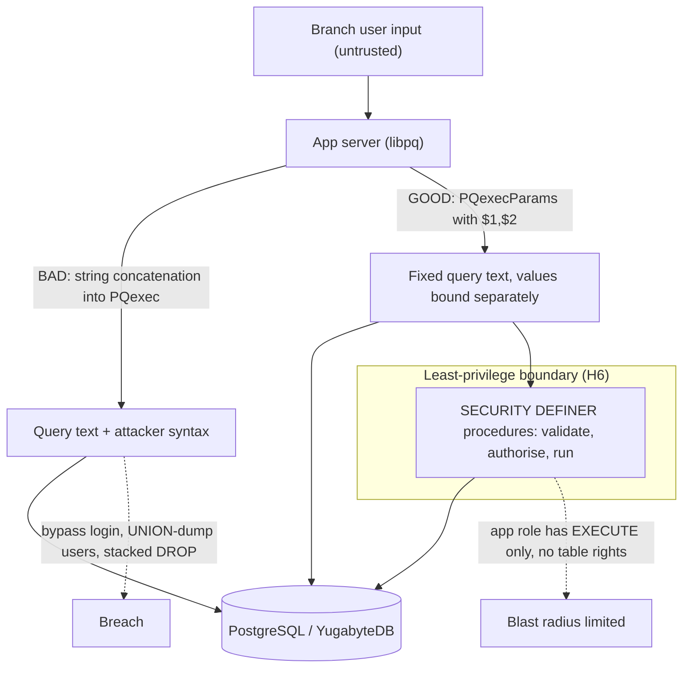

# Module 11.03: SQL injection and input validation

**Estimated hours:** 2

**What you will learn**

1. How SQL injection actually works: the login-bypass with `' OR '1'='1' --`, data extraction with `UNION`, and stacked queries, shown against a deliberately vulnerable C program.
2. The fixes in order of preference: parameterised queries (`PQexecParams`/prepared statements), typed parameters, allow-lists for identifiers, and `PQescapeLiteral` only as a last resort.
3. Injection inside the database (PL/pgSQL `EXECUTE ... USING` versus string concatenation, `format('%I', ...)`/`%L`), second-order injection, and least privilege so the app role can only call the procedure layer.

**Prerequisites:** [Module 11.02: ASLR, canaries, NX and secure C/C++ coding](module-02-aslr-canaries-nx-secure-coding.md). You rely on module 6.02 (SQL), 6.11 (PL/pgSQL), 6.12 (libpq and prepared statements) and the H6 stored-procedure design.

---

## 1. One-line intuition

SQL injection happens when user input is glued into a SQL string so that the input's punctuation becomes part of the query's grammar; the fix is to send the query and the data on separate channels so data can never be read as code.

## 2. Real-life analogy

Imagine a bank clerk who fills in a printed form by reading aloud what the customer says and writing it in the blank: "Show the account for customer named **[blank]**." A normal customer says "Asha Rao" and the clerk writes "Asha Rao". A malicious customer says: "Asha Rao, **and also show every account, ignore the rest of this form**." A clerk who just transcribes words into the sentence has now been told to do something the form never intended, because the customer's words became *instructions*, not *data*.

The fix is a clerk who treats the customer's answer strictly as a value for the blank: no matter what the customer says, including the whole sentence "and also show every account", it goes in the blank as a literal *name*, and the system looks for a customer literally called "Asha Rao, and also show every account". That is a **parameterised query**: the sentence (the SQL) is fixed in advance, and the customer's answer can only ever fill the blank, never change the sentence.

## 3. Why it exists: the problem it solves

SQL injection has sat at or near the top of the OWASP Top 10 (the industry's list of the most critical web application security risks) for twenty years; in the current list it lives under the "Injection" category. It is consistently one of the most damaging and most common web vulnerabilities, because it is easy to introduce (just build a string) and its payoff is total (read or change any data the database user can touch).

It exists because of a category error in how programs talk to databases. The database wants a single string of SQL text. The naive way to include user input is to concatenate it into that string. But SQL has *syntax*: a single quote `'` ends a string literal, `--` starts a comment, `;` separates statements, `UNION` combines result sets. The moment attacker-controlled characters land in the query text, the attacker can use that syntax to rewrite the query. The database cannot tell "data the programmer meant" from "syntax the attacker injected", because by the time it sees the string, it is all just text.

What breaks without the fix: a login box becomes an admin login for anyone; a search box dumps the `users` table including password hashes; a report screen deletes data. For a lending platform, injection against the app server reaches the loan book, customer PII, and the credentials table. This is why resume claim H6 (a PL/pgSQL procedure layer) doubles as a *security boundary*, and why this module is marked must-know.

## 4. Three layers of depth

### Layer 1 (beginner): watch it happen, then watch the fix

The vulnerable program builds a login query by concatenation and runs it with `PQexec` (the "simple query" protocol, module 6.12). The real run below is against a local PostgreSQL 16 with two users: `clerk1` (role 1) and `mgr1` (role 3, a manager).

The query it builds is:

```sql
SELECT user_code, role_id FROM users
WHERE user_code = '<username>' AND password_hash = '<password>'
```

A normal login (`clerk1`, correct password) returns one row and logs in. A wrong password returns zero rows and is denied. Now the attacker types this into the **username** box and anything into the password box:

```text
x' OR 1=1 --
```

The program pastes it in, producing:

```sql
SELECT user_code, role_id FROM users
WHERE user_code = 'x' OR 1=1 --' AND password_hash = 'irrelevant'
```

The `'` closes the username string early; `OR 1=1` is always true; `--` comments out the rest of the line, including the entire password check. Real output from the vulnerable program:

```text
SQL sent: ... WHERE user_code = 'x' OR 1=1 --' AND password_hash = 'irrelevant'
LOGIN OK (2 row(s))
  -> user_code=clerk1 role_id=1
  -> user_code=mgr1 role_id=3
```

Every user matched: the attacker is logged in, as the first row. Worse, they can *target* a role. Typing `x' OR role_id=3 --` returns only the manager:

```text
LOGIN OK (1 row(s))
  -> user_code=mgr1 role_id=3
```

Now the fix. The safe program sends the **same** two malicious inputs, but through a parameterised query where the SQL text never changes:

```text
-- INJECTION attempt against the safe program:
login denied (0 rows)
```

The database looked for a user literally named `x' OR 1=1 --`. There is none. The payload became a harmless value in the blank. Same attack, same data, different API, no breach. That is the entire lesson of this module in one before/after.

A note on a subtlety you will hit: typing `' OR '1'='1` into the username and leaving the password injection out does *not* always work, because `AND` binds tighter than `OR`. `user_code='' OR '1'='1' AND password_hash=''` parses as `user_code='' OR ('1'='1' AND password_hash='')`, which is false. That is why real login-bypass payloads use the comment `--` to delete the `AND password_hash = ...` entirely, as above. Understanding operator precedence is part of understanding the attack.

### Layer 2 (working engineer): extraction, stacking, and the fix hierarchy

**UNION extraction.** A search box that builds `WHERE full_name = '<input>'` can be turned into a data pump with `UNION`, which appends the rows of a second `SELECT` to the first. The attacker needs the column count and compatible types to line up. Input into a customer-name search:

```text
nobody' UNION SELECT role_id, user_code || ':' || password_hash FROM users --
```

Real output (the search for a customer leaks the credentials table):

```text
 customer_id |              full_name
-------------+--------------------------------------
 1           | clerk1:$2b$12$abcdefghijklmnopqrstuv
 3           | mgr1:$2b$12$ZZZsecretmanagerhashxx
```

The "customer search" now returns usernames and password hashes. This is how a low-value screen becomes a full database dump.

**Stacked queries.** Some drivers let one call run multiple statements separated by `;`. libpq's **simple** protocol (`PQexec`) does allow multiple statements in one string, so an injected `; DROP TABLE ...` or `; UPDATE loans SET outstanding_paise = 0 ...` can execute. (The **extended** protocol used by `PQexecParams`/prepared statements sends one statement at a time and does not allow stacking, which is a second reason to use it.) Verified on the test database: `SELECT 1 WHERE false; DROP TABLE ...` ran both statements through `PQexec`.

**The fix hierarchy**, best first:

1. **Parameterised queries / prepared statements.** The query text has placeholders (`$1`, `$2` in PostgreSQL) and the values travel separately. The database parses the query *once*, with the placeholders, so no value can ever change its structure. In libpq this is `PQexecParams` (ad-hoc) or `PQprepare` + `PQexecPrepared` (reused). This is the default and should cover ~99% of cases. It also tends to be faster for repeated queries (the plan is cached) and prevents stacking.
2. **Typed parameters.** Pass values with their type, and let the driver bind them. A loan amount parameter bound as a 64-bit integer cannot carry SQL syntax at all. Combine with application-level range checks (`parse_amount_paise` from 11.02).
3. **Allow-lists for identifiers.** Placeholders work for *values*, not for *identifiers* (table/column names) or SQL keywords (`ASC`/`DESC`). You cannot write `ORDER BY $1` meaning a column. When the SQL structure must vary by user input (sort column, direction), map the input through a fixed allow-list in code: `{"amount": "amount_paise", "date": "created_at"}`. If the input is not a key in the map, reject it. Never concatenate an identifier straight from the user.
4. **`PQescapeLiteral` / `PQescapeIdentifier`, last resort.** If you truly must build dynamic SQL text (a reporting tool), libpq's `PQescapeLiteral` (for values) and `PQescapeIdentifier` (for names) quote and escape input correctly for the current connection's encoding. These are a fallback, not a first choice, because one forgotten call reopens the hole. Never hand-roll escaping with string replace; encoding edge cases (e.g. multi-byte characters, `standard_conforming_strings`) make it unsafe.

**Validation versus sanitisation.** *Validation* asks "is this input acceptable?" and rejects it if not (a branch code is exactly 6 of `[A-Z0-9]`; an amount is a positive integer within limits). *Sanitisation* tries to "clean" bad input by removing or altering characters (strip quotes). Prefer validation: an allow-list of what is permitted is robust, while a deny-list of what to strip is always incomplete (attackers find an encoding you did not strip). Validation is defence in depth; it is **not** a substitute for parameterised queries, because a valid-looking value can still be malicious if concatenated.

### Layer 3 (internals): parse/bind/execute, and injection inside the database

**Why parameters are safe, mechanically.** PostgreSQL's extended query protocol has distinct steps: **Parse** (the server turns the SQL text, with `$1` placeholders, into a parsed statement and a plan — this is where SQL grammar is decided), **Bind** (the client sends the parameter *values*, which are attached to the already-parsed plan), and **Execute**. The grammar is fixed at Parse time, *before* any user value is seen. At Bind, a value is just bytes assigned to a slot; there is no re-parsing, so a value containing `' OR 1=1 --` is stored and compared as that literal string. Injection is impossible not because the value was cleaned, but because the value never passes through the parser. The simple protocol (`PQexec`) collapses parse and execute on one text string, which is why it both allows stacking and is the classic injection vector.

**Injection inside PL/pgSQL.** Moving logic into stored procedures (claim H6) does not by itself stop injection; a procedure that builds dynamic SQL by concatenation is just as vulnerable. Compare:

```sql
-- UNSAFE: concatenation inside the function
CREATE FUNCTION find_customer_unsafe(p_name text) RETURNS SETOF customers AS $$
BEGIN
  RETURN QUERY EXECUTE 'SELECT * FROM customers WHERE full_name = ''' || p_name || '''';
END; $$ LANGUAGE plpgsql;

-- SAFE: EXECUTE ... USING binds the value as a parameter
CREATE FUNCTION find_customer_safe(p_name text) RETURNS SETOF customers AS $$
BEGIN
  RETURN QUERY EXECUTE 'SELECT * FROM customers WHERE full_name = $1' USING p_name;
END; $$ LANGUAGE plpgsql;
```

Verified behaviour: with benign input `'Asha Rao'` both return one row. With malicious input `x'' OR ''1''=''1`:

```text
-- unsafe, malicious input (leaks all rows):
 1 | Asha Rao
 2 | Ravi Kumar
-- safe, same malicious input (0 rows, treated as a literal name):
(0 rows)
```

When you *must* build dynamic SQL in PL/pgSQL (dynamic table or column names), use `format()` with `%I` (identifier, quotes it safely) and `%L` (literal, quotes and escapes the value), never `||`. For example `format('SELECT * FROM %I WHERE pan = %L', tbl, val)`. `quote_ident()` and `quote_literal()` are the lower-level equivalents. Verified: `format('SELECT * FROM %I WHERE pan = %L', 'customers', 'ABCDE1234F''; DROP TABLE x --')` produces a correctly single-quoted literal; the embedded quote and `--` are neutralised inside the string.

**Second-order injection.** The dangerous input is not always used immediately. A classic second-order attack: a user registers with the *name* `admin' --`. Your registration code uses a parameterised INSERT, so storing it is safe. Later, a different, sloppy report builds a query by concatenating that stored name: `... WHERE created_by = '` + name + `'`. Now the stored payload fires. The lesson: data read back *from your own database* is still untrusted input to the next query. Parameterise *every* query, including ones whose inputs came from the database, not just the ones reading directly from the user.

**Least privilege as a boundary.** Even a perfect query layer should run under a database role that can do only what it must. On the lending platform the app connects as a role that has **no direct access to tables** and only `EXECUTE` on the procedure layer. Verified: with `REVOKE ALL ON ALL TABLES ... FROM app_login` and `GRANT EXECUTE ON FUNCTION ... TO app_login`, the role gets `permission denied for table users` on a direct `SELECT`, and the function call works **only** when the function is declared `SECURITY DEFINER` (so it runs with its owner's rights). That is the crucial detail: a plain `SECURITY INVOKER` function still runs as the caller and is still denied the tables; making the procedure layer a real privilege boundary requires `SECURITY DEFINER` functions owned by a role that does have table access, with a locked `search_path`. The payoff: even if an injection bug slips into one query, the blast radius is limited to what that one function exposes, not the whole schema. Row-level security (RLS) adds a second layer, filtering rows per role even for table access, useful so a branch can only see its own customers.

## 5. Architecture diagram



## 6. Code

The vulnerable and safe login programs in C with libpq. Both connect using a `PGCONN` environment variable. **The vulnerable one is a teaching artifact; never ship string-built SQL.**

```c
/* login_vuln.c - DELIBERATELY VULNERABLE: builds SQL by hand, runs via PQexec.
 * Build: cc -std=gnu17 -Wall -Wextra -I/usr/include/postgresql login_vuln.c -o login_vuln -lpq */
#include <libpq-fe.h>
#include <stdio.h>
#include <stdlib.h>

int main(int argc, char **argv) {
    if (argc != 3) { fprintf(stderr, "usage: %s <user_code> <password>\n", argv[0]); return 2; }
    PGconn *c = PQconnectdb(getenv("PGCONN") ? getenv("PGCONN") : "");
    if (PQstatus(c) != CONNECTION_OK) { fprintf(stderr, "connect: %s", PQerrorMessage(c)); return 1; }

    /* THE BUG: user input is pasted straight into the SQL text. */
    char sql[1024];
    snprintf(sql, sizeof sql,
             "SELECT user_code, role_id FROM users "
             "WHERE user_code = '%s' AND password_hash = '%s'", argv[1], argv[2]);
    printf("SQL sent: %s\n", sql);

    PGresult *r = PQexec(c, sql);
    if (PQresultStatus(r) != PGRES_TUPLES_OK) { fprintf(stderr, "%s", PQerrorMessage(c)); return 1; }
    int rows = PQntuples(r);
    printf(rows > 0 ? "LOGIN OK (%d row(s))\n" : "login denied (%d rows)\n", rows);
    for (int i = 0; i < rows; ++i)
        printf("  -> user_code=%s role_id=%s\n", PQgetvalue(r, i, 0), PQgetvalue(r, i, 1));
    PQclear(r); PQfinish(c); return 0;
}
```

```c
/* login_safe.c - the fix: PQexecParams. SQL text is constant; values are bound.
 * Build: cc -std=gnu17 -Wall -Wextra -I/usr/include/postgresql login_safe.c -o login_safe -lpq */
#include <libpq-fe.h>
#include <stdio.h>
#include <stdlib.h>

int main(int argc, char **argv) {
    if (argc != 3) { fprintf(stderr, "usage: %s <user_code> <password>\n", argv[0]); return 2; }
    PGconn *c = PQconnectdb(getenv("PGCONN") ? getenv("PGCONN") : "");
    if (PQstatus(c) != CONNECTION_OK) { fprintf(stderr, "connect: %s", PQerrorMessage(c)); return 1; }

    const char *sql =
        "SELECT user_code, role_id FROM users "
        "WHERE user_code = $1 AND password_hash = $2";   /* placeholders, not values */
    const char *params[2] = { argv[1], argv[2] };

    PGresult *r = PQexecParams(c, sql, 2, NULL, params, NULL, NULL, 0);  /* text results */
    if (PQresultStatus(r) != PGRES_TUPLES_OK) { fprintf(stderr, "%s", PQerrorMessage(c)); return 1; }
    int rows = PQntuples(r);
    printf(rows > 0 ? "LOGIN OK (%d row(s))\n" : "login denied (%d rows)\n", rows);
    for (int i = 0; i < rows; ++i)
        printf("  -> user_code=%s role_id=%s\n", PQgetvalue(r, i, 0), PQgetvalue(r, i, 1));
    PQclear(r); PQfinish(c); return 0;
}
```

Set up and run (real output shown in Layer 1 and Layer 2):

```bash
# Start/point at a PostgreSQL with a users table (Common brief: pg16 on :5432)
export PGCONN="host=localhost port=5432 user=postgres dbname=postgres"
psql "$PGCONN" -c "CREATE TABLE users(branch_code varchar(6), user_code varchar(10) primary key,
  full_name text, password_hash text, role_id smallint);"
psql "$PGCONN" -c "INSERT INTO users VALUES
  ('HYD001','clerk1','Asha Rao','\$2b\$12\$abcdefghijklmnopqrstuv',1),
  ('HYD001','mgr1','Ravi Kumar','\$2b\$12\$ZZZsecretmanagerhashxx',3);"

cc -std=gnu17 -Wall -Wextra -I/usr/include/postgresql login_vuln.c -o login_vuln -lpq
cc -std=gnu17 -Wall -Wextra -I/usr/include/postgresql login_safe.c -o login_safe -lpq

./login_vuln clerk1 '$2b$12$abcdefghijklmnopqrstuv'   # LOGIN OK (1 row)
./login_vuln "x' OR 1=1 --" anything                  # LOGIN OK (2 rows)  <- breach
./login_safe "x' OR 1=1 --" anything                  # login denied (0 rows)  <- fixed
```

(The header path `-I/usr/include/postgresql` is where Debian/Ubuntu's `libpq-dev` puts `libpq-fe.h`; `pg_config --includedir` confirms it.)

## 7. Use case: core-banking loan-origination platform

**The decision it drove: the H6 stored-procedure layer was also the authorisation and least-privilege boundary, and every query — in C and in PL/pgSQL — was parameterised.** Three concrete decisions came out of this:

1. **The app role cannot touch tables.** The connection role (`app_login`) has `EXECUTE` on the procedure layer and nothing else; `REVOKE ALL ON ALL TABLES`. Procedures are `SECURITY DEFINER`, owned by a schema owner that does have table rights, with `SET search_path = app, pg_temp` to stop search-path hijacking. So even a hypothetical injection bug in one procedure cannot read the credentials table or drop anything; it is confined to what that procedure already does. This is why claim H6's "centralising validation, authorisation and workflow rules" is a *security* claim as much as a round-trip-reduction one.
2. **No dynamic SQL by concatenation anywhere.** C code uses `PQexecParams`/`PQexecPrepared`; PL/pgSQL uses `EXECUTE ... USING` and `format('%I'/%L', ...)`. A code-review rule banned string-built SQL, and a grep in CI for `EXECUTE '... ' ||` failed the build.
3. **Validation on top, not instead.** Identifiers like sort columns went through an allow-list map; amounts and codes were validated (type, range, allow-list) at the app boundary before they ever reached the database. This is defence in depth: parameters stop injection, validation stops nonsense and shrinks the attack surface.

The interview sentence: *"Our procedure layer was the security boundary: the app connects with EXECUTE-only on SECURITY DEFINER procedures and no table rights, and every query in C and PL/pgSQL is parameterised. An injection bug in one procedure is contained to that procedure's own job, and most couldn't exist because there's no concatenated SQL to inject into."*

What auditors run: a tool like **sqlmap** automates the attacks in this module (boolean/union/time-based extraction, privilege probing). Knowing it exists matters: your penetration testers and the bank's auditors will point it at the app, and a parameterised, least-privileged design is what makes its report come back empty.

## 8. Lab

Work against the course PostgreSQL (`pg16` on `localhost:5432`, or a local cluster). Set `export PGCONN="host=localhost port=5432 user=postgres dbname=postgres"`.

### Part A: build the target and break in (25 minutes)

1. Create the `users` table and the two rows from section 6. Build `login_vuln.c` and `login_safe.c`.
2. Confirm the honest cases: `./login_vuln clerk1 '<correct hash>'` logs in; `./login_vuln clerk1 wrong` is denied.
3. Run the login bypass: `./login_vuln "x' OR 1=1 --" anything`. Confirm "LOGIN OK (2 rows)" and that you see both users. Read the `SQL sent:` line and mark exactly which characters broke out of the string.
4. Target the manager: `./login_vuln "x' OR role_id=3 --" anything`. Confirm you get only `mgr1`.
5. Try `./login_vuln "' OR '1'='1" x` (no comment). Explain, using operator precedence, why this one is denied while the `--` version works.

Expected: the bypass returns all rows; the role-targeted one returns the manager; the no-comment attempt is denied.

### Part B: extraction and stacking (20 minutes)

1. Add a `customers` table (`customer_id bigint, pan char(10), full_name text`) with two rows. Write a one-off `psql` query that simulates a vulnerable name search and inject a `UNION SELECT role_id::text, user_code||':'||password_hash FROM users` to dump the credentials. Confirm the hashes appear in the "customer" results.
2. Through `PQexec` (the vulnerable program or `psql`), run a harmless stacked query `SELECT 1 WHERE false; CREATE TABLE stack_demo(x int);` and confirm both statements executed (the table now exists). Drop it. Note that `PQexecParams` would reject the second statement.

Expected: the UNION leaks password hashes; the stacked query creates the table.

### Part C: prove the fix, same payloads (15 minutes)

1. Run every payload from Parts A and B against `./login_safe`. All must be denied (0 rows). Capture the output.
2. In `psql`, create `find_customer_unsafe` and `find_customer_safe` from Layer 3. Call each with benign input and with `'x'' OR ''1''=''1'`. Confirm the unsafe one leaks all rows and the safe one returns none.
3. Run `SELECT format('SELECT * FROM %I WHERE pan = %L', 'customers', $$ABCDE1234F'; DROP TABLE x --$$);` and read how `%I` and `%L` quoted the identifier and the dangerous literal.

Expected: safe login denies all payloads; `find_customer_safe` returns 0 rows on the attack; `format` produces correctly quoted SQL text.

### Part D: least privilege as the last line (20 minutes)

1. Create a role: `CREATE ROLE app_login NOLOGIN; REVOKE ALL ON ALL TABLES IN SCHEMA public FROM app_login;`.
2. `GRANT EXECUTE ON FUNCTION find_customer_safe(text) TO app_login;`. Then `SET ROLE app_login;` and try `SELECT count(*) FROM users;` (expect `permission denied for table users`) and `SELECT * FROM find_customer_safe('Asha Rao');`.
3. Observe that the function call is **also** denied (`permission denied for table customers`) because a default function is `SECURITY INVOKER`. Now redefine `find_customer_safe` with `SECURITY DEFINER SET search_path = public, pg_temp`, re-grant EXECUTE, and repeat: the direct table `SELECT` is still denied, but the function call now works.
4. `RESET ROLE;`. Write one sentence on why `SECURITY DEFINER` is what turns the procedure layer into a privilege boundary, and one on the risk it carries (a `SECURITY DEFINER` function with a loose `search_path` or an injectable body is dangerous precisely because it runs with elevated rights).

Expected: `app_login` cannot read tables directly; a `SECURITY INVOKER` function does not help; a `SECURITY DEFINER` function with a locked `search_path` is the boundary.

### Journal

Copy [journal/TEMPLATE.md](../journal/TEMPLATE.md) to `journal/YYYY-MM-DD-sql-injection.md`. Record: the `SQL sent:` line for the successful bypass and which characters did the damage; the UNION payload that leaked hashes; the before/after of the safe login on the same payloads; and your two sentences from Part D about `SECURITY DEFINER`. Note whether the stacked query worked through `PQexec` and why it would not through `PQexecParams`.

## 9. Common mistakes and misconceptions

| Mistake | Why it is wrong | Consequence |
|---|---|---|
| "I escape quotes, so I'm safe" | Hand-rolled escaping misses encodings, comments, numeric contexts, and identifiers | A payload using an unescaped path still injects |
| "Stored procedures stop injection" | A procedure that concatenates into `EXECUTE` is just as vulnerable | Injection moves into the database, with more privilege |
| "Validation replaces parameterisation" | A valid-looking value concatenated is still injectable; validation is a deny-list trap | False confidence; a bypass via an allowed character |
| "Placeholders work for table/column names too" | Parameters bind values only, not identifiers or keywords | Developers concatenate the identifier and reintroduce the hole |
| "Input from our own DB is trusted" | Second-order injection: stored payload fires in a later concatenated query | A safe INSERT plus an unsafe report equals a breach |
| "`PQexec` is fine if I'm careful" | Simple protocol allows stacked statements and mixes parse with data | One missed concatenation enables `; DROP ...` |
| "The app DB user needs full rights to work" | It usually needs only EXECUTE on procedures | A single injection reads or destroys the whole schema |

## 10. Resume link

- **Claim A/H6, "PL/pgSQL ... centralising validation, authorisation and workflow".** Say: *"The procedure layer was our security boundary. The app connects EXECUTE-only on SECURITY DEFINER procedures with a locked search_path and no table rights, and every query in C (PQexecParams) and PL/pgSQL (EXECUTE ... USING, format %I/%L) is parameterised. Injection in one procedure is contained; most can't exist because there's no concatenated SQL."*
- **Claim D/H7, PostgreSQL and libpq.** You can explain parse/bind/execute and why the extended protocol both prevents injection and prevents stacked statements, and why it is often faster (cached plan).
- **Claim F, incident handling.** You can describe what sqlmap tests and how a least-privilege, parameterised design makes its report empty.

Likely follow-up: *"Parameters protect values. How do you safely let a user choose the sort column?"* Answer: *"Map the user's choice through a fixed allow-list in code to a known column name; reject anything not in the map. If I must build identifier SQL in PL/pgSQL, I use `format('%I', ...)` / `quote_ident`, never concatenation."*

## 11. Interview questions

**Q1 (easy). In one sentence, what is SQL injection and what is the primary fix?**

<details>
<summary>Model answer</summary>

It is when user input is concatenated into a SQL string so that the input's punctuation (quotes, comments, `;`, `UNION`) becomes part of the query's grammar and rewrites it; the primary fix is parameterised queries (placeholders with values bound separately), so user data can never be parsed as SQL. In libpq that is `PQexecParams` or `PQprepare`/`PQexecPrepared`.

</details>

**Q2 (easy). Why does `' OR 1=1 --` log an attacker in, and why does the `--` matter?**

<details>
<summary>Model answer</summary>

Typed into the username, the `'` closes the username string literal early, `OR 1=1` makes the WHERE clause always true, and `--` comments out the remainder of the query line including the `AND password_hash = '...'` check. Without the `--`, the trailing `AND password_hash = ''` is still evaluated, and because `AND` binds tighter than `OR`, the condition becomes false, so the bypass fails. The comment is what deletes the password check.

</details>

**Q3 (medium). Mechanically, why does a parameterised query prevent injection? Reference the protocol.**

<details>
<summary>Model answer</summary>

PostgreSQL's extended protocol separates Parse, Bind and Execute. At Parse the server turns the SQL text with `$1` placeholders into a parsed statement and plan; the grammar is fixed here, before any user value exists. At Bind the client sends the parameter values, which are attached to the already-parsed plan as data, with no re-parsing. So a value like `' OR 1=1 --` is stored and compared as that literal string; it never reaches the parser. Injection is impossible by construction, not by cleaning. As a bonus, the extended protocol sends one statement at a time, so stacked queries are rejected too.

</details>

**Q4 (medium). You moved all data access into PL/pgSQL procedures. Are you now immune to injection? What else must be true?**

<details>
<summary>Model answer</summary>

Not by itself. A procedure that builds SQL with `EXECUTE 'SELECT ... ' || p_name` is just as injectable, and now runs with whatever rights the procedure has. To be safe: use `EXECUTE ... USING` to bind values, and `format('%I', ...)`/`%L` or `quote_ident`/`quote_literal` for any dynamic identifiers; set a locked `search_path` on `SECURITY DEFINER` functions; and still validate inputs at the app boundary. The procedure layer helps most as a *least-privilege* boundary: the app role gets EXECUTE only and no table rights, so even a bug is contained. That combination, parameterised bodies plus least privilege, is what makes it a security boundary.

</details>

**Q5 (hard). Describe second-order SQL injection and how to prevent it, given that your INSERTs are already parameterised.**

<details>
<summary>Model answer</summary>

Second-order injection is when a payload is stored safely and fires later. For example a user registers with the name `admin' --`; the registration INSERT is parameterised, so storing it is fine. Later a reporting query builds SQL by concatenating that stored name (`... WHERE created_by = '` + name + `'`), and now the stored payload rewrites that query. The root cause is treating data read back from your own database as trusted. Prevention: parameterise *every* query, including ones whose inputs came from the database, not just the ones reading directly from the user; apply least privilege so even a fired payload is contained; and, as defence in depth, validate on read as well as write. The mental model is that there is no "trusted" source of query inputs: user, database, cache, file, all are untrusted to the next query.

</details>

## 12. Revision

- SQL injection is user input concatenated into SQL text so the input's syntax rewrites the query: `' OR 1=1 --` bypasses login, `UNION SELECT` dumps other tables, `;` stacks statements; it is a perennial OWASP Top 10 "Injection" risk.
- Fix hierarchy: parameterised queries (`PQexecParams`/prepared, which also block stacking via the extended protocol), typed parameters, allow-lists for identifiers, and `PQescapeLiteral`/`PQescapeIdentifier` only as a last resort; in PL/pgSQL use `EXECUTE ... USING` and `format('%I'/%L', ...)`, never `||`.
- Defence in depth: validate (allow-list) at the boundary on top of parameters, parameterise even inputs read back from the DB (second-order), and run the app under a least-privilege role with EXECUTE-only on `SECURITY DEFINER` procedures (locked `search_path`) so an injection bug is contained; auditors run sqlmap against all of this.

---

Previous: [Module 11.02: ASLR, canaries, NX and secure C/C++ coding](module-02-aslr-canaries-nx-secure-coding.md) | Next: [Module 11.04: TLS in practice and secrets management](module-04-tls-and-secrets.md)
