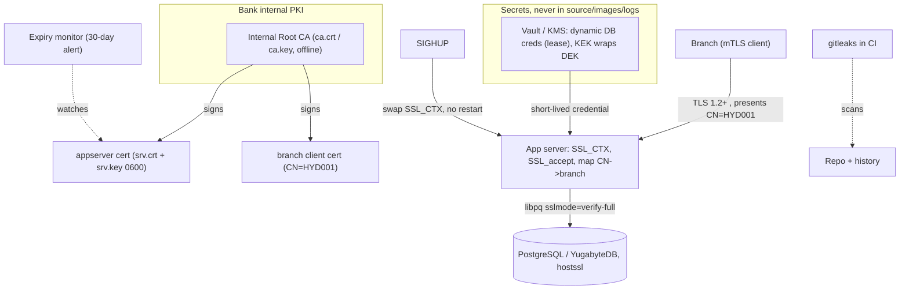

# Module 11.04: TLS in practice and secrets management

**Estimated hours:** 3

**What you will learn**

1. How to put TLS on a C server with OpenSSL 3 (certificate chain, private key, minimum TLS 1.2, `SSL_accept`/`SSL_read`/`SSL_write`), add mutual TLS, and test it with `openssl s_client` and `curl --cacert`.
2. Where certificates come from in a bank (an internal CA, or ACME for internet-facing), how to run a local CA, key file permissions, rotation, and expiry monitoring, including reloading certificates without a restart.
3. How to keep secrets out of source and images (gitleaks, the `/proc/<pid>/environ` leak), the Vault/KMS model (dynamic credentials, leases, DEK/KEK), rotating a database password with no downtime, and encryption at rest.

**Prerequisites:** [Module 11.03: SQL injection and input validation](module-03-sql-injection.md). Builds directly on module 5.09 (TLS basics: certificates, the handshake, `openssl s_client`) and uses 3.09 (signals, for SIGHUP reload) and 6.12 (libpq connection strings).

---

## 1. One-line intuition

TLS proves who the server is and encrypts the bytes in flight; mTLS proves who the client is too; and secrets management keeps the keys and passwords that make all of this work out of your source, your images and your logs.

## 2. Real-life analogy

A bank branch sends a sealed, tamper-evident courier pouch to head office.

- **TLS** is the pouch: sealed so no one on the road can read it (encryption), and stamped with head office's verified wax seal so the branch knows it reached the real head office and not an impostor (server authentication).
- **mTLS** adds the branch's own seal, so head office knows which branch sent the pouch, without a password. The seal's engraving (the certificate's Common Name) *is* the branch's identity.
- **The CA** is the seal-maker the whole bank trusts. Head office's seal is only believed because the trusted seal-maker vouches for it. An internal CA is the bank running its own seal-maker for its own buildings.
- **Secrets management** is how you store the seal-making dies and the pouch keys. You do not photocopy them into every employee handbook (source code), leave them on a noticeboard (environment variables other processes can read), or write them in the daily log (plaintext logs). You keep them in a safe, hand them out on a lease, and change the locks on a schedule.

A sealed pouch with the keys taped to the outside is not secure. TLS and secrets management are two halves of one job.

## 3. Why it exists: the problem it solves

Plain TCP (Phase 5) sends bytes in the clear. Anyone who can see the wire, a switch on the branch LAN, a compromised router, a malicious Wi-Fi access point, can read every loan application and every customer identity number, and can modify them in flight or impersonate either end. For a bank carrying customer PII and, where cards are involved, cardholder data, that is both a breach and a regulatory violation (module 11.05; PCI DSS has required strong cryptography on open networks and banned SSL and early TLS since 2018).

TLS solves three things at once: **confidentiality** (encryption), **integrity** (tamper detection), and **authentication** (certificates prove identity). Module 5.09 covered the protocol; this module is about operating it: real certificate files, key permissions, the server-side API, mutual authentication, and the part that actually bites teams, rotation and expiry.

Secrets management exists because TLS keys and database passwords are themselves high-value targets. The most common way they leak is not a sophisticated attack; it is a developer committing a password to Git, baking it into a Docker image, or printing it to a log. The second most common TLS incident, after misconfiguration, is an expired certificate at 2 a.m. taking a service down. Both are operational problems with engineering answers, which is what this module gives you. What breaks without it: encrypted traffic with the private key sitting in the repository's history is not secure, and a certificate nobody is tracking expires and halts loan origination.

## 4. Three layers of depth

### Layer 1 (beginner): certificates, keys, and a local CA

A **certificate** binds an identity (a hostname like `appserver.bank.local`, or a branch id) to a **public key**, and is **signed** by a **Certificate Authority (CA)** that the other side trusts. The matching **private key** stays secret on the server. Verifying a certificate means checking the CA's signature with the CA's public key, checking the name matches, and checking it has not expired.

Where certificates come from:

- **Internet-facing** servers use a public CA, almost always via **ACME** (the protocol behind Let's Encrypt): a tool like `certbot` proves control of the domain and gets a 90-day certificate, auto-renewed.
- **Bank-internal** services use the bank's **internal CA** (its own private CA). Every server trusts the internal root, so internal certificates are free to issue, can last longer, and never touch the public internet. The lending platform's app server, database and migration engine all used internal-CA certificates.

You can run a local CA yourself with `openssl`, which is exactly what you do in the lab. The steps (verified on OpenSSL 3.0.13):

```bash
# 1. The CA: a self-signed root (its own key signs its own certificate)
openssl req -x509 -newkey rsa:2048 -noenc -days 3650 \
  -subj "/CN=Lending Root CA" -keyout ca.key -out ca.crt

# 2. The server's key and a certificate signing request (CSR)
openssl req -newkey rsa:2048 -noenc -subj "/CN=appserver.bank.local" \
  -keyout srv.key -out srv.csr

# 3. The CA signs the server CSR, adding the SAN the client will verify
openssl x509 -req -in srv.csr -CA ca.crt -CAkey ca.key -CAcreateserial -days 825 \
  -extfile <(printf "subjectAltName=DNS:appserver.bank.local\nextendedKeyUsage=serverAuth") \
  -out srv.crt

openssl verify -CAfile ca.crt srv.crt         # -> srv.crt: OK
```

Two file-hygiene rules from day one:

- **Private keys are `0600`** (owner read/write only): `chmod 600 srv.key`. A key other users can read is a key you must treat as compromised. (On WSL's `/mnt/c` drive the permission bits do not stick; do key work on a native Linux path like `~/certs`.)
- **The chain file** matters. `SSL_CTX_use_certificate_chain_file` wants the server certificate followed by any intermediate CA certificates (not the root), in order, so the client can build the chain. A missing intermediate is the classic "works in my browser, fails in curl" bug.

### Layer 2 (working engineer): the server API, mTLS, and PostgreSQL TLS

Module 5.09 showed the *client* side. Here is the *server* side with OpenSSL 3. The shape: create one `SSL_CTX` (configuration, holds the cert and key), then one `SSL` object per accepted connection, `SSL_accept` to do the handshake, then `SSL_read`/`SSL_write` instead of `recv`/`send`.

```c
SSL_CTX *ctx = SSL_CTX_new(TLS_server_method());
SSL_CTX_set_min_proto_version(ctx, TLS1_2_VERSION);     /* refuse SSLv3/TLS1.0/1.1 */
SSL_CTX_use_certificate_chain_file(ctx, "srv.crt");     /* cert + intermediates */
SSL_CTX_use_PrivateKey_file(ctx, "srv.key", SSL_FILETYPE_PEM);
/* ... accept() a TCP connection into fd ... */
SSL *ssl = SSL_new(ctx);
SSL_set_fd(ssl, fd);
if (SSL_accept(ssl) == 1) {                             /* handshake */
    SSL_read(ssl, buf, sizeof buf);                     /* decrypted bytes */
    SSL_write(ssl, buf, n);                             /* encrypted on the wire */
}
```

Test it without writing a client: `openssl s_client -connect host:8443 -CAfile ca.crt -verify_hostname appserver.bank.local`, or `curl --cacert ca.crt https://appserver.bank.local:8443/`. A real `s_client` run against the lab server reported `Protocol version: TLSv1.3`, `Verification: OK`, `Verified peername: appserver.bank.local`. (The server's *minimum* was 1.2; both sides preferred and negotiated 1.3.)

**Mutual TLS (mTLS).** For service-to-service links inside the bank, the server also demands a client certificate:

```c
SSL_CTX_load_verify_locations(ctx, "ca.crt", NULL);     /* trust clients signed by our CA */
SSL_CTX_set_verify(ctx, SSL_VERIFY_PEER | SSL_VERIFY_FAIL_IF_NO_PEER_CERT, NULL);
```

Now a client with no certificate (or one not signed by the CA) is rejected at the handshake. After a successful mTLS handshake the server reads the client's certificate and maps its **Common Name to a branch id**:

```c
X509 *peer = SSL_get_peer_certificate(ssl);
char cn[256];
X509_NAME_get_text_by_NID(X509_get_subject_name(peer), NID_commonName, cn, sizeof cn);
/* cn is "HYD001": this connection IS that branch, proven cryptographically */
```

Verified in the lab: a client certificate issued with `-subj "/CN=HYD001"` produced `client branch_id (CN) = HYD001` on the server. The branch's identity is the certificate, not a password; there is no password to phish or leak.

**PostgreSQL TLS.** The app-to-database hop must be encrypted and the database authenticated. On the server, `ssl = on` in `postgresql.conf` with a cert and key; in `pg_hba.conf`, use `hostssl` lines so non-TLS connections are refused. On the client (libpq connection string), use `sslmode=verify-full` with `sslrootcert=/path/to/ca.crt`. The levels matter:

| libpq `sslmode` | Encrypted? | Server authenticated? |
|---|---|---|
| `require` | Yes | **No** (accepts an impostor) |
| `verify-ca` | Yes | CA is checked, but not the hostname |
| `verify-full` | Yes | CA **and** hostname checked |

`verify-full` is the only setting that stops a machine-in-the-middle impersonating the database; `require` only encrypts to whoever answers. The lending platform used `verify-full` everywhere, which is the decision in module 5.09's use case.

### Layer 3 (internals): rotation without downtime, and where secrets live

**Reloading certificates without a restart.** Certificates expire; rotation must not drop connections. The pattern: on `SIGHUP`, build a *fresh* `SSL_CTX` from the (newly written) files and swap the pointer; new connections use the new context, in-flight ones finish on the old one, which is freed when done. No restart, no dropped loans.

```c
static volatile sig_atomic_t g_reload = 0;
static void on_sighup(int s) { (void)s; g_reload = 1; }
/* in the accept loop: */
if (g_reload) {
    SSL_CTX *fresh = make_ctx();         /* re-reads srv.crt / srv.key from disk */
    if (fresh) { SSL_CTX_free(ctx); ctx = fresh; }
    g_reload = 0;
}
```

This is the server-side analogue of how nginx and PostgreSQL reload on signal. (`SSL_CTX_free` is reference-counted, so an old context backing a live `SSL` survives until that connection closes.)

**Expiry monitoring.** The fix for "expired at 2 a.m." is boring and essential: a certificate inventory with expiry dates, and an alert well before expiry (say 30 days). `openssl x509 -enddate -noout -in srv.crt` prints the date; a nightly job checks every certificate and pages if any is within the window. Short-lived ACME certs with auto-renew sidestep this for internet-facing services; internal ones still need the inventory.

**Where secrets must not be.** Three leak paths and their checks:

1. **Source control.** A password committed to Git lives in history forever, even after you "delete" it; `git log -p` shows it. **gitleaks** scans the repo and its history for secrets. Verified: gitleaks flagged a committed AWS-style key with `RuleID: aws-access-token` and reported "leaks found: 1". Run it as a pre-commit hook and in CI. If a secret is committed, rotating it is mandatory; scrubbing history is not enough because clones exist.
2. **Images.** A secret baked into a Docker layer is readable by anyone who pulls the image (`docker history`, layer extraction), even if a later layer deletes the file. Pass secrets at run time, never at build time.
3. **Process environment.** Environment variables feel private but are not: on Linux, `/proc/<pid>/environ` exposes a process's environment to the same user (and to root). Verified: a process started with `DB_PASSWORD=super-secret-123` had that value readable via `tr '\0' '\n' < /proc/<pid>/environ | grep DB_PASSWORD`. So env vars are fine for *local dev* via a `.env` file (git-ignored), but for production secrets they are a weak store; a leaked core dump or a `/proc` read exposes them.

**The Vault / KMS model.** The grown-up answer is a secrets manager (HashiCorp Vault, AWS KMS/Secrets Manager, cloud equivalents). The ideas worth knowing:

- **Dynamic credentials.** Instead of a static database password, the app asks Vault for a *freshly created* database user that is valid for a short **lease** (say 1 hour) and is automatically revoked when the lease ends. A leaked credential is useless after an hour, and every app instance has a distinct one, so a leak is traceable.
- **Leases and renewal.** The app renews the lease while it runs and gets a new credential when it restarts. No human ever sees the password.
- **DEK/KEK hierarchy (envelope encryption).** Data is encrypted with a **Data Encryption Key (DEK)**. The DEK is not stored in the clear; it is itself encrypted by a **Key Encryption Key (KEK)** that lives in the KMS/HSM and never leaves it. To decrypt data you send the wrapped DEK to the KMS, which unwraps it using the KEK. Rotating the KEK re-wraps the DEKs without re-encrypting all the data. This is how cloud "encryption at rest" and column encryption are keyed.

**Rotating a database password with no downtime.** You cannot flip a password in one instant across many running app instances. The standard trick is a **two-valid-credentials window**: create a second password/credential, deploy it to the apps (now both old and new work), confirm every instance uses the new one, then revoke the old one. Vault dynamic credentials do this automatically; for a static password you add a second role or use PostgreSQL's ability to have the app reconnect with the new credential before you drop the old.

**Encryption at rest.** Two layers: **disk/volume encryption** (LUKS, cloud disk encryption) protects against a stolen disk but not a live compromised host; and **column-level encryption** (PostgreSQL's `pgcrypto`, or application-side encryption with a KMS-wrapped DEK) protects specific sensitive fields even from a DBA reading the table. For a lending platform, PII columns and any retained card token are candidates; the keys come from the KMS, never from the database itself.

## 5. Architecture diagram



## 6. Code

A TLS 1.2+ echo server in C with OpenSSL 3: optional mTLS, CN-to-branch mapping, and a SIGHUP reload that rotates certificates without a restart. This is the server-side counterpart to the client in module 5.09.

```c
/* tls_server.c - TLS server (OpenSSL 3), optional mTLS, SIGHUP cert rotation.
 * Build: cc -std=gnu17 -Wall -Wextra tls_server.c -o tls_server -lssl -lcrypto
 * Run:   ./tls_server          (server-auth only)
 *        ./tls_server --mtls    (require + verify client certs) */
#include <openssl/err.h>
#include <openssl/ssl.h>
#include <arpa/inet.h>
#include <netinet/in.h>
#include <signal.h>
#include <stdio.h>
#include <string.h>
#include <unistd.h>

static volatile sig_atomic_t g_reload = 0;
static void on_sighup(int s) { (void)s; g_reload = 1; }

/* Build a context from the cert files on disk: called at start and on SIGHUP. */
static SSL_CTX *make_ctx(int require_client_cert) {
    SSL_CTX *ctx = SSL_CTX_new(TLS_server_method());
    if (!ctx) { ERR_print_errors_fp(stderr); return NULL; }
    SSL_CTX_set_min_proto_version(ctx, TLS1_2_VERSION);          /* no SSLv3/TLS1.0/1.1 */
    if (SSL_CTX_use_certificate_chain_file(ctx, "srv.crt") != 1 ||
        SSL_CTX_use_PrivateKey_file(ctx, "srv.key", SSL_FILETYPE_PEM) != 1) {
        ERR_print_errors_fp(stderr); SSL_CTX_free(ctx); return NULL;
    }
    if (require_client_cert) {                                   /* mTLS */
        SSL_CTX_load_verify_locations(ctx, "ca.crt", NULL);
        SSL_CTX_set_verify(ctx, SSL_VERIFY_PEER | SSL_VERIFY_FAIL_IF_NO_PEER_CERT, NULL);
    }
    return ctx;
}

int main(int argc, char **argv) {
    int mtls = (argc > 1 && strcmp(argv[1], "--mtls") == 0);
    signal(SIGHUP, on_sighup);
    signal(SIGPIPE, SIG_IGN);

    SSL_CTX *ctx = make_ctx(mtls);
    if (!ctx) return 1;

    int ls = socket(AF_INET, SOCK_STREAM, 0);
    int yes = 1; setsockopt(ls, SOL_SOCKET, SO_REUSEADDR, &yes, sizeof yes);
    struct sockaddr_in a = {0};
    a.sin_family = AF_INET; a.sin_addr.s_addr = htonl(INADDR_LOOPBACK); a.sin_port = htons(8443);
    bind(ls, (struct sockaddr *)&a, sizeof a);
    listen(ls, 16);
    fprintf(stderr, "listening on 127.0.0.1:8443 mtls=%d\n", mtls);

    for (;;) {
        if (g_reload) {                        /* rotate certs: swap the context */
            SSL_CTX *fresh = make_ctx(mtls);
            if (fresh) { SSL_CTX_free(ctx); ctx = fresh; fprintf(stderr, "reloaded certs\n"); }
            g_reload = 0;
        }
        int cs = accept(ls, NULL, NULL);
        if (cs < 0) continue;
        SSL *ssl = SSL_new(ctx);
        SSL_set_fd(ssl, cs);
        if (SSL_accept(ssl) == 1) {
            if (mtls) {
                X509 *peer = SSL_get_peer_certificate(ssl);
                if (peer) {
                    char cn[256] = "?";
                    X509_NAME_get_text_by_NID(X509_get_subject_name(peer),
                                              NID_commonName, cn, sizeof cn);
                    fprintf(stderr, "client branch_id (CN) = %s\n", cn);  /* map CN -> branch */
                    X509_free(peer);
                }
            }
            char buf[256];
            int n = SSL_read(ssl, buf, sizeof buf - 1);
            if (n > 0) { buf[n] = '\0'; SSL_write(ssl, buf, n); }   /* echo, encrypted */
            SSL_shutdown(ssl);
        } else { ERR_print_errors_fp(stderr); }
        SSL_free(ssl);
        close(cs);
    }
}
```

Build, run, and test (real output shown):

```bash
cc -std=gnu17 -Wall -Wextra tls_server.c -o tls_server -lssl -lcrypto
./tls_server &                 # server-auth only
printf 'hello\n' | openssl s_client -connect 127.0.0.1:8443 \
    -CAfile ca.crt -verify_hostname appserver.bank.local -brief
```

```text
CONNECTION ESTABLISHED
Protocol version: TLSv1.3
Ciphersuite: TLS_AES_256_GCM_SHA384
Peer certificate: CN = appserver.bank.local
Verification: OK
Verified peername: appserver.bank.local
```

```bash
# mTLS: the server now demands a client cert; the CN identifies the branch
./tls_server --mtls &
printf 'hi\n' | openssl s_client -connect 127.0.0.1:8443 \
    -CAfile ca.crt -cert cli.crt -key cli.key -quiet
# server log prints:  client branch_id (CN) = HYD001
```

To rotate without downtime: overwrite `srv.crt`/`srv.key` with the new pair, then `kill -HUP <pid>`. The server logs `reloaded certs`; existing connections are unaffected; new ones use the new certificate.

## 7. Use case: core-banking loan-origination platform

**The decision it drove: TLS terminated at the app server process (not a load balancer), mTLS for every machine-to-machine hop, `verify-full` to the database, and all secrets out of source and out of env into Vault with dynamic DB credentials.** Concretely:

1. **mTLS branch identity.** Each branch machine held a client certificate whose CN was its branch code. The app server mapped the CN to the branch id at the handshake, so a connection's branch identity was cryptographic, not a login field a compromised client could spoof. A stolen branch certificate could be revoked at the CA, and `SSL_CTX` reload picked up the new CRL/trust without a restart. This is why TLS was terminated *at* the app process: the process that logs the request is the process that knows, provably, which branch it came from (the audit-boundary argument from module 5.09).
2. **`verify-full` to the database.** libpq connected with `sslmode=verify-full sslrootcert=internal-ca.crt`, so a man-in-the-middle could not impersonate the database. `require` was explicitly banned in review because it encrypts to an impostor just as happily as to the real server.
3. **Secrets in Vault, not env.** The database credential was a Vault **dynamic secret**: a per-instance PostgreSQL role with a 1-hour lease, auto-revoked. The reasoning recorded in the design doc: a credential that is unique per instance and dead within an hour makes a leaked core dump or a `/proc/<pid>/environ` read a contained, traceable event instead of a master-key compromise. `.env` files were allowed only on developer laptops and were git-ignored; gitleaks ran in CI to catch anything committed by mistake.
4. **Rotation rehearsed.** Certificate rotation (SIGHUP swap) and the two-valid-credentials database-password window were both runbooked and rehearsed, because the team's own incident history had an expired internal certificate take a service down overnight. The fix was the certificate inventory with a 30-day expiry alert.

The honest trade-off for interviews: terminating TLS at the app server costs CPU on that process (every byte is decrypted there), and mTLS adds certificate lifecycle work (issuing, revoking, rotating branch certs). The bank accepted both because the alternative, plaintext on the datacentre LAN and a shared static DB password, failed the threat model and the audit. The interview sentence: *"TLS 1.2-minimum terminated at the app server with mTLS branch identity, verify-full to the database, and dynamic Vault credentials instead of env-var passwords; rotation was reload-on-SIGHUP for certs and a two-credential window for the DB password, both rehearsed after an expiry incident."*

## 8. Lab

Work in `~/labs/11.04` on a **native Linux path** (not `/mnt/c`, so `0600` sticks). You need `openssl`, `gitleaks` (`sudo apt install gitleaks`), and the OpenSSL dev headers (`libssl-dev`, already installed).

### Part A: run a local CA and issue certs (25 minutes)

1. Create the CA (`ca.key`, `ca.crt`), the server key/CSR, and sign `srv.crt` with a SAN of `appserver.bank.local`, using the commands in Layer 1. Run `openssl verify -CAfile ca.crt srv.crt` and confirm `OK`.
2. `chmod 600 srv.key ca.key`. Confirm with `ls -l` that they are `-rw-------`. Explain in your journal why a world-readable key must be treated as compromised.
3. Issue a client cert with `-subj "/CN=HYD001"` and `extendedKeyUsage=clientAuth`; verify it against the CA.

Expected: `srv.crt: OK`, `cli.crt: OK`, keys are `0600`.

### Part B: your TLS server, proven encrypted (25 minutes)

1. Build and run `tls_server.c` (server-auth mode). Connect with `openssl s_client -connect 127.0.0.1:8443 -CAfile ca.crt -verify_hostname appserver.bank.local -brief` and confirm `Verification: OK` and a TLS 1.2 or 1.3 protocol line.
2. Prove it is really encrypted: in one terminal run `sudo tcpdump -i lo -A port 8443`, connect again, type a line, and confirm you see only ciphertext, not your line. (Contrast with module 5.06's plaintext tcpkv, where the line was readable.)
3. Connect with `curl --cacert ca.crt https://127.0.0.1:8443/` (it will handshake and then see your echo). Then connect with the *wrong* expectation: `-verify_hostname wrong.example` and record the verification failure.

Expected: encrypted bytes on the wire, `Verification: OK` with the right name, a verify failure with the wrong name.

### Part C: mTLS and the SIGHUP rotation (25 minutes)

1. Restart the server with `--mtls`. Connect **without** a client cert: the handshake fails. Connect **with** `-cert cli.crt -key cli.key`: it succeeds and the server logs `client branch_id (CN) = HYD001`.
2. Issue a second branch cert (`CN=MUM002`), connect with it, and confirm the server logs the new branch. This is CN-to-branch mapping.
3. Rotate without downtime: reissue `srv.crt` with a new validity window (same key is fine), then `kill -HUP <server pid>`. Confirm the log says `reloaded certs`. Reconnect with `s_client` and check the new `notBefore`/`notAfter` via `-brief` or `openssl x509 -dates`.

Expected: no-cert handshake rejected; valid cert accepted with CN logged; SIGHUP reload picks up the new certificate with no restart.

### Part D: find leaked secrets (20 minutes)

1. Make a throwaway git repo. Commit a `config.yml` containing a fake DB password and an AWS-style key. Run `gitleaks detect --no-banner -v` and confirm it reports the finding with a RuleID and the file:line. Note that even after you `git rm` the file and commit, `gitleaks detect` still finds it in history (and `git log -p` shows it). Write one sentence on why rotating the secret, not just deleting the file, is mandatory.
2. Demonstrate the env-var leak: run `DB_PASSWORD=super-secret-123 sleep 60 &`, then `tr '\0' '\n' < /proc/$!/environ | grep DB_PASSWORD`. Confirm you can read the password. Write one sentence on why env vars are acceptable for local dev but weak for production secrets.

Expected: gitleaks flags the committed key (a RuleID like `aws-access-token`); the env-var value is readable via `/proc`.

### Journal

Copy [journal/TEMPLATE.md](../journal/TEMPLATE.md) to `journal/YYYY-MM-DD-tls-and-secrets.md`. Record: the `openssl verify` result and your key permissions; the `s_client` verification line and the tcpdump observation (ciphertext vs the plaintext tcpkv); the CN the server logged for each branch cert and what `reloaded certs` proved; and the gitleaks RuleID plus your two sentences (why rotate not delete; why env vars are weak for prod). 

## 9. Common mistakes and misconceptions

| Mistake | Why it is wrong | Consequence |
|---|---|---|
| libpq `sslmode=require` is "secure" | It encrypts but does not authenticate the server | A man-in-the-middle database impersonator is accepted |
| TLS means the data is safe everywhere | It only protects data *in transit*; disk and logs are separate | Plaintext PII in a debug log, as in the C6 incident |
| Environment variables are private | `/proc/<pid>/environ` exposes them to the same user and root | A leaked core dump or `/proc` read discloses the DB password |
| Deleting a committed secret from the repo fixes it | Git history and existing clones still contain it | The secret must be rotated; scrubbing history is not enough |
| A self-signed server cert with no CA is fine internally | Nothing vouches for the identity; clients cannot verify | Any impostor presenting a self-signed cert is trusted |
| Rotating certs needs a restart | A `SIGHUP` swap of `SSL_CTX` reloads without dropping connections | Avoidable downtime, or stale certs left in place out of fear |
| One shared static DB password across all instances | A leak is untraceable and compromises everything at once | Use per-instance dynamic credentials with short leases |

## 10. Resume link

- **Claim E, "TLS"; Claim H4, the app server.** Say: *"I terminated TLS at the app server with OpenSSL 3, TLS 1.2 minimum, and mTLS where the client certificate's CN is the branch identity. The app-to-DB hop used libpq `sslmode=verify-full`, not `require`, so an impostor database is rejected. Certificate rotation was a SIGHUP swap of the SSL_CTX, so no restart."*
- **Claim G, Docker / CI.** Say: *"Secrets never went into source or images: gitleaks ran in CI and as a pre-commit hook, DB credentials came from Vault as per-instance dynamic secrets with short leases, and `.env` was local-dev only and git-ignored."*
- **Claim F, incidents.** You can tell the "encrypted on the wire, plaintext in the log" story and the "expired internal certificate at 2 a.m." story, both with the engineering fix (scrub/restrict dumps; certificate inventory with a 30-day alert).

Likely follow-up: *"`require` versus `verify-full` for the database connection, which and why?"* Answer: *"`verify-full`. `require` encrypts to whoever answers, including a man-in-the-middle; `verify-full` checks the CA and the hostname, so only the real database is trusted. The small cost of distributing the CA certificate is worth closing the impersonation gap."*

## 11. Interview questions

**Q1 (easy). What three properties does TLS give you, and which one does mTLS add to?**

<details>
<summary>Model answer</summary>

Confidentiality (encryption), integrity (tamper detection), and authentication (certificates prove identity). Ordinary TLS authenticates the server to the client. mTLS adds authentication of the client to the server: the client also presents a certificate the server verifies, so both ends are identified at the transport layer with no password. We used the client certificate's Common Name as the branch identity.

</details>

**Q2 (easy). Where should a production database password live, and name two places it must not.**

<details>
<summary>Model answer</summary>

It should come from a secrets manager (Vault/KMS), ideally as a short-lived dynamic credential leased to each instance, so a leak is contained and traceable. It must not be committed to source control (it lives in Git history forever; gitleaks and a pre-commit hook catch this) and must not be baked into a Docker image layer (readable by anyone who pulls the image). Environment variables are acceptable for local dev but weak for production because `/proc/<pid>/environ` exposes them to the same user and to core dumps.

</details>

**Q3 (medium). How do you rotate a server's TLS certificate without dropping connections?**

<details>
<summary>Model answer</summary>

Keep the certificate and key in an `SSL_CTX` that you rebuild on demand. Write the new certificate and key to disk, then signal the process (SIGHUP). The handler sets a flag; the accept loop builds a fresh `SSL_CTX` from the new files and swaps the pointer. New connections use the new context; in-flight connections hold a reference to the old context (OpenSSL reference-counts it), so they finish on the old certificate and the old context is freed when the last one closes. No restart, no dropped connections. nginx and PostgreSQL reload the same way.

</details>

**Q4 (medium). Explain the DEK/KEK model and why it beats encrypting data directly with a master key.**

<details>
<summary>Model answer</summary>

Data is encrypted with a Data Encryption Key (DEK). The DEK is not stored in the clear; it is wrapped (encrypted) by a Key Encryption Key (KEK) that lives inside a KMS or HSM and never leaves it. To use the data, you send the wrapped DEK to the KMS, which unwraps it with the KEK. Advantages: the high-value KEK never leaves the secure module, so it is hard to exfiltrate; you can rotate the KEK by re-wrapping the DEKs without re-encrypting all the data; and you can have many DEKs (per table, per tenant) under one KEK, limiting blast radius. Encrypting data directly with a master key means that key must be present wherever data is decrypted, which spreads the crown jewels everywhere.

</details>

**Q5 (hard). A pen test shows your traffic is TLS 1.3 and certificates verify, yet they still recover a customer's PAN. Give three places it could have leaked and how you would prevent each.**

<details>
<summary>Model answer</summary>

TLS only protects data in transit, so a recovered PAN points to data at rest or in a side channel. Three likely places: (1) **logs** — the server wrote the full request, including the PAN, into a debug log in plaintext; prevent it by masking PANs at the logging boundary (first 6 / last 4 at most, module 11.05) and scanning logs for card patterns in CI. (2) **A crash/core dump** — the PAN sat in a buffer that landed in a core dump readable by ops; prevent it by restricting or scrubbing dumps, marking sensitive buffers with `madvise(MADV_DONTDUMP)`, and clearing them right after use. (3) **At rest in the database or a cache, unencrypted** — the column or a Redis entry held the PAN in the clear; prevent it by not storing the PAN at all (tokenise via the payment provider), or encrypting the column with a KMS-wrapped DEK and keeping the key out of the database. The theme: TLS is one control among several, and confidentiality has to hold at rest and in logs, not just on the wire.

</details>

## 12. Revision

- TLS on a server with OpenSSL 3: one `SSL_CTX` (cert chain + private key, TLS 1.2 minimum), one `SSL` per connection, `SSL_accept` then `SSL_read`/`SSL_write`; test with `openssl s_client -CAfile` and `curl --cacert`; mTLS adds `SSL_CTX_set_verify` and maps the client cert CN to a branch id. Keys are `0600`, certs come from an internal CA (or ACME internet-facing), and `libpq sslmode=verify-full` (not `require`) authenticates the database.
- Rotate without downtime: SIGHUP swaps the `SSL_CTX` so new connections use the new cert while in-flight ones finish; watch expiry with a certificate inventory and a 30-day alert.
- Secrets never go in source (gitleaks, `git log -p`), images (`docker history`), or env vars (`/proc/<pid>/environ` leak); use Vault/KMS with dynamic per-instance DB credentials on short leases, the DEK/KEK envelope model for encryption at rest, a two-valid-credentials window to rotate a DB password with no downtime, and `.env` for local dev only.

---

Previous: [Module 11.03: SQL injection and input validation](module-03-sql-injection.md) | Next: [Module 11.05: PCI-DSS awareness](module-05-pci-dss-awareness.md)