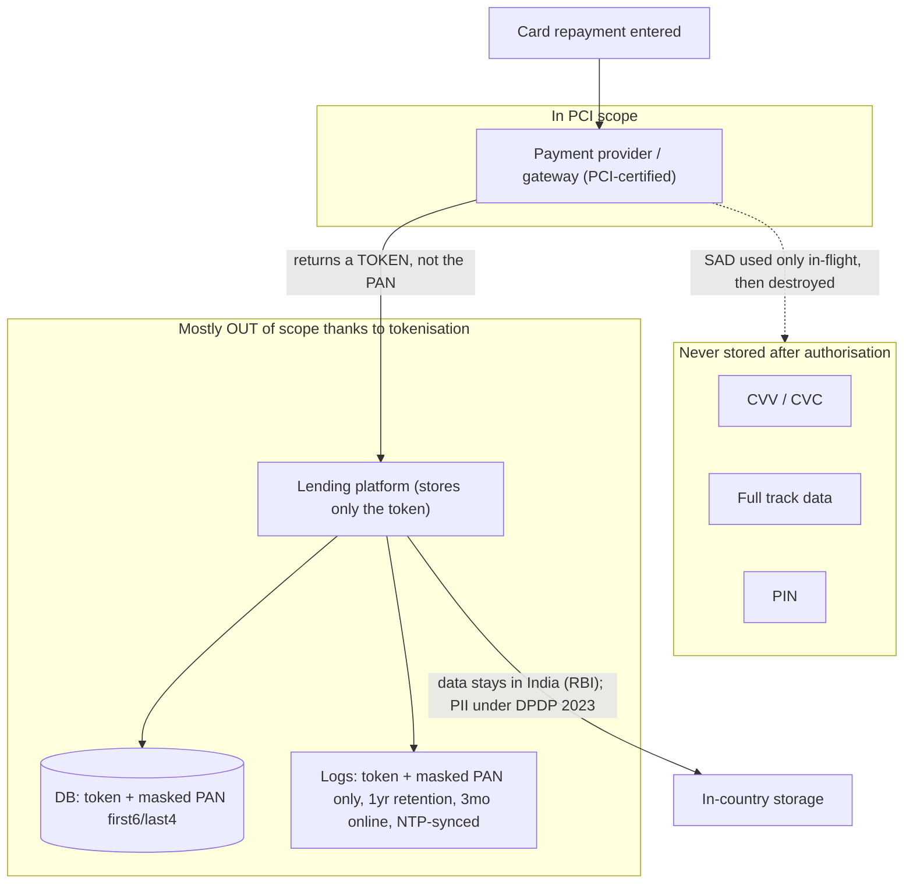

# Module 11.05: PCI-DSS awareness

**Estimated hours:** 2

**What you will learn**

1. What PCI DSS is, what data it protects, and when a lending platform is in scope and when it is not.
2. The 12 requirements translated into what they mean for you as a developer, plus the data classes (PAN, sensitive authentication data, PII) and the hard rules about what must never be stored or logged.
3. Concrete developer rules: masking PANs in logs, keeping card data out of crash dumps, logging and retention, and the Indian regulatory context (RBI localisation and IT governance, the DPDP Act 2023).

**Prerequisites:** [Module 11.04: TLS in practice and secrets management](module-04-tls-and-secrets.md). Uses the logging and dump ideas from 8.02 (core dumps), 8.10 (observability) and the secrets material from 11.04.

---

## 1. One-line intuition

PCI DSS is the card industry's security rulebook; as a developer it mostly comes down to "do not store what you must not store, mask what you do keep, encrypt everything in transit and at rest, and prove you did all of it".

## 2. Real-life analogy

Think of handling cash at a bank counter versus handling the combination to the vault.

Cash (ordinary data) you count, record and lock away with normal care. The vault combination (card data) is different: there are rules about who may ever see it, it may never be written on a sticky note (logs), it may never be left in a drawer overnight (stored after authorisation), and the room where it is handled has its own locked door, its own camera, and its own visitor log separate from the rest of the branch (segmentation). An auditor comes periodically and asks you to *show*, not just assert, that the door was locked, the camera ran, and the log is complete.

PCI DSS is that separate, stricter regime for one specific kind of valuable: payment card data. The genius and the burden of it is the same idea, make the sensitive thing touch as few systems as possible, so most of the bank never has to live under the strict rules.

## 3. Why it exists: the problem it solves

Before PCI DSS, every merchant and bank invented its own card-data handling, badly, and large breaches of card numbers were routine. The major card brands (Visa, Mastercard, American Express, Discover, JCB) jointly created the **Payment Card Industry Data Security Standard (PCI DSS)** so that anyone who stores, processes or transmits cardholder data meets one baseline. It is a contractual standard enforced by the card brands and acquiring banks, not a government law, but for a bank it is mandatory: fail it and you can lose the ability to process cards, plus fines.

The current version is **PCI DSS v4.0.1** (a minor update to v4.0). A set of the new v4.0 requirements were "future-dated" as best practices and became **mandatory on 31 March 2025**; before that date they were recommended, after it they are required. For an interview, the facts to hold are: *v4.0.1 is current, and the future-dated requirements are now in force (effective March 2025).*

Why it matters to you specifically: most of the cost and risk of PCI compliance is created or avoided by developers. A single `log.debug(request)` that prints a full card number drags a server into scope and can cause a finding. The whole art is to design so that card data flows through the fewest possible components, and the rest of the platform is provably out of scope. What breaks without it: card numbers end up in logs, backups, crash dumps and test databases, each a breach waiting to happen and each an audit failure.

## 4. Three layers of depth

### Layer 1 (beginner): the data classes and the one unbreakable rule

PCI DSS splits card data into classes, and the rules differ sharply by class.

| Class | Examples | May you store it? |
|---|---|---|
| **PAN** (Primary Account Number) | The 16-ish-digit card number | Yes, but only if you must, and then **encrypted/rendered unreadable**; it is the center of scope |
| **Cardholder data (CHD)** | PAN, cardholder name, expiry date, service code | PAN must be protected; the others may be stored with the PAN's protections |
| **Sensitive Authentication Data (SAD)** | Full track data (magnetic stripe), **CVV/CVC** (the 3-4 digit code), PIN/PIN block | **Never store after authorisation.** Not even encrypted. This is the hardest rule. |

The one rule you must never get wrong: **CVV and full track data must never be stored after a transaction is authorised.** Not in the database, not in a log, not in a cache, not "temporarily" in a file. They may exist in memory only during the authorisation, and must be gone afterward. The PAN *may* be stored if genuinely needed, but only rendered unreadable (strong encryption, truncation, or tokenisation).

When you must *display* or *log* a PAN, PCI DSS limits what you may show: **at most the first six and last four digits** (the BIN and the last four), with the middle masked, e.g. `457310******1234`. Anything more is a violation. Many systems now show only the last four.

### Layer 2 (working engineer): the 12 requirements in developer terms

PCI DSS is organised into 6 goals and **12 requirements**. Here is each one in the language of someone writing the code, not the auditor's phrasing:

| # | Requirement (short) | What it means for a developer |
|---|---|---|
| 1 | Install and maintain network security controls | Your service sits in a segmented network zone; know which zone and why; firewalls between the card zone and everything else |
| 2 | Apply secure configurations | No default passwords, no unnecessary services, hardened OS/images; the hardening flags from 11.02 live here |
| 3 | Protect stored account data | Do not store SAD; render stored PAN unreadable (encryption with KMS-managed keys, truncation, or tokenisation); this is where DEK/KEK from 11.04 applies |
| 4 | Protect data in transit over open/public networks | Strong TLS (1.2+), no SSL/early TLS; the TLS work from 11.04 |
| 5 | Protect against malware | Anti-malware on relevant systems; mostly ops, but do not ship a channel for it |
| 6 | Develop and maintain secure systems and software | **Your home turf:** secure SDLC, code review, fix known vulnerabilities (patching), address the OWASP injection/memory-safety classes from 11.01-11.03, change control |
| 7 | Restrict access by business need to know | Least privilege: the DB role with EXECUTE-only from 11.03; role-based access |
| 8 | Identify users and authenticate access | Unique IDs per user (no shared accounts), strong authentication, **MFA** for access to the card environment |
| 9 | Restrict physical access | Data centre and media handling; mostly facilities |
| 10 | Log and monitor all access | **Your turf:** audit logs of who did what to card data, time-synced clocks, protect logs from tampering, retention (below) |
| 11 | Test security regularly | Vulnerability scans (ASV scans, below), penetration tests, file-integrity monitoring |
| 12 | Support information security with policies | Policies, training, incident response plan, vendor management |

The ones a C++/backend developer touches most are **2, 3, 4, 6, 7, 8, 10, 11**. If an interviewer asks "which requirements affect you day to day", name those and say why.

**Logging and retention rules (Requirement 10), the numbers to remember:**

- Keep audit logs for **at least one year**, with **at least the most recent three months immediately available** (online, queryable) and the rest archived but retrievable.
- Logs must capture who, what, when, where for access to card data and admin actions, and be protected from modification (append-only / shipped off-box).
- **Clock synchronisation** is explicit: all systems use a consistent, synchronised time source (NTP) so events can be correlated across machines. A log with the wrong clock is nearly useless in an incident and is a finding.

**Testing rules (Requirement 11):**

- **ASV scans:** quarterly external vulnerability scans by an **Approved Scanning Vendor** (a PCI-certified third party) against internet-facing systems; they must pass (no high-severity findings).
- **Penetration tests:** at least annually and after significant changes, internal and external.
- **Segmentation testing:** if you rely on segmentation to keep systems out of scope, you must test that the segmentation actually holds.

### Layer 3 (internals): keeping card data out of logs and crash dumps

Two technical problems bite developers specifically, and both have concrete fixes.

**1. Masking in logs.** Your structured logger must never emit a full PAN. The discipline: mask at the boundary where data enters a log line, not by hoping no one logs the wrong field. Practical measures:

- A logging helper that masks any field tagged as a PAN to first-6/last-4 (or last-4 only), applied centrally so it cannot be forgotten per call site.
- Never log whole request/response bodies for card flows; log identifiers and masked fields.
- A CI check that greps logs and source for card-number patterns (a regex for 13-19 digit sequences passing a Luhn check) and fails the build on a hit. This is the log-leak lesson from module 11.04's incident, made automatic.

**2. Card data in crash dumps.** A core dump (module 8.02) is a snapshot of process memory; if a card number was in a buffer at crash time, it is now in a file on disk, often world-readable or shipped to a crash-analysis service. Three Linux mechanisms to control this:

- `prctl(PR_SET_DUMPABLE, 0)` on a process that handles card data makes the kernel refuse to produce a core dump for it (and blocks `ptrace` attach). The cost: you lose core dumps for debugging, so this is used selectively.
- `madvise(addr, len, MADV_DONTDUMP)` marks a *specific* memory region (the buffer holding card data) to be excluded from any core dump, while the rest of the process still dumps normally. This is the surgical option: dump everything except the sensitive buffer.
- Restrict or scrub dumps operationally: set a tight `core_pattern`, store dumps in a restricted location, and run a scrubber before any dump leaves the secure zone.

And, always: **zero the buffer as soon as the card data is no longer needed** (a `volatile`-safe memset such as `explicit_bzero`), so the window in which it could be captured is as small as possible. This pairs with the "clear sensitive buffers" rule from 11.04.

**The move that removes most of this: tokenisation.** If the lending platform never holds the real PAN, almost all of PCI scope evaporates. **Tokenisation** replaces the PAN with a meaningless **token** (issued by the payment provider or a tokenisation service); the token is useless if stolen and maps back to the PAN only inside the provider's vault. The platform stores and logs the token freely. This is the single highest-leverage design decision for PCI, and it is the one the lending platform made (section 7).

**Indian regulatory context (high level).** India adds its own rules on top of PCI DSS for payments and personal data:

- **RBI data localisation:** the Reserve Bank of India requires that payment system data be stored **only in India** (the 2018 directive on "Storage of Payment System Data"). For a bank operating in India, card and payment data cannot be stored abroad, which shapes where databases and backups live.
- **RBI IT governance / cyber-security directions:** the RBI issues master directions on IT governance, risk and controls for banks and regulated entities (including outsourcing and incident-reporting timelines). Know that they exist and impose reporting obligations.
- **DPDP Act 2023 (Digital Personal Data Protection Act):** India's personal-data law. It governs *personal data* generally (not just cards): consent, purpose limitation, data-principal rights, breach notification, and obligations on "data fiduciaries". A lending platform holds a lot of PII (PAN as in income-tax PAN, Aadhaar-linked identity, income), so DPDP applies even where PCI does not.

You are not the compliance officer. The developer-level takeaways are: card/payment data stays in India, personal data has consent and minimisation obligations, and breaches have mandatory reporting timelines, so "log everything forever, anywhere" is both a PCI and a DPDP problem.

## 5. Architecture diagram



## 6. Code

PCI work for a developer is mostly *not* writing card-handling code; it is enforcing masking and keeping data out of dumps. Two small, real utilities.

First, a PAN masker that emits at most first-6/last-4, with Luhn validation so a log-scanner can tell a real card number from a random digit string.

```c
/* pan_mask.c - mask a PAN for logging (first 6 / last 4 at most), and a Luhn
 * check a log scanner can use to spot unmasked card numbers.
 * Build: cc -std=gnu17 -Wall -Wextra -Werror pan_mask.c -o pan_mask */
#include <stdio.h>
#include <string.h>

/* Luhn checksum: true if the digit string could be a real card number. */
static int luhn_ok(const char *d, size_t n) {
    int sum = 0, dbl = 0;
    for (size_t i = n; i-- > 0;) {
        if (d[i] < '0' || d[i] > '9') return 0;
        int v = d[i] - '0';
        if (dbl) { v *= 2; if (v > 9) v -= 9; }
        sum += v; dbl = !dbl;
    }
    return n >= 13 && n <= 19 && sum % 10 == 0;
}

/* Write a masked form into out: first 6 and last 4 kept, middle as '*'. */
static void mask_pan(const char *pan, char *out, size_t cap) {
    size_t n = strlen(pan);
    if (n < 13 || n > 19 || cap <= n) { snprintf(out, cap, "****"); return; }
    for (size_t i = 0; i < n; ++i)
        out[i] = (i < 6 || i >= n - 4) ? pan[i] : '*';
    out[n] = '\0';
}

int main(void) {
    const char *pan = "4573102345671234";          /* a test number */
    char masked[32];
    mask_pan(pan, masked, sizeof masked);
    printf("store/display: %s\n", masked);          /* 457310******1234 */
    printf("looks like a real PAN (Luhn): %s\n", luhn_ok(pan, strlen(pan)) ? "yes" : "no");
    return 0;
}
```

```bash
cc -std=gnu17 -Wall -Wextra -Werror pan_mask.c -o pan_mask && ./pan_mask
```

Expected output (the Luhn result depends on the test digits; `4573102345671234` is a constructed example):

```text
store/display: 457310******1234
looks like a real PAN (Luhn): no
```

Second, the crash-dump exclusion for a sensitive buffer, the surgical `MADV_DONTDUMP` approach:

```c
/* no_dump.c - keep a card buffer out of any core dump, then wipe it.
 * Build: cc -std=gnu17 -Wall -Wextra -Werror no_dump.c -o no_dump */
#include <string.h>
#include <sys/mman.h>
#include <unistd.h>
#include <stdio.h>

int main(void) {
    long pg = sysconf(_SC_PAGESIZE);
    /* a page-aligned region for the PAN, so madvise can target it exactly */
    void *card = aligned_alloc((size_t)pg, (size_t)pg);
    if (!card) return 1;

    if (madvise(card, (size_t)pg, MADV_DONTDUMP) != 0)   /* exclude from core dumps */
        perror("madvise");

    strcpy((char *)card, "4573102345671234");            /* card data lives here briefly */
    /* ... authorise the payment ... */
    explicit_bzero(card, (size_t)pg);                    /* wipe as soon as done */
    printf("card buffer handled and wiped; excluded from core dumps\n");
    free(card);
    return 0;
}
```

```bash
cc -std=gnu17 -Wall -Wextra -Werror no_dump.c -o no_dump && ./no_dump
```

Expected output:

```text
card buffer handled and wiped; excluded from core dumps
```

(`explicit_bzero` is used instead of `memset` because the compiler is not allowed to optimise it away as a "dead store", which it can do to a plain `memset` on a buffer that is about to be freed. For the whole process, `prctl(PR_SET_DUMPABLE, 0)` disables dumps entirely; `MADV_DONTDUMP` excludes just this region so the rest of the process still dumps for debugging.)

## 7. Use case: core-banking loan-origination platform

**The decision it drove: the PAN was tokenised by the payment provider, so the lending platform stored only a token, keeping almost the entire platform out of PCI scope.** The platform originates loans; card data appears only in one place, when a customer makes a **card repayment** of an EMI. The design decisions:

1. **Tokenise at the edge.** The card details went straight to the PCI-certified payment gateway, which returned a **token**. The lending platform's database and logs stored the token and, where a human needed to recognise the card, a masked PAN (first-6/last-4). The platform never persisted a full PAN and never saw CVV or track data at all. Consequence: the app server, the YugabyteDB cluster and the migration engine were **out of PCI scope**, so the strict Requirement 3/4 controls applied only to the small, certified gateway integration, not the whole system. This is the single most important PCI decision and the one to lead with in an interview.
2. **Masking enforced centrally.** A logging helper masked any field tagged as a PAN, and a CI job scanned source and sample logs for Luhn-passing digit sequences, failing the build on a hit. This came directly from the C6 incident where a debug log held a customer's identity number in plaintext (module 11.04): the fix was to make leakage structurally hard, not rely on vigilance.
3. **Dumps controlled.** The payment-integration component ran with restricted core dumps and marked its card buffer `MADV_DONTDUMP`, wiping it with `explicit_bzero` after authorisation, so even a crash there could not spill a PAN into a dump file.
4. **Retention and clocks.** Audit logs (the `audit_log` table and the system logs) were kept one year with three months online, and every host used NTP so the audit trail across the app server, database and gateway correlated to the same clock, which Requirement 10 demands and which an incident needs.
5. **India constraints.** Payment and card data stayed in Indian data centres (RBI localisation), which influenced where the YugabyteDB cluster and backups were placed; and because the platform holds heavy PII (income-tax PAN, Aadhaar-linked KYC, income), DPDP 2023 obligations (consent, minimisation, breach reporting) governed the rest of the data even outside PCI.

The interview sentence: *"We tokenised the card at the gateway, so the platform stored only a token plus a masked PAN; that kept the app server and the database out of PCI scope and confined the strict controls to the certified gateway integration. Masking was enforced centrally with a CI scanner, card buffers were excluded from core dumps and wiped, and payment data stayed in India per RBI."*

**What a developer must not do, the checklist:** never store CVV or track data, ever; never log a full PAN (first-6/last-4 at most); never put card data in a test/QA database or a shared log aggregator; never bypass the gateway "to make testing easier"; never widen a service's data access "just in case"; never disable NTP; and never let a card buffer reach a crash dump.

## 8. Lab

This module is awareness and design, so the lab is reading, building the two utilities, and producing a scope diagram. Work in `~/labs/11.05`.

### Part A: masking and Luhn (20 minutes)

1. Build and run `pan_mask.c`. Confirm it masks to `457310******1234`. Change the stored output to last-4-only (`************1234`) and note which is more conservative.
2. Feed it a Luhn-valid test number (search "test card numbers"; e.g. a Visa test PAN) and confirm `luhn_ok` returns yes. Write the regex a CI log-scanner would use (a 13-19 digit run) and explain why adding the Luhn check cuts false positives.

Expected: masked output is first-6/last-4; `luhn_ok` distinguishes a real-format PAN from random digits.

### Part B: keep card data out of a dump (20 minutes)

1. Build and run `no_dump.c`. Then write a tiny program that puts a fake PAN in a normal (non-`MADV_DONTDUMP`) buffer and calls `abort()`. With `ulimit -c unlimited`, run it, load the core in GDB (module 8.02), and `grep` the core file for the digits: confirm the PAN is present in the dump.
2. Add `MADV_DONTDUMP` to the buffer, crash again, and confirm the digits are **not** in the new core. Write one sentence on why `explicit_bzero` is used instead of `memset`.

Expected: the unprotected buffer's PAN appears in the core; the `MADV_DONTDUMP` one does not.

### Part C: classify and decide scope (25 minutes)

1. Take the canonical lending schema (Common brief) and the card-repayment flow. For each data element (PAN, CVV, income-tax PAN, Aadhaar, income, loan amount, token), write its class (CHD/SAD/PII/none) and whether it may be stored.
2. Draw the scope diagram (like section 5) for two designs: (a) the platform stores the full PAN itself, (b) the platform tokenises at the gateway. Mark which components are in PCI scope in each. Count the in-scope components.

Expected: design (a) pulls the app server and database into scope; design (b) confines scope to the gateway integration. You can state the scope difference in one sentence.

### Part D: the retention and logging rules (15 minutes)

1. Write the retention policy for the lending platform's logs in one paragraph: one year total, three months immediately available, append-only/off-box, NTP-synced clocks. Note where the `audit_log` table fits.
2. List three things that, if logged, would cause a PCI finding, and the masked/omitted form each should take instead.

Expected: a correct retention statement and three concrete "do not log X, log Y instead" rules.

### Journal

Copy [journal/TEMPLATE.md](../journal/TEMPLATE.md) to `journal/YYYY-MM-DD-pci-dss-awareness.md`. Record: your data-classification table from Part C; the in-scope component count for the two designs and why tokenisation wins; the GDB result from Part B (PAN present vs absent in the core); and your retention paragraph from Part D. Note the one rule you are most likely to break by accident and how you would make breaking it structurally hard.

## 9. Common mistakes and misconceptions

| Mistake | Why it is wrong | Consequence |
|---|---|---|
| "We can store the CVV if we encrypt it" | SAD (CVV, track, PIN) must never be stored after authorisation, encrypted or not | Direct, serious PCI violation |
| "Masking means hiding the last four" | PCI allows showing at most first-6/last-4; the *middle* is masked, and showing only last-4 is more conservative | Over-disclosure if you show too much |
| "Logs are internal, so full PANs are fine there" | Logs are in scope; a full PAN in a log is a violation and a breach vector | Finding; and the log aggregator is now in scope |
| "Core dumps are a debugging detail, not a compliance issue" | A dump is process memory on disk; card data in it is stored card data | PAN leaks via a crash dump |
| "PCI is the ops/security team's job" | Requirements 2, 3, 4, 6, 7, 8, 10, 11 are mostly developer actions | Scope creep and findings caused by code |
| "Tokenisation is just encryption with extra steps" | A token is a meaningless reference held by the provider; it is useless if stolen and removes scope | Missing the biggest scope-reduction lever |
| "One year of logs, delete the rest immediately" | At least one year total, with three months immediately available; clocks must be NTP-synced | Non-compliant retention; uncorrelated incident timelines |

## 10. Resume link

PCI DSS is not a resume line by itself, but it is the compliance frame around claims H4 and H6 and the security phase:

- **Banking-domain credibility.** Say: *"The lending platform tokenised card data at the gateway, so it stored only a token and a masked PAN; that kept the app server and database out of PCI scope. I knew the developer-facing requirements, 3, 4, 6, 7, 10, 11, and the hard rules: never store CVV or track data, mask PANs to first-6/last-4 in logs, keep card data out of crash dumps, one-year log retention with three months online, NTP-synced clocks."*
- **Claim F, incidents.** The "plaintext identity number in a debug log" story (11.04) connects here: the fix was central masking plus a CI scanner, which is exactly Requirement 10 thinking.

Likely follow-up: *"What is the difference between a PAN and SAD, and what may you store?"* Answer: *"The PAN is the card number; it may be stored only rendered unreadable (encryption, truncation, or tokenisation), and shown at most as first-6/last-4. SAD, sensitive authentication data, is CVV, full track data and the PIN; it may never be stored after authorisation, not even encrypted. The cleanest design stores neither: tokenise the PAN and never touch SAD."*

## 11. Interview questions

**Q1 (easy). What does PCI DSS protect, and which version is current?**

<details>
<summary>Model answer</summary>

It protects payment card data for anyone who stores, processes or transmits it. The current version is v4.0.1, a minor update to v4.0; a set of v4.0 requirements were future-dated and became mandatory on 31 March 2025. It is a contractual standard from the card brands, enforced by acquiring banks, not a government law, but for a bank it is mandatory.

</details>

**Q2 (easy). Which card data may never be stored after a transaction is authorised?**

<details>
<summary>Model answer</summary>

Sensitive Authentication Data: the CVV/CVC code, full magnetic-stripe track data, and the PIN/PIN block. These may never be stored after authorisation, even encrypted. The PAN (card number) may be stored if genuinely needed, but only rendered unreadable (strong encryption, truncation, or tokenisation), and displayed as at most first-6/last-4.

</details>

**Q3 (medium). You must log a failed card payment for debugging. What may the log line contain?**

<details>
<summary>Model answer</summary>

It may contain a masked PAN (at most first-6/last-4, or just last-4), the token, the transaction id, the timestamp (from an NTP-synced clock), the result code, and the masked/omitted cardholder name as policy dictates. It must not contain the full PAN, the CVV, track data, or the PIN, ever. In practice I would log identifiers and masked fields only, enforce the masking in a central logging helper so it cannot be forgotten, and run a CI scanner that greps for Luhn-valid digit sequences and fails the build on a hit. Logs are in scope, so a full PAN in a log is both a breach and a finding.

</details>

**Q4 (medium). How do you keep card data out of a crash dump, and why does it matter?**

<details>
<summary>Model answer</summary>

A core dump is a snapshot of process memory written to disk, so any card number in a buffer at crash time becomes stored card data in a file that may be world-readable or shipped to a crash service, a violation and a leak. Controls: `madvise(buf, len, MADV_DONTDUMP)` excludes a specific sensitive region from dumps while the rest of the process still dumps for debugging; `prctl(PR_SET_DUMPABLE, 0)` disables dumps for the whole process; and operationally, restrict the dump location and scrub dumps before they leave the secure zone. Always wipe the buffer with `explicit_bzero` as soon as the data is no longer needed, so the capture window is minimal. `explicit_bzero` rather than `memset` because the compiler may optimise away a plain `memset` on a soon-to-be-freed buffer.

</details>

**Q5 (hard). Explain how tokenisation reduces PCI scope, and name the Indian rules that still apply to a lending platform even after tokenisation.**

<details>
<summary>Model answer</summary>

Tokenisation replaces the PAN with a meaningless token issued by a PCI-certified provider; the token maps back to the PAN only inside the provider's vault and is useless if stolen. If the platform never stores or processes the real PAN, only the token (and perhaps a masked PAN), then the components that handle only tokens fall out of PCI scope, so the strict storage and transmission controls apply only to the small certified integration rather than the whole system. That is the biggest scope-reduction lever and usually the right design. India-specific rules still apply regardless: RBI data localisation requires payment system data to be stored only in India, so databases and backups must be in-country; RBI's IT governance and cyber-security directions impose controls and incident-reporting timelines on the bank; and the DPDP Act 2023 governs the platform's personal data (income-tax PAN, Aadhaar-linked KYC, income) with consent, purpose-limitation, data-principal rights and breach-notification obligations. So tokenisation shrinks PCI scope but does not remove the Indian localisation and personal-data duties.

</details>

## 12. Revision

- PCI DSS (current v4.0.1; future-dated requirements mandatory since March 2025) protects payment card data; the unbreakable rule is never store SAD (CVV, track data, PIN) after authorisation, and store the PAN only rendered unreadable, shown at most first-6/last-4.
- The 12 requirements; the developer-facing ones are 2 (secure config), 3 (protect stored data), 4 (TLS in transit), 6 (secure SDLC/patching), 7 (least privilege), 8 (unique IDs + MFA), 10 (logging: one year retention, three months online, NTP-synced, tamper-protected) and 11 (ASV scans, pen tests, segmentation testing).
- Biggest lever is tokenisation (store a token, not the PAN) to cut scope; developer duties are masking PANs centrally, keeping card data out of crash dumps (`MADV_DONTDUMP`/`PR_SET_DUMPABLE`, `explicit_bzero`) and logs; India adds RBI data localisation, RBI IT governance, and the DPDP Act 2023 for personal data.

---

Previous: [Module 11.04: TLS in practice and secrets management](module-04-tls-and-secrets.md) | Next: [Module 11.06: How a loan-origination system works end to end](module-06-loan-origination-end-to-end.md)
