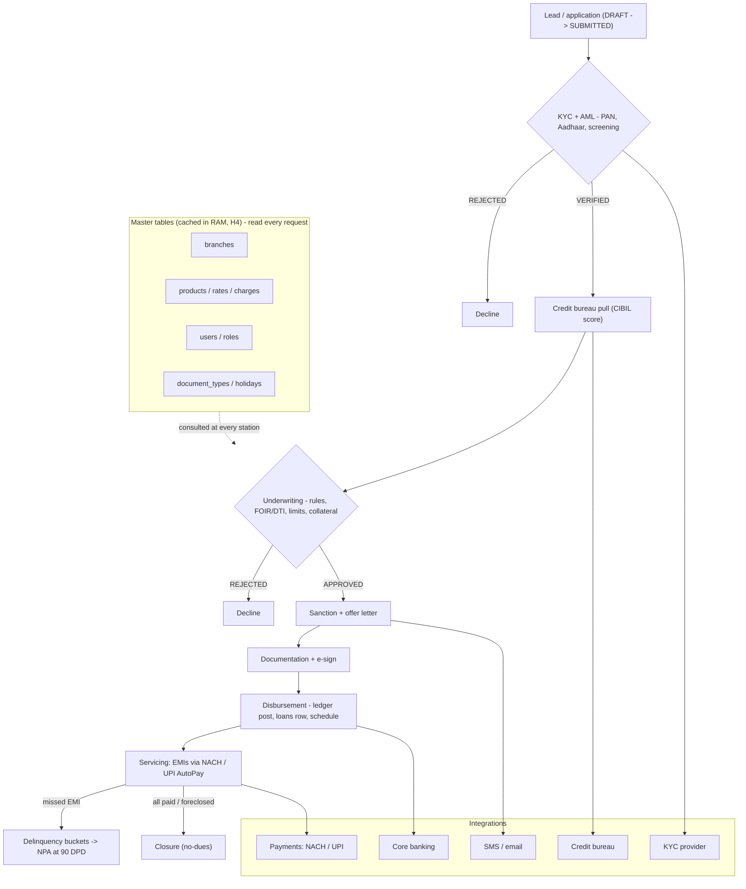

# Module 11.06: How a loan-origination system works end to end

**Estimated hours:** 4

**What you will learn**

1. The full loan journey as a flowchart and then step by step: lead and application, KYC, credit bureau, underwriting, sanction, documentation and e-sign, disbursement, servicing and closure, including delinquency and NPA.
2. The data model behind it: the master tables (and why they are read on every request), the transactional tables, the actors, and the integrations with bureaus, KYC providers, core banking, payments and messaging.
3. Where each capstone (C1-C6) sits in this system, the non-functional requirements, a glossary of banking terms, and how to show domain knowledge in an interview with specifics.

**Prerequisites:** [Module 11.05: PCI-DSS awareness](module-05-pci-dss-awareness.md). This module ties together the whole course: the schema from 6.03, the master-table cache from 4.13, the indexes from 6.09/H7, the app server from 5.07/H4, and the migration and parity work from H1-H3.

---

## 1. One-line intuition

Loan origination is the assembly line that turns a stranger asking for money into a funded loan with a repayment schedule, passing the application through identity, credit and policy gates, and every capstone you built is one station on that line.

## 2. Real-life analogy

Think of a careful restaurant kitchen taking an order it cannot simply refund if it goes wrong.

- A customer places an order (the **application**). The waiter writes down who they are and what they want.
- The kitchen checks the customer is who they say (**KYC**, like checking a reservation and ID), and checks their history of paying the bill (the **credit bureau**, like a note that this table once dined and dashed).
- The head chef decides whether to cook this order at all, and in what portion, given the kitchen's rules and the customer's history (**underwriting**).
- If approved, the order ticket is printed and signed off (**sanction and offer letter**), the dish is prepared (**documentation and disbursement**), and then the customer pays in instalments over the evening (**repayment / EMIs**).
- If the customer stops paying partway, the restaurant escalates: a reminder, then a manager, then it writes the meal off as a loss (**delinquency buckets and NPA**).

Every station depends on reference information that rarely changes but is consulted constantly: the menu, the prices, today's specials, which chefs are on shift (the **master tables**). You do not re-print the menu for every order; you keep it at hand. That is exactly why the platform caches master tables in memory (claim H4).

## 3. Why it exists: the problem it solves

Lending money is easy; lending it *and getting it back* is the entire business. A loan-origination system exists to make that repeatable, auditable and fast at scale:

- **Risk control.** Without a disciplined pipeline, a bank lends to people who will not repay, or lends amounts that do not fit the borrower's income, and the loan book turns bad. KYC, the bureau pull and underwriting are the gates that keep the book healthy.
- **Regulatory compliance.** KYC/AML (anti-money-laundering) checks, fair-lending rules, RBI norms on NPA recognition, data localisation and personal-data law (module 11.05) are all mandatory. The system encodes them so they cannot be skipped.
- **Speed and consistency.** A branch clerk must process an application the same way as every other clerk, in minutes not days, with the same checks and the same rates. The master tables and the procedure layer (claim H6) centralise the rules so every request is consistent.
- **Auditability.** Every decision, who approved what amount at what rate and why, must be reconstructable years later for audits and disputes. The `audit_log` table and append-only logging exist for this.

What breaks without it: inconsistent decisions, a rising bad-loan ratio, regulatory penalties, and no way to defend a decision when a regulator or a court asks. This module is the domain context that makes every technical capstone you built *mean* something to an interviewer.

## 4. Three layers of depth

### Layer 1 (beginner): the loan journey, station by station

The journey, in order, with what happens and which schema tables and status values it touches (names from the canonical schema in the Common brief):

1. **Lead and application.** A prospective borrower is captured as a lead, then a formal application is created: who (`customers`), how much (`amount_paise`), for how long (`tenure_months`), for which product (`products`, e.g. `HL01` home loan, `PL01` personal loan), at which branch (`branches`). A row is inserted into `loan_applications` with status `DRAFT`, then `SUBMITTED`. The clerk (`users`, role `CLERK`) creates it.
2. **KYC (Know Your Customer).** The customer's identity is verified: documents collected, the income-tax **PAN** checked, often an **Aadhaar**-based verification, and **AML screening** against sanction/watch lists. `customers.kyc_status` moves `PENDING` -> `VERIFIED` (or `REJECTED`). A rejected KYC stops the journey here.
3. **Credit bureau pull.** The platform asks a credit bureau (in India, **CIBIL**, plus Experian/Equifax/CRIF) for the applicant's credit history and a **credit score** (CIBIL score, roughly 300-900; higher is better). This reveals existing loans, repayment history and defaults.
4. **Underwriting.** The decision engine applies rules and policy limits: does the amount fit the product's `min_amount_paise`/`max_amount_paise` and `max_tenure_months`? Does the applicant's score clear the cut-off? Does the **FOIR/DTI** (below) stay within policy? For a **secured** loan, is there acceptable **collateral**? The outcome sets `loan_applications.status` to `APPROVED` or `REJECTED`.
5. **Sanction and offer letter.** An approved application becomes a **sanction**: the bank formally offers a specific amount, rate (`rate_bp`, basis points) and tenure. An **offer/sanction letter** is generated for the customer.
6. **Documentation and e-sign.** The customer accepts, signs the agreement (increasingly via **e-sign**), and any remaining documents (`document_types`) are collected and verified.
7. **Disbursement.** The money is released. A `loans` row is created (linked 1:1 to the application via `application_id`), `principal_paise` and `outstanding_paise` are set, `disbursed_at` is stamped, status `ACTIVE`. The funds move via the core banking system, and a **repayment schedule** (`repayments` rows, one per instalment, status `DUE`) is generated.
8. **Servicing.** The customer repays in **EMIs** (equated monthly instalments), usually auto-debited via **NACH** or **UPI AutoPay**. Each paid instalment flips a `repayments` row to `PAID` and reduces `loans.outstanding_paise`. The customer may **prepay** (pay extra) or **foreclose** (pay off the whole loan early).
9. **Delinquency and NPA.** If an instalment is missed, the loan becomes **delinquent** and is tracked in **buckets** (how many days past due: 1-30, 31-60, 61-90, 90+). Per RBI norms, a loan is classified **NPA (Non-Performing Asset)** when it is **90 days past due** (`loans.status = NPA`). Collections escalate through the buckets.
10. **Closure.** When `outstanding_paise` reaches zero (all EMIs paid, or foreclosed), the loan is **CLOSED**. A no-dues certificate is issued and any collateral is released.

### Layer 2 (working engineer): the data model and why master tables are special

The schema divides into **master (reference) tables** and **transactional tables**.

**Master tables** change rarely and are read constantly:

| Master table | Holds | Why read on every request |
|---|---|---|
| `branches` | Branch code, name, city, region | Every request is scoped to a branch; routing, limits, reporting |
| `products` + schemes | Product code, amount/tenure limits, base rate | Every application validates against the product's limits and rate |
| rate matrices | Rate by product × tenure × score band | Pricing every offer |
| charges | Fees (processing, prepayment, late) | Computed on disbursement, prepayment, delinquency |
| `document_types` | Which documents a product needs | Checklist on every application |
| `users` + `roles` | Who, with which permissions | Authentication and authorisation on every action |
| holidays | Non-working days | Scheduling EMI due dates and value dates |

The defining property: a master table is keyed by a **business code** (`branch_code`, `product_code`, `role_name`), it is small, and nearly every request joins against several of them. If each request hits the database for ten or twenty master lookups, the database and the network become the bottleneck, which is exactly the login-latency problem behind claim H7 (full-table scans on master tables keyed by business codes). Two engineering responses, both resume claims:

- **Cache them in memory (claim H4, module 4.13).** The app server loads the master tables into an in-memory `MasterCache` at startup and refreshes on change, so the hot request path does zero database round-trips for reference data. RAM at ~100 ns beats a database round-trip at ~1 ms (module 0.01's latency table), thousands of times over for twenty lookups per request.
- **Index them correctly (claim H7, modules 6.09/6.10).** Where the database *is* queried, composite and covering indexes on the business-code keys turn full-table scans into index-only scans. The login path keyed by `(branch_code, user_code)` is the canonical example: the primary key already covers it, but a naive query or a missing index caused the scan you fix in capstone C5.

**Transactional tables** grow with activity and are the record of what happened: `loan_applications`, `loans`, `repayments`, and the `audit_log`. Later modules add more (a double-entry **ledger**, an **idempotency** table, an **outbox**, from module 10.10 and capstone C2): the ledger records every money movement as balanced debits and credits; idempotency keys stop a retried disbursement from paying twice; the outbox reliably emits events (SMS, email) after a committed transaction.

**Actors** (who does what): the **customer/borrower**; the **clerk** (captures applications); the **credit officer** (reviews and underwrites); the **branch manager** (approves/sanctions within limits); the **auditor** (read-only, reviews the trail); and **system/batch** actors (EOD jobs, NACH presentations, delinquency sweeps). These map to `roles` (`CLERK`, `CREDIT_OFFICER`, `BRANCH_MANAGER`, `AUDITOR`).

**Integrations** (the external systems the platform talks to):

| Integration | Purpose | Notes |
|---|---|---|
| Credit bureau (CIBIL etc.) | Score and credit history pull | Per-pull cost; cache within a validity window; PII in flight (TLS/mTLS) |
| KYC provider | PAN/Aadhaar verification, document OCR | Regulated; AML screening |
| Core banking system | The actual accounts and the money movement | Disbursement and repayment post here |
| Payments (NACH, UPI AutoPay) | Auto-debit of EMIs | Mandates set up at disbursement; presentations in batches |
| SMS / email gateway | Notifications (OTP, sanction, EMI due/paid) | Via the outbox so they fire only after commit |

### Layer 3 (internals): the hard mechanics underwriters and engineers argue about

**FOIR / DTI.** The **Fixed Obligation to Income Ratio** (FOIR), closely related to the **Debt-to-Income** (DTI) ratio, is the fraction of the borrower's monthly income already committed to fixed obligations (existing EMIs, rent) plus the proposed new EMI. If a borrower earns 100,000/month, has 30,000 of existing EMIs, and the new loan's EMI is 25,000, the FOIR is 55,000/100,000 = 55%. Underwriting policy caps FOIR (commonly 50-60%); above the cap the loan is rejected or the amount reduced. This is a core underwriting rule and a great specific to cite.

**The EMI formula.** An equated monthly instalment on principal P, monthly rate r (annual rate / 12 / 100), over n months:

```
EMI = P * r * (1 + r)^n / ((1 + r)^n - 1)
```

Each EMI is split into **interest** (on the current outstanding) and **principal**; early EMIs are mostly interest, later ones mostly principal (an **amortisation** schedule). Money is held as integer **paise** (`bigint`) throughout, never a `double`, because floating-point rounding on money is a bug and an audit problem (this is why the schema uses `amount_paise`/`principal_paise`).

**Secured vs unsecured; collateral.** An **unsecured** loan (personal loan, `PL01`) has no asset backing it; the bank relies on the score and income. A **secured** loan (home loan `HL01`, loan against property) is backed by **collateral** whose value and **LTV (Loan-to-Value)** ratio the bank checks (e.g. lend at most 80% of a property's value). Collateral changes underwriting and the recovery path on default.

**NPA recognition, precisely.** RBI's asset-classification norms classify a loan as a **Non-Performing Asset** when principal or interest is **overdue for more than 90 days** (for term loans). Before that it is a **Special Mention Account** (SMA-0/1/2 as it ages). After NPA it is further graded (sub-standard, doubtful, loss) and the bank must set aside **provisions**. The 90-day rule is the single most-cited number; know it.

**Idempotency and the ledger (why disbursement is hard).** Disbursement moves real money, so it must be exactly-once even though networks retry. The platform uses an **idempotency key** per disbursement request: the first time it runs, it posts a balanced pair of entries to the **double-entry ledger** (debit a funding account, credit the customer) inside one transaction and records the key; a retry with the same key is recognised and returns the original result without posting again. This is module 10.10's banking-transaction design, realised in capstone C2 against PostgreSQL then YugabyteDB.

**Non-functional requirements** the platform must meet:

- **Consistency and correctness** over raw speed for money: a disbursement must be atomic and durable (ACID, module 6.04); a distributed transaction on YugabyteDB (module 7.08) must not double-pay or lose a credit.
- **Latency:** the interactive path (login, create application, fetch master data) targets low tens of milliseconds; the master-table cache (H4) and the right indexes (H7) are how it is met.
- **Availability:** branch hours demand high availability; the 3-node YugabyteDB cluster with RF=3 (module 7.09) survives a node loss without downtime, which capstone C4 rehearses.
- **Auditability and retention:** one year of logs with three months online, NTP-synced clocks (module 11.05), an append-only audit trail.
- **Security:** TLS/mTLS everywhere, least privilege via the procedure layer, PII and card handling per 11.04/11.05.
- **Scale:** many branches, each with concurrent clerks; the pooled request model and thread synchronisation layer (H4, Phase 4) handle concurrency; sharding by branch/customer (module 7.06) handles data growth.

### Where each capstone sits

The whole point of the course is that you *built* the pieces of this system. Here is the map:

| Capstone | Resume claim | Station in the loan system |
|---|---|---|
| **C1 tcpkv** | I | The networking + concurrency foundation: the thread pool, RAII sockets, shared_mutex store and load generator that the app server is built on. Not a station itself; the engine room. |
| **C2 RPC app server** | H4 | The **application server** that handles loan-origination requests over RPC-over-TCP: the pooled request model, the synchronisation layer (mutexes, critical sections, wait objects), and the in-memory master-table cache that removes joins from the hot path. This is the spine of stations 1-7. |
| **C3 BDB→Yugabyte migration** | H1, H2 | Moving the existing loan book from a legacy Berkeley DB environment into distributed SQL: cursor traversal, packed record decoding, composite keys, arena allocator, restartable batches. The data-migration project behind the platform. |
| **C4 Data-parity + cutover** | H3 | Gating the zero-downtime cutover to the multi-node cluster: record-by-record parity diff, dual-write window, cutover runbook, rollback. How the migration goes live safely. |
| **C5 PL/pgSQL + index tuning** | H6, H7 | The **procedure layer** (validation, authorisation, workflow across stations 1-7) and the **index tuning** that fixed the login-latency full-table scans on master tables. Stations' business logic and performance. |
| **C6 Crash/RCA lab** | H5 | The reliability discipline: diagnosing the corruption, leaks, deadlocks and races that happen in production, and writing the formal RCA under SLA. Keeps the whole line running. |

So when an interviewer asks "walk me through your platform", you can say: *the app server (C2) handles requests over RPC, backed by the tcpkv foundation (C1); business rules and authorisation live in a PL/pgSQL layer (C5) with tuned indexes; the loan book was migrated from Berkeley DB to YugabyteDB (C3) and cut over with a data-parity gate (C4); and when something broke I did the crash-dump analysis and RCA (C6).*

## 5. Architecture diagram



## 6. Code

The platform's business logic sits in the PL/pgSQL layer (claim H6, capstone C5). Here is a representative, runnable procedure: submitting an application, which validates against the cached/indexed master tables and records the outcome in the audit log. It uses the canonical schema and shows the master-table lookups, the status transition, and parameterised safety from module 11.03.

```sql
-- submit_application: validate a new loan application against product master
-- limits and the customer's KYC, then record it. Runs in the procedure layer
-- so the app connects EXECUTE-only (module 11.03). All inputs are parameters.
CREATE OR REPLACE FUNCTION submit_application(
    p_application_id bigint,
    p_branch_code    varchar(6),
    p_customer_id    bigint,
    p_product_code   varchar(8),
    p_amount_paise   bigint,
    p_tenure_months  int,
    p_created_by     varchar(10)
) RETURNS text
LANGUAGE plpgsql SECURITY DEFINER SET search_path = public, pg_temp AS $$
DECLARE
    v_min   bigint;
    v_max   bigint;
    v_maxt  int;
    v_active boolean;
    v_kyc   text;
BEGIN
    -- master-table lookup: product limits (in the cache on the hot path; here in SQL)
    SELECT min_amount_paise, max_amount_paise, max_tenure_months, active
      INTO v_min, v_max, v_maxt, v_active
      FROM products WHERE product_code = p_product_code;
    IF NOT FOUND OR NOT v_active THEN
        RETURN 'REJECTED: unknown or inactive product';
    END IF;

    -- customer must have passed KYC before an application can be submitted
    SELECT kyc_status INTO v_kyc FROM customers WHERE customer_id = p_customer_id;
    IF NOT FOUND OR v_kyc <> 'VERIFIED' THEN
        RETURN 'REJECTED: KYC not verified';
    END IF;

    -- policy limits from the product master
    IF p_amount_paise < v_min OR p_amount_paise > v_max THEN
        RETURN format('REJECTED: amount outside %s..%s', v_min, v_max);
    END IF;
    IF p_tenure_months <= 0 OR p_tenure_months > v_maxt THEN
        RETURN format('REJECTED: tenure outside 1..%s', v_maxt);
    END IF;

    INSERT INTO loan_applications(application_id, branch_code, customer_id,
        product_code, amount_paise, tenure_months, status, created_by)
    VALUES (p_application_id, p_branch_code, p_customer_id, p_product_code,
        p_amount_paise, p_tenure_months, 'SUBMITTED', p_created_by);

    INSERT INTO audit_log(branch_code, user_code, action, entity, entity_id, detail)
    VALUES (p_branch_code, p_created_by, 'SUBMIT', 'loan_application', p_application_id,
        jsonb_build_object('amount_paise', p_amount_paise, 'product', p_product_code));

    RETURN 'SUBMITTED';
END; $$;
```

Run it (against the canonical schema loaded into the course PostgreSQL):

```sql
-- after loading branches, products, customers from the Common brief:
SELECT submit_application(1001, 'HYD001', 1, 'PL01', 25000000, 36, 'clerk1');
-- a too-large amount is rejected by the product-master limits:
SELECT submit_application(1002, 'HYD001', 1, 'PL01', 999999999999, 36, 'clerk1');
```

Expected output (status strings; exact limits depend on your `products` rows):

```text
 submit_application
--------------------
 SUBMITTED

 submit_application
-----------------------------------------
 REJECTED: amount outside 5000000..100000000
```

The teaching points: the procedure reads master tables (`products`), enforces the KYC gate and policy limits centrally (so every caller gets the same rules, claim H6), records an audit entry, and is `SECURITY DEFINER` with a locked `search_path` so the app role needs only `EXECUTE` (claim H6 as a security boundary, module 11.03). On the hot path the product-limit lookup comes from the in-memory master cache (claim H4) instead of this SQL `SELECT`, which is the latency decision from module 4.13.

## 7. Use case: core-banking loan-origination platform

This module *is* the use case, so here the job is to state the decisions the end-to-end view drove across the platform:

1. **Centralise rules in the procedure layer (H6).** Because every station (KYC gate, limit checks, status transitions, authorisation) must behave identically for every clerk and every branch, the validation/authorisation/workflow logic lives in PL/pgSQL procedures, not scattered in the app code. This cut round trips (one procedure call instead of several queries) and made the rules auditable and consistent. The decision was driven by the realisation that the same checks appeared at stations 1, 4 and 7, and duplicating them in C++ risked drift.
2. **Cache the master tables (H4).** Because the master tables are consulted at every station and change rarely, they are cached in the app server's RAM, removing joins and round-trips from the hot path. Driven directly by the latency gap between RAM and a database round-trip (module 0.01) multiplied by ~20 lookups per request.
3. **Index the business-code keys (H7).** Because master tables are keyed by business codes and were being full-scanned on the login path, composite and covering indexes were designed from execution plans, turning the login latency bottleneck into an index-only scan. Driven by `EXPLAIN ANALYZE` showing sequential scans (capstone C5).
4. **Migrate the loan book without downtime (H1-H3).** Because the existing book lived in Berkeley DB and the target was a multi-node YugabyteDB cluster, the migration engine streamed records (cursor traversal, batched writes, arena allocator) and a data-parity suite gated a zero-downtime cutover with a dual-write window and rollback. Driven by the need to keep originating loans during the migration.
5. **Treat disbursement as exactly-once money (module 10.10).** Because disbursement moves real funds and networks retry, an idempotency key plus a double-entry ledger post inside one transaction ensures a retried request never double-pays. Driven by the correctness-over-speed non-functional requirement for money.

The interview sentence: *"The end-to-end view is why the architecture looks the way it does: rules centralised in a PL/pgSQL layer because every station shares them, master tables cached and indexed because every request reads them, the loan book migrated to YugabyteDB behind a parity gate, and disbursement made idempotent against a double-entry ledger because it moves real money."*

### Glossary of banking terms

- **PAN:** two meanings in this domain. (1) *Permanent Account Number*, the Indian income-tax identity used in KYC. (2) *Primary Account Number*, a payment card number (module 11.05). Context disambiguates.
- **Aadhaar:** India's 12-digit biometric identity number, used in KYC verification.
- **KYC / AML:** Know Your Customer / Anti-Money-Laundering; identity verification and screening against watch lists.
- **CIBIL score:** a credit score (about 300-900) from the CIBIL bureau; higher means lower risk.
- **Underwriting:** deciding whether and on what terms to lend, using rules, score, FOIR and collateral.
- **FOIR / DTI:** Fixed Obligation to Income Ratio / Debt-to-Income; affordability measure.
- **Sanction:** the bank's formal approval of a specific amount, rate and tenure.
- **Disbursement:** releasing the loan funds.
- **EMI:** Equated Monthly Instalment, the fixed monthly repayment.
- **NACH / UPI AutoPay:** auto-debit mechanisms for collecting EMIs in India.
- **Prepayment / Foreclosure:** paying extra / paying off the whole loan early.
- **Delinquency buckets:** groupings by days past due (1-30, 31-60, 61-90, 90+).
- **NPA:** Non-Performing Asset; a term loan 90+ days past due (RBI norm).
- **Secured / Unsecured; Collateral; LTV:** backed by an asset or not; the asset pledged; Loan-to-Value ratio.
- **Principal / Interest / Amortisation / Outstanding:** the borrowed amount / cost of borrowing / the schedule splitting each EMI / the amount still owed.
- **Basis points (bp):** one hundredth of a percent; 850 bp = 8.50% (the schema's `rate_bp`).
- **Paise:** 1/100 of a rupee; money is stored as integer paise.
- **Master tables / Transactional tables:** rarely-changing reference data / the growing record of activity.
- **Ledger (double-entry) / Idempotency key / Outbox:** balanced debits-and-credits record / dedupe token for retries / reliable post-commit event emission.
- **RBI / DPDP Act 2023:** Reserve Bank of India (regulator) / India's personal-data protection law.

## 8. Lab

A paper-and-schema lab: you will trace a loan through the system, exercise the procedure, and map your capstones onto the stations. Work in `~/labs/11.06` with the course PostgreSQL.

### Part A: load the schema and run the station (30 minutes)

1. Load the canonical schema (Common brief) into the course PostgreSQL and insert at least one branch, one product (`PL01` with sensible limits), and one `VERIFIED` customer.
2. Create and run `submit_application` from section 6. Submit a valid application (expect `SUBMITTED`), an over-limit amount (expect a `REJECTED` with the limits), and an application for a customer whose `kyc_status` is `PENDING` (expect `REJECTED: KYC not verified`).
3. Query `audit_log` and confirm the `SUBMIT` entry with its JSON detail. Explain in your journal why the audit entry is written in the same transaction as the insert.

Expected: three outcomes matching the gates; one audit row per successful submit.

### Part B: trace a loan end to end on paper (40 minutes)

1. Pick a concrete borrower (income, existing EMIs, requested amount, tenure, product). Walk them through all ten stations, writing the status value and the table touched at each: `loan_applications.status` DRAFT -> SUBMITTED -> APPROVED, then a `loans` row ACTIVE, `repayments` rows DUE, and so on.
2. Compute their FOIR (existing obligations + new EMI, over income) and decide, with a 55% cap, whether underwriting approves. Compute the EMI with the formula from Layer 3 for your chosen amount/rate/tenure.
3. Now make them miss three EMIs. Show the delinquency bucket progression and the day the loan becomes NPA (90 DPD). Mark `loans.status = NPA`.

Expected: a complete status timeline, a FOIR-based decision, an EMI figure, and the correct NPA day.

### Part C: master tables, cache and index (30 minutes)

1. List which master tables the `submit_application` procedure reads. For each, say what the key is and why caching it (H4) helps the hot path.
2. Run `EXPLAIN ANALYZE` on a `users` login lookup `WHERE branch_code = 'HYD001' AND user_code = 'clerk1'` with and without the composite primary key (simulate "without" by querying on a non-indexed copy of the table). Record the plan change (seq scan -> index scan) and the time difference. This is the H7 story in miniature.

Expected: a master-table list with keys, and an `EXPLAIN ANALYZE` before/after showing the scan type change.

### Part D: map your capstones (20 minutes)

1. Draw the station flowchart (section 5) and annotate each station or component with the capstone (C1-C6) that built it, using the table in Layer 3.
2. Write the two-minute spoken walk-through of the platform that names each capstone in place (the section 7 sentence is a starting point). You will reuse this in module 12.01.

Expected: an annotated flowchart and a rehearsed walk-through paragraph.

### Journal

Copy [journal/TEMPLATE.md](../journal/TEMPLATE.md) to `journal/YYYY-MM-DD-loan-origination-end-to-end.md`. Record: the three procedure outcomes from Part A; your end-to-end status timeline, FOIR decision, EMI and NPA day from Part B; the `EXPLAIN ANALYZE` before/after from Part C; and your capstone-to-station map and walk-through paragraph from Part D. Note the one banking term you did not know before this module.

## 9. Common mistakes and misconceptions

| Mistake | Why it is wrong | Consequence |
|---|---|---|
| "Origination ends at disbursement" | Servicing, delinquency and closure are part of the lifecycle and drive much of the schema | Designs that ignore repayments, NPA and collections |
| "Master tables are just more tables" | They are small, business-code-keyed, and read on every request; caching and indexing them is the performance story (H4/H7) | The login-latency full-table-scan bug |
| "Store money as a decimal/double for the rate maths" | Floating point rounds money incorrectly and fails audits | Off-by-a-paisa errors, reconciliation failures |
| "NPA is whenever the bank decides" | RBI norms classify a term loan NPA at 90 days past due | Wrong provisioning and regulatory breach |
| "Disbursement is just an UPDATE" | It moves real money and must be exactly-once and atomic | Double disbursement on a retry |
| "KYC is a formality" | It is a regulated AML gate; a rejected KYC must stop the journey | Compliance failure, lending to a screened party |
| "The bureau pull can be skipped for speed" | The credit score drives underwriting and pricing | Mispriced or bad loans |

## 10. Resume link

This module is the connective tissue for the H-claims. It lets you place every technical thing you built inside a real system:

- **Claim H4.** *"The app server handled loan-origination requests over RPC; it is the spine of the lead-to-disbursement flow, with the master-table cache removing joins from the hot path because those tables are read at every station."*
- **Claims H1-H3.** *"We migrated the existing loan book from Berkeley DB to a YugabyteDB cluster, gated by a record-by-record parity suite and a dual-write cutover, so origination never stopped."*
- **Claims H6, H7.** *"Validation, authorisation and workflow live in a PL/pgSQL layer shared by every station; and I fixed the login latency by replacing full-table scans on the business-code-keyed master tables with composite/covering indexes read off execution plans."*
- **Domain credibility.** You can speak FOIR, CIBIL score, NPA at 90 DPD, NACH/UPI AutoPay, secured vs unsecured and LTV without hesitation, which is what separates a candidate who "worked on a banking system" from one who understood it.

Likely follow-up: *"Walk me through what happens from a customer applying to the money arriving."* Answer with the ten stations, naming the status transitions and the gates (KYC, bureau, underwriting/FOIR, sanction, disbursement with an idempotent ledger post), then say which capstone built which part.

## 11. Interview questions

**Q1 (easy). List the main stages of loan origination from application to disbursement.**

<details>
<summary>Model answer</summary>

Lead and application capture; KYC and AML verification; credit bureau pull for the score and history; underwriting against rules, policy limits, FOIR/DTI and collateral; sanction and offer letter; documentation and e-sign; and disbursement, which creates the loan record, posts the money, and generates the repayment schedule. After that comes servicing (EMIs), and eventually closure, with delinquency handling and NPA classification if payments are missed.

</details>

**Q2 (easy). What are master tables, and why does the platform cache them in memory?**

<details>
<summary>Model answer</summary>

Master (reference) tables hold data that changes rarely but is read on almost every request: branches, products and their limits/rates, charges, document types, users and roles, holidays. They are keyed by business codes. Because a single request may need ten or twenty master lookups, hitting the database each time makes the network and database the bottleneck. Caching them in the app server's RAM (claim H4) removes those round-trips from the hot path; RAM at about 100 ns beats a database round-trip at about 1 ms by thousands of times. Where the database is still queried, composite/covering indexes on the business-code keys keep it fast (claim H7).

</details>

**Q3 (medium). What is FOIR, how is it computed, and how does it affect a decision?**

<details>
<summary>Model answer</summary>

FOIR, the Fixed Obligation to Income Ratio (close to debt-to-income), is the share of a borrower's monthly income already committed to fixed obligations plus the proposed new EMI. If income is 100,000, existing EMIs are 30,000, and the new EMI is 25,000, FOIR is 55,000/100,000 = 55%. Underwriting caps it, commonly 50-60%; above the cap the loan is rejected or the sanctioned amount is reduced so the EMI fits. It is a core affordability check that protects both the borrower and the loan book.

</details>

**Q4 (medium). When does a loan become an NPA, and why does the exact rule matter?**

<details>
<summary>Model answer</summary>

Per RBI asset-classification norms, a term loan is a Non-Performing Asset when principal or interest is overdue for more than 90 days. Before that, as it ages past due, it is a Special Mention Account (SMA-0/1/2). The exact rule matters because NPA status triggers provisioning (the bank must set aside capital), changes reporting to the regulator, and escalates collections; getting the day wrong misstates the bank's books and is a compliance breach. The platform tracks days-past-due in buckets and flips `loans.status` to NPA at 90 DPD.

</details>

**Q5 (hard). Design-level: a disbursement request can be retried by the network. How do you guarantee the money moves exactly once, and how does your YugabyteDB migration interact with that?**

<details>
<summary>Model answer</summary>

Make disbursement idempotent and atomic. Each request carries an idempotency key; the handler, inside one transaction, checks whether that key was already processed, and if not, posts a balanced pair of entries to a double-entry ledger (debit a funding account, credit the customer), updates the loan and schedule, and records the key, all committed together. A retry with the same key is recognised and returns the original result without posting again, so the money moves exactly once even under retries. On YugabyteDB this relies on distributed ACID transactions (provisional records, a transaction status tablet, a 2PC-style commit across tablets), so the whole posting is atomic across shards; the key is uniqueness-constrained so two concurrent retries cannot both insert it. During the migration (H1-H3), the cutover used a dual-write window and a record-by-record parity suite (H3/C4) so that the ledger and loan state matched byte-for-byte between the old Berkeley DB book and the new cluster before traffic flipped; idempotency keys also made the dual-write safe, because replaying a request against both stores could not double-post. Correctness over speed: for money, atomic and exactly-once beat a few milliseconds.

</details>

## 12. Revision

- The loan journey: lead/application -> KYC+AML -> credit bureau (CIBIL) -> underwriting (rules, FOIR/DTI, limits, collateral) -> sanction -> documentation/e-sign -> disbursement (ledger, schedule) -> servicing (EMIs via NACH/UPI, prepay/foreclose) -> delinquency buckets -> NPA at 90 DPD -> closure.
- Master tables (branches, products/rates/charges, users/roles, document types, holidays) are small, business-code-keyed and read on every request, so they are cached in RAM (H4) and indexed (H7); transactional tables (applications, loans, repayments, audit, ledger) record what happened; money is integer paise, rates are basis points.
- The capstones map onto the system: C1 the engine room, C2 the app server (H4), C3/C4 the Berkeley-DB-to-YugabyteDB migration and parity cutover (H1-H3), C5 the PL/pgSQL rules and index tuning (H6/H7), C6 the crash/RCA reliability work (H5); non-functionals are correctness-over-speed for money, low interactive latency, HA on a 3-node RF=3 cluster, auditability and security.

---

Previous: [Module 11.05: PCI-DSS awareness](module-05-pci-dss-awareness.md) | Next: [Module 12.01: Resume walk-through and story bank](../phase-12-interview-mastery/module-01-resume-walkthrough-and-story-bank.md)
