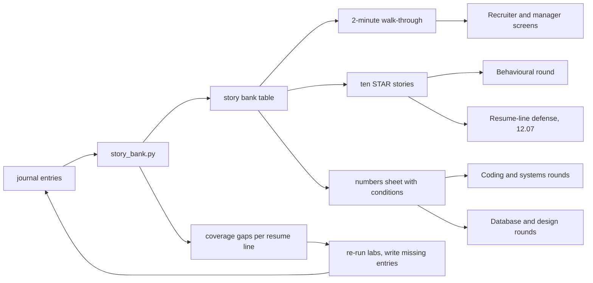

# Module 12.01: Resume walk-through and story bank

**Estimated hours:** 3

**What you will learn**

1. How to give a 2-minute resume walk-through: who you are, what you build, two or three specifics with numbers you measured, and why this role.
2. How to mine your `journal/` into a story bank of ten STAR stories, each tied to a resume line and a number.
3. How to state a number with its machine context, how to say "I do not know" and "not in production" honestly, and a one-week preparation plan.

**Prerequisites:** [Module 11.06: How a loan-origination system works end to end](../phase-11-security-and-banking-context/module-06-loan-origination-end-to-end.md). Capstones C1 to C6 built, and a journal entry written after each lab using [journal/TEMPLATE.md](../journal/TEMPLATE.md).

---

## 1. One-line intuition

Every line on your resume is a door the interviewer may open; this module makes sure there is a true, measured story behind each door before you walk in.

## 2. Real-life analogy

Think of a credit officer reviewing a home-loan file.

- The **application form** lists claims: salary, employer, existing loans. That is your **resume**.
- The officer cannot check everything, so she picks a few claims and asks for proof: payslips, bank statements, Form 16. Those are the interviewer's **follow-up questions**.
- A well-prepared applicant has a **folder** with the documents in the same order as the form. That folder is your **story bank** and your **journal**.
- Each document is something concrete: a number you measured, a command you ran, a file in your repo.
- If one document turns out to be invented, the officer doubts every other page. That is what happens when an interviewer catches one number you never measured.
- An applicant who says "I do not have the 2023 statement, here is 2024" keeps the officer's trust. Saying "I do not know" well works the same way.

## 3. Why it exists: the problem it solves

A typical loop for a 3-year engineer is four to six rounds of 45 to 60 minutes. Almost every round opens with "Tell me about yourself" or "Walk me through your resume". Your answer sets the agenda: interviewers follow up on what you emphasise. If you lead with tcpkv, the next ten minutes are about tcpkv, which you built and can defend. If you ramble through your degree for three minutes, they pick a line at random.

Candidates fail this in predictable ways: a six-minute chronological monologue; vague claims ("I improved performance"); no numbers; "we did" with no "I did"; and numbers they cannot explain when asked "how did you measure that?".

You have spent hundreds of hours building capstones C1 to C6 and writing a journal entry after each lab. That is raw material. Without this module it stays raw: you will remember "something about a deadlock" instead of "AB/BA lock order, found from `thread apply all bt` showing both threads in `futex_wait`, confirmed by TSan's lock-order-inversion report, fixed with `std::scoped_lock`, verified with 1,000 clean runs".

**Two honesty rules for the whole of Phase 12.**

1. **Course evidence is not job history.** The resume mixes three kinds of claims: work experience at Extrieve (the Summary and lines H1 to H7), skills (lines A to G), and a project (line I, tcpkv). The course gives you hands-on evidence for all of them by rebuilding the systems at small scale. It does not create job history. Only you know what you personally did at work. Every answer in Phase 12 keeps the two apart: "At work, I ..." only for what is true; "In my own rebuild, I measured ..." for course evidence.
2. **Teaching scenarios are not your stories.** Section 7 of many earlier modules tells stories about "the app server" (a backup incident, a `SIGPIPE` crash, a pool-sizing sweep). Those are teaching scenarios written to explain a concept. Never retell them as things that happened to you. Your stories come from your journal and, where true, from your job.

## 4. Three layers of depth

### Layer 1 (beginner): what a junior-level interviewer tests

At junior depth the interviewer checks three things: can you explain, in order and in plain words, what you built; do you use the right terms ("a fixed thread pool with a task queue", not "a multithreading library"); and do you know every line of your own resume.

**The 2-minute walk-through.** Four parts, about 250 spoken words in total (people speak 120 to 140 words a minute under mild stress):

| Part | Time | Content |
|---|---|---|
| 1. Who you are | 15 s | Name, current role, domain, how long |
| 2. What you build | 30 s | The kind of systems, the languages, the one-sentence summary of your work and your projects |
| 3. Two or three specifics | 60 s | Your proudest pieces, each with one number you measured and how |
| 4. Why this role | 15 s | One sentence linking what you have built to what they build |

**A filled example for this resume.** Placeholders in angle brackets are filled from your own journal. The sentence marked `[WORK]` must describe only what you personally did at Extrieve; if you cannot say it truthfully, cut it.

> "I'm Shakir. I've been a software engineer at Extrieve Technologies since March 2024, working on server-side C for core-banking lending platforms used by HDFC Bank and Kotak Mahindra Bank. `[WORK: one true sentence about what you own, for example the part of the application server or the support work you personally handle.]`
>
> To understand these systems to the bottom, I rebuilt scaled-down versions of them from scratch. Three pieces I'm proud of. First, tcpkv, a multithreaded TCP key-value server in C++17 with a fixed thread pool, a `shared_mutex` store, RAII sockets and graceful shutdown on SIGTERM. On my `<cores>`-core laptop in WSL2 it handles about `<ops/sec>` operations a second at `<N>` client threads with p99 around `<p99>` microseconds, and CI runs the tests under ASan, TSan and UBSan on every push. Second, on the lending schema in PostgreSQL I recreated a login slowdown: the plan showed a sequential scan because the query could not use the primary key's leading column. A covering index took it from `<before>` to `<after>` milliseconds. Third, a Berkeley DB to YugabyteDB migration engine in C with an arena allocator and restartable batches, plus a parity checker that compared `<N>` records and caught every defect I injected before a rehearsed cutover on a three-node cluster.
>
> I'm looking for a role that goes deeper into C++ systems and databases, and `<their product or team>` is exactly that work."

That is about 230 words before your `[WORK]` sentence and your placeholders. Read it aloud with a timer. If it runs over 2:15, cut the third specific, not the numbers.

**Know every line.** Junior-level interviewers often point at a random word on the resume: "MSBuild?", "Raft?", "Azure DevOps?". You need a 20-second answer for every one: what it is, where you used it, where the evidence is. Module 12.07 drills this line by line.

### Layer 2 (working engineer): what a mid-level interviewer tests

At mid depth the interviewer wants decisions, trade-offs, numbers with conditions, and what went wrong. The tool is the **STAR** story:

| Beat | Share of the answer | What it contains |
|---|---|---|
| **S**ituation | 10% | Context in one or two sentences: the system, the symptom |
| **T**ask | 10% | Your responsibility or goal, with a constraint (time, correctness, an SLA) |
| **A**ction | 60% | What **you** did, step by step, including the dead end and the decision |
| **R**esult | 20% | The number, how it was measured, and what you would change |

A good STAR answer runs 90 seconds to 2 minutes. The Action is where you score; the Situation is where most candidates waste their time.

**STAR traps.**

| Trap | What it sounds like | Fix |
|---|---|---|
| Too much situation | 60 seconds on the company and the project | Two sentences, then "My task was ..." |
| "We" everywhere | "We found the bug, we fixed it" | Say "I" for what you did; name others' parts honestly |
| No number | "It got much faster" | "From `<before>` to `<after>` ms, median of 5 runs" |
| A number with no method | "p99 was 200 µs" | Add the load, the machine, the tool, the repetitions |
| No tension | A story where everything worked | Include the wrong first hypothesis and how you ruled it out |
| No reflection | Ends at the result | One sentence: "Next time I would ..." |
| Borrowed story | Retelling a module's teaching scenario as yours | Use your journal; if it did not happen to you, do not tell it |

**Mining the journal into a story bank.** Each journal entry already has the STAR beats in it:

| Journal section | STAR beat |
|---|---|
| What I built | Situation and Task |
| Decisions and why | Action (the decision, and what you rejected) |
| Problems I hit; How I debugged it | Action (the tension and the method) |
| Numbers I measured | Result |
| What I would do differently | Reflection |
| Interview story | Your first draft of the whole answer |

**The ten stories every candidate needs**, with the course event that supplies each. Fill the angle brackets from your own journal. If your journal has no entry for a row, that is a gap to close this week, not a row to invent.

| # | Story (question it answers) | Resume line | Situation | Action | Result with number | What you would change |
|---|---|---|---|---|---|---|
| 1 | Hardest bug | F, H5 | C6: server crashed under load with SIGSEGV | Loaded the core in GDB (`bt`, `info threads`, `frame`, `print`), then reproduced under ASan, which showed heap-use-after-free with the freeing stack | Root cause in `<min>` minutes from the dump; `<N>` clean ASan runs after the fix | Run ASan in CI before the load test, not after |
| 2 | Performance win | H7, D | C5: login query slow on the lending schema | `EXPLAIN (ANALYZE, BUFFERS)` showed a Seq Scan; designed a composite covering index | `<before>` ms to `<after>` ms; buffers `<b1>` to `<b2>` | Check `pg_stat_statements` first to rank queries |
| 3 | Design trade-off | C, I | 4.05: lock choice for the tcpkv store | Measured `shared_mutex` against `mutex` at a 95/5 read mix over 1 to 16 threads | `<x>` versus `<y>` ops/s at `<N>` threads | Try lock striping if writes rise |
| 4 | Failure or mistake | C | 4.11: transfer program hung | `thread apply all bt` showed both threads in `futex_wait`; TSan reported lock-order-inversion | Fixed with `std::scoped_lock`; `<N>` runs without a hang | Write the lock order down before coding |
| 5 | Disagreement with a design assumption | C, H4 | 4.13: "use a `shared_mutex` for the master cache" | Measured the reload stall, chose a copy-on-write snapshot | p99 during reload `<a>` versus `<b>` | Measure before arguing |
| 6 | Ownership end to end | I, G | C1: tcpkv from an empty folder | CMake, GoogleTest, sanitizer jobs in GitHub Actions, load generator | `<N>` tests, ASan/TSan/UBSan jobs green, `<ops/sec>` | Add fuzzing earlier |
| 7 | Learning something hard fast | E | 7.05 and 7.09: Raft | Traced a Raft log by hand, then killed a leader on a 3-node cluster | New leader serving writes after about `<s>` s | Read the paper before the blog posts |
| 8 | Incident under pressure | F, H5 | C6: timed RCA drill | 7-step core-dump method, then the RCA template | RCA written in `<min>` minutes with timeline and prevention | Practise WinDbg as often as GDB |
| 9 | Quality and testing | H3 | C4: parity suite | Record-by-record diff, injected defects on purpose | Caught `<k>` of `<k>` injected defects over `<N>` records | Hash-compare first, diff only mismatching ranges |
| 10 | Explaining to a non-engineer | H5 | 8.09: client-facing RCA | Rewrote the engineering RCA for a bank operations manager | One page: impact, timeline, cause, prevention | Lead with customer impact, not the stack trace |

Row 5 is honest about its limits: in the course you disagreed with a **design assumption**, using a measurement. If an interviewer asks about a conflict **with a person**, you need a real story from work or study. Module 12.06 covers how to answer when you have only a small one.

### Layer 3 (internals): what a senior-level interviewer tests

At senior depth the interviewer tests whether your numbers survive cross-examination, where your knowledge ends, and how you think about scale and failure. "How did you measure that?", "Was that closed loop?", "What was the variance?", "What breaks first at ten times the load?", "What do you not know about this?"

**The numbers you should have by now.** Each comes from a module or capstone. If a cell in your journal is empty, re-run the lab before interviewing.

| Number | Where you measured it | How to state it |
|---|---|---|
| tcpkv ops/sec and p99 at N threads | 5.11, C1 | "On a `<CPU>`, `<cores>`-core laptop in WSL2 over loopback, `<T>` closed-loop client threads, `<ratio>` SET/GET over `<K>` keys, 30-second runs repeated three times: about `<ops>` ops/s, p50 `<p50>` µs, p99 `<p99>` µs, median run." |
| Cache hit versus database round trip | 4.13, C2 | "A master-table lookup from the in-memory snapshot took about `<ns>` ns; the same lookup as a PostgreSQL query over localhost took about `<ms>` ms; the cache removes `<N>` round trips per loan request." |
| Index before and after | 6.09, 6.10, C5 | "Same query, same `<rows>` rows, warm cache, median of five runs: `<before>` ms with a Seq Scan reading `<b1>` buffers, `<after>` ms with an Index Only Scan reading `<b2>`." |
| Round trips before and after PL/pgSQL | 6.11, C5 | "Loan submission went from `<n>` client round trips to one procedure call; end-to-end `<before>` to `<after>` ms over localhost." |
| Failover gap | 7.09, C4 | "On a 3-node RF=3 YugabyteDB cluster in Docker, killing the node with the tablet leaders stopped writes for about `<s>` s, measured with a write loop logging timestamps; no committed row was lost." |
| Migration throughput and restart | C3 | "About `<rows/s>` rows a second with batches of `<B>`; after `kill -9` mid-batch it resumed from the last committed batch and the parity check found `<0>` differences." |
| Sanitizer-clean runs | 9.04, 9.06, C1 | "`<N>` GoogleTest tests pass under ASan, UBSan and TSan in GitHub Actions on every push; the load generator ran `<duration>` against the TSan build with zero reports." |
| `shared_mutex` versus `mutex` | 4.05 | "At a 95/5 GET/SET mix, `<x>` versus `<y>` ops/s at `<N>` threads; the writer's worst wait was `<w>` µs." |

**The five parts of an honest number.** What was measured; the value; the conditions (machine, environment, load, configuration); the method (tool, warm-up, duration); the repetitions and spread. Never round up. Never quote an average alone. Say "on my laptop" whenever it was your laptop.

**Saying "I do not know".** Three steps: say it plainly, say what you do know next to it, say how you would find out. Example, asked for PostgreSQL's default autovacuum scale factor: "I don't remember the exact default. I know autovacuum triggers when dead tuples pass a fixed threshold plus a fraction of the table's rows, and I'd check with `SHOW autovacuum_vacuum_scale_factor`." (It is 0.2.) That answer scores better than a confident wrong number, because it shows how you work when you do not know.

**Saying "not in production".** Asked "Did tcpkv run in production?": "No. tcpkv is a project I built to learn; it has never served real traffic. What I can tell you is how it behaves under a load generator and the sanitizers, and what I would add before production: TLS, authentication, persistence, metrics and a connection limit tested under abuse." For the work lines, separate the two sources in one breath: "At work my part was `<true scope>`. The numbers I'm quoting now are from my own rebuild, not from the bank's systems, because client figures are confidential and I don't have them memorised." Never fill a gap in what you know about your job with a number from your rebuild presented as the bank's.

**Questions to ask the interviewer.** Ask two or three. Good ones show you think like an owner:

1. What does success look like for this role after 90 days?
2. What system would I work on most, and what is its hardest problem right now?
3. How do engineers debug production issues here: core dumps, logs, on-call?
4. What runs in CI before a release: unit tests, sanitizers, integration tests?
5. What is the split between new development and support or maintenance?
6. For a bank-facing product: how are releases coordinated with bank clients and their change windows?
7. What would you want a new engineer to learn first?

**A one-week preparation schedule.**

| Day | Work (2 to 3 hours) |
|---|---|
| 1 | Run `story_bank.py` (section 6). List coverage gaps. Pick your ten stories. |
| 2 | Write and record the walk-through three times. Fill the numbers table; re-run any lab whose number is missing. |
| 3 | Module 12.02: one mock coding round and the rapid-fire drill. |
| 4 | Modules 12.03 and 12.04: one question set each, aloud. |
| 5 | Module 12.05: one full design round. |
| 6 | Modules 12.06 and 12.07: behavioural mock and the resume audit table. |
| 7 | A full mock loop (walk-through, one coding problem, one design, two behavioural questions). Check that tcpkv CI is green. Rest. |

## 5. Architecture diagram

How a journal entry becomes an interview answer, and which round uses which artefact:



The loop on the left matters most: a gap in the coverage report sends you back to a lab, never to your imagination.

## 6. Code

`story_bank.py` reads every journal entry, pulls out the date, module, resume lines, measured numbers and the interview story, and prints a story-bank draft plus a coverage report per resume line. Save it as `tools/story_bank.py` in the course repo.

```python
#!/usr/bin/env python3
"""story_bank.py -- turn journal entries into a story-bank draft and a coverage report.

Usage: python3 story_bank.py journal > story-bank.md
Reads every journal/*.md except TEMPLATE.md (format: journal/TEMPLATE.md).
"""
import pathlib
import re
import sys

RESUME_LINES = ["A", "B", "C", "D", "E", "F", "G",
                "H1", "H2", "H3", "H4", "H5", "H6", "H7", "I"]


def field(text, name):
    """Value of a '| Name | value |' row in the header table."""
    m = re.search(r"^\|\s*" + re.escape(name) + r"\s*\|\s*(.*?)\s*\|\s*$", text, re.M)
    return m.group(1) if m else ""


def section(text, heading):
    """Body of a '## heading' section, up to the next '## '."""
    m = re.search(r"^## " + re.escape(heading) + r".*?$\n(.*?)(?=^## |\Z)", text, re.M | re.S)
    return m.group(1).strip() if m else ""


def numbers(text):
    """Data rows of the 'Numbers I measured' table, as 'what: before -> after'."""
    rows = []
    for line in section(text, "Numbers I measured").splitlines():
        cells = [c.strip() for c in line.strip().strip("|").split("|")]
        if len(cells) < 3 or cells[0] in ("What", "") or set(cells[0]) <= set("-: "):
            continue
        if cells[0].startswith("e.g.") or not (cells[1] or cells[2]):
            continue                                   # template example or empty row
        rows.append(f"{cells[0]}: {cells[1] or '?'} -> {cells[2] or '?'}")
    return rows


def main():
    jdir = pathlib.Path(sys.argv[1] if len(sys.argv) > 1 else "journal")
    entries = sorted(p for p in jdir.glob("*.md") if p.name != "TEMPLATE.md")
    coverage = {line: 0 for line in RESUME_LINES}
    print("| Date | Module / capstone | Resume lines | Numbers measured | Story (start) |")
    print("|---|---|---|---|---|")
    for p in entries:
        text = p.read_text(encoding="utf-8")
        lines = [t for t in re.findall(r"\b(H[1-7]|[A-I])\b", field(text, "Resume line this supports"))
                 if t in coverage]
        for t in set(lines):
            coverage[t] += 1
        nums = numbers(text)
        story = " ".join(section(text, "Interview story").split())
        print("| {} | {} | {} | {} | {} |".format(
            field(text, "Date") or p.stem[:10],
            field(text, "Module / capstone") or p.stem,
            ", ".join(sorted(set(lines))) or "TODO",
            "; ".join(nums) or "TODO: no numbers",
            (story[:90] + "...") if len(story) > 90 else (story or "TODO: no story")))
    print()
    print("| Resume line | Journal entries | Status |")
    print("|---|---|---|")
    for line in RESUME_LINES:
        n = coverage[line]
        print(f"| {line} | {n} | {'NO STORY' if n == 0 else 'ok' if n >= 2 else 'thin'} |")
    print(f"\n{len(entries)} entries read from {jdir}/")


if __name__ == "__main__":
    main()
```

Run it from the repo root in WSL:

```bash
mkdir -p tools
# save the script as tools/story_bank.py, then:
python3 tools/story_bank.py journal > story-bank.md
cat story-bank.md
```

Expected output shape. This was produced from two test entries whose numbers were left as placeholders on purpose; yours will show your real numbers and many more rows:

```text
| Date | Module / capstone | Resume lines | Numbers measured | Story (start) |
|---|---|---|---|---|
| 2026-12-02 | C1 tcpkv milestone 5 | C, I | ops/sec at 8 threads: <ops before> -> <ops after>; p99 latency at 8 threads: <p99 before> -> <p99 after> | I load-tested my tcpkv server with a closed-loop generator and found the knee at <N> worke... |
| 2027-01-15 | C5 plpgsql-index-lab, login fix | D, H7 | login query time: <ms before> -> <ms after> | TODO: no story |

| Resume line | Journal entries | Status |
|---|---|---|
| A | 0 | NO STORY |
| B | 0 | NO STORY |
| C | 1 | thin |
| D | 1 | thin |
...
| H7 | 1 | thin |
| I | 1 | thin |

2 entries read from journal/
```

Read the output in two ways. Every `TODO` is a journal entry to finish while you still remember the details. Every `NO STORY` row is a resume line you cannot yet defend from your own work; close it with a lab, or soften the line in module 12.07. The script reads only what you wrote, so it cannot invent a story for you, which is the point.

## 7. Use case: core-banking loan-origination platform

The same resume is read differently by different employers. Your walk-through should lead with the specifics each one weighs most:

| Employer type | What they fear most | Lead with |
|---|---|---|
| Core-banking or lending platform vendor; a bank's technology team | Wrong money, data loss in a migration, a long outage, a bad RCA to a client | Parity suite gating the cutover (C4), the failover gap you measured (7.09), the RCA method (C6, 8.09), the login fix with plan evidence (C5) |
| Database or storage company | Not understanding what happens below SQL | MVCC, WAL and index internals (6.05 to 6.10), the migration engine's cursor traversal and batching (C3), YugabyteDB tablets and Raft (7.05, 7.07) |
| C++ systems or infrastructure team | Undefined behaviour, races, slow hot paths | tcpkv with sanitizer CI and measured p99 (C1), the thread pool (4.10), the `shared_mutex` measurement (4.05) |
| Backend product company | Systems that fall over under load or retries | Backpressure and timeouts (5.10), idempotency and the ledger (10.10), caching (10.03) |

**The decision this drove: for a banking-platform role, lead with correctness and operability, not raw speed.** A lending platform's interviewers have lived through a migration defect or a 3 a.m. incident with a bank on the phone. To them "zero data defects, proven by a record-by-record parity check" and "a written RCA with a timeline and a prevention step" signal more than tcpkv's ops/sec. So for those roles the second and third specifics in the walk-through are the parity suite and the RCA method, and tcpkv comes third. For a C++ infrastructure role, swap the order.

Banking interviewers also ask questions other employers rarely do: how you handle client-confidential data in a dump or a log, how a fix reaches a bank's production (change windows, sign-offs), and how you write to a client during an incident. Have one sentence ready for each from modules 8.09, 8.10 and 11.05.

## 8. Lab

A mock session in four parts. Budget 3 hours.

### Part A: build the story bank (45 minutes)

1. Save `story_bank.py` as `tools/story_bank.py` and run it on your journal.
2. Fix every `TODO` row while the details are fresh: add the missing number or story paragraph to that journal entry.
3. Copy the ten-row story table from Layer 2 into `story-bank.md`. Fill every angle bracket from your journal. Where you have no entry, write `GAP` and the lab that would close it.

Expected: at least 8 of the 10 rows filled from real entries. Two or more `GAP` rows means one more lab session before you interview.

### Part B: write and time the walk-through (30 minutes)

1. Write your walk-through in the four-part structure. Fill every placeholder with your numbers. Write the `[WORK]` sentence only if it is true.
2. Record it on your phone three times. Time each take.
3. Transcribe the best take and count: words, numbers stated, times you said "we", times you said "basically" or "like".

Expected: 1:45 to 2:15 per take; at least three numbers, each with its conditions; zero "we" for work you did alone.

### Part C: the mock (45 minutes)

1. Ask a friend, or ask Claude to act as the interviewer: "Play an interviewer for a C++ systems role. Ask me to walk through my resume, then ask five follow-ups on whatever I emphasise. Push on how I measured every number and on what I did in production."
2. Answer aloud. Record it.
3. Your interviewer must ask at least one "Did you run this in production?" and one question you cannot answer. Practise the scripts from Layer 3.

### Part D: grade the recording (30 minutes)

Score each dimension 1 to 4:

| Dimension | 1 (weak) | 2 | 3 | 4 (strong) |
|---|---|---|---|---|
| Structure | no order | some order | four parts present | four parts, clean transitions, on time |
| Specificity | no numbers | a number without conditions | numbers with conditions | numbers with conditions, method and spread |
| Honesty boundary | blurred course work and job | corrected when pushed | separated without being asked | separated in one natural sentence each time |
| Ownership | "we" throughout | mixed | "I" for own work | "I" for own work and credit to others named |
| Conciseness | over 4 minutes | 3 to 4 minutes | about 2 minutes | 2 minutes and every sentence earns its place |
| Relevance | same talk for any company | names the role | links one project to the role | specifics ordered for this employer type (section 7) |
| Follow-ups | stuck or invented | partial | answered with evidence | answered with evidence and named the limits |
| "I do not know" | bluffed | froze | admitted it | admitted it, gave the nearby fact and how to find out |

**Passing bar:** 24 out of 32 with no 1 in Honesty boundary. A 1 there is a fail regardless of the total.

### Journal

Copy [journal/TEMPLATE.md](../journal/TEMPLATE.md) to `journal/YYYY-MM-DD-walkthrough-and-story-bank.md`. Record: the coverage table from `story_bank.py`, your take times and word counts from Part B, the rubric scores from Part D, the question you could not answer in Part C and your "I do not know" answer to it, and the `GAP` rows with the date you will close each one.

## 9. Common mistakes and misconceptions

| Mistake | Why it is wrong | What it causes |
|---|---|---|
| Chronological life story | The interviewer wanted the 2 minutes that set the agenda | They pick a random line to probe |
| Reciting the resume aloud | They have read it; they want what is behind it | No new information, no specifics |
| Numbers without conditions | "p99 200 µs" means nothing without load and machine | First follow-up exposes it |
| Rounding up or quoting the best run | One check in a follow-up and trust is gone | The interviewer discounts every other number |
| Telling a module's teaching scenario as your history | It did not happen to you, and details will not hold | A failed probe that can end the loop |
| Presenting rebuild numbers as bank production numbers | It is false, and bank interviewers know scale | Integrity concern, often fatal |
| "We" for everything | Interviewers cannot hire your team | "What did you personally do?" with no good answer |
| Bluffing instead of "I do not know" | Senior interviewers test exactly this | Marked as unreliable |
| No questions for the interviewer | Signals low interest | A weaker close |
| Preparing stories the night before | The details have faded | Thin answers and invented filler |

## 10. Resume link

This module is the index for every line on the resume.

- **Summary and H1 to H7 (work experience).** Your walk-through names your employer and clients from the resume. For each H line, your story bank holds the course rebuild (C2 to C6) as hands-on evidence. What you did at work, with real scope and real numbers, is yours to add and only if true. If an H line is not your personal work, module 12.07's audit table tells you to soften or remove it.
- **A to G (skills).** Each must point at a journal entry or a capstone file. A skill with no story in the coverage report is a skill you cannot defend yet.
- **I (tcpkv).** Your strongest, fully hands-on evidence. Lead with it for systems roles. Its numbers come from 5.11 and C1, stated with the five parts of an honest number.

Likely opening exchange: "Walk me through your resume." Then: "You said p99 was `<p99>`; how did you measure it?" You now have the walk-through and the five-part answer.

## 11. Interview questions

**Q1 (easy). Walk me through your resume.**

<details>
<summary>Model answer</summary>

Use the four-part structure from Layer 1 and keep it near two minutes. Who: name, Extrieve since March 2024, server-side C for lending platforms at HDFC Bank and Kotak Mahindra Bank, plus one true sentence about what you own there. What you build: "To understand these systems fully I rebuilt scaled-down versions from scratch." Two or three specifics with numbers: tcpkv with `<ops/sec>` at `<N>` threads and p99 `<p99>` µs on a `<cores>`-core laptop, sanitizers in CI; the login query from `<before>` to `<after>` ms with the plan evidence; the parity suite that caught all `<k>` injected defects before a rehearsed cutover. Why this role: one sentence linking those to their product. Then stop and let them choose where to dig.

</details>

**Q2 (easy). Tell me about a project you are proud of.**

<details>
<summary>Model answer</summary>

"tcpkv, a multithreaded TCP key-value server in C++17 that I built from an empty folder (capstone C1). The server uses a fixed thread pool from my own `ThreadPool` class, a line-based protocol I specified first, an `unordered_map` behind a `shared_mutex`, RAII wrappers for sockets and file descriptors, and a shutdown path that turns SIGTERM into a clean drain. I chose the pool over epoll on purpose: one connection per task keeps state on one stack and keeps the code sanitizer-friendly, and I documented where it stops scaling. CI builds with `-Wall -Wextra -Werror` and runs `<N>` GoogleTest tests under ASan, UBSan and TSan. With my load generator, 30-second runs repeated three times on a `<cores>`-core laptop in WSL2: `<ops/sec>` ops/s at `<N>` client threads, p99 `<p99>` µs. If I started again I would write the fuzz target for the parser on day one." Every claim points at a file in the repo.

</details>

**Q3 (medium). What is a number you are proud of, and how did you measure it?**

<details>
<summary>Model answer</summary>

Pick one and give all five parts. For example the index fix from capstone C5: "The login query on my rebuilt lending schema, with `<rows>` users, went from `<before>` ms to `<after>` ms. I measured with `EXPLAIN (ANALYZE, BUFFERS)`, warm cache, median of five runs, on PostgreSQL 16 in Docker on my laptop. Before, the plan was a Seq Scan reading `<b1>` buffers because the query filtered on a column that was not the leading column of the primary key. After a covering index it was an Index Only Scan reading `<b2>` buffers. I also checked the cost: every insert into `users` now maintains one more index, which is fine for a master table that changes rarely." The buffer counts matter: they show the improvement is less work, not a lucky cache.

</details>

**Q4 (medium). Have you run this in production?**

<details>
<summary>Model answer</summary>

Be exact about each system. "tcpkv, no: it is a learning project and has never served real traffic. I can tell you how it behaves under load and sanitizers, and what I would add before production: TLS, authentication, persistence, metrics, and connection limits tested under abuse. The migration engine and parity suite I built in the course ran against a three-node YugabyteDB cluster in Docker, not a bank's data. At work, `<true scope of what you did in production, if anything>`; the numbers I've quoted today are from my rebuilds, not from client systems." Interviewers respect a clean boundary. What they punish is discovering it themselves.

</details>

**Q5 (hard). Your resume says you shipped a Berkeley DB to YugabyteDB migration engine with a verified zero-downtime cutover. What exactly was your part, and how do you know it was zero-downtime?**

<details>
<summary>Model answer</summary>

Two sources, kept apart. First, the work part, which only you can answer: your exact role, what you designed versus maintained, the scale you are allowed to share, and how the cutover was verified at work. If you were not the person who did this, the line must change before you send the resume (module 12.07). Second, the course evidence, which you can state in full: "I rebuilt it to understand it end to end. Capstone C3 is a C engine that walks a Berkeley DB B-tree with a cursor, decodes packed records by offset, writes batches of `<B>` rows to YugabyteDB, and records the last committed key so a killed run resumes without duplicates. C4 is the parity suite and a cutover rehearsal. I defined zero-downtime as: reads never failed, and writes paused for less than the client's retry budget during the switch. I measured the write gap with a loop logging timestamps: about `<s>` seconds on a three-node cluster in Docker, inside a `<budget>`-second retry budget, and the parity check found `<0>` differences after cutover. The honest limit is that a rehearsal in Docker proves the procedure, not production timing."

</details>

## 12. Revision

- The walk-through is four parts in two minutes: who, what you build, two or three specifics each with a measured number, why this role; it sets the agenda for the whole round.
- Stories come from `journal/` in STAR form, mostly Action, ending with a number and a reflection; ten stories cover nearly every behavioural and project question.
- A number has five parts (what, value, conditions, method, spread); "I do not know" and "not in production" are said plainly, and course rebuilds are never presented as job history.

---

Previous: [Module 11.06: How a loan-origination system works end to end](../phase-11-security-and-banking-context/module-06-loan-origination-end-to-end.md) | Next: [Module 12.02: Mock: C++ coding rounds](module-02-mock-cpp-coding-rounds.md)
