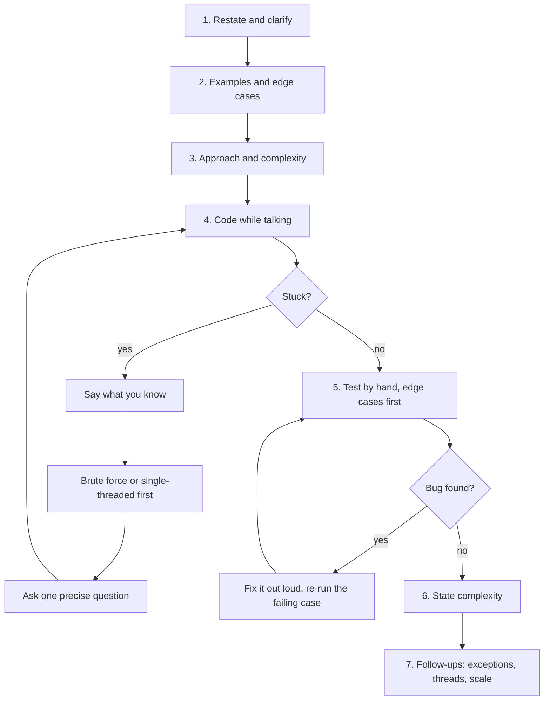

# Module 12.02: Mock: C++ coding rounds

**Estimated hours:** 6

**What you will learn**

1. A live-coding protocol (clarify, examples, approach, code, test, complexity, follow-ups) that keeps you scoring points even when you get stuck.
2. Twelve problems that C++ systems interviewers really set, each solved in complete C++17 that was compiled with GCC and Clang, run, and re-checked under sanitizers.
3. Thirty rapid-fire answers on RAII, move semantics, smart pointers and the STL, each short enough to say in one breath.

**Prerequisites:** [Module 12.01: Resume walk-through and story bank](module-01-resume-walkthrough-and-story-bank.md). The problems reuse code you wrote in [2.03 RAII](../phase-02-cpp17-from-zero-to-modern/module-03-raii-and-rule-of-0-3-5.md), [2.04 move semantics](../phase-02-cpp17-from-zero-to-modern/module-04-move-semantics.md), [2.05 smart pointers](../phase-02-cpp17-from-zero-to-modern/module-05-smart-pointers-and-control-block.md), [4.04 condition variables](../phase-04-concurrency-deep-dive/module-04-condition-variables.md) and [4.10 thread pool](../phase-04-concurrency-deep-dive/module-10-thread-pool-design.md).

---

## 1. One-line intuition

A coding round does not test whether you can produce code; it tests whether the interviewer would trust you to change their production code while they watch.

## 2. Real-life analogy

Think of a driving test.

- The examiner does not only check that you reach the end of the route. They watch you check mirrors, signal, and keep to the speed limit.
- A driver who arrives but never checked a mirror fails. A driver who stalls once, says "I stalled, restarting", and then drives carefully usually passes.
- In a coding round, **clarifying questions** are the mirror checks, **tests** are the signals, and **talking while you code** is saying out loud what you see on the road.

The route is the problem. The examiner is grading the driving.

## 3. Why it exists: the problem it solves

Resume line B says "RAII, smart pointers, move semantics, templates, STL internals". Line C says "thread pools". Line I says tcpkv has "RAII socket and file-descriptor wrappers, move-only connection handles". These words cost nothing to type. A 45-minute coding round is the cheapest way for a company to check them.

A typical loop for a 3-year C++ systems role has one or two coding rounds of 45 to 60 minutes. Sometimes you get a compiler. Often you get a shared editor with no compiler and no autocomplete. The interviewer picks problems that sit close to your resume: if you claim a thread pool, expect to write one.

What breaks without practice: you know the material, but under a timer and an observer it does not come out. You code in silence, forget the empty case, never test, and run out of time on the part that carried the most points. This module turns the knowledge you already have into a routine you can run under pressure.

## 4. Three layers of depth

### Layer 1 (beginner): what a junior-level round tests

A junior round checks four things:

1. **Correct code for a small, known structure.** A queue, a cache, a parser. It must compile in your head: matching braces, correct types, includes you can name.
2. **Ownership basics.** Every `new` has an owner. No leaks on any path. You can say who frees what.
3. **STL fluency.** You pick the right container and know its cost: `vector` push is amortised O(1), `unordered_map` find is average O(1), `map` is O(log n).
4. **Testing your own code.** You walk three or four cases through the code by hand, including an empty or boundary case.

**The live-coding protocol.** Use the same seven steps every time, with this time budget for a 45-minute round:

| Step | Minutes | What you say or do |
|---|---|---|
| 1. Restate and clarify | 3 | "So I need X that does Y. Is it called from several threads? What happens when it is full?" |
| 2. Examples and edge cases | 3 | Write two normal examples and two edge cases (empty, capacity 0, duplicate key) as comments |
| 3. Approach and complexity | 5 | Name the data structures and the cost of each operation before writing code |
| 4. Code | 20 | Talk while typing: "This lock protects the deque and the closed flag" |
| 5. Test by hand | 7 | Walk your edge cases through the code, line by line, out loud |
| 6. Complexity, restated | 1 | Time and space, and where the constant factor hides |
| 7. Follow-ups | 6 | Answer "what if" questions; this is where mid and senior scores are decided |

**When you get stuck.** Say what you know, write the brute-force version, simplify the problem (single-threaded first, then add the lock), or ask a precise question ("Is it fine if `pop` returns an `optional`?"). Silence is the only move that always loses points.

### Layer 2 (working engineer): what a mid-level round tests

A mid-level interviewer takes the same problem and pushes on behaviour under stress:

- **Exception safety.** The three guarantees: **nothrow** (cannot fail), **strong** (on failure nothing changed), **basic** (on failure no leak and a valid state). "What happens if `T`'s copy constructor throws halfway through growth?"
- **`noexcept` on moves.** Why `std::vector` copies instead of moving when your move constructor is not `noexcept`. Problem 11 measures it.
- **Concurrency correctness.** Wait with a predicate, notify the right number of waiters, a shutdown path that wakes everyone and loses no work.
- **API design.** Does `pop` return `std::optional<T>`, throw, or return `bool` with an out-parameter? Does the function take ownership (`std::unique_ptr<T>` by value) or borrow (`T&` or `std::string_view`)?
- **Edge cases a reviewer would catch.** Self-assignment, capacity zero, an argument that aliases your own storage (`v.push_back(v[0])`), a view into a temporary.
- **Testing as engineering.** Which test catches which bug, and which sanitizer catches the rest.

### Layer 3 (internals): what a senior-level round tests

A senior interviewer wants to see that you know what the standard library does and why:

- **Layout and size.** Why `std::unique_ptr<int>` is 8 bytes but a naive version with a deleter member is 16 (empty base optimisation, or `[[no_unique_address]]` in C++20). Why `make_shared` does one allocation instead of two.
- **Memory ordering choices.** Why a reference count increment can be `relaxed` but the decrement needs `acq_rel`.
- **Design trade-offs.** Why `std::function` has a small-buffer optimisation, why it requires copyable callables, why C++23 added `std::move_only_function`.
- **Judgement.** "Would you ship your own `SharedPtr`?" The senior answer is "no, I would use the standard one; I wrote this to show I know what it does, and here is the one case where I would write my own".

## 5. Architecture diagram

The protocol, including the recovery path when you get stuck:



Finding your own bug in step 5 is a positive signal, not a negative one. Interviewers write "found and fixed own bug" in their notes.

## 6. Code

Twelve problems. Each has a prompt, the clarifying questions worth asking, an approach, a complete C++17 solution with its tests in `main`, the run command and expected output, the complexity and the follow-ups.

**How these were checked.** Every solution was compiled with g++ 13.3 and clang 18 using `-std=c++17 -O2 -Wall -Wextra -Werror -g -pthread`, run, and run again under AddressSanitizer plus UndefinedBehaviorSanitizer. Problems 1, 4 and 12 were also run under ThreadSanitizer. All passed. Do the same on your machine:

```bash
mkdir -p ~/interview && cd ~/interview
# save a solution as, for example, p01_bounded_queue.cpp, then:
g++ -std=c++17 -O2 -Wall -Wextra -Werror -g -pthread -o p01 p01_bounded_queue.cpp && ./p01
g++ -std=c++17 -O1 -g -pthread -fsanitize=address,undefined -o p01_asan p01_bounded_queue.cpp && ./p01_asan
g++ -std=c++17 -O1 -g -pthread -fsanitize=thread -o p01_tsan p01_bounded_queue.cpp && setarch x86_64 -R ./p01_tsan
```

(`setarch x86_64 -R` turns off address randomisation for one process. Newer kernels randomise more address bits than ThreadSanitizer expects, and without it TSan may abort with `unexpected memory mapping`. It is a tooling clash, not a bug in your code; module 4.12 met it too.)

**First attempt rule.** Read the prompt, close this page, and solve the problem in a plain text editor with a 25-minute timer. Then compare.

### Problem 1: Thread-safe bounded queue (25 minutes)

**Prompt.** Write a blocking queue with a fixed capacity for producer and consumer threads. `push` blocks while full. `pop` blocks while empty. Provide a way to shut it down so that every blocked thread wakes up.

**Clarifying questions.** Many producers and many consumers, or one of each? What should `push` do after shutdown: fail, or throw? Should consumers get the remaining items after shutdown (drain) or stop at once? Is a timeout needed?

**Approach.** One mutex, a `std::deque<T>`, two condition variables (`not_full_` for producers, `not_empty_` for consumers) and a `closed_` flag. Every wait uses a predicate, which handles spurious wakeups and the lost-wakeup race. `close()` sets the flag under the lock and calls `notify_all` on both, because every waiter must re-check. `pop` returns `std::nullopt` only when closed **and** empty, so consumers drain the remaining work. This is the `BoundedQueue` from module 4.04.

```cpp
// p01_bounded_queue.cpp -- blocking bounded queue with close() for shutdown.
#include <cassert>
#include <condition_variable>
#include <cstddef>
#include <cstdio>
#include <deque>
#include <mutex>
#include <optional>
#include <thread>
#include <vector>

template <class T>
class BoundedQueue {
public:
    explicit BoundedQueue(std::size_t cap) : cap_(cap) {}
    bool push(T item) {                          // blocks while full; false once closed
        std::unique_lock<std::mutex> lk(m_);
        not_full_.wait(lk, [&] { return closed_ || q_.size() < cap_; });
        if (closed_) return false;
        q_.push_back(std::move(item));
        lk.unlock();
        not_empty_.notify_one();
        return true;
    }
    std::optional<T> pop() {                     // blocks while empty; nullopt = closed and drained
        std::unique_lock<std::mutex> lk(m_);
        not_empty_.wait(lk, [&] { return closed_ || !q_.empty(); });
        if (q_.empty()) return std::nullopt;
        T item = std::move(q_.front());
        q_.pop_front();
        lk.unlock();
        not_full_.notify_one();
        return item;
    }
    void close() {
        { std::lock_guard<std::mutex> lk(m_); closed_ = true; }
        not_empty_.notify_all();                 // every waiter must re-check the predicate
        not_full_.notify_all();
    }
private:
    std::mutex m_;
    std::condition_variable not_empty_, not_full_;
    std::deque<T> q_;
    std::size_t cap_;
    bool closed_ = false;
};

int main() {
    BoundedQueue<int> q(8);
    constexpr int kProducers = 4, kPerProducer = 10000, kConsumers = 3;
    std::vector<long long> sums(kConsumers, 0);
    std::vector<std::thread> consumers, producers;
    for (int c = 0; c < kConsumers; ++c)
        consumers.emplace_back([&, c] { while (auto v = q.pop()) sums[c] += *v; });
    for (int p = 0; p < kProducers; ++p)
        producers.emplace_back([&] { for (int i = 1; i <= kPerProducer; ++i) q.push(i); });
    for (auto& t : producers) t.join();
    q.close();                                   // consumers drain what is left, then exit
    for (auto& t : consumers) t.join();
    long long total = 0;
    for (long long s : sums) total += s;
    assert(total == 1LL * kProducers * kPerProducer * (kPerProducer + 1) / 2);
    assert(!q.push(1));                          // a closed queue rejects new work
    std::printf("bounded queue: total=%lld OK\n", total);
}
```

Expected output: `bounded queue: total=200020000 OK`, and no TSan warnings.

**Complexity.** `push` and `pop` are O(1) plus the cost of the lock. Space is O(capacity).

**Follow-ups.** "Why notify after unlocking?" The woken thread does not immediately block on a mutex you still hold; both orders are correct. "Why two condition variables?" One with `notify_all` works but wakes producers when only consumers can proceed. "Add `try_push` with a timeout" (use `wait_for` with the same predicate). "What if a consumer throws while handling an item?" The queue is unaffected because the item was already moved out under the lock.

### Problem 2: LRU cache (25 minutes)

**Prompt.** Implement a least-recently-used cache with a fixed capacity. `get(key)` returns the value and marks it as recently used. `put(key, value)` inserts or updates; when full, it evicts the least recently used entry. Both must be O(1).

**Clarifying questions.** Generic key and value types? What does `get` return on a miss? Is capacity 0 legal? Single-threaded, or must it be thread-safe? (Ask; then solve the single-threaded version first.)

**Approach.** A `std::list<std::pair<K, V>>` keeps recency order with the most recent at the front. An `std::unordered_map<K, list::iterator>` finds the node in O(1). `list::splice` moves a node to the front in O(1) without invalidating any iterator, which is why `list` is used here instead of `vector`.

```cpp
// p02_lru.cpp -- O(1) LRU cache: list for recency order, hash map for lookup.
#include <cassert>
#include <cstddef>
#include <cstdio>
#include <list>
#include <optional>
#include <string>
#include <unordered_map>
#include <utility>

template <class K, class V>
class LruCache {
public:
    explicit LruCache(std::size_t capacity) : cap_(capacity) {}
    std::optional<V> get(const K& key) {
        auto it = index_.find(key);
        if (it == index_.end()) return std::nullopt;
        items_.splice(items_.begin(), items_, it->second);   // move to front; iterators stay valid
        return it->second->second;
    }
    void put(const K& key, V value) {
        if (cap_ == 0) return;
        auto it = index_.find(key);
        if (it != index_.end()) {                             // update in place, mark recent
            it->second->second = std::move(value);
            items_.splice(items_.begin(), items_, it->second);
            return;
        }
        if (items_.size() == cap_) {                          // evict least recently used
            index_.erase(items_.back().first);
            items_.pop_back();
        }
        items_.emplace_front(key, std::move(value));
        index_.emplace(key, items_.begin());
    }
    std::size_t size() const { return items_.size(); }
private:
    using List = std::list<std::pair<K, V>>;                  // front = most recently used
    std::size_t cap_;
    List items_;
    std::unordered_map<K, typename List::iterator> index_;
};

int main() {
    LruCache<std::string, int> rates(2);                      // product code -> rate in bp
    rates.put("HL01", 850);
    rates.put("PL01", 1100);
    assert(rates.get("HL01") == 850);                         // HL01 is now most recent
    rates.put("CL01", 975);                                   // evicts PL01
    assert(!rates.get("PL01"));
    assert(rates.get("CL01") == 975 && rates.get("HL01") == 850);
    rates.put("HL01", 900);                                   // update does not grow the cache
    assert(rates.get("HL01") == 900 && rates.size() == 2);
    LruCache<int, int> none(0);
    none.put(1, 1);
    assert(!none.get(1));
    std::printf("lru: OK\n");
}
```

Expected output: `lru: OK`.

**Complexity.** `get` and `put` are average O(1). Space is O(capacity), with one list node (two pointers plus the pair) and one hash entry per item.

**Follow-ups.** "Why does the key live in both the list and the map?" Eviction starts from the list tail and must erase the map entry, so the list node needs the key. "Make it thread-safe." One mutex around both operations is correct; note that `get` mutates (it splices), so a `shared_mutex` with shared `get` would be a data race. "It is too slow under contention." Shard by key hash into N independent caches, each with its own lock. "Cache-unfriendly?" Yes: list nodes are scattered in memory; production caches often use an intrusive list or an array of slots with indices.

### Problem 3: `unique_ptr` with a custom deleter (20 minutes)

**Prompt.** Write `UniquePtr<T, D>`: a move-only owning pointer whose deleter type `D` defaults to calling `delete`. Support `get`, `release`, `reset`, `*`, `->` and a boolean test.

**Clarifying questions.** Array form (`T[]`) needed? (Usually no.) May I ignore the empty-base optimisation and talk about it afterwards? Should the deleter be stateful?

**Approach.** Store the pointer and the deleter. Delete the copy operations, which is the whole point of "unique". The move constructor steals the pointer and leaves the source null. `reset` swaps in the new pointer **before** deleting the old one, so a deleter that somehow reaches back into this object never sees a dangling pointer. This is the ownership model of module 2.05.

```cpp
// p03_unique_ptr.cpp -- a move-only owning pointer with a custom deleter.
#include <cassert>
#include <cstdio>
#include <utility>

template <class T>
struct DefaultDelete { void operator()(T* p) const noexcept { delete p; } };

template <class T, class D = DefaultDelete<T>>
class UniquePtr {
public:
    UniquePtr() noexcept = default;
    explicit UniquePtr(T* p, D d = D()) noexcept : p_(p), d_(std::move(d)) {}
    ~UniquePtr() { reset(); }
    UniquePtr(const UniquePtr&) = delete;                    // exactly one owner
    UniquePtr& operator=(const UniquePtr&) = delete;
    UniquePtr(UniquePtr&& o) noexcept : p_(o.release()), d_(std::move(o.d_)) {}
    UniquePtr& operator=(UniquePtr&& o) noexcept {
        if (this != &o) { reset(o.release()); d_ = std::move(o.d_); }
        return *this;
    }
    T* release() noexcept { return std::exchange(p_, nullptr); }
    void reset(T* p = nullptr) noexcept {
        T* old = std::exchange(p_, p);                       // update first, then delete
        if (old) d_(old);
    }
    T* get() const noexcept { return p_; }
    T& operator*() const { return *p_; }
    T* operator->() const noexcept { return p_; }
    explicit operator bool() const noexcept { return p_ != nullptr; }
private:
    T* p_ = nullptr;
    D d_{};
};

static int g_deleted = 0;
struct CountingDelete { void operator()(int* p) const noexcept { ++g_deleted; delete p; } };
struct FileClose { void operator()(std::FILE* f) const noexcept { std::fclose(f); } };

int main() {
    {
        UniquePtr<int, CountingDelete> a(new int(42));
        UniquePtr<int, CountingDelete> b(std::move(a));       // ownership moves, nothing deleted
        assert(!a && *b == 42 && g_deleted == 0);
        b = UniquePtr<int, CountingDelete>(new int(7));       // old 42 deleted by move-assign
        assert(g_deleted == 1 && *b == 7);
        int* raw = b.release();                               // caller owns it now
        assert(!b && *raw == 7);
        b.reset(raw);                                         // hand it back
    }
    assert(g_deleted == 2);                                   // 7 deleted at scope end
    UniquePtr<std::FILE, FileClose> f(std::tmpfile());        // RAII for a C handle
    assert(f && std::fputs("loan\n", f.get()) >= 0);
    std::printf("unique_ptr: deleted=%d sizeof(ours)=%zu OK\n", g_deleted, sizeof(UniquePtr<int>));
}
```

Expected output on x86-64 Linux: `unique_ptr: deleted=2 sizeof(ours)=16 OK`.

**Complexity.** Every operation is O(1). No allocation of its own.

**Follow-ups.** "Ours is 16 bytes. `sizeof(std::unique_ptr<int>)` is 8. Why?" An empty deleter member still occupies one byte, and alignment pads it to 8. The standard library stores the deleter as an empty base class (the **empty base optimisation**) or, in C++20, as a `[[no_unique_address]]` member, so it takes no space. "Why is the deleter a type parameter here but not in `shared_ptr`?" `unique_ptr` must stay one pointer wide with zero overhead, so the deleter is part of the type. `shared_ptr` already has a heap control block, so it stores the deleter there and keeps one type for all deleters. "Why `std::exchange`?" It sets the new value and returns the old one in one expression, which makes the "update first, then delete" order hard to get wrong.

### Problem 4: `shared_ptr` with a control block, no `weak_ptr` (25 minutes)

**Prompt.** Write `SharedPtr<T>`: copies share ownership, the object is deleted when the last copy goes away, and copying from several threads at once must be safe.

**Clarifying questions.** Do I need `weak_ptr`, custom deleters or `make_shared`? (Here no.) Must `use_count` be exact under concurrency? (It cannot be; it is a snapshot.)

**Approach.** A heap **control block** holds an atomic strong count and the object pointer. Copy increments, destructor decrements; the thread that takes the count from 1 to 0 deletes the object and the block. Assignment uses copy-and-swap, which gives copy assignment, move assignment and self-assignment in one function. The memory orders: incrementing needs no ordering (you already hold a reference, so the object cannot vanish), but the decrement must be `acq_rel` so that every other owner's writes to the object happen-before the `delete`.

```cpp
// p04_shared_ptr.cpp -- reference-counted pointer with a separate control block (no weak_ptr).
#include <atomic>
#include <cassert>
#include <cstdio>
#include <thread>
#include <utility>
#include <vector>

template <class T>
class SharedPtr {
    struct ControlBlock {
        std::atomic<long> strong{1};
        T* ptr;
        explicit ControlBlock(T* p) : ptr(p) {}
    };
public:
    SharedPtr() noexcept = default;
    explicit SharedPtr(T* p) {
        if (!p) return;
        try { cb_ = new ControlBlock(p); } catch (...) { delete p; throw; }   // no leak if new throws
    }
    SharedPtr(const SharedPtr& o) noexcept : cb_(o.cb_) {
        if (cb_) cb_->strong.fetch_add(1, std::memory_order_relaxed);        // a new owner needs no ordering
    }
    SharedPtr(SharedPtr&& o) noexcept : cb_(std::exchange(o.cb_, nullptr)) {}
    SharedPtr& operator=(SharedPtr o) noexcept {          // copy-and-swap: copy, move, self-assign
        std::swap(cb_, o.cb_);
        return *this;                                     // o's destructor drops our old reference
    }
    ~SharedPtr() { release(); }
    T* get() const noexcept { return cb_ ? cb_->ptr : nullptr; }
    T& operator*() const { return *get(); }
    T* operator->() const noexcept { return get(); }
    long use_count() const noexcept { return cb_ ? cb_->strong.load(std::memory_order_relaxed) : 0; }
    explicit operator bool() const noexcept { return get() != nullptr; }
private:
    void release() noexcept {
        // acq_rel: every owner's writes to *ptr happen-before the delete by whoever reaches zero
        if (cb_ && cb_->strong.fetch_sub(1, std::memory_order_acq_rel) == 1) {
            delete cb_->ptr;
            delete cb_;
        }
        cb_ = nullptr;
    }
    ControlBlock* cb_ = nullptr;
};

struct Loan {
    static inline std::atomic<int> alive{0};
    long id;
    explicit Loan(long i) : id(i) { ++alive; }
    ~Loan() { --alive; }
};

int main() {
    {
        SharedPtr<Loan> a(new Loan(1001));
        SharedPtr<Loan> b = a;                            // copy: count 2
        assert(a.use_count() == 2 && b->id == 1001);
        SharedPtr<Loan> c = std::move(b);                 // move: count unchanged, b empty
        assert(!b && a.use_count() == 2);
        std::vector<std::thread> ts;
        for (int t = 0; t < 4; ++t)                       // 4 threads copy and drop 100k times each
            ts.emplace_back([&a] {
                for (int i = 0; i < 100000; ++i) { SharedPtr<Loan> local = a; (void)local; }
            });
        for (auto& t : ts) t.join();
        assert(a.use_count() == 2 && Loan::alive == 1);
        a = SharedPtr<Loan>();                            // drop one owner
        assert(c.use_count() == 1 && Loan::alive == 1);
    }
    assert(Loan::alive == 0);                             // the last owner deleted the object
    std::printf("shared_ptr: OK\n");
}
```

Expected output: `shared_ptr: OK`, with no TSan warnings.

**Complexity.** Copy and destroy are O(1), each one atomic read-modify-write on a shared cache line. Construction is one extra allocation for the control block.

**Follow-ups.** "Add `weak_ptr`." Add a weak count; the object is destroyed when strong reaches 0, the block when strong and weak both reach 0; `lock()` must increment strong only if it is not already 0, which needs a compare-and-swap loop. "What does `make_shared` change?" One allocation holds the block and the object together: faster, better locality, but the object's memory is held until the last `weak_ptr` dies. "Is `SharedPtr` itself thread-safe?" The **counts** are. Two threads writing the **same** `SharedPtr` variable are a data race; that needs `std::atomic<std::shared_ptr<T>>` in C++20 or the `std::atomic_load`/`std::atomic_store` free functions used in module 4.13.

### Problem 5: `string_view` tokenizer for the tcpkv protocol (20 minutes)

**Prompt.** Parse one tcpkv request line (spec in module 5.06) into a command without copying: `GET key`, `SET key value`, `DEL key`, `PING`, `QUIT`. The value of `SET` is the rest of the line and may contain spaces or be empty. Return either a command or an error code: `UNKNOWN_COMMAND`, `BAD_ARGS` or `KEY_TOO_LONG`.

**Clarifying questions.** Is the trailing `\n` (or `\r\n`) included? Are commands case-sensitive? (The spec says upper-case only.) Who owns the bytes: may the result point into the input line? What is the maximum key length? (256 bytes.)

**Approach.** Work on a `std::string_view` and cut tokens off the front with `find(' ')` and `remove_prefix`. No allocation at all; the result holds views into the caller's buffer. Return `std::variant<Command, ParseError>`, so a caller cannot read a command out of an error. This is the zero-copy version of the parser from module 2.16, which returned owning `std::string`s.

```cpp
// p05_tokenizer.cpp -- zero-copy tcpkv command parser over std::string_view.
#include <cassert>
#include <cstdio>
#include <string>
#include <string_view>
#include <variant>

enum class Op { Get, Set, Del, Ping, Quit };
struct Command { Op op; std::string_view key; std::string_view value; };  // views into the caller's line
struct ParseError { std::string_view code; };                             // points at a string literal
using ParseResult = std::variant<Command, ParseError>;

// Cuts the token before the first space off the front of s.
static std::string_view next_token(std::string_view& s, bool& had_space) {
    auto sp = s.find(' ');
    had_space = sp != std::string_view::npos;
    std::string_view tok = s.substr(0, sp);
    s.remove_prefix(had_space ? sp + 1 : s.size());
    return tok;
}

static ParseResult key_only(Op op, std::string_view rest) {
    bool more = false;
    std::string_view key = next_token(rest, more);
    if (key.empty() || more) return ParseError{"BAD_ARGS"};      // "GET", "GET a b", "GET  a"
    if (key.size() > 256) return ParseError{"KEY_TOO_LONG"};
    return Command{op, key, {}};
}

ParseResult parse(std::string_view line) {
    if (!line.empty() && line.back() == '\n') line.remove_suffix(1);
    if (!line.empty() && line.back() == '\r') line.remove_suffix(1);
    if (line.empty()) return ParseError{"BAD_ARGS"};
    bool sp = false;
    std::string_view word = next_token(line, sp);
    if (word == "GET") return key_only(Op::Get, line);
    if (word == "DEL") return key_only(Op::Del, line);
    if (word == "PING" || word == "QUIT") {
        if (sp) return ParseError{"BAD_ARGS"};                    // "PING extra"
        return Command{word == "PING" ? Op::Ping : Op::Quit, {}, {}};
    }
    if (word == "SET") {
        bool has_value = false;
        std::string_view key = next_token(line, has_value);
        if (key.empty() || !has_value) return ParseError{"BAD_ARGS"};
        if (key.size() > 256) return ParseError{"KEY_TOO_LONG"};
        return Command{Op::Set, key, line};                       // value = rest of line, may be empty
    }
    return ParseError{"UNKNOWN_COMMAND"};                         // includes lower-case "get"
}

int main() {
    auto cmd = [](std::string_view l) { return std::get<Command>(parse(l)); };
    auto err = [](std::string_view l) { return std::get<ParseError>(parse(l)).code; };
    Command c = cmd("SET branch:001 Mumbai Fort\r\n");
    assert(c.op == Op::Set && c.key == "branch:001" && c.value == "Mumbai Fort");
    assert(cmd("SET k ").value.empty());                          // empty value is legal
    assert(cmd("GET branch:001\n").key == "branch:001");
    assert(cmd("PING").op == Op::Ping && cmd("QUIT\n").op == Op::Quit);
    assert(err("") == "BAD_ARGS" && err("GET") == "BAD_ARGS" && err("SET k") == "BAD_ARGS");
    assert(err("GET a b") == "BAD_ARGS" && err("PING extra") == "BAD_ARGS");
    assert(err("get k") == "UNKNOWN_COMMAND" && err("HELLO 2") == "UNKNOWN_COMMAND");
    assert(err("GET " + std::string(257, 'k')) == "KEY_TOO_LONG");
    std::printf("tokenizer: OK\n");
}
```

Expected output: `tokenizer: OK`.

**Complexity.** O(length of the line), one pass, zero heap allocations.

**Follow-ups.** "What is the lifetime risk?" The `Command` views die with the line buffer. If the worker keeps the command after the next `recv` overwrites the buffer, the views dangle; copy into `std::string` at the point where ownership must outlive the buffer (for example, when storing a `SET` value in the map). "The spec says keys are printable ASCII; you do not check." Add a loop over the key rejecting bytes outside `0x21` to `0x7E`. "How would you test it more?" A table of malformed inputs as unit tests, then libFuzzer on `parse` under ASan (module 9.03).

### Problem 6: Decode a packed little-endian record (15 minutes)

**Prompt.** A Berkeley DB value holds a 19-byte loan record: bytes 0 to 3 `loan_id` (unsigned 32-bit, little-endian), 4 to 9 `branch_code` (6 raw ASCII bytes, space-padded), 10 `product` (1 byte), 11 to 18 `principal_paise` (signed 64-bit, little-endian). Write `decode(const unsigned char* buf, size_t len)`.

**Clarifying questions.** Can the buffer be shorter than 19 bytes? Is it aligned? (Assume not.) What do I return on a bad record? Must it work on a big-endian host?

**Approach.** Never cast the buffer to a struct: the struct has padding (24 bytes, not 19), the buffer may be misaligned, and the cast breaks strict aliasing. Read each field by offset, assembling integers byte by byte with shifts, which gives the same answer on any host endianness. Check the length first. This is the decoder from module 1.07, in C++.

```cpp
// p06_decode.cpp -- decode the 19-byte little-endian loan record from module 1.07.
#include <cassert>
#include <cstddef>
#include <cstdint>
#include <cstdio>
#include <cstring>
#include <optional>
#include <string>

struct LoanRecord {
    std::uint32_t loan_id;
    std::string   branch_code;        // 6 bytes on the wire, space-padded, no NUL
    std::uint8_t  product;
    std::int64_t  principal_paise;
};

constexpr std::size_t kWireSize = 19;  // [0..3] id, [4..9] branch, [10] product, [11..18] principal

static std::uint64_t get_le(const unsigned char* p, int nbytes) {
    std::uint64_t v = 0;
    for (int i = 0; i < nbytes; ++i) v |= std::uint64_t{p[i]} << (8 * i);
    return v;
}

std::optional<LoanRecord> decode(const unsigned char* buf, std::size_t len) {
    if (buf == nullptr || len < kWireSize) return std::nullopt;   // never read past the buffer
    LoanRecord r;
    r.loan_id = static_cast<std::uint32_t>(get_le(buf + 0, 4));
    r.branch_code.assign(reinterpret_cast<const char*>(buf + 4), 6);
    r.product = buf[10];
    r.principal_paise = static_cast<std::int64_t>(get_le(buf + 11, 8));
    return r;
}

int main() {
    const unsigned char wire[kWireSize] = {0xE9, 0x03, 0x00, 0x00, 'M', 'U', 'M', '0', '1', ' ',
                                           0x07, 0x80, 0xB2, 0xE6, 0x0E, 0x00, 0x00, 0x00, 0x00};
    auto r = decode(wire, sizeof wire);
    assert(r && r->loan_id == 1001 && r->branch_code == "MUM01 " && r->product == 7);
    assert(r->principal_paise == 250000000);
    assert(!decode(wire, kWireSize - 1));                         // truncated record rejected
    unsigned char odd[kWireSize + 1] = {};
    std::memcpy(odd + 1, wire, kWireSize);                        // deliberately misaligned start
    std::memset(odd + 1 + 11, 0xFF, 8);                           // principal = -1
    auto n = decode(odd + 1, kWireSize);
    assert(n && n->loan_id == 1001 && n->principal_paise == -1);
    std::printf("decode: loan_id=%u branch=\"%s\" product=%u principal_paise=%lld OK\n",
                r->loan_id, r->branch_code.c_str(), unsigned{r->product},
                static_cast<long long>(r->principal_paise));
}
```

Expected output: `decode: loan_id=1001 branch="MUM01 " product=7 principal_paise=250000000 OK`. The bytes are the exact dump from module 1.07.

**Complexity.** O(1): 19 bytes read once.

**Follow-ups.** "Is the `uint64_t` to `int64_t` cast safe?" For values above `INT64_MAX` it is implementation-defined in C++17 (GCC, Clang and MSVC all wrap as two's complement) and fully defined since C++20. "What about `memcpy` into an `int64_t` and then a byte swap on big-endian hosts?" Also correct and often faster; the shift version needs no `#ifdef`. "Composite keys in the B-tree?" Encode them **big-endian** so that byte-wise comparison matches numeric order; little-endian keys sort wrongly (module 1.07, claim H2).

### Problem 7: Rule-of-five file descriptor holder (20 minutes)

**Prompt.** Write a `FileDescriptor` class that owns a POSIX fd and closes it in its destructor. Implement all five special members. The interviewer adds: "copies should be independent descriptors".

**Clarifying questions.** Copyable or move-only? (In tcpkv it is move-only, module 2.03. Here the interviewer wants copies, so copy means `dup`.) What happens if `dup` fails? Should new descriptors be close-on-exec?

**Approach.** Destructor: close if valid. Copy constructor: duplicate with `fcntl(fd, F_DUPFD_CLOEXEC, 0)`, which keeps `O_CLOEXEC` (plain `dup` drops it), and throw `std::system_error` on failure. Copy assignment: **copy-and-swap**, which gives the strong guarantee and handles self-assignment. Move constructor and move assignment: steal the integer and set the source to `-1`; they are `noexcept` because they make no system call.

```cpp
// p07_fd.cpp -- rule-of-five file descriptor holder; copy duplicates the fd.
#include <cassert>
#include <cerrno>
#include <cstdio>
#include <fcntl.h>
#include <system_error>
#include <unistd.h>
#include <utility>

class FileDescriptor {
public:
    FileDescriptor() noexcept = default;
    explicit FileDescriptor(int fd) noexcept : fd_(fd) {}
    ~FileDescriptor() { reset(); }                                       // 1. destructor
    FileDescriptor(const FileDescriptor& o) : fd_(dup_or_throw(o.fd_)) {} // 2. copy = new fd
    FileDescriptor& operator=(const FileDescriptor& o) {                 // 3. copy-and-swap
        FileDescriptor tmp(o);                                           //    may throw; *this untouched
        swap(tmp);
        return *this;                                                    //    tmp closes our old fd
    }
    FileDescriptor(FileDescriptor&& o) noexcept : fd_(std::exchange(o.fd_, -1)) {}  // 4.
    FileDescriptor& operator=(FileDescriptor&& o) noexcept {                        // 5.
        if (this != &o) reset(std::exchange(o.fd_, -1));
        return *this;
    }
    int get() const noexcept { return fd_; }
    int release() noexcept { return std::exchange(fd_, -1); }
    void reset(int fd = -1) noexcept {
        int old = std::exchange(fd_, fd);
        if (old >= 0) ::close(old);
    }
    void swap(FileDescriptor& o) noexcept { std::swap(fd_, o.fd_); }
    explicit operator bool() const noexcept { return fd_ >= 0; }
private:
    static int dup_or_throw(int fd) {
        if (fd < 0) return -1;
        int d = ::fcntl(fd, F_DUPFD_CLOEXEC, 0);                         // dup that keeps O_CLOEXEC
        if (d < 0) throw std::system_error(errno, std::generic_category(), "F_DUPFD_CLOEXEC");
        return d;
    }
    int fd_ = -1;
};

static bool is_open(int fd) { return ::fcntl(fd, F_GETFD) != -1; }

int main() {
    int p[2];
    if (::pipe2(p, O_CLOEXEC) != 0) return 1;
    FileDescriptor rd(p[0]), wr(p[1]);
    FileDescriptor wr2 = wr;                                  // copy: a second fd, same pipe end
    assert(wr2.get() != wr.get() && is_open(wr2.get()));
    assert(::fcntl(wr2.get(), F_GETFD) & FD_CLOEXEC);
    int raw = wr.get();
    FileDescriptor moved = std::move(wr);                     // move: no syscall, ownership moves
    assert(!wr && moved.get() == raw);
    assert(::write(moved.get(), "x", 1) == 1);
    moved = FileDescriptor();                                 // move-assign closes raw
    assert(!is_open(raw));
    FileDescriptor& alias = wr2;
    wr2 = alias;                                              // self-assignment is safe
    assert(is_open(wr2.get()));
    char c = 0;
    assert(::read(rd.get(), &c, 1) == 1 && c == 'x');
    std::printf("fd holder: OK\n");
}
```

Expected output: `fd holder: OK`.

**Complexity.** Moves are O(1) with no system call. Copies cost one `fcntl` system call each.

**Follow-ups.** "Why is tcpkv's version move-only instead?" A socket has one logical owner (the connection handler). A copy that silently creates a second descriptor hides bugs: the peer sees no FIN until **every** duplicate is closed. Deleting copy turns that bug into a compile error. "Should the destructor report `close` errors?" It cannot throw. On Linux, `close` releases the descriptor even when it returns `EINTR`, so never retry it; if the error matters (data written to a file), call an explicit `close()` method before destruction and check the result. "What is the rule of zero?" If a class only holds members that already manage themselves (`FileDescriptor`, `std::vector`, `std::unique_ptr`), write none of the five.

### Problem 8: `std::function`-like type erasure (25 minutes)

**Prompt.** Write `Function<R(Args...)>` that can hold any callable with that signature (function pointer, lambda with captures, functor), can be copied, moved and called, and throws when called empty.

**Clarifying questions.** Copyable callables only, like `std::function`? Is a small-buffer optimisation expected? (Usually "mention it, do not write it".)

**Approach.** **Type erasure**: a private abstract base `Concept` with virtual `call` and `clone`, and a template `Model<F>` that derives from it and stores the real callable. `Function` holds `std::unique_ptr<Concept>`. The constructor template is disabled for `Function` itself, otherwise it would hijack copy construction. Copy uses `clone()`, a virtual copy constructor.

```cpp
// p08_function.cpp -- a std::function-like wrapper built with type erasure.
#include <cassert>
#include <cstdio>
#include <functional>   // std::bad_function_call
#include <memory>
#include <string>
#include <type_traits>
#include <utility>

template <class Sig> class Function;                   // only the specialisation below is defined

template <class R, class... Args>
class Function<R(Args...)> {
    struct Concept {                                   // the erased interface
        virtual ~Concept() = default;
        virtual R call(Args... args) = 0;
        virtual std::unique_ptr<Concept> clone() const = 0;
    };
    template <class F>
    struct Model final : Concept {                     // one instantiation per callable type
        F f;
        explicit Model(F fn) : f(std::move(fn)) {}
        R call(Args... args) override { return f(std::forward<Args>(args)...); }
        std::unique_ptr<Concept> clone() const override { return std::make_unique<Model>(f); }
    };
    std::unique_ptr<Concept> impl_;
public:
    Function() noexcept = default;
    template <class F, class = std::enable_if_t<!std::is_same_v<std::decay_t<F>, Function>>>
    Function(F&& f) : impl_(std::make_unique<Model<std::decay_t<F>>>(std::forward<F>(f))) {}
    Function(const Function& o) : impl_(o.impl_ ? o.impl_->clone() : nullptr) {}
    Function(Function&&) noexcept = default;
    Function& operator=(Function o) noexcept { impl_ = std::move(o.impl_); return *this; }
    R operator()(Args... args) const {
        if (!impl_) throw std::bad_function_call();
        return impl_->call(std::forward<Args>(args)...);
    }
    explicit operator bool() const noexcept { return static_cast<bool>(impl_); }
};

static int twice(int x) { return 2 * x; }

int main() {
    Function<int(int)> f = twice;                                      // plain function
    assert(f(21) == 42);
    int base_rate_bp = 850;
    f = [base_rate_bp](int spread) { return base_rate_bp + spread; };  // capturing lambda
    assert(f(125) == 975);
    Function<int(int)> g = f;                                          // deep copy via clone()
    assert(g(0) == 850);
    auto counter = std::make_shared<int>(0);
    Function<void()> h = [counter] { ++*counter; };
    Function<void()> h2 = std::move(h);                                // move steals the pointer
    h2();
    h2();
    assert(*counter == 2 && !h);
    Function<std::string(const std::string&)> bang = [](const std::string& s) { return s + "!"; };
    assert(bang("PONG") == "PONG!");
    bool threw = false;
    try { h(); } catch (const std::bad_function_call&) { threw = true; }
    assert(threw);
    std::printf("function: OK\n");
}
```

Expected output: `function: OK`.

**Complexity.** A call is one virtual dispatch plus the callable's own cost. Construction and copy are one heap allocation each in this version.

**Follow-ups.** "How does `std::function` avoid the allocation?" A **small-buffer optimisation**: callables up to a few pointers in size (implementation-defined; libstdc++ uses 16 bytes) are stored inside the object, and only bigger ones go to the heap. "Why can `std::function` not hold a `std::packaged_task`?" It requires copyable callables because `Function` itself is copyable; C++23 added `std::move_only_function` for that case (problem 12 works around it with a `shared_ptr`). "Notice `operator()` is `const` but calls a non-`const` `call`." That is the same const-correctness hole `std::function` has: a `const` wrapper can run a mutating lambda.

### Problem 9: Fixed-size arena allocator (20 minutes)

**Prompt.** Write an arena: one fixed buffer, `allocate(n, align)` hands out the next aligned chunk, nothing is freed individually, `reset()` frees everything at once. Return `nullptr` when full.

**Clarifying questions.** Is the alignment always a power of two? What happens to objects with destructors? Thread-safe? (No: one arena per batch or per thread, as in module 3.06.)

**Approach.** Keep `used_`. Round the current address up to the alignment with `(cur + align - 1) & ~(align - 1)`, check the remaining space with subtraction (which cannot overflow, unlike `used_ + padding + n > cap_`), bump. `make<T>` placement-constructs a `T` and refuses types that need a destructor, because the arena never runs one. This is the C++ shape of the migration arena from module 3.06, whose ownership contract was "everything allocated for a batch dies at `reset()` after the batch commits".

```cpp
// p09_arena.cpp -- fixed-size bump (arena) allocator with alignment and bulk reset.
#include <cassert>
#include <cstddef>
#include <cstdint>
#include <cstdio>
#include <memory>
#include <new>
#include <type_traits>
#include <utility>

class Arena {
public:
    explicit Arena(std::size_t capacity) : buf_(new std::byte[capacity]), cap_(capacity) {}
    Arena(const Arena&) = delete;
    Arena& operator=(const Arena&) = delete;

    // Returns nullptr when full. 'align' must be a power of two.
    void* allocate(std::size_t n, std::size_t align = alignof(std::max_align_t)) noexcept {
        auto base = reinterpret_cast<std::uintptr_t>(buf_.get());
        std::uintptr_t cur = base + used_;
        auto mask = static_cast<std::uintptr_t>(align - 1);
        std::uintptr_t aligned = (cur + mask) & ~mask;                 // round up to the boundary
        auto padding = static_cast<std::size_t>(aligned - cur);
        if (padding > cap_ - used_ || n > cap_ - used_ - padding)     // subtraction form cannot overflow
            return nullptr;
        used_ += padding + n;
        return reinterpret_cast<void*>(aligned);
    }
    template <class T, class... A>
    T* make(A&&... args) {
        static_assert(std::is_trivially_destructible_v<T>, "the arena never runs destructors");
        void* p = allocate(sizeof(T), alignof(T));
        return p ? ::new (p) T{std::forward<A>(args)...} : nullptr;
    }
    void reset() noexcept { used_ = 0; }          // frees everything at once; old pointers now dangle
    std::size_t used() const noexcept { return used_; }
private:
    std::unique_ptr<std::byte[]> buf_;
    std::size_t cap_;
    std::size_t used_ = 0;
};

struct BatchHeader { std::uint32_t first_id; std::int64_t total_paise; };   // 16 bytes, align 8

int main() {
    Arena a(64);
    auto* tag = static_cast<char*>(a.allocate(1, 1));
    assert(tag && a.used() == 1);
    BatchHeader* h = a.make<BatchHeader>(1001u, std::int64_t{250000000});
    assert(h && reinterpret_cast<std::uintptr_t>(h) % alignof(BatchHeader) == 0);
    assert(a.used() == 24);                       // 1 byte + 7 padding + 16
    assert(a.allocate(40, 8) != nullptr);         // 24 + 40 = 64: exactly full
    assert(a.allocate(1, 1) == nullptr);          // full: nullptr, not a crash
    a.reset();
    assert(a.used() == 0 && a.allocate(64, 1) != nullptr);
    std::printf("arena: OK\n");
}
```

Expected output: `arena: OK`.

**Complexity.** `allocate` is O(1): a few additions and a compare. `reset` is O(1) regardless of how many objects were allocated, which is the whole point.

**Follow-ups.** "Why did the second allocation leave 7 bytes of padding?" `BatchHeader` contains an `int64_t`, so it needs 8-byte alignment, and the cursor was at offset 1. "How would you grow instead of failing?" Chain blocks: when the current block is full, allocate a new one (often double the size) and keep a list for `reset`. "How would you plug it into `std::vector`?" C++17's `std::pmr::monotonic_buffer_resource` is exactly this, and `std::pmr::vector` accepts it. "What bug does an arena make impossible, and which does it make easier?" Leaks and double frees inside a batch are impossible; use-after-reset becomes possible, which is why the module 3.06 contract forbids keeping arena pointers across a batch boundary and why ASan manual poisoning on `reset()` is worth adding.

### Problem 10: Find the undefined behaviour in five snippets (15 minutes)

**Prompt.** Each function below compiles cleanly with `-Wall -Wextra -Werror`. Each has undefined behaviour (UB). Find it, name it, fix it, and say which tool would catch it.

```cpp
// p10_ub.cpp -- five snippets with undefined behaviour. Run one at a time: ./p10_ub 1 .. 5
#include <cstdint>
#include <cstdio>
#include <cstdlib>
#include <string>
#include <string_view>
#include <thread>
#include <vector>

// 1. Dangling view: the string dies at the end of the function.
std::string_view branch_label(int code) {
    std::string name = "BRANCH-MUMBAI-FORT-" + std::to_string(code);
    return name;
}

// 2. Iterator invalidation: push_back may reallocate under a range-for.
int sum_with_append(std::vector<int> ids) {
    int s = 0;
    for (int id : ids) {
        s += id;
        if (id == 2) ids.push_back(4);
    }
    return s;
}

// 3. Signed overflow.
int total_paise(int a, int b) { return a + b; }

// 4. Misaligned load through a cast (also a strict-aliasing violation).
std::int64_t principal(const unsigned char* rec) {
    return *reinterpret_cast<const std::int64_t*>(rec + 11);
}

// 5. Data race on a plain bool used as a stop flag.
bool stop = false;
void run_until_stopped() {
    std::thread t([] { while (!stop) { } });
    stop = true;
    t.join();
}

int main(int argc, char** argv) {
    int which = argc > 1 ? std::atoi(argv[1]) : 0;
    volatile int big = 2000000000;
    alignas(8) unsigned char rec[19] = {};
    switch (which) {
        case 1: { auto v = branch_label(7); std::printf("%c\n", v[0]); break; }
        case 2: std::printf("%d\n", sum_with_append({1, 2, 3})); break;
        case 3: std::printf("%d\n", total_paise(big, big)); break;
        case 4: std::printf("%lld\n", static_cast<long long>(principal(rec))); break;
        case 5: run_until_stopped(); std::printf("stopped\n"); break;
        default: std::printf("usage: p10_ub 1..5\n");
    }
}
```

The comments name the bugs to make this page usable as a reference; in the interview they will not be there. Cover them and try first.

```bash
g++ -std=c++17 -O1 -g -pthread -fsanitize=address,undefined -o p10_asan p10_ub.cpp
g++ -std=c++17 -O1 -g -pthread -fsanitize=thread -o p10_tsan p10_ub.cpp
for i in 1 2 3 4; do ./p10_asan $i 2>&1 | grep -E "ERROR|runtime error" | head -1; done
setarch x86_64 -R timeout 10 ./p10_tsan 5 2>&1 | grep -E "WARNING|Location"
```

<details>
<summary>Answers, with what the sanitizers printed on one machine</summary>

Addresses and line numbers vary; the error kinds are what matter.

```text
ERROR: AddressSanitizer: heap-use-after-free on address 0x503000000040 ...        (snippet 1, line 47 in main)
ERROR: AddressSanitizer: heap-use-after-free on address 0x502000000018 ...        (snippet 2, in sum_with_append)
p10_ub.cpp:27:44: runtime error: signed integer overflow: 2000000000 + 2000000000 cannot be represented in type 'int'
p10_ub.cpp:31:59: runtime error: load of misaligned address 0x7e66267000cb for type 'const int64_t', which requires 8 byte alignment
WARNING: ThreadSanitizer: data race (pid=6434)
  Location is global 'stop' of size 1 at 0x55555555a019 (p10_ub.tsan+0x6019)
```

1. **Dangling `string_view`.** `name` is destroyed when the function returns; the view points into freed heap memory (the string is longer than the 15-character small-string buffer, so it lives on the heap). Fix: return `std::string`. Caught by ASan.
2. **Iterator invalidation.** The range-for holds iterators into `ids`; `push_back` on a full vector reallocates and frees the old buffer, so the next `++it` reads freed memory. Fix: iterate by index over the original size, or collect additions in a second vector and append after the loop. Caught by ASan.
3. **Signed integer overflow.** Two thousand crore paise plus two thousand crore paise does not fit in `int`. The compiler may assume it never happens and, for example, delete an `if (a + b < a)` overflow check. Fix: `std::int64_t` for money (the course stores paise in `bigint`), and check bounds before adding. Caught by UBSan.
4. **Misaligned access and strict aliasing.** `rec + 11` is not 8-byte aligned, and reading `unsigned char` storage through an `int64_t*` breaks the aliasing rule, so at `-O2` the load may be reordered or dropped. x86 tolerates the misalignment in hardware; ARM may not. Fix: decode by bytes as in problem 6, or `std::memcpy` into an `int64_t`. Caught by UBSan's alignment check.
5. **Data race.** One thread writes `stop`, another reads it, with no synchronisation. Besides being UB, the optimiser may load `stop` once and spin forever: on the run above, TSan reported the race and then the program hung until `timeout` killed it. Fix: `std::atomic<bool>` (or, for a flag set inside a signal handler, `volatile std::sig_atomic_t` or better a self-pipe or `signalfd`, module 3.09). Caught by TSan.

</details>

**Follow-ups.** "Which of these would `-Wall -Wextra` catch?" None here; GCC does warn for the simplest form of returning the address of a local, but not through `std::string` to `std::string_view` conversion. "Which UB do you see most in C migration code?" Out-of-bounds reads on short records and misaligned casts, which is why the decoder in problem 6 checks length and reads by byte.

### Problem 11: `vector` growth with move-if-noexcept (25 minutes)

**Prompt.** Write `Vec<T>::emplace_back` with doubling growth. When it grows, it must move elements if that cannot throw, otherwise copy them, so that a throwing constructor leaves the vector unchanged. Show the difference with two element types.

**Clarifying questions.** Growth factor? (2 here; libstdc++ uses 2, MSVC uses 1.5.) Must it handle `v.push_back(v[0])`? (Yes, a classic trap.) Is the strong guarantee required? (Yes: that is the point of the exercise.)

**Approach.** Allocate raw memory with `::operator new` (no construction), placement-new into it, destroy with explicit destructor calls. On growth: build the **new** element first in the new buffer (its argument may refer into the old buffer), then relocate old elements with `std::move_if_noexcept`, which returns `T&&` if `T`'s move constructor is `noexcept` (or `T` is not copyable) and `const T&` otherwise. If anything throws, destroy what was built, free the new buffer and rethrow; the old buffer was never modified.

```cpp
// p11_vec.cpp -- vector growth that relocates with std::move_if_noexcept.
#include <cassert>
#include <cstddef>
#include <cstdio>
#include <new>
#include <string>
#include <utility>

template <class T>
class Vec {
public:
    Vec() = default;
    Vec(const Vec&) = delete;                       // keep the exercise on growth
    Vec& operator=(const Vec&) = delete;
    ~Vec() { destroy_all(); ::operator delete(data_); }

    template <class... A>
    T& emplace_back(A&&... args) {
        if (size_ < cap_) {
            ::new (static_cast<void*>(data_ + size_)) T(std::forward<A>(args)...);
            return data_[size_++];
        }
        std::size_t new_cap = cap_ ? 2 * cap_ : 1;
        T* nd = static_cast<T*>(::operator new(new_cap * sizeof(T)));
        std::size_t built = 0;
        bool tail_built = false;
        try {
            // Build the new element first: args may refer into the old buffer (v.push_back(v[0])).
            ::new (static_cast<void*>(nd + size_)) T(std::forward<A>(args)...);
            tail_built = true;
            for (; built < size_; ++built)  // copy if the move could throw, so the old buffer survives
                ::new (static_cast<void*>(nd + built)) T(std::move_if_noexcept(data_[built]));
        } catch (...) {
            for (std::size_t i = 0; i < built; ++i) nd[i].~T();
            if (tail_built) nd[size_].~T();
            ::operator delete(nd);
            throw;                                  // strong guarantee: *this unchanged
        }
        destroy_all();
        ::operator delete(data_);
        data_ = nd;
        cap_ = new_cap;
        return data_[size_++];
    }
    void push_back(const T& v) { emplace_back(v); }
    void push_back(T&& v) { emplace_back(std::move(v)); }
    T& operator[](std::size_t i) { return data_[i]; }
    std::size_t size() const { return size_; }
    std::size_t capacity() const { return cap_; }
private:
    void destroy_all() noexcept { for (std::size_t i = 0; i < size_; ++i) data_[i].~T(); }
    T* data_ = nullptr;
    std::size_t size_ = 0, cap_ = 0;
};

struct Counts { int copies = 0, moves = 0; };
static Counts g;

struct NoexceptMove {
    int v;
    explicit NoexceptMove(int x) : v(x) {}
    NoexceptMove(const NoexceptMove& o) : v(o.v) { ++g.copies; }
    NoexceptMove(NoexceptMove&& o) noexcept : v(o.v) { ++g.moves; }
};
struct ThrowingMove {                               // move constructor NOT marked noexcept
    int v;
    explicit ThrowingMove(int x) : v(x) {}
    ThrowingMove(const ThrowingMove& o) : v(o.v) { ++g.copies; }
    ThrowingMove(ThrowingMove&& o) : v(o.v) { ++g.moves; }
};

template <class T>
Counts fill(int n) {
    g = {};
    Vec<T> v;
    for (int i = 0; i < n; ++i) v.emplace_back(i);
    for (int i = 0; i < n; ++i) assert(v[static_cast<std::size_t>(i)].v == i);
    return g;
}

int main() {
    Counts a = fill<NoexceptMove>(17);              // grows at sizes 1,2,4,8,16: 31 relocations
    Counts b = fill<ThrowingMove>(17);
    std::printf("noexcept move : copies=%d moves=%d\n", a.copies, a.moves);
    std::printf("throwing move : copies=%d moves=%d\n", b.copies, b.moves);
    assert(a.copies == 0 && a.moves == 31 && b.copies == 31 && b.moves == 0);
    Vec<std::string> s;
    s.push_back(std::string(40, 'x'));
    s.push_back(s[0]);                              // argument lives in the buffer being replaced
    assert(s.size() == 2 && s[1] == s[0] && s.capacity() == 2);
    std::printf("vec: OK\n");
}
```

Expected output (identical on every machine, because it counts constructor calls, not time):

```text
noexcept move : copies=0 moves=31
throwing move : copies=31 moves=0
vec: OK
```

Forgetting one `noexcept` turned 31 cheap moves into 31 copies. For a `std::string` member that means 31 heap allocations; for a request object holding a buffer it means 31 buffer copies.

**Complexity.** Amortised O(1) per `emplace_back`: across n pushes the total relocation work is 1 + 2 + 4 + ... < 2n. Worst case for a single push is O(n).

**Follow-ups.** "Why does the standard need `move_if_noexcept` at all?" If a move throws halfway, some old elements are already moved-from and cannot be restored, so the strong guarantee would be lost. Copying leaves the old buffer intact. "Why build the new element first?" In `s.push_back(s[0])` the argument is a reference into the old buffer, which is destroyed during growth. "Does a defaulted move constructor count as `noexcept`?" Yes, if every member's move is `noexcept`, which is one more reason to prefer the rule of zero.

### Problem 12: A 40-line thread pool with futures (25 minutes)

**Prompt.** Write a fixed-size thread pool. `submit(f)` queues a callable and returns a `std::future` for its result. Exceptions thrown by a task must reach the caller through the future. The destructor finishes queued work and joins all threads.

**Clarifying questions.** Drain on shutdown, or drop queued work? (Drain here; module 4.10 built both policies.) Bounded queue? (Not in 40 lines; mention backpressure.) Can tasks submit tasks?

**Approach.** Workers loop: wait on a condition variable with the predicate `stop_ || !q_.empty()`, pop one job, run it **outside** the lock. `submit` wraps the callable in a `std::packaged_task`, which stores the return value or the exception in the future's shared state. `std::function` requires copyable callables and `packaged_task` is move-only, so it is held by `std::shared_ptr`. This is the tcpkv pool from module 4.10, cut to its core.

```cpp
// p12_pool.cpp -- fixed-size thread pool; submit() returns a std::future.
#include <cassert>
#include <condition_variable>
#include <cstddef>
#include <cstdio>
#include <functional>
#include <future>
#include <memory>
#include <mutex>
#include <queue>
#include <stdexcept>
#include <thread>
#include <type_traits>
#include <vector>

class ThreadPool {
public:
    explicit ThreadPool(std::size_t n) {
        for (std::size_t i = 0; i < n; ++i) workers_.emplace_back([this] { run(); });
    }
    ~ThreadPool() {                                   // drain policy: finish queued work, then join
        { std::lock_guard<std::mutex> lk(m_); stop_ = true; }
        cv_.notify_all();
        for (auto& t : workers_) t.join();
    }
    template <class F>
    auto submit(F&& f) -> std::future<std::invoke_result_t<std::decay_t<F>>> {
        using R = std::invoke_result_t<std::decay_t<F>>;
        // packaged_task is move-only; std::function needs copyable, so share it.
        auto task = std::make_shared<std::packaged_task<R()>>(std::forward<F>(f));
        std::future<R> fut = task->get_future();
        {
            std::lock_guard<std::mutex> lk(m_);
            if (stop_) throw std::runtime_error("submit on a stopped pool");
            q_.emplace([task] { (*task)(); });
        }
        cv_.notify_one();                             // one task, one worker: no thundering herd
        return fut;
    }
private:
    void run() {
        for (;;) {
            std::function<void()> job;
            {
                std::unique_lock<std::mutex> lk(m_);
                cv_.wait(lk, [this] { return stop_ || !q_.empty(); });
                if (stop_ && q_.empty()) return;
                job = std::move(q_.front());
                q_.pop();
            }
            job();                                    // outside the lock; exceptions go to the future
        }
    }
    std::mutex m_;
    std::condition_variable cv_;
    std::queue<std::function<void()>> q_;
    std::vector<std::thread> workers_;
    bool stop_ = false;
};

int main() {
    std::vector<std::future<long long>> parts;
    {
        ThreadPool pool(4);
        for (long long chunk = 0; chunk < 8; ++chunk)
            parts.push_back(pool.submit([chunk] {
                long long s = 0;
                for (long long i = chunk * 1000 + 1; i <= (chunk + 1) * 1000; ++i) s += i;
                return s;
            }));
        auto bad = pool.submit([]() -> int { throw std::runtime_error("bad loan id"); });
        bool caught = false;
        try { bad.get(); } catch (const std::runtime_error&) { caught = true; }
        assert(caught);
    }                                                 // destructor drains and joins
    long long total = 0;
    for (auto& f : parts) total += f.get();
    assert(total == 8000LL * 8001 / 2);
    std::printf("thread pool: total=%lld OK\n", total);
}
```

Expected output: `thread pool: total=32004000 OK`, with no TSan warnings.

**Complexity.** `submit` is O(1) plus one allocation for the task and one for the `std::function` wrapper. Each task costs one lock round trip to dequeue.

**Follow-ups.** "Why are the members declared in this order?" Members are constructed top to bottom and destroyed bottom to top; the threads start in the constructor body after every member exists, and the destructor joins them before anything they use is destroyed. "What happens if a task calls `submit` while the pool is shutting down?" Here it throws, and the exception lands in that task's own future. Alternatives: allow submits until the queue is empty, or return an error code; decide and document. "What if a task blocks forever?" The destructor never returns; production pools add per-task deadlines or a `Now` stop policy (module 4.10). "Why `notify_one` in `submit` but `notify_all` in the destructor?" One task needs one worker; shutdown is a state change every worker must see.

### Rapid-fire: 30 knowledge questions

Interviewers often open or close a round with quick questions. Cover the right column, answer aloud, then check. Aim for under 10 seconds each.

| # | Question | One-line answer |
|---|---|---|
| 1 | What is RAII? | Tie a resource to an object's lifetime: acquire in the constructor, release in the destructor, so every exit path releases it. |
| 2 | Rule of zero, three, five? | Write all five special members if you write one; better, write none and let members like `unique_ptr` and `vector` manage resources. |
| 3 | What does `std::move` do at runtime? | Nothing; it is a cast to an rvalue reference that lets overload resolution pick a move. |
| 4 | State of a moved-from `std::string`? | Valid but unspecified: you may assign to it or destroy it, not rely on its value. |
| 5 | Why mark a move constructor `noexcept`? | So `vector` moves instead of copies when it grows (problem 11: 0 copies versus 31). |
| 6 | lvalue versus rvalue? | An lvalue has an identity you can take the address of; an rvalue is a temporary or a value about to expire. |
| 7 | What is a forwarding reference? | `T&&` with `T` deduced; with `std::forward<T>` it passes the argument on with its original value category. |
| 8 | `unique_ptr` versus `shared_ptr` cost? | `unique_ptr` is one pointer with no overhead; `shared_ptr` is two pointers plus a control block with atomic counts. |
| 9 | Why prefer `make_shared`? | One allocation for object and control block, and no leak if an argument throws; cost: memory stays until the last `weak_ptr` dies. |
| 10 | What is in the control block? | Strong count, weak count, deleter, allocator, and with `make_shared` the object itself. |
| 11 | How do you break a `shared_ptr` cycle? | Make one direction a `weak_ptr`, typically child to parent. |
| 12 | Is `shared_ptr` thread-safe? | The counts are; the pointee is not, and one `shared_ptr` variable written by two threads is a race. |
| 13 | Why is `push_back` amortised O(1)? | Geometric growth means total relocation work over n pushes is under 2n. |
| 14 | What invalidates `vector` iterators? | Reallocation invalidates all; insert or erase invalidates from that point to the end. |
| 15 | `map` versus `unordered_map`? | Red-black tree, ordered, O(log n), stable iterators; hash table, unordered, average O(1), rehash invalidates iterators. |
| 16 | When does `unordered_map` rehash? | When size exceeds `bucket_count() * max_load_factor()` (default 1.0); iterators are invalidated, references to elements are not. |
| 17 | `reserve` versus `resize`? | `reserve` changes capacity only; `resize` changes size and constructs or destroys elements. |
| 18 | `emplace_back` versus `push_back`? | `emplace_back` constructs in place from arguments; with an existing object both cost the same. |
| 19 | Danger of `std::string_view`? | It does not own: if the string dies or reallocates, the view dangles; it is also not NUL-terminated. |
| 20 | What is SSO? | Small-string optimisation: short strings (up to 15 chars in libstdc++) live inside the object with no heap allocation. |
| 21 | When must a destructor be virtual? | When an object is deleted through a pointer to its base class. |
| 22 | What is object slicing? | Copying a derived object into a base object by value, losing the derived part. |
| 23 | Cost of a virtual call? | One vtable pointer per object, one indirect call, and usually no inlining. |
| 24 | What does a `const` member function promise? | It does not change the object's observable state; `this` points to `const`. |
| 25 | Three exception-safety guarantees? | Nothrow, strong (commit or roll back), basic (no leak, valid state). |
| 26 | An exception escapes a destructor? | Destructors are `noexcept` by default since C++11, so `std::terminate` is called. |
| 27 | What is undefined behaviour? | Code the standard gives no meaning to; the optimiser assumes it never happens, so anything can result. |
| 28 | `optional`, error code or exception? | `optional` for a normal "no value", error codes for expected failures on hot paths, exceptions for rare failures that must not be ignored. |
| 29 | `lock_guard`, `unique_lock`, `scoped_lock`? | Simplest scope lock; movable and re-lockable, needed by `condition_variable`; several mutexes at once without deadlock. |
| 30 | Why wait on a condition variable with a predicate? | It handles spurious wakeups and notifications that arrived before the wait. |

## 7. Use case: core-banking loan-origination platform

The problems are not random. Each one is a piece of the systems in this course:

| Problem | Where it lives in the course systems |
|---|---|
| 1 bounded queue | the app server's request queue with a cap and a `BUSY` reply (4.04, 5.10, C2) |
| 2 LRU cache | a per-customer lookup cache; deliberately **not** used for master tables |
| 3, 4 smart pointers | the master-table snapshot `shared_ptr<const MasterTables>` (4.13) |
| 5 tokenizer | the tcpkv request parser (2.16, C1) |
| 6 record decoder | Berkeley DB record decoding in the migration engine (1.07, C3) |
| 7 fd holder | tcpkv sockets and listeners (2.03, 5.03, C1) |
| 8 type erasure | the thread pool's task queue of `std::function<void()>` |
| 9 arena | per-batch memory in the migration engine (3.06, C3) |
| 11 vector growth | request objects with buffers stored in vectors |
| 12 thread pool | tcpkv and the app server workers (4.10, C1, C2) |

**The decision this drove: write custom code only where the standard library has no answer.** In tcpkv and the app server you use `std::unique_ptr`, `std::shared_ptr`, `std::function` and `std::vector` as they are. You wrote custom versions of two things only: the `BoundedQueue`, because the standard library has no bounded blocking queue, and the arena, because the migration engine needed a written ownership contract (everything for a batch dies at `reset()` after commit). Problems 3, 4, 8 and 11 exist so you can explain what the standard types do, not so you ship your own.

**A second decision an interviewer may probe: why the master-table cache is a snapshot, not an LRU.** Master tables (branches, products, roles) are small and every request needs them to be **complete**: a partial cache that evicts a product code turns a cache miss into a database round trip on the hot path at the worst time. So module 4.13 caches all of them and swaps the whole snapshot on reload. An LRU fits a different shape: a large working set, like customer summaries, where only recent entries matter and a miss is acceptable. Saying "I would not use an LRU there, and here is why" is a stronger answer than writing a perfect LRU.

## 8. Lab

A mock coding session. Budget the 6 hours as three 45-minute mock rounds, the rapid-fire drill, compiling and grading, and fixing your weakest problem.

### Part A: set up the round (15 minutes)

1. Use a plain editor with no autocomplete and no compiler for the first 30 minutes: Notepad on Windows, or `nano` in WSL. Interviews in a shared editor feel exactly like this.
2. Find an interviewer: a friend who codes, or ask Claude to act as the interviewer ("Give me problem N from module 12.02, push me with follow-ups, do not show the solution"). If you are alone, record your screen and voice.
3. Pick two problems at random: `shuf -i 1-12 -n 2` in WSL. Write the numbers down before you look at them.

### Part B: run the round (45 minutes per round, three rounds)

1. Follow the seven-step protocol from Layer 1 with the time budget. Say every step out loud.
2. At minute 30, stop typing. Walk your edge cases through the code by hand.
3. Then compile exactly what you wrote with `-Wall -Wextra -Werror`. Count the compile errors **before** fixing any of them, and write the count down.
4. Fix, run, then run under ASan and UBSan (and TSan for problems 1, 4, 12).

Expected: in the first round, most people have 2 to 6 compile errors (missing includes, a `const` mismatch, a misspelled member) and at least one edge case missed. By the third round, aim for 0 to 2 trivial compile errors and every edge case named before coding.

### Part C: rapid-fire drill (15 minutes)

1. Cover the answer column of the rapid-fire table. Answer all 30 aloud with a timer.
2. Mark each: correct and under 10 seconds, correct but slow, wrong.
3. Re-drill only the slow and wrong ones the next day.

Expected: 20 or more correct and fast on the first attempt if Phase 2 and Phase 4 are fresh. Anything below 20 means re-reading 2.04, 2.05 and 2.07 before the next mock.

### Part D: grade yourself with the rubric (15 minutes per round)

Score each dimension 1 to 4 from your recording or your interviewer's notes:

| Dimension | 1 (weak) | 2 | 3 | 4 (strong) |
|---|---|---|---|---|
| Clarification | started coding at once | asked one question | asked about threads, errors, edge cases | asked and wrote the agreed contract as a comment |
| Approach | no plan stated | plan but no complexity | plan with complexity | plan, complexity and one alternative rejected with a reason |
| Correctness | does not work | works for the happy path | works with one edge bug | all tests pass, sanitizers clean |
| C++ ownership and idiom | leaks or raw `new` without an owner | owner exists, copy semantics wrong | RAII and moves right | plus `noexcept`, `const`, and no needless copies |
| Testing | none | happy path only | edge cases by hand | found and fixed own bug out loud |
| Communication | long silences | narrated some steps | narrated all steps | interviewer never had to ask "what are you doing?" |
| Follow-ups | could not answer | answered one | answered most | answered and connected to your own course code |
| Time | ran out before working code | working code at 40 minutes | working code at 30 minutes | working code at 25 minutes with time for follow-ups |

**Passing bar:** 24 out of 32 with no dimension at 1. Typical first rounds score 14 to 20. Track the score across your three rounds.

### Journal

Copy [journal/TEMPLATE.md](../journal/TEMPLATE.md) to `journal/YYYY-MM-DD-mock-cpp-coding.md`. Record: the problem numbers you drew, compile errors before fixing in each round, the rubric scores for all three rounds, your rapid-fire score, the one follow-up question you could not answer, and which problem you will re-do from a blank page in 12.03's week.

## 9. Common mistakes and misconceptions

| Mistake | Why it is wrong | What it costs in the round |
|---|---|---|
| Coding before clarifying | You solve a different problem than the one asked | Rewrite at minute 25, no time for tests |
| Silent coding | The interviewer cannot grade thinking they cannot hear | "Communication: 1" even with correct code |
| `wait()` without a predicate | Spurious wakeups and notifications before the wait break it | Lost-wakeup hang; a senior interviewer stops the round here |
| Holding the lock while running a task | Serialises the pool and invites deadlock when a task takes another lock | "Why is your pool single-threaded?" |
| Forgetting `noexcept` on moves | Containers fall back to copying | Problem 11 shows 31 copies instead of 0 |
| Returning `string_view` to a local | The view outlives the string | Use-after-free that tests may not catch without ASan |
| Casting a byte buffer to a struct | Padding, alignment and aliasing all break it | Wrong values on some records, crashes on ARM |
| Self-assignment never considered | `delete` then copy from the deleted object | Use-after-free on `x = x` |
| Writing your own `shared_ptr` "for production" | The standard one is tested, faster, and has `weak_ptr` | Judgement score drops |
| Saying "I would just use the STL" without showing you could build it | The round exists to see the internals | Counted as not solving the problem |

## 10. Resume link

- **Claim B, "RAII, smart pointers, move semantics, templates, STL internals, memory and ownership design, undefined-behaviour-aware coding".** Problems 3, 4, 7, 8, 9, 10 and 11 are that line in code. Say: "I have written `unique_ptr`, a ref-counted pointer and a `std::function`-style wrapper from scratch, and measured what a missing `noexcept` does: 31 copies instead of 0 on 17 insertions."
- **Claim C, "thread pools, condition variables".** Problems 1 and 12. Say: "The tcpkv pool is built on the same pattern: a predicate wait, `notify_one` per task, `notify_all` on shutdown, and a drain policy. It is TSan-clean under the load generator." Have your TSan command ready.
- **Claim I, "tcpkv ... line-based text protocol ... RAII socket and file-descriptor wrappers, move-only connection handles".** Problems 5 and 7. Be ready for: "Why move-only and not copyable?" (answer in problem 7's follow-ups).
- **Claim H1, "arena allocator with explicit ownership contracts".** Problem 9. This is a work-experience line; the course gives you a working arena and its contract (3.06, C3). What you did at work with it is yours to describe, and only if it is true.

## 11. Interview questions

**Q1 (easy). What does `std::move` actually do?**

<details>
<summary>Model answer</summary>

At runtime, nothing. It is a cast, `static_cast<T&&>(x)`, that turns an lvalue into an rvalue reference (an xvalue). That changes which overload the compiler picks: the move constructor or move assignment instead of the copy versions. The move itself happens in that constructor, which typically steals the source's pointer and leaves the source empty but valid. If the type has no move constructor, the "move" silently becomes a copy. In my `UniquePtr` and `FileDescriptor` solutions the move constructor is one `std::exchange`: take the pointer or fd, leave `nullptr` or `-1` behind.

</details>

**Q2 (easy). Why does `std::vector` care whether your move constructor is `noexcept`?**

<details>
<summary>Model answer</summary>

When `vector` grows it must relocate the old elements into a new buffer and still give the strong exception guarantee for `push_back`. If a move could throw halfway, some old elements would already be moved-from and could not be restored. So it uses `std::move_if_noexcept`: move when the move constructor is `noexcept`, copy otherwise. I measured it in my own `Vec`: inserting 17 elements with doubling growth relocated 31 elements, and that was 0 copies and 31 moves with `noexcept`, and 31 copies and 0 moves without it. The fix is to mark moves `noexcept`, or better to follow the rule of zero so the defaulted move is `noexcept` automatically.

</details>

**Q3 (medium). Your `UniquePtr<int>` is 16 bytes. `std::unique_ptr<int>` is 8. Explain the difference and how to fix it.**

<details>
<summary>Model answer</summary>

My class stores the deleter as a data member. Even an empty class has a size of at least 1 byte, and the next member's 8-byte alignment pads the object to 16. The standard library stores the deleter so that an empty one takes no space. Before C++20 that was the **empty base optimisation**: inherit from the deleter (usually through a compressed-pair helper), because an empty base subobject may have zero size. In C++20 you write `[[no_unique_address]] D d_;`. It matters because `unique_ptr` is meant to be a zero-cost abstraction: exactly the size of a raw pointer, so that replacing raw owning pointers costs nothing. A stateful deleter, such as a function pointer, does take space in both versions.

</details>

**Q4 (medium). In your `SharedPtr`, why is the increment `relaxed` but the decrement `acq_rel`?**

<details>
<summary>Model answer</summary>

Incrementing only happens when the caller already holds a reference, so the object cannot be destroyed concurrently, and no other memory needs to be published by the increment; it only has to be atomic. The decrement is different. Suppose thread A writes to the object and then drops its reference, and thread B drops the last reference and deletes the object. A's writes must happen-before B's delete, otherwise B could destroy the object while A's writes are still in flight, or the destructor could read stale data. The `release` half on every decrement publishes each owner's writes; the `acquire` half on the final decrement makes them visible to the deleting thread. libstdc++ does the same thing, and a common alternative is a `release` decrement followed by an `acquire` fence only on the thread that reaches zero. I ran four threads copying and dropping 100,000 times each under ThreadSanitizer with no reports.

</details>

**Q5 (hard). Your thread pool's destructor drains the queue. A running task calls `submit` during shutdown. What happens, and how would you design shutdown for the tcpkv server?**

<details>
<summary>Model answer</summary>

In my 40-line pool, `submit` sees `stop_ == true` and throws `std::runtime_error`. Because the calling task runs inside a `packaged_task`, that exception is captured into the calling task's own future, so the pool does not crash, but the follow-up work is lost silently unless someone reads that future. There are three coherent policies: reject new work once stop begins (what I do, but it must be visible as an error, not swallowed), accept submits until the queue is empty (risks never finishing if tasks keep spawning tasks), or two-phase shutdown: first stop the sources of new work, then drain. For tcpkv I use the two-phase version from modules 3.09 and 4.10: the signal arrives through a self-pipe or `signalfd`; the acceptor stops accepting and closes the listener; connection handlers finish their current command and reply `ERR SHUTTING_DOWN` to new ones; then the pool drains and joins. Tasks in tcpkv never submit tasks, which I state as an invariant in the code. A task that blocks forever would hang the destructor, so production pools add a deadline and fall back to the `Now` policy after it.

</details>

## 12. Revision

- Run the protocol every time: clarify, examples, approach with complexity, code while talking, test edge cases aloud, complexity, follow-ups; finding your own bug scores points.
- The internals interviewers probe: predicate waits and `notify_one` versus `notify_all`, `noexcept` moves and `move_if_noexcept`, control blocks and `acq_rel` decrements, EBO, type erasure with `clone`, arena alignment math.
- Never cast byte buffers or keep views past their owner; prove correctness with tests plus ASan, UBSan and TSan, and say which tool catches which bug.

---

Previous: [Module 12.01: Resume walk-through and story bank](module-01-resume-walkthrough-and-story-bank.md) | Next: [Module 12.03: Mock: systems and concurrency rounds](module-03-mock-systems-and-concurrency-rounds.md)
