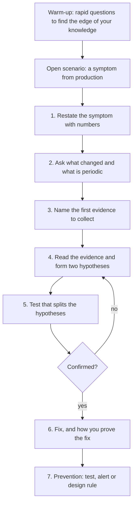

# Module 12.03: Mock: systems and concurrency rounds

**Estimated hours:** 4

**What you will learn**

1. Forty systems and concurrency questions, from processes and page faults to memory orders and ABA, each with a model answer and the module where you practised it.
2. Five whiteboard scenarios (a hang from a core dump, a slowdown at 200 connections, p99 spikes every five minutes, a counter wrong under load, the app server's sync layer) and how to walk through each one out loud.
3. How a systems round is graded, and how to score yourself against the same rubric.

**Prerequisites:** [Module 12.02: Mock: C++ coding rounds](module-02-mock-cpp-coding-rounds.md). This module draws on all of [Phase 3](../phase-03-os-internals/module-01-processes.md), [Phase 4](../phase-04-concurrency-deep-dive/module-01-threads-in-cpp.md) and modules 8.01, 8.02 and 8.05.

---

## 1. One-line intuition

A systems round asks one question in forty forms: do you know what the machine and the kernel actually do when your code runs, well enough to predict and debug it?

## 2. Real-life analogy

Think of an exam for a bank branch's operations manager, not a cashier.

- A cashier is asked "how do you count notes?" (what a mutex is).
- The operations manager is asked "the queue at counter 3 doubles every day at 11:00; why?" (p99 spikes on a schedule) and "two cashiers are each waiting for the other's key to the vault; how do you find out who holds which key?" (a deadlock in a core dump).
- A good manager answers by naming what to look at first, what each observation would mean, and what she would change, not by reciting the bank's rulebook.

The rulebook is Phases 3 and 4. This module is the manager's exam.

## 3. Why it exists: the problem it solves

Resume line C claims "threads, mutexes, `shared_mutex`, condition variables, atomics and memory model, thread pools, lock-free basics; Win32 synchronisation (critical sections, wait objects)". Line F claims crash-dump analysis. Line H4 claims a thread synchronisation layer. Interviewers for C++ systems roles test these in a dedicated round of 45 to 60 minutes, usually in two halves: rapid questions to find the edge of your knowledge, then one open scenario ("our server hangs; here is a core dump; go").

Without practice, two failures are common. You know a fact but cannot say why ("use `notify_one`" without "because one item needs one waiter and the rest would wake for nothing"). Or you know every fact but have no method for an open scenario, and spend ten minutes guessing. This module gives you both: forty answers to say aloud, and a method for scenarios.

## 4. Three layers of depth

The forty questions are grouped by the depth at which interviewers usually ask them. Cover each answer, say yours aloud, then open the box. Each question names the module where you practised it.

### Layer 1 (beginner): what a junior-level interviewer tests

At junior depth: correct definitions, the right words, and one concrete example. Topics: processes and threads, scheduling, virtual memory, `malloc`, system calls, file descriptors.

**Q1. What is the difference between a thread and a process?** (3.02)

<details><summary>Model answer</summary>

A process is a running program with its own virtual address space, file descriptor table and credentials. A thread is a path of execution inside a process; all threads of a process share the address space, heap, globals and descriptors, but each has its own stack, registers and thread-local storage. On Linux both are kernel tasks created by `clone()` with different sharing flags. Threads communicate through shared memory (fast, but needs synchronisation); processes need IPC (slower, but a crash in one does not corrupt the other).

</details>

**Q2. What does each thread own, and what is shared?** (3.02, 4.01)

<details><summary>Model answer</summary>

Own: stack (8 MiB default on Linux, from `ulimit -s`; 1 MB reserved by default on Windows), registers including the instruction and stack pointers, `thread_local` variables, signal mask, `errno`. Shared: code, globals, heap, open descriptors, current directory, signal handlers. So any heap object reachable from two threads needs a rule: one owner, a lock, or an atomic.

</details>

**Q3. What happens if a multithreaded program calls `fork()`?** (3.01, 3.02)

<details><summary>Model answer</summary>

Only the calling thread exists in the child, but the child gets a copy of the whole address space, including mutexes that other threads held at that moment. Those mutexes stay locked forever in the child, and `malloc`'s own locks may be among them. So between `fork()` and `exec()` the child may only call async-signal-safe functions. In practice: `fork` then `exec` immediately, or use `posix_spawn`.

</details>

**Q4. What is a context switch, and what does it cost?** (3.03)

<details><summary>Model answer</summary>

The kernel saves one task's registers and restores another's, switching stacks and, between processes, the address space. The direct cost is typically one to a few microseconds; the larger hidden cost is cold caches and TLB entries for the incoming task. Voluntary switches happen when a thread blocks (on I/O, a futex); involuntary ones when its time slice ends. `pidstat -w` or `/proc/PID/status` shows both counts.

</details>

**Q5. Why can adding threads make a program slower?** (3.03, 4.10)

<details><summary>Model answer</summary>

Beyond the number of cores, CPU-bound threads only take turns: more context switches, more cache thrash, more lock contention, and more memory for stacks. Shared data adds coherence traffic (module 4.08). The tcpkv thread sweep in 5.11 shows the knee: throughput stops growing near the core count while p99 keeps rising. Threads that mostly wait on I/O can usefully outnumber cores, which is why pool size depends on the wait ratio (Q29).

</details>

**Q6. What problem does virtual memory solve?** (3.04)

<details><summary>Model answer</summary>

Each process gets its own private address space, mapped to physical frames by page tables that only the kernel controls. That gives isolation (one process cannot read another's memory), a simple layout for every program, overcommit and lazy allocation, shared libraries mapped once, and memory-mapped files. The cost is the translation, made cheap by the TLB.

</details>

**Q7. What is a page fault? Minor versus major?** (3.04)

<details><summary>Model answer</summary>

A page fault is the CPU trapping to the kernel because the page-table entry for an address is not present or not permitted. A **minor** fault is resolved without disk I/O: first touch of a fresh anonymous page, or a page already in the page cache. A **major** fault needs a disk read (a file page or swapped page) and costs milliseconds on a disk, tens of microseconds on NVMe. An invalid address ends in SIGSEGV. `/usr/bin/time -v` reports both counts; first-touch minor faults are one reason a benchmark needs warm-up.

</details>

**Q8. What is copy-on-write?** (3.04)

<details><summary>Model answer</summary>

After `fork()`, parent and child share the same physical pages marked read-only. The first write by either raises a fault, and the kernel copies just that page for the writer. So `fork` of a 2 GB process is fast, and memory is only duplicated where it is written. Redis uses it for background snapshots, which is why its memory can grow during a save under a heavy write load.

</details>

**Q9. How does `malloc` get memory, and why does `free` often not return it to the OS?** (3.05)

<details><summary>Model answer</summary>

glibc serves small requests from arenas carved from the heap (grown with `brk`) or from `mmap`ed heaps for extra threads, keeping freed chunks in bins for reuse. Requests above the mmap threshold (128 KiB by default, adjusted dynamically) get their own `mmap`, and `free` returns those with `munmap`. Small freed chunks stay in the process for reuse, and the heap top can only shrink if the top chunk is free, so fragmentation keeps RSS high. glibc creates up to 8 arenas per core on 64-bit to cut lock contention, which can also inflate memory. Fixes: fewer allocations on hot paths, pools or arenas (3.06), `malloc_trim`, or a different allocator.

</details>

**Q10. What is a system call, and how expensive is one?** (3.07)

<details><summary>Model answer</summary>

A controlled entry from user mode into the kernel through the `syscall` instruction: the CPU switches privilege level, the kernel validates arguments, does the work and returns. A trivial syscall typically costs from about a hundred nanoseconds to under a microsecond, depending on the CPU and on mitigations such as page-table isolation. `clock_gettime` usually avoids the kernel through the vDSO. `strace -c` counts calls; in tcpkv the cost shows up as one `recv` and one `send` per request, which is why batching replies (pipelining) raises throughput.

</details>

**Q11. What is a file descriptor?** (3.08)

<details><summary>Model answer</summary>

A small integer that indexes the process's descriptor table; each slot points to a kernel open-file description holding the offset, flags and a reference to the file, socket or pipe. `dup` creates a second descriptor for the same description (shared offset). The lowest free number is always reused, which is why a double `close` can close somebody else's freshly opened socket. Limits: `ulimit -n` per process; exceeding it gives `EMFILE`.

</details>

**Q12. Why open descriptors with `O_CLOEXEC`?** (3.08)

<details><summary>Model answer</summary>

Without it, descriptors survive `exec`, so a child program inherits your sockets and files. Then the peer may never see the connection close (the child still holds it), the child can read data it should not, and descriptors leak. Setting the flag later with `fcntl` races with a `fork` in another thread, so pass it atomically at creation: `O_CLOEXEC`, `SOCK_CLOEXEC`, `accept4(..., SOCK_CLOEXEC)`, `pipe2(..., O_CLOEXEC)`.

</details>

**Q13. A server's `accept` starts failing with `EMFILE` after a few days. What is happening?** (3.08, 2.03)

<details><summary>Model answer</summary>

It has run out of descriptors, almost always a leak: an error path that returns without closing a socket. Check `ls /proc/PID/fd | wc -l` over time and `ls -l /proc/PID/fd` to see what kind of descriptor accumulates. The structural fix is RAII ownership (the `FileDescriptor` and `Socket` classes from 2.03 and 5.03), so no path can forget. Also handle `EMFILE` in the accept loop by backing off instead of spinning.

</details>

**Q14. Stack versus heap: where do things live, and what goes wrong?** (1.10, 3.02)

<details><summary>Model answer</summary>

Locals and call frames live on the thread's stack, allocated by moving the stack pointer, freed automatically on return, limited in size (8 MiB default for the main thread on Linux). Heap objects come from `malloc` or `new` and live until freed. Stack failures: overflow from deep recursion or large local arrays (a SIGSEGV on the guard page) and returning pointers to locals. Heap failures: leaks, use-after-free, double free, overflow into a neighbouring chunk. Each looks different in a core dump (module 8.06).

</details>

### Layer 2 (working engineer): what a mid-level interviewer tests

At mid depth: behaviour, trade-offs and failure modes, with numbers. Topics: signals and shutdown, I/O models, condition variables, `shared_mutex`, deadlock, Win32, pool sizing, backpressure.

**Q15. How does a server shut down gracefully on SIGTERM?** (3.09, 4.10)

<details><summary>Model answer</summary>

The handler does almost nothing: it writes one byte to a self-pipe (or the signal is read from a `signalfd`, or a dedicated thread calls `sigwait`). The main loop wakes, stops accepting, closes the listener, tells handlers to finish the current request and reply `ERR SHUTTING_DOWN` to new ones, closes the work queue so workers drain and exit, joins them, flushes logs and exits 0. Every step has a deadline, after which it falls back to closing connections. That is tcpkv's sequence.

</details>

**Q16. What may you call inside a signal handler?** (3.09)

<details><summary>Model answer</summary>

Only async-signal-safe functions, listed in `man 7 signal-safety`: `write`, `_exit`, `sigaction` and a few dozen others. Not `printf`, `malloc`, `new`, a mutex, or anything that may take a lock, because the signal can interrupt the same thread while it holds that lock, deadlocking itself. Writing a `volatile std::sig_atomic_t` or a lock-free `std::atomic` flag is allowed. Doing the real work outside the handler (self-pipe, `signalfd`) avoids the whole problem.

</details>

**Q17. Your server dies silently when a client disconnects mid-reply. Why?** (3.09, 5.03)

<details><summary>Model answer</summary>

Writing to a socket whose peer has closed raises SIGPIPE, whose default action terminates the process with no core and no message. Fix: `signal(SIGPIPE, SIG_IGN)` at start-up, or `send(..., MSG_NOSIGNAL)` on every write, and then handle `EPIPE` as an ordinary error that closes that connection only. tcpkv does both.

</details>

**Q18. epoll or a thread pool: when do you choose each?** (3.11, 5.05)

<details><summary>Model answer</summary>

A pool with blocking I/O is simplest when connections are few or each request blocks on something slow anyway (the app server blocks on the database for milliseconds, so a reactor gains nothing). epoll wins when there are thousands of mostly idle connections: one thread watches all of them, memory per connection is a buffer rather than a stack. The usual production shape is a few epoll loops for I/O plus a worker pool for blocking work. For tcpkv I chose a fixed pool with one connection per task for clarity and sanitizer-friendliness, measured where it stops scaling, and documented epoll as the upgrade.

</details>

**Q19. Level-triggered versus edge-triggered epoll?** (3.11)

<details><summary>Model answer</summary>

Level-triggered (the default) reports a descriptor as ready on every `epoll_wait` while data remains, so you may read part of it and come back. Edge-triggered reports only when the state changes from not-ready to ready, so you must read until `EAGAIN` on a non-blocking socket, or you will never be told about the leftover bytes and the connection stalls. Edge-triggered saves wakeups but makes "forgot to drain" bugs silent.

</details>

**Q20. Why must a condition-variable wait use a predicate?** (4.04)

<details><summary>Model answer</summary>

Because a wakeup does not mean the condition is true. **Spurious wakeups** are allowed by the standard and happen with futex-based implementations. Another consumer may have taken the item between the notify and your wakeup. And if the notify happened before you started waiting, the notification is gone and you would sleep forever (a **lost wakeup**). `cv.wait(lock, [&]{ return closed_ || !q_.empty(); })` checks the condition under the mutex before sleeping and again after every wakeup, which fixes all three.

</details>

**Q21. Show a lost-wakeup bug.** (4.04)

<details><summary>Model answer</summary>

The producer sets `ready = true` without holding the mutex, then calls `notify_one()`. The consumer checked `ready` (false) under the mutex and is about to call `wait`, but has not yet. The notify arrives with nobody waiting and is lost; the consumer then sleeps forever. The fix is to change the shared state **under the same mutex** the waiter uses, and to wait with a predicate. Notifying after unlocking is fine; modifying the state outside the lock is not. Win32 auto-reset events have the mirror bug when two signals arrive before one wait (module 4.12).

</details>

**Q22. `notify_one` or `notify_all`?** (4.04, 4.10)

<details><summary>Model answer</summary>

`notify_one` when one waiter can make progress per event, such as one task pushed to a work queue; waking all of them is a thundering herd of N wakeups for one unit of work. `notify_all` when the change matters to every waiter: shutdown, a configuration reload, or when waiters wait for different conditions on the same variable. My thread pool uses `notify_one` in `submit` and `notify_all` in the destructor.

</details>

**Q23. When does `shared_mutex` beat a plain mutex, and when does it lose?** (4.05)

<details><summary>Model answer</summary>

It wins when reads dominate, read critical sections are long enough to overlap usefully, and there are enough reader threads. It loses for very short critical sections, because a shared lock still does an atomic read-modify-write on the lock's counter, so readers bounce the same cache line, and its bookkeeping costs more than a mutex. Measure: in 4.05 I compared both at a 95/5 read/write mix over 1 to 16 threads and got `<shared ops/s>` versus `<mutex ops/s>` at `<N>` threads on my machine. If writes grow, striping or a copy-on-write snapshot usually beats both.

</details>

**Q24. What is writer starvation?** (4.05)

<details><summary>Model answer</summary>

With a reader-preferring lock, new readers may enter while a writer waits, so under constant read traffic the reader count never reaches zero and the writer waits indefinitely. glibc's default `pthread_rwlock_t`, which libstdc++'s `std::shared_mutex` uses, is reader-preferring. Options: a writer-preferring attribute (`PTHREAD_RWLOCK_PREFER_WRITER_NONRECURSIVE_NP`), shorter read sections, or a design where writers never block readers (copy-on-write, as the master-table cache in 4.13 does). I measured the writer's worst wait in 4.05: `<w>` µs with 8 readers.

</details>

**Q25. What are the four conditions for deadlock, and how do you prevent one?** (4.11)

<details><summary>Model answer</summary>

Mutual exclusion, hold and wait, no preemption, and circular wait (Coffman). Remove any one. In practice: a global lock order (lock hierarchy) removes circular wait; `std::scoped_lock(a, b)` acquires a set without hold-and-wait; `try_lock_for` with a timeout turns a hang into a logged error; and never holding a lock across I/O, callbacks or another component's lock removes most real cases. TSan's lock-order-inversion report finds potential cycles even on runs that did not hang.

</details>

**Q26. How do you debug a process that is hung?** (4.11, 8.01, 8.02)

<details><summary>Model answer</summary>

Take evidence before restarting: `gcore PID` or `gdb -p PID`. Then `thread apply all bt`. Threads in `futex_wait` under `__lll_lock_wait` are blocked on mutexes; `pthread_cond_wait` means a condition variable. For each blocked mutex, `print m._M_mutex.__data.__owner` gives the LWP of the holder; `info threads` maps it to a thread; follow the chain. A cycle is a deadlock. A holder blocked in `recv` or a database call is a lock held across I/O. Scenario 1 in section 8 walks through it.

</details>

**Q27. Win32: CRITICAL_SECTION, Mutex, Event and SRWLock. When each?** (4.12)

<details><summary>Model answer</summary>

`CRITICAL_SECTION`: process-local, recursive for the owning thread, spins briefly then sleeps; the default lock inside one process. `SRWLOCK`: pointer-sized, process-local, shared or exclusive, not recursive and not upgradeable; good for read-mostly data and pairs with `SleepConditionVariableSRW`. **Mutex** object: a kernel handle, can be named and shared across processes, waitable with `WaitForSingleObject`/`WaitForMultipleObjects`, and reports `WAIT_ABANDONED` if its owner died; much slower because every operation enters the kernel. **Event**: a signal, not a lock; manual-reset stays signalled for all waiters, auto-reset releases one and resets. In C2's Win32 variant I used a `CRITICAL_SECTION` with `CONDITION_VARIABLE` for the queue and an Event for shutdown.

</details>

**Q28. What does `WaitForMultipleObjects` do, and what are its limits?** (4.12)

<details><summary>Model answer</summary>

It blocks until one (`bWaitAll = FALSE`) or all (`TRUE`) of up to `MAXIMUM_WAIT_OBJECTS` (64) handles are signalled, or a timeout passes. With `FALSE` it returns `WAIT_OBJECT_0 + i` for the lowest signalled index, so a constantly signalled low-index handle can starve higher ones. It returns `WAIT_ABANDONED_0 + i` if a mutex's owner exited without releasing it, meaning the protected data may be inconsistent. Typical use in the app server's Win32 variant: a worker waits on {shutdown event, work-available event} so shutdown wakes it even when idle. More than 64 handles needs several waiting threads or a thread pool wait API.

</details>

**Q29. How do you size a thread pool?** (4.10, 5.10, 6.12)

<details><summary>Model answer</summary>

CPU-bound work: about the number of cores. Blocking work: by Little's law, in-flight requests = arrival rate × time in system, so workers ≈ target throughput × time per request, plus headroom; equivalently cores × (1 + wait time / compute time). Then measure with a load generator sweep and find the knee (5.11). Keep the database connection pool smaller than the worker pool so the queue forms inside the server, where it is bounded and timed, not inside the database. My tcpkv pool size came from the sweep: `<K>` workers on a `<cores>`-core laptop.

</details>

**Q30. What is backpressure, and how did you apply it?** (5.10)

<details><summary>Model answer</summary>

Backpressure is a full stage slowing or refusing its producer instead of buffering without limit. Without it, a queue absorbs overload until memory runs out, and every request waits behind work nobody will use. Mechanisms: bounded queues (`push` blocks or fails), connection limits, per-connection buffer limits, stopping `recv` when replies cannot be sent (TCP's window then pushes back on the client), and fast `BUSY` replies with client retry and jitter. In my servers: a bounded request queue, a connection cap, and timeouts on every wait, each shorter than the one upstream.

</details>

### Layer 3 (internals): what a senior-level interviewer tests

At senior depth: what happens underneath, and judgement about when the clever tool is worth it. Topics: futex, spinlocks, atomics and CAS, memory orders, false sharing, ABA, lock-free design, sanitizer limits.

**Q31. How does `std::mutex` work underneath on Linux?** (4.03)

<details><summary>Model answer</summary>

`std::mutex` wraps `pthread_mutex_t`. The fast path is one atomic compare-and-swap in user space on a lock word: 0 free, 1 locked, 2 locked with waiters. Uncontended lock and unlock never enter the kernel, so they cost tens of nanoseconds. On contention the thread sets the word to 2 and calls `futex(FUTEX_WAIT)`, which sleeps on a kernel wait queue keyed by the word's address only if the word still holds the expected value (that check closes the lost-wakeup race). Unlock sees 2 and calls `FUTEX_WAKE`. So contention costs system calls and context switches, microseconds per hand-off.

</details>

**Q32. What is a spinlock, and when is spinning wrong?** (4.06)

<details><summary>Model answer</summary>

A lock that loops on an atomic flag instead of sleeping. It is right only when critical sections are a few dozen nanoseconds and the holder is guaranteed to be running, for example in a kernel with preemption disabled. In user space it is usually wrong: if the holder is descheduled, every spinner burns its whole time slice, and with more threads than cores it can collapse throughput. Real mutexes already spin briefly before sleeping (adaptive mutexes, `CRITICAL_SECTION` spin counts). If you must spin, spin on a plain load (test-and-test-and-set) and use a pause instruction.

</details>

**Q33. What does compare-and-swap do? Write an atomic maximum with it.** (4.06)

<details><summary>Model answer</summary>

CAS atomically compares a memory value with an expected value and, only if equal, replaces it; it reports success, and on failure `compare_exchange` writes the current value into `expected`. Lock-free updates are loops around it:

```cpp
void update_max(std::atomic<long>& m, long v) {
    long cur = m.load(std::memory_order_relaxed);
    while (cur < v && !m.compare_exchange_weak(cur, v, std::memory_order_relaxed)) {
        // cur now holds the latest value; loop re-checks cur < v
    }
}
```

`compare_exchange_weak` may fail spuriously, which is fine inside a loop and can be cheaper on LL/SC architectures such as ARM. Use it for the peak in-flight request gauge in a server's metrics.

</details>

**Q34. Explain `seq_cst`, acquire/release and `relaxed`. When do you use each?** (4.07)

<details><summary>Model answer</summary>

`relaxed` gives atomicity only, no ordering: right for counters and statistics read later. **Release** on a store and **acquire** on a load that reads it create a happens-before edge: everything written before the release is visible after the acquire. That is the pattern for publishing data through a flag or pointer. `seq_cst` (the default) adds a single total order over all `seq_cst` operations, needed for Dekker-style patterns where each thread writes one variable and reads another (module 4.07's example fails with acquire/release). On x86, acquire loads and release stores are plain moves; `seq_cst` stores need an `xchg` or `mfence`. On ARM all of them cost something, which is why code that "works on x86" can break on ARM.

</details>

**Q35. A thread writes `data = 42; ready = true;` and another reads `if (ready) use(data);`. What is wrong, and what is the minimal fix?** (4.07)

<details><summary>Model answer</summary>

With a plain `bool` it is a data race, so undefined behaviour; in practice the compiler or CPU may reorder the stores or hoist the load, and the reader may see `ready` true with stale `data`. Make `ready` a `std::atomic<bool>`, store it with `memory_order_release` after writing `data`, and load it with `memory_order_acquire` before reading `data`. `data` itself can stay non-atomic because the release-acquire pair orders it. `relaxed` on the flag would remove the ordering and bring the bug back; `volatile` would not help at all (Q39).

</details>

**Q36. What is false sharing, and how do you find and fix it?** (4.08)

<details><summary>Model answer</summary>

Two threads write different variables that sit in the same 64-byte cache line. MESI coherence moves the line between cores on every write, so independent counters run as if they shared one. Find it with a benchmark that compares padded and unpadded layouts, or `perf c2c` on Linux. Fix with `alignas(64)` (or `std::hardware_destructive_interference_size` where supported) or per-thread data combined at the end. Section 6 shows it: four threads with per-thread atomic counters took `<unpadded ms>` packed together and `<padded ms>` padded on my machine.

</details>

**Q37. What is the ABA problem?** (4.09)

<details><summary>Model answer</summary>

A lock-free algorithm reads value A, prepares an update, and uses CAS expecting A. Meanwhile another thread changes A to B and back to A (for example, pops a node, frees it, and a new node is allocated at the same address and pushed). The CAS succeeds although the structure changed, corrupting it; in a Treiber stack the `next` pointer it saved is now stale. Fixes: a version counter alongside the pointer (double-width CAS or a tagged pointer), safe memory reclamation (hazard pointers, epoch-based reclamation) so a node cannot be reused while anyone may still read it, or a design without reuse.

</details>

**Q38. Lock-free or locks: when is lock-free worth it?** (4.09)

<details><summary>Model answer</summary>

Lock-free guarantees system-wide progress: a descheduled thread cannot block others. It is worth it for narrow, hot structures with simple invariants: a single-producer single-consumer ring buffer, a counter, a stats gauge, a published snapshot pointer. Its costs are complexity, memory reclamation (Q37), and often no throughput gain, because contended atomics on one cache line serialise just like a lock. For most server data structures an uncontended mutex costs tens of nanoseconds and is far easier to prove correct. My rule: lock first, measure contention, and replace only the structure the profile names.

</details>

**Q39. Is `volatile` useful for sharing data between threads in C++?** (4.02, 4.07)

<details><summary>Model answer</summary>

No. `volatile` stops the compiler from removing or merging accesses, for memory-mapped I/O, but gives no atomicity and no inter-thread ordering; a `volatile` shared variable is still a data race. My counter demo uses a `volatile long` only to stop the optimiser merging a million increments into one, and it still lost more than half of them. Use `std::atomic`. (MSVC has a non-standard mode, `/volatile:ms`, that gives `volatile` acquire/release semantics; portable code must not rely on it, and it is not the default on ARM.)

</details>

**Q40. What does ThreadSanitizer detect, and what does it miss?** (8.05, 9.04)

<details><summary>Model answer</summary>

It instruments every memory access and synchronisation operation and tracks happens-before with vector clocks, reporting two accesses to the same location from different threads, at least one a write, with no happens-before between them, plus lock-order inversions and some misuse of mutexes. It only sees code paths that actually run in that execution, so coverage depends on your tests and load; races inside uninstrumented libraries can be missed; and it typically slows programs 5 to 15 times and uses 5 to 10 times more memory, so it runs in CI and test environments, not production. It cannot be combined with ASan in one build. My tcpkv CI has a separate TSan job driven by the load generator so the concurrent paths are exercised.

</details>

## 5. Architecture diagram

How a systems round usually runs, and the method to use for the open scenario in its second half:



Steps 3 and 5 score the most. Interviewers want to hear the exact command or tool, and a test whose result would change your mind.

## 6. Code

Scenario 4 below says "the approved-loans counter is wrong under load". This program reproduces it and compares three fixes: one shared `std::atomic`, per-thread atomics packed together (false sharing), and per-thread atomics each on its own cache line.

```cpp
// counter.cpp -- "the approved-loans counter is wrong under load": reproduce, fix, measure.
// Usage: ./counter racy|atomic|unpadded|padded [threads] [increments_per_thread]
#include <atomic>
#include <chrono>
#include <cstdio>
#include <cstdlib>
#include <string>
#include <thread>
#include <vector>

struct Slot { std::atomic<long> v{0}; };                    // 8 bytes: 8 slots share a cache line
struct alignas(64) PaddedSlot { std::atomic<long> v{0}; };  // one 64-byte cache line per slot

volatile long racy_count = 0;  // volatile only stops the optimiser merging increments; still a race

template <class Body>
double timed_ms(int threads, Body body) {
    auto t0 = std::chrono::steady_clock::now();
    std::vector<std::thread> ts;
    for (int t = 0; t < threads; ++t) ts.emplace_back(body, t);
    for (auto& th : ts) th.join();
    return std::chrono::duration<double, std::milli>(std::chrono::steady_clock::now() - t0).count();
}

template <class S>
long sharded(int threads, long n, double& ms) {
    std::vector<S> slots(static_cast<std::size_t>(threads));  // one counter per thread, summed at read
    ms = timed_ms(threads, [&slots, n](int t) {
        for (long i = 0; i < n; ++i) slots[static_cast<std::size_t>(t)].v.fetch_add(1, std::memory_order_relaxed);
    });
    long sum = 0;
    for (auto& s : slots) sum += s.v.load();
    return sum;
}

int main(int argc, char** argv) {
    std::string mode = argc > 1 ? argv[1] : "racy";
    int threads = argc > 2 ? std::atoi(argv[2]) : 4;
    long n = argc > 3 ? std::atol(argv[3]) : 1000000;
    long got = 0;
    double ms = 0;
    if (mode == "racy") {                                   // load, add, store: updates get lost
        ms = timed_ms(threads, [n](int) { for (long i = 0; i < n; ++i) racy_count = racy_count + 1; });
        got = racy_count;
    } else if (mode == "atomic") {                          // correct; one line bounces between cores
        std::atomic<long> c{0};
        ms = timed_ms(threads, [&c, n](int) {
            for (long i = 0; i < n; ++i) c.fetch_add(1, std::memory_order_relaxed);
        });
        got = c.load();
    } else if (mode == "unpadded") {
        got = sharded<Slot>(threads, n, ms);                // correct; false sharing
    } else if (mode == "padded") {
        got = sharded<PaddedSlot>(threads, n, ms);          // correct; no shared line
    } else {
        std::fprintf(stderr, "usage: counter racy|atomic|unpadded|padded [threads] [n]\n");
        return 2;
    }
    long expected = threads * n;
    std::printf("%-8s threads=%d expected=%ld got=%ld lost=%ld time=%.1f ms\n",
                mode.c_str(), threads, expected, got, expected - got, ms);
}
```

```bash
g++ -std=c++17 -O2 -Wall -Wextra -Werror -g -pthread -o counter counter.cpp
for m in racy atomic unpadded padded; do ./counter $m 4 10000000; done
g++ -std=c++17 -O1 -g -fsanitize=thread -pthread -o counter_tsan counter.cpp
setarch x86_64 -R ./counter_tsan racy 2 100000 2>&1 | grep -E "WARNING|SUMMARY"
```

Output from one run on one laptop (Intel Core i5-10210U, 4 vCPUs in WSL2, which was also running other jobs at the time, so the times are noisier than on an idle machine). The `lost` count and all times change on every run and every machine; the pattern is what to expect:

```text
racy     threads=4 expected=40000000 got=21681348 lost=18318652 time=139.6 ms
atomic   threads=4 expected=40000000 got=40000000 lost=0 time=614.9 ms
unpadded threads=4 expected=40000000 got=40000000 lost=0 time=506.6 ms
padded   threads=4 expected=40000000 got=40000000 lost=0 time=277.3 ms
```

Over three repeated runs on that machine, `racy` lost between about 18 and 28 million of the 40 million increments, `atomic` took 615 to 930 ms, `unpadded` 410 to 510 ms, and `padded` 205 to 280 ms. TSan reports `WARNING: ThreadSanitizer: data race` on the racy line and stays silent for the other three modes.

Read it like an interviewer: the racy version is fastest because it is wrong. The shared atomic is correct but every increment moves one cache line between cores. Per-thread counters in one line are still slowed by false sharing. Padding gives correct counts at less than half the shared-atomic time. A reader sums the slots, which is fine for a metric that is read rarely.

## 7. Use case: core-banking loan-origination platform

Scenario 5, the senior-level whiteboard question for this resume: **"Design the synchronisation layer of a multithreaded application server that handles loan-origination requests over RPC from branch terminals."** This is resume line H4, and capstone C2 is your hands-on evidence. Walk it like this:

1. **Threads and their jobs.** One acceptor thread (or a few epoll loops) reading framed RPC requests (5.07). A fixed pool of workers that run requests and block on the database. One background thread that reloads master data.
2. **Shared state and its rule, one line each.** Request queue: `BoundedQueue` with a mutex and two condition variables (4.04); full means an immediate `BUSY` reply (5.10). Request objects: a `RequestPool` of preallocated objects, so the hot path does not call `malloc` and the pool size caps in-flight work (4.13). Master tables: an immutable snapshot behind `std::shared_ptr<const MasterTables>`, read with an atomic load, replaced by the reload thread with an atomic store; readers never block on a reload (4.13). Database connections: a pool smaller than the worker pool, with a timed wait (6.12). Per-connection reply writes: owned by one thread at a time, so no lock.
3. **Lock order, written down.** Never hold more than one of these at once; if unavoidable, the order is cache, then queue, then connection pool. No lock is held across a network or database call. These two rules remove nearly every deadlock in 4.11.
4. **Shutdown.** Signal to self-pipe, stop accepting, reply `SHUTTING_DOWN`, close the queue, workers drain, join, close the DB pool (3.09, 4.10).
5. **Windows variant.** The same design with `CRITICAL_SECTION` plus `CONDITION_VARIABLE` (`SleepConditionVariableCS`) for the queue, `SRWLOCK` or the atomic snapshot for the cache, and a manual-reset Event for shutdown that idle workers wait on with `WaitForMultipleObjects` (4.12).
6. **Proof.** TSan clean under a load generator; a deadlock test that would hang if the lock order were broken; p99 measured during a master-data reload to show readers do not stall.

**The decision this drove:** the master-table cache uses a copy-on-write snapshot instead of a `shared_mutex`, because a reload rebuilds every table and would hold an exclusive lock long enough to stall every request thread behind it. In C2 you measured p99 during a reload both ways (`<snapshot p99>` versus `<shared_mutex p99>` µs). Say which parts you built in the course and, separately, which parts match what you did at work, only if true.

## 8. Lab

A mock systems round. Budget 4 hours.

### Part A: rapid questions (60 minutes)

1. Pick 15 of the 40 questions at random: `shuf -i 1-40 -n 15` in WSL.
2. Answer each aloud in under 2 minutes, recording yourself. Then open the model answer.
3. Mark each: complete, partial (missed the "why" or the number), or wrong.

Expected: at least 10 complete if Phases 3 and 4 are fresh. Re-read the cited module for every partial or wrong answer before Part C.

### Part B: run the counter experiment (30 minutes)

1. Build and run `counter.cpp` as in section 6, three times per mode, with 4 threads, then with 2 and with your `nproc`.
2. Run the TSan build on `racy` and on `padded`.

Expected: `racy` always loses increments (a different number every run); the other three never do; `padded` is the fastest correct mode and the shared `atomic` usually the slowest; TSan reports a race only for `racy`.

### Part C: whiteboard scenarios (90 minutes)

Have a friend, or Claude, read each scenario and play the interviewer: answer your questions with plausible evidence and push back. Use the seven-step method from section 5. Spend 20 minutes per scenario, then compare with the model walkthrough.

**Scenario 1: debug a hang from a core dump.** "The app server stopped answering at 14:02. Operations took a core with `gcore` before restarting. Go."

<details>
<summary>Model walkthrough</summary>

1. Restate: the process was alive, not crashing, not answering; CPU usage at the time matters (near zero suggests blocked threads, 100% suggests a spin or infinite loop). Ask for it.
2. Load: `gdb ./app_server core.12345` with the exact binary and its debug symbols.
3. `info threads`, then `thread apply all bt`. Group threads by where they sit: workers in `pthread_cond_wait` (idle, waiting for work), threads in `__lll_lock_wait`/`futex_wait` (blocked on a mutex), threads in `recv` or inside the database client library.
4. For each blocked mutex: `frame N` to reach our code, `print some_mutex._M_mutex.__data.__owner` to get the holder's LWP, map it with `info threads`.
5. Two hypotheses, split by the evidence: (a) a cycle, thread 7 holds the cache lock and waits for the queue lock while thread 12 holds the queue lock and waits for the cache lock: a deadlock from inconsistent lock order; (b) one holder sitting in `recv` on a database socket while holding the cache lock: a lock held across I/O, with every request piling up behind it.
6. Fix: (a) a documented lock order or `std::scoped_lock` for the pair; (b) do the I/O outside the lock and publish the result under a short lock. Prove it with a stress test that hung before and passes 1,000 runs after, plus TSan's lock-order report going silent.
7. Prevention: TSan job in CI with the load generator, a liveness check that exercises the locked path (not just "port open"), and `try_lock_for` with a logged timeout on locks known to be risky.

Module references: 4.11 (owner field, lock order), 8.01 and 8.02 (GDB on cores), C6 (your practice dump).

</details>

**Scenario 2: slowdown at 200 connections.** "Up to about 150 branch connections, p99 is 20 ms. At 200 it is 4 seconds, but CPU is only 30%. Why?"

<details>
<summary>Model walkthrough</summary>

1. Low CPU with high latency means requests are **waiting**, not computing. Something with a fixed size is full.
2. Candidates: the worker pool (if each connection occupies a worker for its lifetime, connection 1 beyond the pool size waits for a disconnect); the database connection pool; the listen backlog; a lock.
3. Evidence: queue-depth metric or a log of time spent waiting for a worker versus time in the handler; `ss -ltn` (a non-zero `Recv-Q` on the listening socket means the accept queue is backing up); `top -H` to see whether worker threads are busy or sleeping; `thread apply all bt` on a live process to see where workers block; `pg_stat_activity` for database sessions.
4. If workers are all blocked in `recv` on idle connections: the design ties a worker to a connection. That is tcpkv's documented limit (5.05). Fix: dispatch per request, not per connection (epoll front end plus a worker pool), or raise the pool with a reason.
5. If workers are blocked waiting for a DB connection: the DB pool is the bottleneck, which may be correct by design; then the fix is faster queries (the master-table cache, indexes) or more connections if the database has headroom.
6. Little's law check: at 150 connections × the request rate, in-flight work = rate × time; once demand exceeds pool capacity, queue time grows without bound, which matches "fine at 150, terrible at 200".
7. Prevention: a bounded queue with `BUSY` replies so overload is fast and visible (5.10), and a load-test sweep that includes 2× the expected connection count.

</details>

**Scenario 3: p99 spikes every five minutes.** "p50 is steady at 3 ms. Every five minutes p99 jumps to 900 ms for about 20 seconds."

<details>
<summary>Model walkthrough</summary>

1. A strict period means a timer, not load. List periodic things: database checkpoints (PostgreSQL's `checkpoint_timeout` defaults to exactly 5 minutes), cron jobs, a master-data reload interval, log rotation, monitoring scrapes, backups, autovacuum on a hot table, TCP keepalive or connection-pool recycling timers.
2. Evidence: line up spike timestamps with the database log (`log_checkpoints` is on by default since PostgreSQL 15), the application's reload log, `crontab -l`, and the pool's recycle settings.
3. Split hypotheses: if the spike aligns with checkpoint start, look at I/O saturation and checkpoint settings (`checkpoint_completion_target` 0.9 spreads writes; a larger `max_wal_size` avoids extra checkpoints; module 6.06). If it aligns with the master-data reload, check whether the reload takes an exclusive lock that request threads wait for.
4. The reload case is the one in your own code: the fix is the copy-on-write snapshot from 4.13, where the reload builds a new object off to the side and swaps a pointer, so readers never wait.
5. Proof: rerun the load test across several periods and plot p99 per 10-second window; the spikes should be gone, not just smaller.
6. Prevention: dashboards with p99 per short window (an average per minute hides a 20-second spike), and annotations for periodic jobs.

</details>

**Scenario 4: a counter wrong under load.** "The approved-loans counter on the dashboard is correct in testing but under load it is lower than the number of rows in the database."

<details>
<summary>Model walkthrough</summary>

1. "Correct when quiet, low under load" points at lost updates: a non-atomic read-modify-write on a shared counter. `++count` is a load, an add and a store; two threads can load the same value and both store value plus one.
2. Evidence: TSan on a load test reports the race on the counter line; the code shows a plain `long` (or a `volatile` one, which does not help).
3. Reproduce with section 6's `counter.cpp`: four threads lost tens of millions of 40 million increments on my laptop.
4. Fix options with their costs: `std::atomic<long>::fetch_add(1, relaxed)` (correct, simplest; contended cache line); per-thread counters padded to 64 bytes and summed on read (correct and about twice as fast in my run); or increment under a mutex that is already held for the request.
5. Ordering: `relaxed` is enough because nothing else is published through the counter.
6. Prevention: TSan job in CI with concurrent tests; for business counts, treat the database as the source of truth and the in-memory counter as a metric.

</details>

### Part D: grade the round (30 minutes)

Score each dimension 1 to 4 from your recording:

| Dimension | 1 (weak) | 2 | 3 | 4 (strong) |
|---|---|---|---|---|
| Accuracy | wrong facts | right facts, gaps in "why" | right with mechanism | right, with mechanism and a number |
| Depth on demand | stopped at the definition | one level deeper when pushed | reached the kernel or hardware level | knew where your knowledge ends and said so |
| Method in scenarios | guessed causes | listed causes | evidence first, then hypotheses | evidence that splits hypotheses, then proof and prevention |
| Tools named | none | generic ("use a debugger") | the right tool | the exact command and what output would mean |
| Evidence from own work | none | mentioned a module | cited a lab result | cited your measured number with conditions |
| Trade-offs | one answer for everything | named a trade-off | compared two options | chose with a reason and named when you would switch |
| Communication | long silences | rambling | structured | structured and checked in with the interviewer |
| Honesty | bluffed | hedged vaguely | said "I don't know" | said it and how you would find out |

**Passing bar:** 24 out of 32, with no 1 in Accuracy or Honesty.

### Journal

Copy [journal/TEMPLATE.md](../journal/TEMPLATE.md) to `journal/YYYY-MM-DD-mock-systems-round.md`. Record: the 15 question numbers and your complete/partial/wrong marks; the counter results for every mode and thread count with your CPU model and `nproc`; which scenario was hardest and the step where you stalled; the rubric scores; and the three modules you will re-read.

## 9. Common mistakes and misconceptions

| Mistake | Why it is wrong | What it costs |
|---|---|---|
| "Atomics are lock-free so they are free" | A contended atomic moves a cache line between cores on every operation | The shared atomic in section 6 was the slowest correct option |
| "`volatile` makes it thread-safe" | No atomicity, no ordering | Lost updates, as in the racy mode |
| Waiting on a condition variable without a predicate | Spurious and lost wakeups | Rare hangs that tests miss |
| "More threads, more throughput" | Beyond cores and the bottleneck you add switching and contention | A worse p99 after "scaling up" |
| Restarting a hung server before taking a core | The evidence is gone | The hang returns and you still cannot explain it |
| Holding a lock across a DB or network call | One slow call stalls every thread waiting on the lock | Latency incidents that look like deadlocks |
| Doing work in a signal handler | Non-async-signal-safe calls can self-deadlock | Random hangs at shutdown |
| `seq_cst` everywhere "to be safe" with no reasoning, or `relaxed` everywhere "for speed" | Interviewers want the happens-before argument | Marked as cargo-cult knowledge |
| Guessing causes in a scenario | No method, no evidence | Lowest method score even if the guess is right |
| Quoting someone else's benchmark numbers | They do not hold on your hardware, and you cannot defend them | Weak answer to "how did you measure that?" |

## 10. Resume link

- **Claim C, "threads, mutexes, `shared_mutex`, condition variables, atomics and memory model, thread pools, lock-free basics; Win32 synchronisation (critical sections, wait objects)".** Questions 15 to 40 are this line. Your evidence: the `BoundedQueue` (4.04), the `shared_mutex` measurement (4.05), the deadlock lab (4.11), the Win32 layer (4.12), the counter and false-sharing results (section 6, 4.08). Say numbers with conditions.
- **Claim F, "crash dump and core dump analysis (WinDbg, GDB) ... ASan/TSan".** Scenario 1 and Q26, Q40. Evidence: capstone C6 dumps you analysed.
- **Claim H4, "own the thread synchronisation layer (mutexes, critical sections, wait objects, a pooled request model)".** Section 7 is how you explain it. The course evidence is C2. What you owned at work is yours to state, and only what is true; if you did not own it, the verb "own" must change before the resume goes out (12.07).
- **Claim I, tcpkv.** Q15, Q17, Q18, Q29: your shutdown sequence, SIGPIPE handling, the pool-versus-epoll decision and the pool size from your sweep.

## 11. Interview questions

**Q1 (easy). Why does `++counter` on a shared `long` lose updates?**

<details>
<summary>Model answer</summary>

Because it is three steps, load, add, store, and two threads can interleave them: both load 41, both store 42, and one increment is gone. Formally it is a data race and therefore undefined behaviour. In my counter experiment four threads doing ten million increments each lost between about 18 and 28 million of the 40 million on a 4-vCPU laptop. `std::atomic<long>::fetch_add` makes the read-modify-write indivisible; `relaxed` order is enough for a pure counter.

</details>

**Q2 (easy). What is the difference between `notify_one` and `notify_all`, and which does your thread pool use where?**

<details>
<summary>Model answer</summary>

`notify_one` wakes at most one waiter; `notify_all` wakes all of them, and each re-checks its predicate under the mutex. My pool calls `notify_one` in `submit` because one task can use one worker, and waking all idle workers would be a thundering herd. The destructor calls `notify_all` after setting the stop flag because every worker must see shutdown. Both are called after releasing the mutex so the woken thread does not immediately block on it.

</details>

**Q3 (medium). Your packed per-thread counters were slower than the padded ones. Explain at the hardware level.**

<details>
<summary>Model answer</summary>

Caches keep coherence per 64-byte line using a protocol like MESI. Eight `atomic<long>` counters packed together share one line. When core 0 writes its counter, the line must be in Modified state in core 0's cache, which invalidates every other core's copy; when core 1 writes its own counter in the same line, the line moves again. The threads never touch each other's data, but the hardware sees one shared line. With `alignas(64)` each counter owns its line, stays Modified in one core's L1, and the increments run at local speed. In my run: `<unpadded ms>` versus `<padded ms>` for 40 million increments on four threads.

</details>

**Q4 (medium). How would you find out what a hung process is waiting for, without restarting it?**

<details>
<summary>Model answer</summary>

Take a core with `gcore PID` first, so the evidence survives, then `gdb -p PID` or load the core. `thread apply all bt` shows where every thread sits. Threads in `__lll_lock_wait` and `futex_wait` are blocked on a mutex; going up to our frame, `print m._M_mutex.__data.__owner` gives the holder's LWP, and `info threads` maps that to a thread whose backtrace says what the holder is doing. A cycle of holders is a deadlock; a holder in `recv` or the database client is a lock held across I/O. On Windows the equivalent is a ProcDump dump in WinDbg with `~*k` and `!locks` for critical sections. I practised both on the C6 dumps.

</details>

**Q5 (hard). Explain why a release store and an acquire load are enough to publish a pointer to a fully built object, and what breaks if the load is relaxed.**

<details>
<summary>Model answer</summary>

The writer builds the object with ordinary writes, then does `ptr.store(p, memory_order_release)`. The reader does `p = ptr.load(memory_order_acquire)` and, if it sees the new pointer, reads the object. The release store guarantees all writes before it in the writer's thread are ordered before it; the acquire load that reads that stored value synchronises-with it, creating a happens-before edge, so every write that built the object is visible to the reader. With a relaxed load there is no synchronises-with edge: on a weakly ordered CPU such as ARM, or after compiler reordering, the reader can see the new pointer but stale contents of the object, such as an uninitialised field. On x86 the hardware rarely shows it, so the bug survives testing and appears on ARM servers. This is the master-table snapshot in 4.13: the reload thread publishes a new `shared_ptr<const MasterTables>` with `std::atomic_store`, which is sequentially consistent by default and therefore at least release, and readers use `std::atomic_load`.

</details>

## 12. Revision

- Junior depth is correct definitions with an example; mid depth is behaviour and trade-offs with a number; senior depth is the mechanism underneath (futex, MESI, happens-before) and judgement about when the clever tool is worth it.
- For any open scenario: restate with numbers, ask what changed or is periodic, collect evidence first, split two hypotheses with a test, fix, prove, prevent.
- Your own numbers carry the round: lost increments, padded versus shared atomics, `shared_mutex` versus `mutex`, the pool knee, all stated with machine and method.

---

Previous: [Module 12.02: Mock: C++ coding rounds](module-02-mock-cpp-coding-rounds.md) | Next: [Module 12.04: Mock: database rounds](module-04-mock-database-rounds.md)
