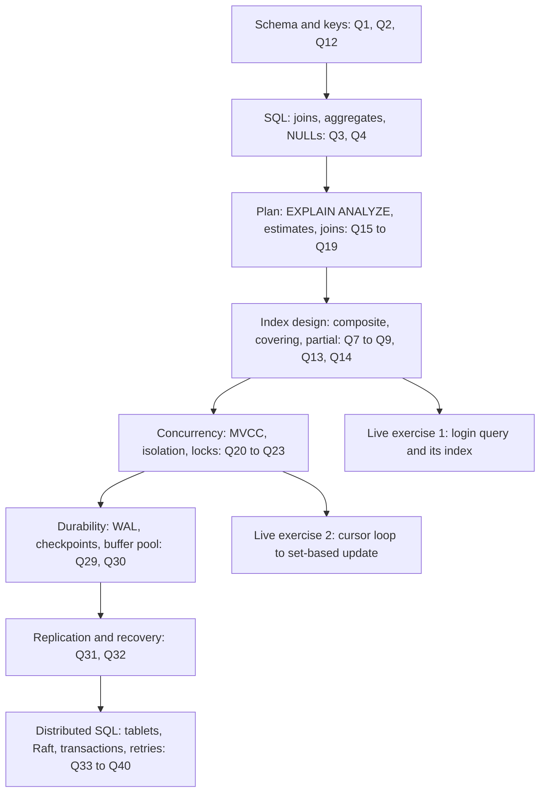

# Module 12.04: Mock: database rounds

**Estimated hours:** 4

**What you will learn**

1. Forty database questions, from keys and joins to YugabyteDB tablets and failover, each with a model answer that cites the module or capstone where you practised it.
2. How to read three real `EXPLAIN ANALYZE` plans and name the problem in each: a stale visibility map, stale statistics, and a sort spilling to disk.
3. Two live SQL exercises interviewers set for this resume: the login query with its ideal index, and a set-based update that replaces a cursor loop.

**Prerequisites:** [Module 12.03: Mock: systems and concurrency rounds](module-03-mock-systems-and-concurrency-rounds.md). This module draws on [Phase 6](../phase-06-databases-from-zero-to-internals/module-01-what-a-database-is.md), [Phase 7](../phase-07-distributed-systems-and-yugabytedb/module-01-why-distribute-cap-pacelc.md) and capstones C3 and C5. You need the `pg16` container from module 0.05 and the lending schema from module 6.03.

---

## 1. One-line intuition

A database round checks whether you can follow one query all the way down, from the SQL you type to the pages, locks, log records and replicas that make it fast, correct and durable.

## 2. Real-life analogy

Think of the bank's record room and a request for one customer's loan file.

- A junior clerk knows which cabinet holds which files (tables and keys).
- A good clerk knows the index cards: cards sorted by PAN number find a file in seconds; a request by mobile number means reading every card (an index versus a full scan).
- A senior clerk knows what happens when two clerks edit the same file at once, how the ledger of changes lets the room be rebuilt after a fire (the write-ahead log), and how the branch's copy in another city stays in step (replication).

A database interviewer starts with the cabinet and keeps asking "and then what happens?" until you reach the fire.

## 3. Why it exists: the problem it solves

Resume line D lists six databases and seven internals topics: "PostgreSQL, YugabyteDB, Berkeley DB, Redis, Oracle, SQL Server; storage engines, B-tree indexing, MVCC and transactions, WAL, query planning (EXPLAIN), caching, replication". Lines H1, H2, H3, H6 and H7 are all database work. For a backend or database role that is the centre of the interview, and for a C++ systems role at a lending company it is at least one full round.

The usual failure is shallow breadth: a candidate can define MVCC but cannot read the plan that shows its cost, or names YugabyteDB but cannot say what happens to a write when a node dies. Another is the honesty trap: listing Oracle and SQL Server and then meeting one question about them. This module drills both depth and the honest boundary.

## 4. Three layers of depth

Cover each answer, say yours aloud, then open the box. Questions are grouped by the depth at which they are usually asked.

### Layer 1 (beginner): what a junior-level interviewer tests

Correct SQL, correct definitions, and a concrete example from the lending schema.

**Q1. Natural key or surrogate key?** (6.01, 6.03)

<details><summary>Model answer</summary>

A natural key is a business value that already identifies the row, such as `branch_code` or `pan`; a surrogate key is a generated number such as `loan_id`. Natural keys are meaningful and avoid a lookup, but can change and are often wider; surrogate keys are stable and compact but need a unique constraint on the business value anyway. The lending schema keys master tables by business code (`branches.branch_code`, `users (branch_code, user_code)`) because every request arrives with those codes, and keys transactional tables by surrogate ids. The trade-off shows up in indexing: a query that filters on part of a composite business key can miss the index, which is the login problem in Exercise 1.

</details>

**Q2. What is normalisation, and when would you denormalise?** (6.03)

<details><summary>Model answer</summary>

Normalisation removes redundancy so each fact is stored once: 1NF, atomic values and no repeating groups; 2NF, no column depends on only part of a composite key; 3NF, no column depends on another non-key column. It prevents update anomalies, such as a branch name stored in every loan row and updated in only some of them. Denormalise for read performance when a join is on the hot path and the duplicated data changes rarely, and then own the consistency: a materialised view, a trigger, or an application cache. The master-table cache in C2 is a form of denormalisation that lives in memory instead of in the schema.

</details>

**Q3. List customers who have never applied for a loan.** (6.02)

<details><summary>Model answer</summary>

```sql
SELECT c.customer_id, c.full_name
FROM customers c
WHERE NOT EXISTS (SELECT 1 FROM loan_applications a WHERE a.customer_id = c.customer_id);
```

A `LEFT JOIN ... WHERE a.application_id IS NULL` gives the same result, and PostgreSQL plans both as an anti-join. Avoid `NOT IN (SELECT customer_id ...)`: if the subquery ever returns a NULL, `NOT IN` returns no rows at all. An index on `loan_applications (customer_id)` makes the anti-join cheap for a single customer; for the whole table a hash anti-join is fine.

</details>

**Q4. What is the difference between `WHERE` and `HAVING`?** (6.02)

<details><summary>Model answer</summary>

`WHERE` filters rows before grouping; `HAVING` filters groups after aggregation, so it can use aggregates. "Branches with more than 50 submitted applications": `WHERE status = 'SUBMITTED'` first, then `GROUP BY branch_code HAVING count(*) > 50`. Putting a row condition in `HAVING` gives the right answer but aggregates rows it could have discarded.

</details>

**Q5. What does ACID mean?** (6.04)

<details><summary>Model answer</summary>

Atomicity: all of a transaction's changes happen or none do. Consistency: constraints hold before and after. Isolation: concurrent transactions do not see each other's partial work, to the degree the isolation level promises. Durability: once commit returns, the change survives a crash, because the WAL record was flushed to disk first. For a loan disbursement, atomicity is what stops "loan row created but ledger entry missing".

</details>

**Q6. What is a lost update, and how do you prevent it?** (6.04, 6.08)

<details><summary>Model answer</summary>

Two transactions read `outstanding_paise = 100000`, each subtracts a different repayment in application code, and both write back; the second write erases the first. Fixes: do the arithmetic in one statement (`UPDATE loans SET outstanding_paise = outstanding_paise - $1 WHERE loan_id = $2`), lock the row first with `SELECT ... FOR UPDATE`, use an optimistic version column (`UPDATE ... WHERE loan_id = $1 AND version = $2` and retry if zero rows changed), or run at `REPEATABLE READ`/`SERIALIZABLE`, where PostgreSQL raises a serialization error for the second writer, which must then retry.

</details>

**Q7. What is an index, and what does it cost?** (6.09)

<details><summary>Model answer</summary>

A separate sorted structure (a B-tree by default) mapping key values to row locations, so a lookup reads a few pages instead of the whole table. Costs: disk space, slower writes (every insert, and every update that changes an indexed column, maintains every index), more WAL, more vacuum work, and planner time. In Exercise 1 the new covering index on 50,000 users is about 4 MB, while the partial index for failed logins is about 2 MB next to an 81 MB `audit_log` table.

</details>

**Q8. How does a B-tree index find a row?** (6.09)

<details><summary>Model answer</summary>

Start at the root page, binary-search the keys in the page to pick a child, repeat through internal pages to a leaf, then read the leaf entry, which holds the key and the heap tuple's location (its `ctid`, page and slot). Pages are 8 KB and hold hundreds of keys, so even tens of millions of rows need only three or four levels: three or four page reads plus one heap read. Leaves are linked, so a range scan walks sideways without going back to the root.

</details>

**Q9. Which queries can use an index on `(branch_code, user_code)`?** (6.09)

<details><summary>Model answer</summary>

Queries that constrain the leading column: `branch_code = $1` (all users of a branch), `branch_code = $1 AND user_code = $2` (exact lookup), and `branch_code = $1 AND user_code > $2` (a range within a branch). Also `ORDER BY branch_code, user_code`. A query on `user_code` alone cannot descend the tree, because the index is sorted by branch first; on PostgreSQL 16 the planner falls back to a sequential scan. (PostgreSQL 18 added B-tree skip scan, which can help when the leading column has few distinct values; with 2,000 branch codes it is still not the right fix.) Rule: equality columns first, then the range or sort column.

</details>

**Q10. Why might the planner ignore your index?** (6.10)

<details><summary>Model answer</summary>

The index cannot match: the leading column is not constrained; the query wraps the column in a function (`upper(user_code) = ...`) or compares it to a different type, which forces a cast. Or the index can match but is not cheaper: the predicate returns a large fraction of the table, so a sequential scan reads less in total; the table is tiny; or statistics are stale and the estimate is wrong. Diagnose with `EXPLAIN (ANALYZE, BUFFERS)`, comparing estimated and actual rows.

</details>

**Q11. Name the four standard isolation levels.** (6.08)

<details><summary>Model answer</summary>

Read uncommitted, read committed, repeatable read, serializable, defined by which anomalies each allows (dirty reads, non-repeatable reads, phantoms; serializable allows none). PostgreSQL implements read uncommitted as read committed, its default is read committed, repeatable read is snapshot isolation, and serializable is Serializable Snapshot Isolation (SSI), which aborts transactions that would form a non-serializable pattern.

</details>

**Q12. What does a foreign key cost?** (6.03)

<details><summary>Model answer</summary>

Every insert or update of the referencing column checks the parent row (an index lookup on the parent's primary key, plus a `FOR KEY SHARE` lock on it). Every delete or key update of the parent must find referencing rows; without an index on the referencing column (`repayments.loan_id`, `loans.customer_id`) that is a sequential scan per parent row, which is the classic "deleting one loan takes minutes" bug. PostgreSQL does not create that index automatically.

</details>

### Layer 2 (working engineer): what a mid-level interviewer tests

Reading plans, choosing indexes, explaining MVCC and locking, and knowing when logic belongs in the database. Three of these questions show real plans.

**Q13. What is a covering index, and when does PostgreSQL do an index-only scan?** (6.09)

<details><summary>Model answer</summary>

An index that contains every column the query needs, using key columns plus `INCLUDE` columns (non-key payload, stored only in the leaves). Then the executor can answer from the index alone. PostgreSQL still has to know the row is visible to this snapshot, so it checks the **visibility map**: if the heap page is marked all-visible, it skips the heap; otherwise it fetches the heap tuple. `VACUUM` sets those bits. So an index-only scan is only as good as vacuum keeps the visibility map. Plan A below shows what happens when it does not.

</details>

**Q14. When do you use a partial index?** (6.09)

<details><summary>Model answer</summary>

When queries only ever look at a small, well-defined subset of the table. The login lockout check only reads failed logins, which are 5% of `audit_log` in the test data, so `CREATE INDEX ... ON audit_log (user_code, at) WHERE action = 'LOGIN_FAIL'` indexes only those rows: smaller, cheaper to maintain, and the planner uses it when the query's `WHERE` implies the index predicate. Another example: `WHERE status = 'DUE'` on repayments, as in Plan C's fix.

</details>

**Q15. How do you read `EXPLAIN (ANALYZE, BUFFERS)`?** (6.10)

<details><summary>Model answer</summary>

It is a tree; children run first and feed their parents. For each node compare estimated rows to actual rows (multiplied by `loops`): a large mismatch is the first thing to explain, because every choice above it was based on the estimate. `actual time` is first-row..last-row in milliseconds, inclusive of children, per loop. `Buffers: shared hit` are pages found in shared buffers, `read` are pages fetched from the OS, `temp` means spilling to disk. Look for the node where time or buffers jump, and the lines that explain why: `Rows Removed by Filter`, `Heap Fetches`, `Sort Method: external merge`. Timings vary run to run; buffer counts and row counts are the stable evidence.

</details>

**Q16. Plan A. A dashboard query that used to take a few milliseconds is slower after a nightly batch updated 5% of loans. Diagnose.** (6.07, 6.09)

```text
 Aggregate (actual time=78.142..78.144 rows=1 loops=1)
   Buffers: shared hit=20590
   ->  Index Only Scan using loans_branch_idx on loans (actual time=0.173..74.626 rows=20000 loops=1)
         Index Cond: ((branch_code >= 'B00001'::text) AND (branch_code <= 'B00400'::text))
         Heap Fetches: 20798
         Buffers: shared hit=20590
 Execution Time: 78.690 ms
```

<details><summary>Model answer</summary>

It is an index-only scan that is not index-only: `Heap Fetches: 20798` for 20,000 rows means almost every row was checked in the heap, and the buffers (20,590) are about one per row. The batch's updates cleared the all-visible bits on nearly every heap page of `loans`, because the updated rows are spread across the table, and nothing has vacuumed since (here autovacuum had been switched off for the demonstration; in production it is usually just behind). Fix: `VACUUM loans` (or tune autovacuum for that table so it runs soon after the batch). After `VACUUM`, the same query on the same data showed `Heap Fetches: 0`, 188 buffers, and about 10 ms. Captured on PostgreSQL 16.15 on a busy laptop; the times will differ on yours, the buffer counts should be close.

</details>

**Q17. Plan B. A report on today's bulk-loaded staging table took over a second. After someone ran one command it took under 200 ms. What command, and why?** (6.10)

```text
 Nested Loop  (cost=0.42..2454.48 rows=1 width=32) (actual time=2.429..1226.699 rows=100000 loops=1)
   Buffers: shared hit=398240 read=3007 written=1713
   ->  Seq Scan on app_staging a  (cost=0.00..2446.04 rows=1 width=16) (actual time=0.782..57.192 rows=100000 loops=1)
         Filter: (status = 'SUBMITTED'::text)
         Rows Removed by Filter: 1000
   ->  Index Scan using customers_pkey on customers c  (cost=0.42..8.44 rows=1 width=32) (actual time=0.011..0.011 rows=1 loops=100000)
         Index Cond: (customer_id = a.customer_id)
 Execution Time: 1233.634 ms
```

<details><summary>Model answer</summary>

`ANALYZE app_staging`. The planner estimated `rows=1` for `status = 'SUBMITTED'` and got 100,000. The table's statistics were gathered when it held 1,000 rows that were all `DISBURSED`, then 100,000 `SUBMITTED` rows were bulk-loaded and nothing re-analysed it, so the statistics said "no row has this status". Believing one outer row, the planner chose a nested loop: 100,000 separate index lookups into `customers`, about 400,000 buffer touches. After `ANALYZE` the estimate was 100,007, and the plan became a hash join over one sequential scan of each table: 3,707 buffers and about 183 ms instead of 1,234 ms on the same laptop. Prevention: run `ANALYZE` as the last step of every bulk load; autovacuum's analyze threshold (50 rows plus 10% of the table) eventually catches it, but not before the first report runs.

</details>

**Q18. Plan C. A month-end report sorts all due instalments. Diagnose and give two fixes.** (6.06, 6.09, 6.10)

```text
 Sort (actual time=1413.268..1557.271 rows=300000 loops=1)
   Sort Key: due_date, loan_id
   Sort Method: external merge  Disk: 10000kB
   Buffers: shared hit=292 read=10637, temp read=1250 written=1255
   ->  Seq Scan on repayments (actual time=0.304..662.139 rows=300000 loops=1)
         Filter: (status = 'DUE'::text)
         Rows Removed by Filter: 900000
 Execution Time: 1594.963 ms
```

<details><summary>Model answer</summary>

Two costs. The sort did not fit in `work_mem` (4 MB in this session), so it spilled: `external merge Disk: 10000kB` and `temp read/written`. And the scan read the whole 1.2-million-row table to keep 300,000 rows. Fix 1, for this report only: `SET work_mem = '64MB'` in the report's session, so the sort runs in memory (it became an in-memory quicksort using about 26 MB). Do not raise `work_mem` globally: it applies per sort node per connection, so 200 connections times several sorts can exhaust RAM. Fix 2, structural: a partial index that returns rows already in order, `CREATE INDEX ON repayments (due_date, loan_id) INCLUDE (amount_paise) WHERE status = 'DUE'`. With it the plan became an Index Only Scan with no Sort node: about 98 ms warm on that laptop, versus about 1.6 s. The index costs writes on repayments, which is acceptable for a table updated by a nightly job.

</details>

**Q19. Nested loop, hash join, merge join: when does the planner choose each?** (6.10)

<details><summary>Model answer</summary>

Nested loop: for each outer row, look up matches in the inner side; ideal when the outer side is small and the inner side has an index (the login query joins one user to one role and one branch). Hash join: build a hash table on the smaller input, probe with the larger; good for large unsorted inputs with an equality condition, needs `work_mem` for the hash (spills in batches if it does not fit). Merge join: both inputs sorted on the join key (from indexes or a sort), then walk them together; good for large inputs already in order and for range-ish joins. The planner picks by estimated cost, which is why bad estimates (Plan B) pick the wrong one.

</details>

**Q20. How does MVCC work in PostgreSQL, and what does `VACUUM` do?** (6.05, 6.07)

<details><summary>Model answer</summary>

An `UPDATE` does not overwrite: it writes a new tuple version and marks the old one with the updating transaction's id in `xmax`. Each tuple carries `xmin` (creator) and `xmax` (deleter). A snapshot decides visibility: a tuple is visible if its creator committed before the snapshot and its deleter did not. Readers never block writers and writers never block readers. The cost is dead tuples. `VACUUM` removes dead tuples no snapshot can see, records free space for reuse, sets visibility-map bits (Plan A), and freezes old tuples. It does not shrink the file; `VACUUM FULL` or `pg_repack` does, with heavier locking.

</details>

**Q21. What happens if vacuum falls behind?** (6.07)

<details><summary>Model answer</summary>

Bloat: tables and indexes grow with dead tuples, scans read more pages, caches hold less useful data. Index-only scans degrade into heap fetches. Long-running transactions make it worse, because vacuum cannot remove tuples an old snapshot may still need, so one forgotten `idle in transaction` session can bloat a busy table. The extreme case is transaction-id wraparound: ids are 32-bit, and if old tuples are not frozen before about 2 billion transactions pass, PostgreSQL stops accepting writes to protect data. Watch `pg_stat_user_tables.n_dead_tup`, `last_autovacuum`, and the age of the oldest transaction.

</details>

**Q22. Which anomalies does PostgreSQL allow at each isolation level?** (6.08)

<details><summary>Model answer</summary>

Read committed (default): each statement sees a fresh snapshot, so non-repeatable reads and phantoms between statements are possible; no dirty reads. Repeatable read: one snapshot for the whole transaction, so no non-repeatable reads and, in PostgreSQL, no phantoms, but **write skew** is possible: two transactions each read "two credit officers on duty", each takes one off duty, both commit, nobody is on duty. Serializable (SSI) detects that pattern and aborts one transaction with SQLSTATE `40001`; the application must retry. Concurrent updates of the same row at repeatable read or serializable also fail with `40001` instead of silently overwriting.

</details>

**Q23. How do row locks and deadlocks work in PostgreSQL?** (6.08)

<details><summary>Model answer</summary>

`UPDATE`, `DELETE` and `SELECT ... FOR UPDATE` lock rows, recorded in the tuple header, so a second writer waits on the first transaction. `FOR UPDATE SKIP LOCKED` lets job workers each take different rows from a queue table. A deadlock happens when two transactions lock rows in opposite orders; after `deadlock_timeout` (1 s by default) PostgreSQL checks for a cycle and aborts one transaction with SQLSTATE `40P01`. Prevention is the same as in threads (4.11): lock in a consistent order (for example by ascending `loan_id`), keep transactions short, and never wait for user input or a network call inside one.

</details>

**Q24. Why use a connection pool, and how do you size it?** (6.12)

<details><summary>Model answer</summary>

Each PostgreSQL connection is a backend process with its own memory, and connecting costs a fork, authentication and possibly TLS, often milliseconds. A pool keeps a few connections open and lends them out. Size it to what the database can run in parallel, roughly a small multiple of its cores, not to the number of clients; extra connections just queue inside the database. In the app server the DB pool is smaller than the worker pool on purpose, with a timed wait. PgBouncer's transaction mode multiplexes many clients over few connections, but session state (`SET`, advisory locks, temp tables) does not survive between transactions, and protocol-level prepared statements need PgBouncer 1.21 or later configured for them.

</details>

**Q25. When should business logic live in PL/pgSQL?** (6.11, C5)

<details><summary>Model answer</summary>

When it is data-heavy, needs to be atomic with the data, and would otherwise cost many round trips: validation against several tables, authorisation checks on rows, a workflow transition that must update three tables and write an audit row. One procedure call replaces a conversation. Keep out of the database: CPU-heavy computation, calls to external systems, and anything that needs frequent deployment or rich testing tools. In C5 I moved loan-submission validation into a procedure and measured `<n>` client round trips before and 1 after, `<before>` to `<after>` ms over localhost. The costs I accept: procedures need versioned migrations and their own tests.

</details>

**Q26. How do Berkeley DB cursors and transactions work, and how did your migration engine read the source?** (6.13, C3)

<details><summary>Model answer</summary>

Berkeley DB is an embedded key-value library: an environment (`DB_ENV`) opened with the subsystems you need (`DB_INIT_MPOOL` for the cache, `DB_INIT_LOCK`, `DB_INIT_LOG`, `DB_INIT_TXN` for transactions), and databases (`DB`) using an access method such as `DB_BTREE`. Keys and values are byte strings in `DBT` structs; the B-tree compares keys bytewise by default, which is why composite keys are stored big-endian. A cursor (`DBC`) walks keys in order: `DB_SET_RANGE` positions at the first key not less than a given one, `DB_NEXT` advances. Transactions give ACID with page-level locking and a write-ahead log. In C3 the engine opens a cursor, positions with `DB_SET_RANGE` at the last committed key, reads a batch of `<B>` records, decodes them by offset into rows, writes the batch to YugabyteDB in one transaction, records the batch's last key, and repeats; a killed run resumes from that key. On a live source, long read transactions hold locks, so you read in short transactions or from a snapshot or copy.

</details>

**Q27. Where would you use Redis, and where not?** (6.14)

<details><summary>Model answer</summary>

Use: a cache in front of the database (cache-aside with TTLs), session storage, rate-limit counters (`INCR` plus `EXPIRE`, or a Lua script for atomicity), short-lived locks with care, leaderboards with sorted sets, and lightweight queues with Streams. Commands execute one at a time on a single thread, so each command is atomic and very fast, but one slow command (`KEYS *`, a huge `SMEMBERS`) blocks everyone. Persistence is RDB snapshots (fork plus copy-on-write) and/or an append-only file with `fsync` every second by default, so a crash can lose about the last second. Not for: the system of record for money, or anything that needs multi-key transactions with rollback and SQL constraints.

</details>

**Q28. Your resume lists Oracle and SQL Server. How does Oracle's MVCC differ from PostgreSQL's?** (6.15)

<details><summary>Model answer</summary>

First the honest boundary, said plainly: "I studied the differences in my course; `<I have / I have not>` used Oracle at work." If you have not, the resume line should already be gone (module 12.07). The difference itself: PostgreSQL keeps old versions in the table and needs vacuum; Oracle updates rows in place and keeps the before-images in undo segments, rebuilding an old version from undo for a consistent read. So Oracle has no vacuum, but a long query can fail with `ORA-01555 snapshot too old` if the undo it needs was overwritten. SQL Server by default uses locking read committed, where readers take shared locks; with `READ_COMMITTED_SNAPSHOT` on it keeps row versions in tempdb's version store instead. Oracle's `SERIALIZABLE` is snapshot isolation, so write skew is possible there, unlike PostgreSQL's SSI.

</details>

### Layer 3 (internals): what a senior-level interviewer tests

Durability, replication and distributed SQL: what happens on a crash, a failover and a write that spans nodes.

**Q29. What is the WAL, and what does a checkpoint do?** (6.06)

<details><summary>Model answer</summary>

The write-ahead log is an append-only record of every change. The rule: the WAL record describing a change reaches disk before the changed data page does, and commit returns only after the commit record is flushed (with `synchronous_commit = on`). Data pages are written lazily from shared buffers. After a crash, recovery replays WAL from the last checkpoint. A checkpoint flushes all dirty pages and records a point recovery can start from, so WAL before it can be recycled. It runs every `checkpoint_timeout` (5 minutes by default) or when WAL reaches `max_wal_size`, spread over `checkpoint_completion_target` (0.9) of the interval. After each checkpoint the first change to a page logs a full-page image, to survive torn writes.

</details>

**Q30. How does the buffer pool interact with the operating system's cache?** (6.06)

<details><summary>Model answer</summary>

PostgreSQL reads and writes 8 KB pages through its own shared buffers (128 MB by default; commonly about a quarter of RAM on a dedicated server) and uses ordinary buffered file I/O, so the OS page cache holds a second copy: double buffering. That is why shared buffers are not set to most of RAM: the OS cache still serves misses quickly. Eviction is a clock-sweep over usage counts; dirty pages are written by the background writer, by checkpoints, or by a backend that needs a free buffer, the last being a sign of pressure. `Buffers: shared hit` versus `read` in a plan tells you which tier answered.

</details>

**Q31. How does streaming replication work, and what can you lose on failover?** (6.16)

<details><summary>Model answer</summary>

The primary streams WAL records to standbys, which replay them continuously and can serve read-only queries. Asynchronous (default): commit returns once WAL is flushed locally, so a primary failure can lose the last transactions the standby had not received, and replicas can lag. Synchronous (`synchronous_standby_names`): commit waits for the standby to confirm, so no committed transaction is lost, at the cost of commit latency and of blocking if the standby disappears (configure a quorum, such as `ANY 1 (s1, s2)`). Failover is promotion of a standby (`pg_promote()`), done by tooling such as Patroni; the old primary must not keep accepting writes (fencing).

</details>

**Q32. How do you restore the database to 10:42 yesterday?** (6.16)

<details><summary>Model answer</summary>

Point-in-time recovery needs a base backup (`pg_basebackup`) taken before 10:42 and a continuous WAL archive (`archive_command` or `pg_receivewal`) from that backup onwards. Restore the base backup to a new data directory, set `restore_command` to fetch archived WAL and `recovery_target_time = '<yesterday> 10:42:00'`, create `recovery.signal`, start the server; it replays WAL up to the target and pauses or promotes as configured. A `pg_dump` cannot do this: it is a logical snapshot of one moment. Test restores regularly; a backup that has never been restored is a hope.

</details>

**Q33. Describe YugabyteDB's architecture.** (7.07)

<details><summary>Model answer</summary>

Two layers. YSQL is a PostgreSQL-compatible query layer built from PostgreSQL's own parser, planner and executor (the 2024.x releases are based on PostgreSQL 11.2; later releases moved to PostgreSQL 15; check `SELECT version()`). Under it, DocDB is a distributed document store: each table and index is split into **tablets**, each tablet is a Raft group of replicas (three with RF=3), and each replica stores data in a RocksDB-based LSM engine. `yb-tserver` processes host tablets and serve queries; `yb-master` processes hold the system catalog, place tablets and balance leaders. A YSQL query goes to any tserver, which plans it and sends reads and writes to the tablet leaders that own the keys.

</details>

**Q34. How is a write replicated, and what does RF=3 buy you?** (7.05, 7.07, 7.09)

<details><summary>Model answer</summary>

The write goes to the tablet's Raft leader, which appends it to its log and sends it to the followers; when a majority (2 of 3) has persisted it, it is committed and applied, and the client gets success. Reads go to the leader by default, which holds a time-bounded **leader lease** so it can serve consistent reads without a round of messages; a new leader cannot serve until the old lease has expired. RF=3 tolerates one replica failure per tablet with no data loss and keeps majority writes going; RF=5 tolerates two. Losing two of three replicas of a tablet makes it unavailable for writes, by design, rather than risk divergence.

</details>

**Q35. How does a distributed transaction commit in YugabyteDB?** (7.08)

<details><summary>Model answer</summary>

A transaction touching several tablets gets a record in a **transaction status tablet**. Its writes go to each involved tablet as **provisional records** (intents), which also act as locks; other transactions that meet an intent check the status record. Commit is a single Raft-replicated write that flips the status record to committed with a commit hybrid timestamp; that is the atomic commit point, two-phase-commit style. Afterwards the intents are converted to regular records asynchronously; readers seeing an intent of a committed transaction resolve it through the status tablet. Single-row (single-tablet) operations take a faster path without a status tablet.

</details>

**Q36. What retries must a YSQL client handle, and why?** (7.08)

<details><summary>Model answer</summary>

SQLSTATE `40001` serialization failures from conflicts between concurrent transactions (more frequent than on single-node PostgreSQL, because conflicts are detected at the storage layer), and read-restart errors, caused by clock skew: hybrid logical clocks plus a maximum skew bound (`max_clock_skew_usec`, 500 ms by default) create an uncertainty window, and a read that meets a value written inside it must restart at a later time. YSQL retries some of these automatically when nothing has yet been returned to the client; the rest reach the application, which must retry the whole transaction with backoff. So every transaction must be safe to retry: idempotent, with no side effects outside the database before commit. Leader changes during failover surface as errors too, and the same retry loop handles them.

</details>

**Q37. Hash or range sharding: which for `loan_id`, and which for `created_at`?** (7.06)

<details><summary>Model answer</summary>

Hash sharding (the YSQL default for the first primary-key column, `PRIMARY KEY (loan_id HASH)`) spreads keys evenly across tablets: good for point lookups and for avoiding hot spots with sequential ids, bad for range scans, which must visit every tablet. Range sharding (`PRIMARY KEY (created_at ASC)`) keeps neighbouring keys together: good for range scans and `ORDER BY`, but a monotonically increasing key sends every insert to the last tablet, a hot spot. So `loan_id` hash; for time-ordered access, a composite key such as `(branch_code HASH, created_at ASC)`, which spreads branches across tablets and keeps each branch's rows in time order.

</details>

**Q38. What are colocated tables, and why use them for master tables?** (7.07)

<details><summary>Model answer</summary>

Normally each table and index gets its own tablets, each a Raft group with its own overhead. With colocation (`CREATE DATABASE lending WITH COLOCATION = true`), small tables share one tablet. Master tables such as `branches`, `roles`, `products` and `users` are small, read on every request and joined together; colocated, a join between them stays inside one tablet instead of fanning out, and the cluster carries far fewer tablets. Large, growing tables (`loan_applications`, `repayments`, `audit_log`) opt out with `WITH (COLOCATION = false)` so they are split and distributed.

</details>

**Q39. How does YSQL behave differently from PostgreSQL in practice?** (7.07)

<details><summary>Model answer</summary>

No `VACUUM`: MVCC versions live in DocDB and are garbage-collected during compaction after a history-retention interval. Indexes are LSM-based and distributed, not B-tree pages, and a secondary-index lookup that is not covering needs a second request to the main table's tablet, so `INCLUDE` matters more than on PostgreSQL. A sequential scan is a distributed scan across all of a table's tablets, so a missing index on a master table hurts more on a multi-node cluster than on one node, which is the shape of the login problem in resume line H7. Sequences are cached per tserver, so values have gaps and are not ordered across nodes. Plans look familiar, and recent releases add `EXPLAIN (ANALYZE, DIST)` to show storage read and write requests. And applications must retry `40001` errors more often (Q36).

</details>

**Q40. A tserver dies during business hours. What do connected clients see, and what did you measure?** (7.09, C4)

<details><summary>Model answer</summary>

Connections to the dead tserver break, and the client must reconnect elsewhere (a load balancer or a multi-host connection string). For tablets whose leader was on that node, the followers notice missed heartbeats, wait for the old leader's lease to expire, and elect a new leader; with default settings that typically takes a few seconds. Requests to those tablets fail or stall during the gap; requests to other tablets carry on. No committed write is lost because a majority had it. In my C4 rehearsal on a 3-node RF=3 cluster in Docker, a write loop logging timestamps showed a gap of about `<s>` seconds after `docker stop` of the leader's node, and the parity check afterwards found `<0>` differences. I state that it was Docker on one laptop, not a production network.

</details>

## 5. Architecture diagram

How a database round escalates. Each step is where the interviewer can stop or push deeper:



The two live exercises sit where interviewers usually place them: after indexing and after concurrency.

## 6. Code

Both exercises run on the lending schema from module 6.03. The data below was generated and both exercises were run on PostgreSQL 16.15; every plan in this module is real output from that run.

**Load test data.** In an empty database with the 6.03 tables created, run this once (about one to two minutes):

```sql
-- load_test_data.sql: 2,000 branches, 50,000 users, 200,000 customers, 100,000 loans,
-- 1.2 million repayments, 1 million audit rows. Assumes the empty 6.03 schema.
INSERT INTO branches
SELECT 'B' || lpad(i::text, 5, '0'), 'Branch ' || i, 'City ' || (i % 200), 'Region ' || (i % 8),
       date '2000-01-01' + (i % 7000)
FROM generate_series(1, 2000) i;
INSERT INTO roles VALUES (1, 'CLERK'), (2, 'CREDIT_OFFICER'), (3, 'BRANCH_MANAGER'), (4, 'AUDITOR');
INSERT INTO users                                   -- 25 per branch; user codes unique bank-wide
SELECT 'B' || lpad(((i - 1) / 25 + 1)::text, 5, '0'), 'U' || lpad(i::text, 7, '0'),
       'User ' || i, md5(i::text), 1 + (i % 4), 'A', NULL
FROM generate_series(1, 50000) i;
INSERT INTO products VALUES
  ('HL01', 'Home loan', 50000000, 1000000000, 360, 850, true),
  ('PL01', 'Personal loan', 5000000, 50000000, 60, 1100, true),
  ('CL01', 'Car loan', 10000000, 200000000, 84, 975, true),
  ('GL01', 'Gold loan', 1000000, 20000000, 12, 900, true);
INSERT INTO customers
SELECT i, 'B' || lpad((1 + i % 2000)::text, 5, '0'), 'Customer ' || i, 'PAN' || lpad(i::text, 7, '0'),
       date '1960-01-01' + (i % 15000), 'VERIFIED', now()
FROM generate_series(1, 200000) i;
INSERT INTO loan_applications
SELECT i, 'B' || lpad((1 + i % 2000)::text, 5, '0'), 1 + (i * 7) % 200000,
       (ARRAY['HL01','PL01','CL01','GL01'])[1 + i % 4], 10000000 + (i % 100) * 100000, 12,
       CASE WHEN i <= 100000 THEN 'DISBURSED' ELSE 'SUBMITTED' END, 'U0000001', now()
FROM generate_series(1, 200000) i;
INSERT INTO loans
SELECT i, i, a.branch_code, a.customer_id, a.product_code, a.amount_paise, a.amount_paise,
       900, 12, timestamptz '2025-12-05', 'ACTIVE'
FROM generate_series(1, 100000) i JOIN loan_applications a ON a.application_id = i;
INSERT INTO repayments                              -- 12 instalments per loan; ~10% of past ones unpaid
SELECT (l - 1) * 12 + m, l, date '2026-01-05' + (m - 1) * interval '1 month', 1000000,
       CASE WHEN date '2026-01-05' + (m - 1) * interval '1 month' < date '2026-10-19' AND (l + m) % 10 <> 0
            THEN timestamptz '2026-01-05' + (m - 1) * interval '1 month' ELSE NULL END,
       CASE WHEN date '2026-01-05' + (m - 1) * interval '1 month' < date '2026-10-19' AND (l + m) % 10 <> 0
            THEN 'PAID' ELSE 'DUE' END
FROM generate_series(1, 100000) l, generate_series(1, 12) m;
INSERT INTO audit_log (at, branch_code, user_code, action, entity, entity_id, detail)
SELECT timestamptz '2026-10-19 12:00' - (i % 43200) * interval '1 minute',
       'B' || lpad((1 + i % 2000)::text, 5, '0'), 'U' || lpad((1 + i % 50000)::text, 7, '0'),
       CASE WHEN i % 20 = 0 THEN 'LOGIN_FAIL' ELSE 'VIEW' END, 'loan', i % 100000, NULL
FROM generate_series(1, 1000000) i;
VACUUM ANALYZE;
```

```bash
docker exec -i pg16 psql -U postgres -d lending < load_test_data.sql
```

### Exercise 1: the login query and its ideal index (20 minutes)

**Prompt.** "Branch staff log in with a user code and a password. User codes are unique across the bank. Write the query that fetches what the login needs (branch, name, password hash, status, role name, branch name) and design the ideal index. Then the lockout check: count this user's failed logins in the last 15 minutes."

**Clarifying questions.** Is `user_code` unique bank-wide, or only within a branch? (If only within a branch, the screen must also send the branch, and the primary key already serves it.) Case-sensitive? How many users, and how often do they change? PostgreSQL or YugabyteDB? Is the password hash checked in the database or in the application? (In the application; the query only fetches it.)

```sql
SELECT u.branch_code, u.full_name, u.password_hash, u.status, r.role_name, b.name AS branch_name
FROM users u
JOIN roles r    ON r.role_id = u.role_id
JOIN branches b ON b.branch_code = u.branch_code
WHERE u.user_code = 'U0031337';
```

Before the index (`EXPLAIN (ANALYZE, BUFFERS, COSTS OFF)`, planning lines removed):

```text
 Nested Loop (actual time=9.464..14.090 rows=1 loops=1)
   Buffers: shared hit=570 read=3
   ->  Nested Loop (actual time=9.213..13.838 rows=1 loops=1)
         Join Filter: (r.role_id = u.role_id)
         Rows Removed by Join Filter: 1
         ->  Seq Scan on users u (actual time=9.026..13.650 rows=1 loops=1)
               Filter: ((user_code)::text = 'U0031337'::text)
               Rows Removed by Filter: 49999
               Buffers: shared hit=569
         ->  Seq Scan on roles r (actual time=0.154..0.154 rows=2 loops=1)
   ->  Index Scan using branches_pkey on branches b (actual time=0.246..0.247 rows=1 loops=1)
         Index Cond: ((branch_code)::text = (u.branch_code)::text)
 Execution Time: 14.262 ms
```

**Diagnosis.** `Seq Scan on users` with `Rows Removed by Filter: 49999`: it read all 569 pages to find one row. An index on users exists, the primary key `(branch_code, user_code)`, but the query does not constrain its leading column (Q9). The joins to `roles` and `branches` are tiny and already fine.

**The ideal index.**

```sql
CREATE UNIQUE INDEX users_user_code_uq ON users (user_code)
  INCLUDE (branch_code, full_name, password_hash, status, role_id);
VACUUM ANALYZE users;
```

`UNIQUE` because the business rule says user codes are unique bank-wide, so the index enforces the rule and serves the lookup at once. `INCLUDE` makes it covering, so the users side becomes an index-only scan.

```text
 Nested Loop (actual time=0.119..0.120 rows=1 loops=1)
   Buffers: shared hit=5 read=3
   ->  Nested Loop (actual time=0.112..0.113 rows=1 loops=1)
         Join Filter: (r.role_id = u.role_id)
         Rows Removed by Join Filter: 1
         ->  Index Only Scan using users_user_code_uq on users u (actual time=0.106..0.107 rows=1 loops=1)
               Index Cond: (user_code = 'U0031337'::text)
               Heap Fetches: 0
               Buffers: shared hit=1 read=3
         ->  Seq Scan on roles r (actual time=0.003..0.003 rows=2 loops=1)
   ->  Index Scan using branches_pkey on branches b (actual time=0.005..0.005 rows=1 loops=1)
         Index Cond: ((branch_code)::text = (u.branch_code)::text)
 Execution Time: 0.138 ms
```

On the users side, 569 buffers became 4. Times on that (busy) laptop over six runs each: 9 to 65 ms before, median about 14 ms; 0.16 to 1.3 ms after, median about 0.25 ms. The spread is large, which is why the buffer counts are the evidence to quote.

**The lockout check** read all one million `audit_log` rows with a parallel sequential scan (10,310 buffers, about 190 ms in the captured run, 60 to 340 ms across runs). The fix is a partial composite index, equality column first and the range column last:

```sql
SELECT count(*) FROM audit_log
WHERE user_code = 'U0031337' AND action = 'LOGIN_FAIL'
  AND at > timestamptz '2026-10-19 12:00' - interval '15 minutes';

CREATE INDEX audit_login_fail_idx ON audit_log (user_code, at) WHERE action = 'LOGIN_FAIL';
```

```text
 Aggregate (actual time=0.092..0.093 rows=1 loops=1)
   Buffers: shared read=3
   ->  Index Only Scan using audit_login_fail_idx on audit_log (actual time=0.091..0.091 rows=0 loops=1)
         Index Cond: ((user_code = 'U0031337'::text) AND (at > ('2026-10-19 12:00:00+00'::timestamp with time zone - '00:15:00'::interval)))
         Heap Fetches: 0
 Execution Time: 0.104 ms
```

10,310 buffers became 3. Sizes: the users index is 4,208 kB; the partial index is 2,008 kB next to an 81 MB table, because it holds only the 5% of rows that are failed logins.

**Follow-ups.** "Why not reorder the primary key to `(user_code, branch_code)`?" The current order also serves "all users of this branch" screens, and changing a primary key is a table rewrite; on YugabyteDB the primary key is also the sharding and sort key, so it is a full data migration. "What does the new index cost?" One more index to maintain on every insert into `users` and every update of an included column, which is cheap for a master table that changes a few times a day. "Case-insensitive login?" Store codes normalised to upper case with a `CHECK` constraint, or index the expression `upper(user_code)` and query the same expression. "On YugabyteDB?" A secondary index is its own distributed table, so a non-covering lookup costs a second request to the main table's tablet; the `INCLUDE` columns save that hop, and colocating the master tables keeps the joins local (Q38, Q39).

### Exercise 2: replace a cursor loop with one set-based statement (20 minutes)

**Prompt.** "A nightly job marks unpaid instalments that are past due as `OVERDUE` and writes one audit row per instalment. The current code loops over a cursor. Rewrite it set-based and explain what changes."

**Clarifying questions.** Can payments arrive while the job runs? Must it be safe to re-run? How many rows per night? Is there a maintenance window, or does it run while branches are working?

The loop, as a port of C-style record-at-a-time code usually looks:

```sql
CREATE OR REPLACE PROCEDURE mark_overdue_loop(p_as_of date)
LANGUAGE plpgsql AS $$
DECLARE
  rec record;
BEGIN
  FOR rec IN
    SELECT repayment_id, loan_id FROM repayments
    WHERE status = 'DUE' AND due_date < p_as_of
  LOOP
    UPDATE repayments SET status = 'OVERDUE' WHERE repayment_id = rec.repayment_id;
    INSERT INTO audit_log (action, entity, entity_id, detail)
    VALUES ('MARK_OVERDUE', 'repayment', rec.repayment_id, jsonb_build_object('loan_id', rec.loan_id));
  END LOOP;
END;
$$;
```

The set-based version: one statement updates every qualifying row and feeds the updated rows straight into the audit insert through a data-modifying CTE with `RETURNING`:

```sql
CREATE OR REPLACE PROCEDURE mark_overdue_set(p_as_of date)
LANGUAGE plpgsql AS $$
BEGIN
  WITH overdue AS (
    UPDATE repayments SET status = 'OVERDUE'
    WHERE status = 'DUE' AND due_date < p_as_of
    RETURNING repayment_id, loan_id
  )
  INSERT INTO audit_log (action, entity, entity_id, detail)
  SELECT 'MARK_OVERDUE', 'repayment', repayment_id, jsonb_build_object('loan_id', loan_id)
  FROM overdue;
END;
$$;
```

Check that both give the same result, inside a transaction you roll back:

```sql
BEGIN;
CALL mark_overdue_set(date '2026-10-19');
SELECT status, count(*) FROM repayments GROUP BY status ORDER BY status;
SELECT count(*) AS audit_rows FROM audit_log WHERE action = 'MARK_OVERDUE';
ROLLBACK;
```

Expected output, identical for `mark_overdue_loop` and `mark_overdue_set` on the test data:

```text
 status  | count
---------+--------
 DUE     | 200000
 OVERDUE | 100000
 PAID    | 900000

 audit_rows
------------
     100000
```

**What changes.** The loop executes 200,001 statements inside the server (one query plus two statements per row); each one is parsed once but planned, executed and checked separately. The set-based version executes one statement: one scan, one pass of updates, one bulk insert. If the loop runs in the **client** instead, as in the legacy C server, every one of those 200,000 statements is also a network round trip: typically tens of microseconds on localhost and around a millisecond across a data-centre network, so 200,000 round trips is minutes of pure waiting. Measure all three versions yourself in capstone C5 and record the spread over several runs. (On the laptop used for this module the timings were too noisy to quote, because other jobs were running, which is itself the lesson: repeat, report the spread, and prefer counts you can explain, such as statements executed and round trips.)

**Follow-ups.** "A customer pays while the job runs. Can you mark a paid instalment overdue?" No. Under read committed, if the payment's update commits first, the job's `UPDATE` waits on the row lock and then re-checks `WHERE status = 'DUE'` against the new row version, finds `PAID`, and skips it. "Is it safe to re-run?" Yes: re-running finds no `DUE` rows past the date, so it is idempotent. "It holds 100,000 row locks until commit. Is that a problem?" During business hours, yes: payments on those rows wait. Process in batches (for example by `repayment_id` ranges of 5,000, committing between batches, which procedures may do since PostgreSQL 11) so each lock window is short. "On YugabyteDB?" One huge transaction touches many tablets and has more chances of a conflict and a `40001`; batching keeps transactions small and makes each retry cheap.

## 7. Use case: core-banking loan-origination platform

Resume lines H6 and H7 are both about this round's material. The course recreated each one so you have hands-on evidence:

- **H7, the login-latency bottleneck.** Exercise 1 is the same shape: master tables keyed by business codes, a query that cannot use the key's leading column, a sequential scan found in the plan, a composite covering index designed from it. On a multi-node YugabyteDB cluster the same missing index is worse than on one PostgreSQL node, because the scan fans out to every tablet of the table over the network (Q39).
- **H6, the PL/pgSQL layer.** Exercise 2 and Q25 are the same idea: move a record-at-a-time conversation into one set-based operation inside the database, so the client makes one call.

**The decisions this drove.** (1) Index the login path with a **unique covering index on the code the user actually types**, because it enforces the business rule and removes the scan in one object; do not change the primary key, which other screens and the sharding layout depend on. (2) Serve the lockout check from a **partial index** on failed logins instead of scanning the audit log or adding a counter column that every login would have to update. (3) On distributed SQL, **colocate the small master tables** so login joins never leave one tablet, and keep the big transactional tables hash-sharded.

How to say it: course evidence first, with your numbers ("in my C5 rebuild, `<before>` ms to `<after>` ms, buffers `<b1>` to `<b2>`"). What you did at work, at what scale, is yours to add only if it is true; if you did not do the H7 work yourself, module 12.07 tells you how to rewrite the line.

## 8. Lab

A mock database round. Budget 4 hours.

### Part A: rapid questions (60 minutes)

1. `shuf -i 1-40 -n 15` in WSL. Answer each aloud in under two minutes, recording yourself.
2. Mark each complete, partial or wrong. Re-read the cited module for every partial or wrong answer.

Expected: 10 or more complete. Layer 3 questions are the usual weak spot; they are also where senior interviewers spend their time.

### Part B: reproduce the three plans (60 minutes)

1. Load the test data from section 6 into your `pg16` container.
2. **Plan A:** `CREATE INDEX loans_branch_idx ON loans (branch_code) INCLUDE (outstanding_paise); VACUUM ANALYZE loans; ALTER TABLE loans SET (autovacuum_enabled = false);` then `UPDATE loans SET outstanding_paise = outstanding_paise - 1000000 WHERE loan_id % 20 = 0;` and run the Q16 query with `EXPLAIN (ANALYZE, BUFFERS)`. Then `VACUUM loans;` and run it again. Reset autovacuum afterwards.
3. **Plan B:** create `app_staging` with `(LIKE loan_applications INCLUDING ALL) WITH (autovacuum_enabled = false)`, insert applications 1 to 1000, `ANALYZE` it, insert applications above 100000, and run the Q17 join. Then `ANALYZE app_staging` and run it again.
4. **Plan C:** `SET work_mem = '4MB'` and run the Q18 query; then create the partial index from the Q18 answer, `VACUUM ANALYZE repayments`, and run it again.

Expected: Plan A shows `Heap Fetches` near the row count before `VACUUM` and 0 after; Plan B shows `rows=1` estimated against 100,000 actual and a nested loop, then a hash join with a correct estimate; Plan C shows `Sort Method: external merge`, then an index-only scan with no sort node. Your times will differ from this module's; your buffer counts and row counts should be close.

### Part C: the two live exercises (45 minutes)

1. Without looking at section 6, solve Exercise 1 in 20 minutes: write the query, run `EXPLAIN`, design the index, prove it with a second `EXPLAIN`.
2. Solve Exercise 2 in 20 minutes: write the set-based version and prove it matches the loop with the rollback check.
3. Say the follow-up answers aloud.

### Part D: grade the round (30 minutes)

| Dimension | 1 (weak) | 2 | 3 | 4 (strong) |
|---|---|---|---|---|
| SQL correctness | does not run | runs, wrong result in an edge case (NULLs, duplicates) | correct | correct and idiomatic (`NOT EXISTS`, `RETURNING`, CTE) |
| Plan reading | cannot read the tree | finds the slow node | explains why from estimates, buffers, filters | names the fix and predicts the new plan |
| Index design | "add an index on everything" | right columns, wrong order | right order, covering or partial where useful | also states the write and storage cost |
| Concurrency | ignores it | knows locks exist | explains MVCC and isolation for this case | names the anomaly and the retry or lock that prevents it |
| Durability and replication | none | defines WAL | explains crash recovery and replication modes | states what is lost in each failure and why |
| Distributed SQL | buzzwords | describes tablets and Raft | explains transactions and retries | relates it to measured failover and the schema choices |
| Evidence | none | mentions a module | quotes a plan or a number | quotes your number with conditions |
| Honesty | bluffs Oracle or SQL Server | vague | states the boundary | states it and answers what is known |

**Passing bar:** 24 out of 32, with no 1 in SQL correctness or Honesty.

### Journal

Copy [journal/TEMPLATE.md](../journal/TEMPLATE.md) to `journal/YYYY-MM-DD-mock-database-round.md`. Record: your 15 question numbers and marks; for each of Plans A, B and C the before and after buffer counts and times on your machine; your Exercise 1 index and its before and after plans; whether your set-based version matched the loop; the rubric scores; and your decision on keeping Oracle and SQL Server on the resume.

## 9. Common mistakes and misconceptions

| Mistake | Why it is wrong | What it causes |
|---|---|---|
| "An index exists, so the query uses it" | The leading column must be constrained; functions and type casts block it | Seq Scans behind "indexed" tables, as in Exercise 1 |
| Quoting `EXPLAIN` without `ANALYZE` | Estimates are not measurements | Arguing about a plan that never ran |
| Raising `work_mem` globally | It is per sort or hash node per connection | Out-of-memory under concurrency |
| Forgetting `ANALYZE` after bulk loads | Statistics describe the old data | Plan B: a nested loop over 100,000 rows |
| Treating index-only scans as free | They depend on the visibility map | Plan A: one heap fetch per row |
| `NOT IN` with a nullable subquery | One NULL makes it return nothing | Silent empty reports |
| Cursor loops in the client | One round trip per row | Batch jobs that take hours |
| Ignoring `40001` on YugabyteDB or at serializable | Conflicts are normal there | Errors surfacing to branch users |
| Listing Oracle or SQL Server without having used them | One question exposes it | Every other line is doubted |
| "MVCC means no locks" | Writers still lock rows; readers just do not block on them | Surprise waits and deadlocks between writers |

## 10. Resume link

- **Claim D, "PostgreSQL, YugabyteDB, Berkeley DB, Redis, Oracle, SQL Server; storage engines, B-tree indexing, MVCC and transactions, WAL, query planning (EXPLAIN), caching, replication".** Questions 1 to 40 cover every word. The evidence: Phase 6 labs, the three plans you reproduced, the 7.09 failover measurement. Oracle and SQL Server stay only if you used them at work.
- **Claim H2, "set-based SQL"** and **H6, "PL/pgSQL ... cutting application-to-database round trips".** Exercise 2 and Q25. Quote statements executed and round trips, then your C5 timings.
- **Claim H7, "login-latency bottleneck ... composite and covering indexes from execution plans".** Exercise 1 and Q9, Q13, Q39. Course evidence: C5 numbers. Work scope: only what is true.
- **Claim H1, "B-tree cursor traversal, batched write paths"** and **H3, "zero-downtime cutover".** Q26 and Q40, from C3 and C4.

## 11. Interview questions

**Q1 (easy). What is the difference between a clustered table and PostgreSQL's heap?**

<details>
<summary>Model answer</summary>

In SQL Server and MySQL's InnoDB, a clustered index is the table: rows live in the primary key's B-tree leaves, in key order, and secondary indexes point to the primary key. PostgreSQL stores rows in an unordered heap, and every index, including the primary key, points to a tuple location (`ctid`). Consequences: in PostgreSQL an update that moves a row must update every index unless it is a HOT update on the same page, while range scans on the primary key may jump around the heap; `CLUSTER` reorders the heap once but is not maintained. YugabyteDB is closer to the clustered model: rows are stored in DocDB ordered by the primary key.

</details>

**Q2 (easy). Why is `SELECT count(*)` on a big table slow in PostgreSQL?**

<details>
<summary>Model answer</summary>

Because of MVCC there is no single correct row count: each transaction may see a different set of rows, so PostgreSQL must check visibility row by row, scanning the table or an index (an index-only scan helps when the visibility map is current). Options: accept an estimate from `pg_class.reltuples` for dashboards, keep a counter table updated transactionally if an exact number is needed often, or count a narrow filtered subset through a partial index.

</details>

**Q3 (medium). Walk me through how you would fix a slow query you have never seen before.**

<details>
<summary>Model answer</summary>

Find it first: `pg_stat_statements` ordered by total time, not just mean, so a fast query called a million times is not missed. Get the real plan with `EXPLAIN (ANALYZE, BUFFERS)` on realistic data. Read bottom up: compare estimated and actual rows at each node, find where time and buffers jump, and read the explaining lines (filters, heap fetches, sort method, loops). Classify: missing or unusable index, bad estimate (run `ANALYZE`, add extended statistics for correlated columns), spill (memory or a sort-avoiding index), or bloat (vacuum). Fix one thing, rerun the same plan, compare buffers. Then check the cost of the fix on writes. That is the method I used for the login query in my C5 rebuild: 569 buffers to 4 on the users side with a unique covering index.

</details>

**Q4 (medium). Two transfers run at the same time: one from loan account A to B, one from B to A. What can happen in PostgreSQL, and how do you design against it?**

<details>
<summary>Model answer</summary>

Each transaction locks its first row with an `UPDATE`, then tries to update the second, which the other holds: a deadlock. PostgreSQL detects the cycle after `deadlock_timeout` (1 s) and aborts one with `40P01`; the other proceeds. Design: lock both rows in a fixed order, for example `SELECT ... FROM accounts WHERE id IN ($1, $2) ORDER BY id FOR UPDATE`, then apply both updates; keep the transaction short; and have the client retry on `40P01` and `40001` with backoff, with an idempotency key so a retry cannot apply the transfer twice. It is the same lock-ordering rule as the AB/BA deadlock I reproduced with mutexes in module 4.11.

</details>

**Q5 (hard). You move the lending database from single-node PostgreSQL to a 3-node YugabyteDB cluster. What do you re-check, and what would you measure before cutover?**

<details>
<summary>Model answer</summary>

Schema: primary keys become sharding keys, so choose hash or range per table (hash for `loan_id`, a composite with `ASC` for time-ordered access), and colocate the small master tables. Indexes: re-check every hot query's plan, because a sequential scan now fans out to every tablet and non-covering secondary lookups cost an extra request; add `INCLUDE` columns on the hot paths. Transactions: make every transaction retry-safe and add a retry loop for `40001` and read-restart errors; keep batch jobs in small transactions. Sequences: expect gaps and per-node caching. Operations: no vacuum tuning, but compaction and tablet splitting to watch. Before cutover I would measure: p99 of the top queries under a load test against both systems, the failover gap when a node is stopped (`<s>` seconds in my C4 rehearsal), and a record-by-record parity check between source and target (C4's suite compared `<N>` records and caught every injected defect). In the course this was a rehearsal on Docker; I say so.

</details>

## 12. Revision

- Read plans by comparing estimated and actual rows, then buffers; the three classic problems are a stale visibility map (heap fetches), stale statistics (wrong join choice) and spills (temp I/O), each with a one-line fix.
- Design indexes from the query: equality columns first, range or sort last, `INCLUDE` for covering, `WHERE` for partial; make business-rule indexes `UNIQUE`; state the write cost.
- Distributed SQL changes the rules: tablets, Raft majorities, leader leases, provisional records and `40001` retries; colocate small master tables, hash-shard big ones, and measure the failover gap and parity before any cutover.

---

Previous: [Module 12.03: Mock: systems and concurrency rounds](module-03-mock-systems-and-concurrency-rounds.md) | Next: [Module 12.05: Mock: system design rounds](module-05-mock-system-design-rounds.md)
